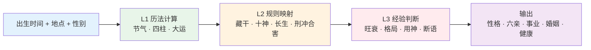
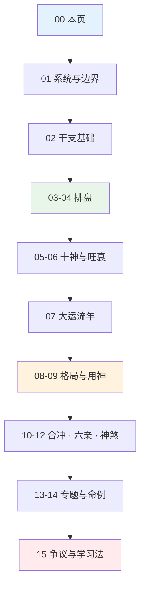

# 四柱预测学教程

四柱，民间叫八字。它用一个人出生的年、月、日、时，排出四组天干地支，共八个字，再用阴阳五行、生克合冲这套语言去解释性格、关系与际遇。

这套东西流传了一千多年，注家众多、流派互斥、术语密布。绝大多数入门材料的写法是：先给一张神煞表，再给一堆断语，让你背。背完你会发现两件事——第一，同样一个八字，不同老师给出的结论能完全相反；第二，你没法判断谁对，因为没人告诉你哪一步是算出来的，哪一步是猜的。

这套教程换个写法：**把整个体系拆成三层，逐层标注确定性**。

## 一、三层确定性

| 层级 | 内容 | 能不能复现 | 本教程的处理 |
|------|------|-----------|-------------|
| **L1 历法计算** | 干支纪年、节气划分、日柱推算、时柱推算、大运起运 | 能。同一个出生时间，任何人用同一套历法算出的四柱必须一致 | 给公式、给验算方法，写错就是错，不讲情面 |
| **L2 规则映射** | 藏干表、十神推导、十二长生、五合六冲三合三会三刑六害、神煞查表 | 能，但规则本身是**约定**。不同流派对同一张表可能取值不同 | 给标准表，同时标注分歧点与流派差异 |
| **L3 经验判断** | 旺衰强弱、格局高低、用神取舍、具体断语（哪年升职、婚姻如何） | 不能。同一张盘，不同师承的结论可以相反 | 讲清推理链条，明确写「这是经验规则，不是计算结果」 |

分层的意义不在于给四柱「洗白」或「证伪」，而在于让你知道自己在哪一层上说话。把 L3 的判断说成 L1 的事实，是这门学问里最常见的骗术；把 L1 的计算当成「玄学所以随便」，则是最常见的偷懒。

## 二、三条写作原则

**1. 算得准的，必须算对。**
四柱的排盘是纯历法问题：立春换年、节气定月、日柱按干支六十日循环、时柱用五鼠遁。这些都有唯一正确答案。第 03、04 章会把公式和验算方法都给出来，你随手拿万年历就能对。凡是排错盘的，后面讲得再玄也没意义。

**2. 讲得清的，给出推导。**
十神不是背出来的，是「日干与我」的生克关系加上阴阳同异推出来的；十二长生不是背出来的，是五行在十二地支上的气机曲线。第 05、06 章把推导过程展开，你忘一个字可以自己推回来。

**3. 讲不清的，标明是经验。**
旺衰怎么判、格局怎么取、用神怎么选，这三件事是四柱里分歧最大的地方。我不会假装有唯一解，而是把主流几派的判法摆出来，说明各自的假设，再讲这套东西的适用边界。第 15 章专门处理争议：它为什么不能当科学、为什么还有人用、以及怎么避免被它伤害。

## 三、目录

### 排盘篇：先把八个字算对

| 序号 | 章节 | 核心内容 |
|------|------|---------|
| 01 | [四柱是什么](/docs/sizhu/01四柱是什么.html) | 源流、与六爻紫微的区别、系统五层结构、确定性分层、先天与后天 |
| 02 | [阴阳五行与干支](/docs/sizhu/02阴阳五行与干支.html) | 阴阳的相对性、五行生克、十天干与十二地支的象、六十甲子与旬空 |
| 03 | [年柱与月柱](/docs/sizhu/03年柱与月柱.html) | 立春换年、节气定月、五虎遁、真太阳时与夏令时、边界案例 |
| 04 | [日柱与时柱](/docs/sizhu/04日柱与时柱.html) | 日柱干支推算与锚点验算、五鼠遁、早子时晚子时之争、完整排盘流程 |

### 读盘篇：把符号翻译成人话

| 序号 | 章节 | 核心内容 |
|------|------|---------|
| 05 | [地支藏干与十神](/docs/sizhu/05地支藏干与十神.html) | 藏干表与本气中气余气、十神推导公式、十神组合的性格含义 |
| 06 | [十二长生与旺衰](/docs/sizhu/06十二长生与旺衰.html) | 十二长生表、得令得地得势、月令权重、旺衰判断的三种流派 |
| 07 | [大运与流年](/docs/sizhu/07大运与流年.html) | 阳男阴女顺排、起运岁数换算、大运流年小运的叠加规则 |
| 08 | [格局](/docs/sizhu/08格局.html) | 月令取格、八格与变格、格局高低、从格与专旺格的成立条件 |
| 09 | [用神](/docs/sizhu/09用神.html) | 扶抑、调候、通关、病药四种取用法、用神与忌神的动态变化 |

### 断盘篇：从结构到具体问题

| 序号 | 章节 | 核心内容 |
|------|------|---------|
| 10 | [合冲刑害](/docs/sizhu/10合冲刑害.html) | 天干五合、地支六合三合三会、六冲、三刑、六害、合化条件 |
| 11 | [六亲与宫位](/docs/sizhu/11六亲与宫位.html) | 年月日时四宫、十神配六亲、父母配偶子女的取象与限制 |
| 12 | [神煞](/docs/sizhu/12神煞.html) | 常用神煞查法、神煞在体系中的真实权重、为什么我建议少用 |
| 13 | [专题事业婚姻健康](/docs/sizhu/13专题事业婚姻健康.html) | 事业看官杀财星、婚姻看配偶宫与合冲、健康看五行偏枯 |
| 14 | [命例实战](/docs/sizhu/14命例实战.html) | 六个完整命例，从排盘到结论的完整推理链，含反例与误判复盘 |
| 15 | [争议与学习法](/docs/sizhu/15争议与学习法.html) | 可证伪性、幸存者偏差、巴纳姆效应、流派分歧、怎么学而不被带偏 |

## 四、阅读路线

- **只想看懂别人排的盘**：01 → 02 → 05 → 06 → 11，五章够用。
- **想自己排盘并做基础分析**：01 到 09 顺序读完，中间不要跳，第 05 章之后每一章都依赖前面的表。
- **想判断某个「大师」靠不靠谱**：直接读 15，再回头看 08、09 两章，看他有没有把经验判断当计算结果卖。

## 五、阅读约定

**输入只有三样**：出生年月日时（尽量精确到分钟）、出生地点（用于真太阳时校正）、性别（用于大运顺逆）。

**关于「准不准」**：本教程不承诺预测能力。它承诺的是——你读完能独立排出任何一个八字的四柱、藏干、十神、大运，并知道每一步的可信度是多少。至于这套符号能不能描述真实人生，属于第 15 章的议题，不是本教程的前提。

**术语**：首次出现的术语给中英文对照与一句话定义；同一概念的不同叫法（如「日主」与「日元」、「月令」与「月建」）在首次出现时注明等价。

**引书**：涉及古籍原文时标注出处，但**不做大段摘抄**。想读原始文本，去看同站的[周易基础笔记](/docs/zhouyi/01基础知识.html)，那边是摘抄加注解的体例，与本教程互补。

**不适合谁**：想学「三分钟看透一个人」的人；想靠这套东西做收费咨询的人；以及坚持认为四柱能精确预测具体事件、不接受任何限定条件的人。这套教程的写法会让你不舒服。

## 六、开始之前

先准备两样东西：

1. 一个能查节气精确时刻的工具（万年历、排盘软件都行）。第 03 章会用到「立春几点几分」这种精度。
2. 一张纸。第 02 章开始，每张表都建议你手抄一遍。四柱的表不多，但必须熟到不用查——这不是记忆比赛，是因为后面的推理全靠这些表做索引。

下一章先把这个体系的边界画清楚：它到底在算什么，以及它凭什么这么算。
