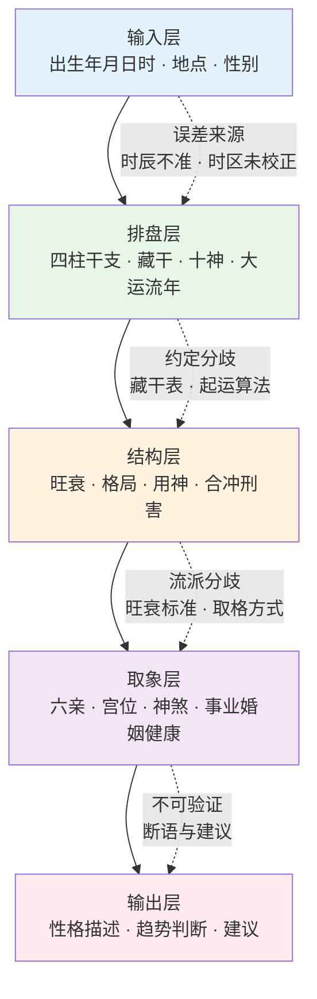
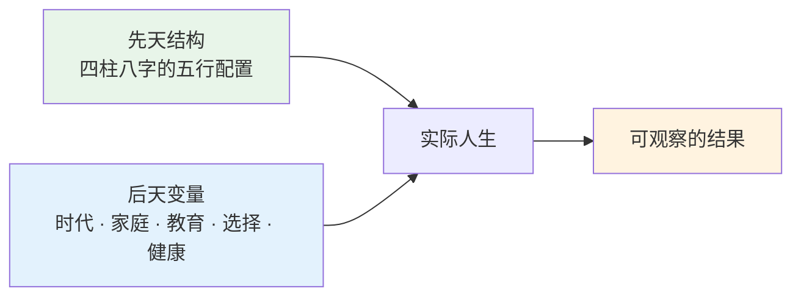

## 一、先定义：四柱是「时间编码」

一个人出生的那一刻，同时被四种历法刻度标记：

- 处在哪一个**年**（以立春为界，不是元旦也不是春节）
- 处在哪一个**月**（以节气为界，不是农历初一）
- 处在哪一个**日**（干支纪日，六十天一循环）
- 处在哪一个**时**（十二时辰，两小时一个）

每个刻度用一组「天干 + 地支」表示，四组并列，像四根柱子，所以叫**四柱**；每柱两个字，共八个字，所以叫**八字**。

```
年柱    月柱    日柱    时柱
庚午    辛巳    乙酉    壬午
```

上面这组就是 1990 年 5 月 20 日中午 12 点（北京时间，东经 120° 左右）的四柱，第 03、04 章会一步步算出来。

关键认知：**四柱不是「算出来的命运」，而是「用干支写出的出生时间」**。它是一个编码结果，确定、唯一、可复现。所有后面的吉凶判断，都是在这个编码上再套解释框架——这是两件事，初学者最容易混为一谈。

## 二、源流：从三柱到四柱

干支纪日的历史很早，商代甲骨上就有干支表，六十甲子完整排列。但「用出生干支论命」是后来才有的。

| 阶段 | 代表人物/文献 | 变化 |
|------|--------------|------|
| 孕育 | 汉代阴阳五行、纳音、卦气说 | 干支被赋予五行属性，出现「以干支配人事」的思路 |
| 三柱 | 唐代 李虚中（传） | 用年、月、日三柱，**以年柱为主**，配合纳音论贵贱 |
| 四柱 | 五代宋初 徐子平（传） | 加时柱，改为**以日干为主**，称「子平术」，后世四柱的正统 |
| 集成 | 宋 《渊海子平》 | 第一次系统整理子平法，十神、格局、神煞的基本框架成型 |
| 集成 | 明 《三命通会》（万民英） | 集大成之作，资料最全，也最杂，神煞与断语大量堆积 |
| 提炼 | 明 《滴天髓》（传刘基，清任铁樵注） | 重气势与流通，讲「衰旺」「中和」，理论性最强 |
| 提炼 | 清 《子平真诠》（沈孝瞻） | 专讲格局，月令取格体系最清晰 |
| 提炼 | 清 《穷通宝鉴》（余春台） | 专讲调候，按月令与日干给「喜用」的用神手册 |

这张表要读出两件事：

1. **以日干为主是后来确立的**。唐代以年柱为主，宋代以后才改。所以你看到「年柱代表祖上、日干代表自己」这类说法，是子平术的约定，不是自古如此。
2. **体系一直在分叉**。《三命通会》里神煞上百种，《子平真诠》几乎不谈神煞。同一个技术传统，内部差异极大。第 12 章会讲神煞为什么权重低，第 15 章讲这种分叉的后果。

## 三、和六爻、紫微、占星的区别

初学者常把这几种混成一类「算命」。它们的**输入、机制、时间尺度**完全不同。

| 体系 | 输入 | 核心机制 | 时间尺度 | 可复现性 |
|------|------|---------|---------|---------|
| **四柱（八字）** | 出生时间 + 地点 + 性别 | 历法编码，再按五行生克与格局解释 | 一生（大运流年） | 输入确定则盘确定 |
| 六爻 | 起卦时间或摇卦结果 | 六十四卦 + 六亲六神 + 动爻变爻 | 针对某一件事，短期 | 摇卦有随机性，同一问题重摇可不同 |
| 紫微斗数 | 农历生日 + 时辰 | 按固定规则安百余颗星到十二宫 | 一生 | 输入确定则盘确定 |
| 西方占星 | 出生时间 + 地点 | 行星在黄道十二宫与宫位的分布 | 一生 | 需精确星历，输入确定则盘确定 |

对你有用的判断是：

- **四柱和紫微是「本命盘」思路**——先给一个人一张静态结构图，再看时间推移（大运、流年）如何激活它。
- **六爻是「占事」思路**——一个问题一次起卦，问的是「这件事成不成」，不负责描述你的性格底色。
- 所以「用六爻补八字」这类说法，本质是把两套不同粒度的系统硬拼，可以玩，但别当成理论。

还有一点常被忽略：四柱的「月」是**节气月**，紫微用的是**农历月**，两者在一年里有近半个月的错位。同一个生日，两套盘给你的月份信息本来就不一样，争论谁对没有意义。

## 四、系统的五层结构

把四柱拆开看，它是一个严格分层的流水线。任何一步出错，后面全废。



逐层说明：

**输入层**。看起来最简单，其实错得最多。出生时间记成「大概下午三点」，时柱就可能从申时变到酉时；出生地在乌鲁木齐却用北京时间，真太阳时能差近两小时，整个时柱作废。

**排盘层**。纯计算。年柱看立春，月柱看节气，日柱按六十日循环，时柱用五鼠遁。这一步有唯一答案，做错了没有任何辩解空间。

**结构层**。开始出现判断。旺衰怎么算、格局怎么取、用神怎么定，是四柱里分歧最大的三件事。第 06、08、09 章会讲清楚各派怎么算，以及为什么算不到一起。

**取象层**。把结构翻译成具体人事。「官杀代表事业与压力」「配偶宫看日支」这些是映射规则，属于约定，可用但不可当因果。

**输出层**。断语和建议。这一层几乎不可验证：「你 32 岁会有变动」这种话，事后总能找到对应，事前无法检验。第 15 章专门处理这层的可信度问题。

## 五、三层确定性（全书主线）

这是本教程反复要用的一把尺子，第 01 章先立起来。

| 层 | 判定标准 | 例子 | 出错时 |
|----|---------|------|--------|
| **L1 可计算** | 有唯一答案，任何人独立算都应一致 | 1990-05-20 12:00 的四柱是庚午 辛巳 乙酉 壬午 | 就是算错，没有第二解 |
| **L2 可约定** | 有明确规则，但规则是人为约定，流派可不同 | 午的藏干是丁己；甲己合化土；乙木在午为长生还是死 | 说清依据哪一派，别声称唯一 |
| **L3 经验** | 依赖师承、样本与个人判断，无法复现 | 这个八字「身弱不胜财」，所以 2024 年破财 | 只能说是经验判断，不能当结论 |

为什么要这么较真？因为四柱的争论九成来自层级混淆：

- 有人拿 L3 的判断冒充 L1 的事实——「你日主弱，所以你一定存不住钱」，把一个经验假设说成了计算结论。
- 有人因为 L3 不准，就连 L1 一起否掉——「八字连我几点生的都算不对」，其实那是输入错误，不是体系问题。
- 有人把 L2 的约定当成宇宙法则——「午里必定藏丁己」，其实那就是一张流传下来的表，换一派可能给你另一种取法（如某些体系只取本气）。

**分层不是为四柱辩护，是为了让你能定位问题。** 盘排错了，去查历法；规则用错了，去查表；结论不准，那是 L3，本来就该打折扣。

## 六、先天与后天：四柱到底「定」了什么

四柱只编码出生时刻。它不含你的父母收入、营养状况、教育机会、所处时代、个人选择。所以任何「八字决定一切」的说法，在逻辑上先塌了。

比较诚实的表述是：



四柱能提供的，最多是「初始配置的一种描述」：比如某个结构天生偏燥、偏寒、偏刚、偏柔。这类描述如果成立，也更像**气质倾向**，而不是命运剧本。

这就带来一个实用结论：**四柱适合用来看「倾向」和「结构失衡」，不适合用来断「事件」。** 「这个盘火土燥烈，性格上偏急、耐性差、易上火」是一个可讨论的结构判断；「这个盘 2027 年必定离婚」是一个不可检验的事件断言。前者可以拿来反思，后者只能拿来吓人。

## 七、学习路径与常见误区

| 误区 | 表现 | 纠正 |
|------|------|------|
| 跳过排盘直接学断语 | 背了「伤官见官为祸百端」，但排不出十神 | 先把 03、04 章的排盘练到不出错 |
| 把神煞当主菜 | 见「羊刃」「桃花」就下结论 | 神煞是调味料，第 12 章会讲清权重 |
| 只学一派，不知有别派 | 认为旺衰只有一种算法 | 第 06、08、09 章并列给出主流几派 |
| 用八字解释一切 | 事后附会，越说越准 | 第 15 章讲幸存者偏差与巴纳姆效应 |
| 忽略输入精度 | 时辰靠猜，地点不校正 | 第 03、04 章给出校正方法 |
| 把 L3 当 L1 | 「我算出来你就是这个命」 | 每次下结论前问自己：这是算的，还是猜的 |

## 八、本章小结

- 四柱是**用干支编码出生时间**的结果，四柱八字，确定且可复现。
- 以日干为主是宋代子平术的约定，不是自古如此；体系内部流派分歧很大。
- 它与六爻（占事）、紫微（本命盘）机制不同，别混用。
- 系统分五层：输入、排盘、结构、取象、输出。越往后越不确定。
- 全书用 L1/L2/L3 三层标注确定性：算得对的必须算对，约定要说明依据，经验不许冒充结论。
- 四柱最多描述**气质倾向与结构失衡**，不适合断具体事件。

**练习**

1. 找三个你认识的人的出生时间（精确到小时），用任意排盘工具排出四柱，先不看任何解释，只记录八个字。感受一下「八个字」的信息量和你想当然以为的差别。
2. 拿一句你听过的断语（如「财多身弱，富屋贫人」），判断它属于 L1、L2 还是 L3，并写出判断理由。
3. 想一想：如果一个人的出生时间记错了两个时辰，四柱里哪一柱会变？其他三柱会不会受影响？（答案在第 04 章）

下一章进入基础件：阴阳、五行、十天干、十二地支。这些表必须熟，不熟后面寸步难行。
