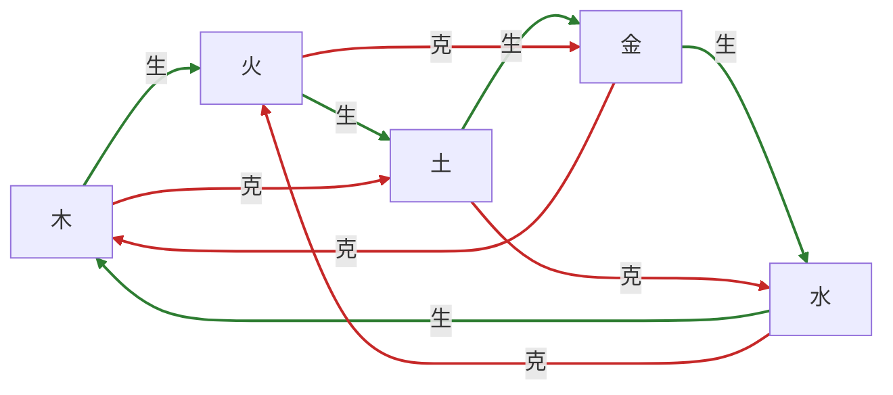

## 一、阴阳：相对属性，不是道德判断

阴阳最容易被误解成「好」和「坏」。它其实只描述**一对相对属性**：

| 阳 | 阴 |
|----|----|
| 外、上、动、刚、显、热 | 内、下、静、柔、隐、寒 |
| 白天、春夏、男性、背面 | 夜晚、秋冬、女性、正面 |

三条要点：

1. **阴阳必须成对比较才有意义**。单独说「甲木是阳」没有信息量，要说「甲木与乙木相比，甲偏阳」。
2. **阴阳不是固定标签，会随参照系翻转**。一个人在公司是下属（阴），在家里是父亲（阳）。四柱里也一样：日干为阳的男性，遇到阴干的正财，关系性质就与阳干遇阳干不同。
3. **阴阳不是价值排序**。传统命书里「阳贵阴贱」的话很多，那是时代偏见，不是技术结论。本教程只把阴阳当分类用。

## 二、五行：五种运动状态

木、火、土、金、水，古人用来归纳「气的运动方式」，不是五种物质。

| 五行 | 运动特征 | 常见取象 | 对应季节 |
|------|---------|---------|---------|
| 木 | 生发、向外、曲直 | 树木、条达、规划、生长 | 春 |
| 火 | 上升、发散、炎上 | 火焰、明亮、热情、显化 | 夏 |
| 土 | 承载、转化、稼穑 | 大地、包容、稳定、中介 | 四季末（辰戌丑未月） |
| 金 | 收敛、肃杀、从革 | 金属、锐利、规则、决断 | 秋 |
| 水 | 下行、潜藏、润下 | 江河、流动、智慧、隐藏 | 冬 |

### 生与克

记忆口诀：**相生是顺时针一圈，相克是隔一位**。木生火、火生土、土生金、金生水、水生木；木克土、土克水、水克火、火克金、金克木。

三个容易踩的坑：

**坑一：生不等于吉。** 「生多反为害」是四柱里的常见判断。水多木漂、木多火塞、土多金埋、金多水浊、火多土焦——生得过量，反而失去结构。

**坑二：克不等于凶。** 木需要金来修剪成材，火需要水来既济。没有克，五行就散漫无制。

**坑三：生克里没有物理因果。** 这套关系是类比模型，不是物质反应。用它做推理可以，用它做物理解释（「你缺水所以要喝水补运」）就是滥用。

## 三、十天干

天干十个，是「天」这一层的刻度，主要描述外在的、显性的属性。

| 天干 | 阴阳 | 五行 | 象 | 气质关键词 |
|------|------|------|-----|-----------|
| 甲 | 阳 | 木 | 参天大树、栋梁 | 直、硬、担当、不肯弯 |
| 乙 | 阴 | 木 | 花草、藤蔓 | 柔、韧、会借力、缠绕 |
| 丙 | 阳 | 火 | 太阳 | 外放、热烈、爱表现 |
| 丁 | 阴 | 火 | 灯烛、星光 | 内敛、专注、敏感 |
| 戊 | 阳 | 土 | 城墙、高山 | 稳、厚、固执 |
| 己 | 阴 | 土 | 田园、湿土 | 包容、琐碎、易受影响 |
| 庚 | 阳 | 金 | 刀剑、矿石 | 果断、刚硬、易伤人 |
| 辛 | 阴 | 金 | 珠玉、首饰 | 精致、要面子、锋利在内 |
| 壬 | 阳 | 水 | 江河、大海 | 开阔、流动、不受约束 |
| 癸 | 阴 | 水 | 雨露、泉水 | 细腻、渗透、易感 |

这张表叫「天干象义」，属于 **L2 约定**。它来自历代注家的取象，不是计算。不同书对同一个干的描述略有出入（比如辛有时被取为「针」），但大方向一致：**阳干偏刚显，阴干偏柔隐；同类五行里，阳干是「大体量」，阴干是「小体量、精微」**。

天干的阴阳顺位还有个实用规律：**甲丙戊庚壬为阳，乙丁己辛癸为阴**，即序号为奇数者阳。

## 四、十二地支

地支十二个，描述「地」这一层，偏内在、偏承载，同时兼任月份与时辰的刻度。

| 地支 | 阴阳 | 五行 | 生肖 | 时辰 | 节气月 | 象 |
|------|------|------|------|------|--------|-----|
| 子 | 阳 | 水 | 鼠 | 23-01 | 十一月 | 寒水、暗藏、流动性强 |
| 丑 | 阴 | 土 | 牛 | 01-03 | 十二月 | 湿土、冻土、含金水 |
| 寅 | 阳 | 木 | 虎 | 03-05 | 正月 | 初春木、带火气、有冲劲 |
| 卯 | 阴 | 木 | 兔 | 05-07 | 二月 | 仲春木、纯粹、柔中带刚 |
| 辰 | 阳 | 土 | 龙 | 07-09 | 三月 | 湿土、水库、变化多 |
| 巳 | 阴 | 火 | 蛇 | 09-11 | 四月 | 初夏火、带金气、外柔内烈 |
| 午 | 阳 | 火 | 马 | 11-13 | 五月 | 盛夏火、极旺、易燥 |
| 未 | 阴 | 土 | 羊 | 13-15 | 六月 | 燥土、木库、外柔内燥 |
| 申 | 阳 | 金 | 猴 | 15-17 | 七月 | 初秋金、带水气、机变 |
| 酉 | 阴 | 金 | 鸡 | 17-19 | 八月 | 仲秋金、纯粹、锋利 |
| 戌 | 阳 | 土 | 狗 | 19-21 | 九月 | 燥土、火库、忠诚固执 |
| 亥 | 阴 | 水 | 猪 | 21-23 | 十月 | 初冬水、带木气、包容 |

两列要特别注意：

- **「节气月」不等于农历月**。寅月是立春到惊蛰，不是正月初一到二月初一。这在第 03 章会反复强调。
- **时辰是两小时一段**，23:00 开始算子时，不是 0 点。23:00 到 24:00 这一段归属哪一天，是四柱里著名的分歧点，第 04 章专讲。

### 地支阴阳的两套说法

主流做法按**序数奇偶**：子阳、丑阴、寅阳、卯阴、辰阳、巳阴、午阳、未阴、申阳、酉阴、戌阳、亥阴。十神推导用的就是这一套。

另有一派从**气机消长**看：子为「一阳生」却处极寒，午为「一阴生」却处极热，所以子午的阴阳「有体用两层」——体上子属阳水、午属阳火，用上则一寒一热、一升一降。这套说法主要用来解释藏干与季节气势，**不用来改十神**。

**本教程的约定**：十神一律按序数阴阳，遇到引用气机说的段落会明确标注。这也是 L2 层「有规则但有分歧」的典型例子——不是谁错，是要说清依据。

## 五、六十甲子

天干十个、地支十二个，按顺序两两相配，只有阳干配阳支、阴干配阴支，所以能配出的组合不是 120 个，而是 **10 与 12 的最小公倍数 = 60** 个。配到第 61 位又回到甲子，所以叫「六十甲子」。

| 序 | 干支 | 序 | 干支 | 序 | 干支 | 序 | 干支 | 序 | 干支 | 序 | 干支 |
|----|------|----|------|----|------|----|------|----|------|----|------|
| 1 | 甲子 | 2 | 乙丑 | 3 | 丙寅 | 4 | 丁卯 | 5 | 戊辰 | 6 | 己巳 |
| 7 | 庚午 | 8 | 辛未 | 9 | 壬申 | 10 | 癸酉 | 11 | 甲戌 | 12 | 乙亥 |
| 13 | 丙子 | 14 | 丁丑 | 15 | 戊寅 | 16 | 己卯 | 17 | 庚辰 | 18 | 辛巳 |
| 19 | 壬午 | 20 | 癸未 | 21 | 甲申 | 22 | 乙酉 | 23 | 丙戌 | 24 | 丁亥 |
| 25 | 戊子 | 26 | 己丑 | 27 | 庚寅 | 28 | 辛卯 | 29 | 壬辰 | 30 | 癸巳 |
| 31 | 甲午 | 32 | 乙未 | 33 | 丙申 | 34 | 丁酉 | 35 | 戊戌 | 36 | 己亥 |
| 37 | 庚子 | 38 | 辛丑 | 39 | 壬寅 | 40 | 癸卯 | 41 | 甲辰 | 42 | 乙巳 |
| 43 | 丙午 | 44 | 丁未 | 45 | 戊申 | 46 | 己酉 | 47 | 庚戌 | 48 | 辛亥 |
| 49 | 壬子 | 50 | 癸丑 | 51 | 甲寅 | 52 | 乙卯 | 53 | 丙辰 | 54 | 丁巳 |
| 55 | 戊午 | 56 | 己未 | 57 | 庚申 | 58 | 辛酉 | 59 | 壬戌 | 60 | 癸亥 |

用法：知道干支序数，就能反推年月日的循环位置；反过来，算日柱时得到一个 1-60 的序号，查表就得到干支。第 04 章会用这套表验算。

### 旬与旬空

六十甲子每十个为一「旬」，每旬以甲开头，共六旬。每旬里十天干配十个地支，会**空出两个地支**，这两个就是这一旬的「旬空」，也叫「空亡」。

| 旬 | 干支范围 | 旬空 |
|----|---------|------|
| 甲子旬 | 甲子 — 癸酉 | 戌、亥 |
| 甲戌旬 | 甲戌 — 癸未 | 申、酉 |
| 甲申旬 | 甲申 — 癸巳 | 午、未 |
| 甲午旬 | 甲午 — 癸卯 | 辰、巳 |
| 甲辰旬 | 甲辰 — 癸丑 | 寅、卯 |
| 甲寅旬 | 甲寅 — 癸亥 | 子、丑 |

旬空在传统断法里表示「虚而不实、有名无实」。它属于 L2 到 L3 之间的规则：查法确定，但「空亡就意味着没有」这个推论是经验，第 12 章会说明它的权重。

## 六、五行在四季的旺衰

同一个五行，在一年里状态不同。传统用「旺、相、休、囚、死」五档描述：

- **当令者旺**：正值它主管的季节
- **我生者相**：旺者的下一环，势头正起
- **生我者休**：上一环已经功成身退
- **克我者囚**：被当令者压制，无力
- **我克者死**：被当令者耗泄，最弱

| 季节 | 旺 | 相 | 休 | 囚 | 死 |
|------|----|----|----|----|----|
| 春（寅卯月） | 木 | 火 | 水 | 金 | 土 |
| 夏（巳午月） | 火 | 土 | 木 | 水 | 金 |
| 秋（申酉月） | 金 | 水 | 土 | 火 | 木 |
| 冬（亥子月） | 水 | 木 | 金 | 土 | 火 |
| 四季（辰戌丑未月） | 土 | 金 | 火 | 木 | 水 |

这张表是第 06 章「旺衰」的起点。注意「四季」指每个季节的最后一个月，土在这里轮流当令，这是四柱里土的特殊地位所在，也是「土旺四季」这句话的来历。

## 七、本章小结

- 阴阳描述相对属性，不是好坏，且随参照系翻转。
- 五行是五种运动状态；生克是类比关系，生多反害、克亦有功。
- 十天干偏外显，十二地支偏内载，同时兼作月份与时辰刻度。
- 地支阴阳主流按序数奇偶，另有气机说，用于解释气势而非改十神。
- 六十甲子是 10 与 12 的最小公倍数循环；每旬空出两个地支，即旬空。
- 五行在四季有旺相休囚死五档，是判断旺衰的第一手依据。

**练习**

1. 不看表，写出十天干的五行与阴阳，再写出十二地支的生肖与时辰。写不出来的抄三遍。
2. 用「阳干配阳支、阴干配阴支」的规则解释：为什么没有「甲丑」这个组合？（提示：甲的序数是 1，丑的序数是 2，一奇一偶配不上。）
3. 判断「丙午」属于哪一旬、旬空是哪两个地支。（答：丙午序号 43，落在甲辰旬 41-50，旬空寅卯。）
4. 一个八字里木旺、金也旺，是相战还是相济？先别急着回答，把你的理由写下来，读完第 10 章再回来看。

下一章开始算盘：年柱怎么定，月柱怎么定，以及为什么「立春」这一天会让无数人排错。
