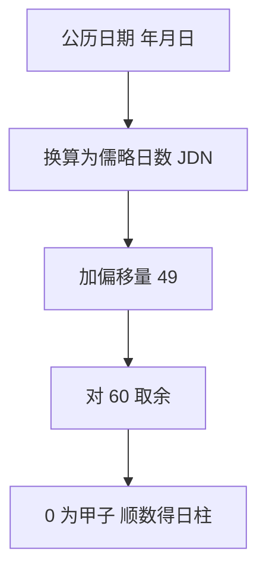

## 一、日柱为什么最难算

年柱和月柱都能落到天文量上。年柱以立春为界，月柱以太阳黄经每 30° 为一节，背后是地球绕日的位置，给一台天文计算器就能算到秒。

日柱不行。

**日柱**（day pillar）是出生当天的干支。它既不跟太阳走，也不跟月亮走，而是一个独立的六十日循环：甲子、乙丑、丙寅……癸亥，然后回到甲子。这个循环从不断档，也从不跳号。它跟月长、闰年、节气统统无关——**今天是什么干支，只取决于从某个已知甲子日到今天过了多少天**。

所以日柱的推算只有两步：先把公历日期换成连续天数，即**儒略日数**（Julian Day Number，JDN，一种从公元前 4713 年起算的连续日计数；这里只是天数计数器，跟古罗马的儒略历不是一回事）；再对 60 取模，用固定偏移量对齐到甲子。

【L1 计算】这是全书最硬的 L1 之一。同一个日期，任何正确实现都必须给出同一个干支。算错没有解释空间，也不存在「流派不同」。



偏移量 49 是一次性标定的常数，不是每一步都要重新推导的经验参数。它来自「某天是甲子日」这个锚点。锚点定死，全部日期就都定死了。这跟第 03 章年柱公式里减 4 是同一个思路。

## 二、儒略日算法

公历日期的换算公式：

```
a  = floor((14 - m) / 12)
y  = Y + 4800 - a
m' = m + 12a - 3

JDN = d + floor((153m' + 2) / 5) + 365y + floor(y/4)
      - floor(y/100) + floor(y/400) - 32045
```

`Y` 是年，`m` 是月，`d` 是日，`floor` 表示向下取整。`a` 的作用是把一月、二月挪到上一年的十三、十四月，这样闰日永远落在年末，公式不必分情况讨论。三个取整项 `y/4`、`y/100`、`y/400` 处理的是闰年规则。

日柱干支：

```
干支序 = (JDN + 49) mod 60
```

结果 0 = 甲子、1 = 乙丑、……、59 = 癸亥。要查干支名，回第 02 章那张六十甲子表。

### 逐步验算 1990-05-20

| 步骤 | 计算 | 结果 |
|------|------|------|
| a | floor((14 - 5) / 12) | 0 |
| y | 1990 + 4800 - 0 | 6790 |
| m' | 5 + 0 - 3 | 2 |
| 第一项 | d | 20 |
| 第二项 | floor((153×2 + 2) / 5) = floor(308 / 5) | 61 |
| 第三项 | 365 × 6790 | 2478350 |
| 第四项 | floor(6790 / 4) | 1697 |
| 第五项 | floor(6790 / 100) | 67 |
| 第六项 | floor(6790 / 400) | 16 |
| 常数项 | -32045 | -32045 |

合计与取模：

```
20 + 61 + 2478350 + 1697 - 67 + 16 - 32045 = 2448032
2448032 mod 60 = 32
(32 + 49) mod 60 = 21
```

序 21 是乙酉。【L1 计算】1990 年 5 月 20 日为**乙酉日**。注意是先把 49 加到 JDN 上再对 60 取余，只对 JDN 取余得到的是 32，那不是干支序。

拿下面三个锚点对表，能立刻判断你的实现对不对。

| 日期 | JDN | JDN 除 60 的余数 | 加 49 再取余 | 干支 |
|------|-----|-----------------|-------------|------|
| 1949-10-01 | 2433191 | 11 | 0 | 甲子 |
| 2000-01-01 | 2451545 | 5 | 54 | 戊午 |
| 2024-01-01 | 2460311 | 11 | 0 | 甲子 |

三个点跨度七十多年，覆盖了多个闰年、多个世纪边界。三个都对，基本可以确认偏移量 49 没写错。

【L1 计算】为什么取模就够了？因为 JDN 是**连续日计数**：大月小月、平年闰年，在 JDN 里已经被吸收成了一个整数。六十日循环只关心「隔了多少天」，不关心中间跨过什么。所以不存在「跨月要修正」「跨年要加一」这类补丁，只要有连续天数，模 60 天然正确。

两个边界要记住：

- **1582 年 10 月 15 日以前**欧洲用儒略历，上面公式的 `y/100`、`y/400` 项按格里高利历设计。做古代盘要先做历法转换，否则差十天以上。
- **公式给出的 JDN 以中午为界**。日柱的「哪一天」用的是民用日期，不涉及这个中午分界；但如果你在做天文计算，别把它和民用日混用。

## 三、更省事的三种办法

### 1 查万年历

最快，但三个坑要知道：确认你查的是**干支日**而不是农历日，纸质万年历的日柱常标成「日建」；确认它几点换日，有的 23:00 就翻页，有的等到 0 点；在线万年历多数按北京时间，不做真太阳时校正。

### 2 排盘软件

用之前先看四个开关：真太阳时校正默认常关、晚子时处理各软件不同、默认时区多为东八区、部分老版本的节气数据按日不按时。【L1 计算】前三项只要有一项设错，四柱就不是「有争议」，而是**直接算错**。软件只是计算器，不是裁判。

### 3 已知锚点心算

记住一个近锚点，比如 2000-01-01 为戊午日（序 54）。算目标日与锚点的天数差，对 60 取余，再加到锚点序上。

例：1990-05-20 与 2000-01-01 相差：

```
2451545 - 2448032 = 3513 天，3513 mod 60 = 33，(54 - 33) mod 60 = 21
```

序 21 为乙酉，与公式结果一致。往过去推用减，往未来推用加，减出负数就补 60。

## 四、时柱与五鼠遁

**时柱**（hour pillar）是出生时辰的干支。时支由钟点决定，时干由日干推出。

### 十二时辰边界

| 时辰 | 时段 | 时辰 | 时段 |
|------|------|------|------|
| 子 | 23:00 - 01:00 | 午 | 11:00 - 13:00 |
| 丑 | 01:00 - 03:00 | 未 | 13:00 - 15:00 |
| 寅 | 03:00 - 05:00 | 申 | 15:00 - 17:00 |
| 卯 | 05:00 - 07:00 | 酉 | 17:00 - 19:00 |
| 辰 | 07:00 - 09:00 | 戌 | 19:00 - 21:00 |
| 巳 | 09:00 - 11:00 | 亥 | 21:00 - 23:00 |

子时横跨午夜，被切成两半，这是下一节全部争议的来源。

### 五鼠遁口诀

> 甲己还加甲，乙庚丙作初。
> 丙辛从戊起，丁壬庚子居。
> 戊癸何方发，壬子是真途。

意思是先定「子时的天干」，然后顺推到出生时辰：

| 日干 | 子时 | 往后顺推 |
|------|------|---------|
| 甲、己 | 甲子 | 丑乙丑、寅丙寅、卯丁卯…… |
| 乙、庚 | 丙子 | 丑丁丑、寅戊寅、卯己卯…… |
| 丙、辛 | 戊子 | 丑己丑、寅庚寅、卯辛卯…… |
| 丁、壬 | 庚子 | 丑辛丑、寅壬寅、卯癸卯…… |
| 戊、癸 | 壬子 | 丑癸丑、寅甲寅、卯乙卯…… |

### 公式版

```
时干序 = (日干序 × 2 + 时支序) mod 10
```

日干序按甲=0、乙=1……癸=9，时支序按子=0、丑=1……亥=11。

验算日干乙、午时：日干乙为 1，午为 6，代入得 (1 × 2 + 6) mod 10 = 8，即壬。

时柱为**壬午**。用口诀核对：乙庚丙作初，子丙、丑丁、寅戊、卯己、辰庚、巳辛、午壬，一致。

为什么乘 2？因为五组日干对应的子时天干是甲、丙、戊、庚、壬，正好每次前进两位。【L2 约定】五鼠遁的这张对应表是人为约定，但因为结构严整、千年未变，实务中可当固定规则使用。

## 五、早子时与晚子时之争

**早子时**指 00:00-01:00，**晚子时**（也叫夜子时）指 23:00-24:00。两者都叫「子时」，但归属哪一天，三家说法不同。

| 流派 | 日柱归属 | 时柱起法 | 依据 |
|------|---------|---------|------|
| A 23 点换日 | 23:00 起算次日 | 用次日日干起子时 | 子时为一日之始 |
| B 夜子时派 | 仍算当日 | 时柱按次日子时起 | 日界在 0 点，子时分早晚 |
| C 0 点换日 | 仍算当日 | 用当日日干起子时 | 民用日界优先 |

【L2 约定】**本教程默认 A 派**。理由很实际：十二时辰以子为首，子时又是一天的起点，23:00 换日与「子时属水、为一阳生」的模型自洽。这只是选择，不是真理。

### 影响有多大

只影响 23:00-24:00 出生的人。但这一个小时足够让**日柱差一整天**，进而日干变了、十神全变、日支配偶宫变了、大运起运的参照也变了。

例：1995 年 6 月 30 日 23:40，广州出生。广州真太阳时约 23:10，仍在晚子时，不改变下面的分歧结构。

| 流派 | 日柱 | 时柱 | 完整四柱 |
|------|------|------|---------|
| A 23 点换日 | 癸巳 | 壬子 | 乙亥 壬午 癸巳 壬子 |
| B 夜子时派 | 壬辰 | 壬子 | 乙亥 壬午 壬辰 壬子 |
| C 0 点换日 | 壬辰 | 庚子 | 乙亥 壬午 壬辰 庚子 |

注意 B、C 两派的日柱相同、时柱不同，A 派则两柱都不同。三张盘的日主从癸变成壬，取用神的思路完全不是一回事。

【L2 约定】这不是计算错误，是规则选择。实务处理：问清出生时间的来源（钟表、家人回忆、出生证明），如果落在 23:00-24:00 且无法确认分钟，就把两种日柱都排出来，看结论是否依赖这一柱。依赖，就明确说「此盘在日柱上存在流派分歧」。

## 六、完整排一盘

**输入**：1990 年 5 月 20 日 12:00（北京时间），出生地北京，男性。

**校正时刻**：经度差 -14.4 分钟，均时差约 +3.5 分钟，真太阳时约 **11:49**，仍在午时，时支为午。

四柱结果：

| 柱 | 年柱 | 月柱 | 日柱 | 时柱 |
|----|------|------|------|------|
| 天干 | 庚 | 辛 | 乙 | 壬 |
| 地支 | 午 | 巳 | 酉 | 午 |
| 藏干 | 丁 己 | 丙 戊 庚 | 辛 | 丁 己 |
| 天干十神 | 正官 | 七杀 | 日主 | 正印 |
| 藏干十神 | 食神 偏财 | 伤官 正财 正官 | 七杀 | 食神 偏财 |
| 星运 | 长生 | 沐浴 | 绝 | 长生 |

以日干乙（阴木）为「我」核对十神：

- 年干庚为阳金、克我异性，正官；月干辛为阴金、克我同性，七杀；时干壬为阳水、生我异性，正印
- 午藏丁为食神、己为偏财；酉藏辛为七杀
- 巳藏丙为伤官、戊为正财、庚为正官

藏干与十神的完整推导在第 05 章，这里先给结果。【L2 约定】「地支藏哪几个干、谁先谁后」是人为约定的表，不是计算结果；十神则是在这张表上按生克与阴阳机械推出来的。

### 排盘七列表模板

手排时照这个格式写，一列不缺：

| 柱 | 天干 | 地支 | 藏干 | 天干十神 | 藏干十神 | 星运 |
|----|------|------|------|---------|---------|------|
| 年 | 庚 | 午 | 丁 己 | 正官 | 食神 偏财 | 长生 |
| 月 | 辛 | 巳 | 丙 戊 庚 | 七杀 | 伤官 正财 正官 | 沐浴 |
| 日 | 乙 | 酉 | 辛 | 日主 | 七杀 | 绝 |
| 时 | 壬 | 午 | 丁 己 | 正印 | 食神 偏财 | 长生 |

「星运」是日干在四支上的十二长生状态，用来做旺衰参考，第 06 章专讲。日干乙在酉为「绝」，这个信息本身不构成结论，只说明「日支无根」。

## 七、排完之后的三步自查

**第一步，与万年历比对四柱。** 四个柱逐一核，不要只看年柱。差异先怀疑时刻，再怀疑历法。

**第二步，检查是否跨日、跨时辰。** 三个高风险点是出生时刻距时辰边界不足 15 分钟、出生在 23:00 之后、出生在节气交节当天。

**第三步，检查藏干有没有漏字。** 常见漏法是「午只写丁、忘了己」「巳只写丙、忘了戊庚」。藏干表一共 12 行，逐支对一遍，两分钟的事。

## 八、边界与错误清单

| 情况 | 错法 | 正确做法 |
|------|------|---------|
| 只记日期不记时间 | 随便按中午排时柱 | 时柱必须问时刻，问不到就标「时柱存疑」 |
| 用农历日期当公历 | 直接把农历月日代进公式 | 先转公历，农历日期对日柱毫无意义 |
| 不做时区校正 | 乌鲁木齐用北京时间定时辰 | 先经度校正，可能差两个时辰 |
| 忽略夏令时 | 1986-1991 年夏半年多用一小时 | 先减 1 小时，再校正经度 |
| 把 23:30 当当日 | 未处理晚子时，日柱少一天 | 明确声明用哪一派，或并列两盘 |
| 软件默认时区错误 | 海外出生按东八区算 | 先确认软件时区设置 |
| 藏干只取本气 | 地支只写一个天干 | 按藏干表补齐中气余气 |
| 用儒略历公式算古代日期 | 1582 年前直接代入 | 先做历法转换 |

后三条属于【L2 约定】层面的错误——不是算错，是规则用错，但后果一样：整盘不可用。

## 本章小结

- 日柱是纯六十日循环，没有天文公式，只能靠 JDN 加模运算；偏移量 49 由锚点标定。
- JDN 公式里 `a` 负责把一月二月挪到上年年末，三个取整项负责闰年规则。
- 干支序 = (JDN + 49) mod 60，0 为甲子；1990-05-20 算得乙酉。
- 三个锚点 1949-10-01 甲子、2000-01-01 戊午、2024-01-01 甲子，可用来验算实现。
- 时支由钟点定，时干用五鼠遁推，公式为 (日干序 × 2 + 时支序) mod 10。
- 23:00-24:00 出生者存在三派分歧，本教程默认 23 点换日，但必须声明。
- 排完盘做三步自查：对四柱、查跨界、补藏干。

**练习**

1. 用 JDN 公式算 1984 年 2 月 2 日的日柱，再用 2000-01-01 锚点法验算一次。（提示：两次结果必须一致，不一致说明取整或偏移写错。）
2. 日干为戊、出生时刻 17:30，时柱是什么？（答：17:30 为酉时，时支序 9；(4×2+9) mod 10 = 7 → 辛，时柱辛酉。）
3. 某人 1990 年 5 月 20 日 12:00 生于成都，真太阳时约几点？时柱会变吗？（答：约 10:56 到 11:00 之间，属巳时，时柱由壬午变为辛巳。）
4. 找一个 23:30 出生的人，分别按 A、C 两派排盘，比较日干十神差了哪些。

下一章处理地支内部的第二层结构：藏干，以及由它推出来的十神。 [第 05 章](/docs/sizhu/05地支藏干与十神.html)
