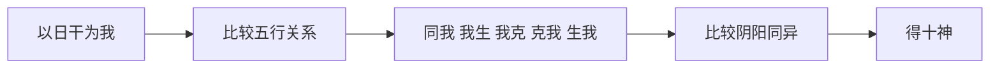

## 一、藏干是什么

前面四章把八个字排出来了。但八个字只是骨架，真正的信息量在**地支内部**。

**藏干**（hidden stem），又叫「人元」，指一个地支内部所藏的一到三个天干。天干叫「天元」，地支叫「地元」，藏干叫「人元」，合称三才。这个概念的意义很简单：地支不是一块单一属性的铁板，它是**一个月或一个时辰内部气机的压缩包**。

一个地支里的天干按力量分三层：

| 名称 | 位置 | 含义 |
|------|------|------|
| 本气 | 第一位 | 该地支的主导五行，力量最大 |
| 中气 | 第二位 | 次要之气，多为上一季残留或长生之气 |
| 余气 | 第三位 | 残余之气，力量最小，常被忽略但断事时会用到 |

【L2 约定】藏干表是人为约定的。它的来源是月令气机的观察与推演，不是天文计算。所以你会看到不同书对同一地支给出不同顺序，甚至不同数量。本章给的是子平术主流表，后面所有推导都以它为准。

## 二、藏干表

这张表必须背到不用查。十二行，一个字都不能错。

| 地支 | 本气 | 中气 | 余气 | 完整藏干 |
|------|------|------|------|---------|
| 子 | 癸 | — | — | 癸 |
| 丑 | 己 | 癸 | 辛 | 己 癸 辛 |
| 寅 | 甲 | 丙 | 戊 | 甲 丙 戊 |
| 卯 | 乙 | — | — | 乙 |
| 辰 | 戊 | 乙 | 癸 | 戊 乙 癸 |
| 巳 | 丙 | 戊 | 庚 | 丙 戊 庚 |
| 午 | 丁 | 己 | — | 丁 己 |
| 未 | 己 | 丁 | 乙 | 己 丁 乙 |
| 申 | 庚 | 壬 | 戊 | 庚 壬 戊 |
| 酉 | 辛 | — | — | 辛 |
| 戌 | 戊 | 辛 | 丁 | 戊 辛 丁 |
| 亥 | 壬 | 甲 | — | 壬 甲 |

### 记忆规律

不要逐格死记，按三类分组：

**四正（子午卯酉）**，气最纯，基本只藏本气。唯一的变数是午多一个己土，因为火生土、土寄于火；卯只有乙，是全表最纯的一支。

**四生（寅申巳亥）**，是四个「长生」之地，藏本气 + 长生之气 + 余气：

- 寅藏甲（本气）、丙（火长生在寅）、戊（余气）
- 巳藏丙（本气）、戊（中气）、庚（金长生在巳）
- 申藏庚（本气）、壬（水长生在申）、戊（余气）
- 亥藏壬（本气）、甲（木长生在亥）

**四墓（辰戌丑未）**，是四个「库」，藏本气土 + 库神 + 上一季余气：

- 辰为水库，藏戊、乙（木之余）、癸（水之库）
- 未为木库，藏己、丁（火之余）、乙（木之库）
- 戌为火库，藏戊、辛（金之余）、丁（火之库）
- 丑为金库，藏己、癸（水之余）、辛（金之库）

【L2 约定】「四墓即库」这个说法在实务中有分歧：一派认为墓库必须逢冲才开，一派认为透干即用。本教程按「有透则用、无透只作根」处理，遇到关键判断会标出分歧。

## 三、人元司令

**人元司令**（月令分日）指一个月支内部，不同的日子由不同的藏干「当权」。比如寅月，并不是整月甲木说了算，而是按日切成几段，甲、丙、戊轮流主事。

常见的一种分法是寅月甲木七日、丙火七日、戊土十六日。也有表把三段拉成五五二十，或者按节气时刻精确到时辰。差异以日计，落到具体命局上，可能让「本气是否得令」这个判断翻转。

【L2 约定】这是 L2 层的典型分歧：规则明确、可以复现，但**各家用哪张表是约定**，而且没有权威仲裁。它直接影响旺衰判断，所以到了第 06 章，同一个八字在不同老师手里强弱相反，根子常在这里。

本教程的处理原则：

1. 默认**只用本气主事**，不切分日辰。
2. 遇到必须讨论分日的场景（比如月支为辰、出生在清明后三天），明确写「此处涉及人元司令分歧」。
3. 不把分日结果当唯一结论，只当加权项。

## 四、十神的定义方式

**十神**（ten gods）是以日干为「我」，把其他天干与「我」的关系分类命名的一套符号。它不是十个神，是十种关系。

关键在推，不在背。推导分两步：

1. 看**五行关系**：同我、我生、我克、克我、生我，共五组
2. 看**阴阳同异**：同性与异性，各分一个

五组乘两种阴阳，正好十个。【L2 约定】十神的名称与阴阳对应是人为约定，但一旦约定，推导过程完全机械，没有取巧空间。



### 十神对照表

| 五行关系 | 同性 | 异性 |
|---------|------|------|
| 同我 | 比肩 | 劫财 |
| 我生 | 食神 | 伤官 |
| 我克 | 偏财 | 正财 |
| 克我 | 七杀 | 正官 |
| 生我 | 偏印 | 正印 |

### 一条公式记住全表

```
先定五行关系，再看阴阳
同性 → 比肩 食神 偏财 七杀 偏印
异性 → 劫财 伤官 正财 正官 正印
```

把「同性」那一列读成一句：**比食偏杀枭**；「异性」那一列读成：**劫伤正官印**。记不住就现场推，五秒的事。

### 三个演算

**例一**：日干乙（阴木），见庚（阳金）。

金克木，是「克我」；乙阴、庚阳，异性。查表得**正官**。

**例二**：日干乙，见辛（阴金）。

仍是「克我」，但乙辛同为阴，同性。得**七杀**。

**例三**：日干丙（阳火），见壬（阳水）。

水克火，是「克我」；丙壬同为阳，同性。得**七杀**。

三个例子说明一件事：**同一个「克我」，阴阳一变，正官与七杀就互换**。这就是为什么第 02 章要反复强调地支阴阳按序数奇偶——阴阳错一位，十个神的正偏全反。

### 简称对照

| 全称 | 简称 | 全称 | 简称 |
|------|------|------|------|
| 比肩 | 比 | 正财 | 财 |
| 劫财 | 劫 | 偏财 | 才 |
| 食神 | 食 | 正官 | 官 |
| 伤官 | 伤 | 七杀 | 杀 |
| 正印 | 印 | 偏印 | 枭 |

古书和软件里简称混用，看到「才」不要以为是「人才」，那就是偏财。

## 五、十神含义表

下面是取象，不是计算结果。

【L3 经验】同一颗十神在不同命局里表现可以相反，所以表里的「过旺偏差」尤其不牢靠：它描述的是一种常见走向，不是必然结果。表的用法是「先有结构判断，再回来找词」，不是「看到伤官就说人叛逆」。

| 十神 | 社会关系 | 性格关键词 | 典型行为 | 过旺时的偏差 |
|------|---------|-----------|---------|-------------|
| 比肩 | 兄弟、同辈、合伙人 | 自立、固执、竞争 | 独立作业、平辈合作 | 争强、破财、合作破裂 |
| 劫财 | 异性同辈、竞争者 | 冲动、豪爽、善借力 | 抢资源、投机、拉帮 | 被拖累、口舌、赌性 |
| 食神 | 输出、才华、女命子女 | 温和、耐心、有口福 | 创作、教学、慢工细活 | 懒散、想多做少 |
| 伤官 | 表达、技艺、下属 | 聪明、锋利、不服管 | 创新、演讲、挑错 | 恃才傲物、官非 |
| 偏财 | 男命父亲、客户、横财 | 慷慨、善交际、机会主义 | 做生意、投资、应酬 | 挥霍、投机失利 |
| 正财 | 男命妻子、稳定收入 | 节俭、守规、务实 | 上班、理财、按部就班 | 吝啬、被钱困住 |
| 七杀 | 压力、竞争、权力 | 果断、抗压、狠 | 创业、军警、冒险 | 攻击性、意外、被压制 |
| 正官 | 职位、规则、女命丈夫 | 自律、守序、要面子 | 体制内、管理、守规矩 | 拘谨、被规则绑死 |
| 偏印 | 偏门学问、孤独 | 敏感、多思、直觉强 | 研究、技术、玄学 | 孤僻、钻牛角尖 |
| 正印 | 母亲、学历、庇护 | 宽厚、好学、依赖 | 读书、文职、照顾人 | 依赖、懒、想太多 |

读这张表的正确姿势：**十神描述的是「关系模式」，不是「人格测验」**。一个人对上级是正官，对下属可能是七杀，对朋友可能是比肩。命局里哪颗星被引动，哪套模式就上线。

## 六、天干十神与藏干十神

同一颗十神，出现在天干和出现在藏干，分量不同：

| 位置 | 性质 | 读法 |
|------|------|------|
| 天干 | 显 | 外露的、被看见的、当事人自己认得的 |
| 藏干本气 | 半显 | 主要底色，力量最实 |
| 藏干中气 | 隐 | 次要倾向，常在特定年份被引动 |
| 藏干余气 | 微 | 残余影响，单看几乎无意义 |

所以一个八字天干透正官、地支藏七杀，和天干透七杀、地支藏正官，是两种人：前者外在守规矩、内里有狠劲；后者外显强势、内里反而讲规则。

【L2 约定】「天干为显、藏干为隐」是读法约定，不是硬规则。它的可靠性建立在大量命例的经验上，属于 L2 与 L3 的过渡带：结构判断（谁透谁藏）是确定的，由此推出性格是经验。

权重上，本教程的默认排序是：**月令本气 > 日支本气 > 天干 > 中气 > 余气**。这不是唯一排法，第 06 章会给三种流派的分值方案。

## 七、常见十神组合

以下七条全部属于【L3 经验】。每条都先给成立条件，再给那句被说烂了的断语。**条件不成立，断语就是耍流氓。**

| 组合 | 成立条件 | 传统说法 |
|------|---------|---------|
| 伤官见官 | 伤官与正官同时透干，中间无财通关、无印制伤 | 是非多、职业不稳、女命婚姻波折 |
| 食神制杀 | 七杀有根而旺，食神有力，且不被偏印夺 | 以技艺或手段驾驭压力，成事 |
| 财星坏印 | 财旺克印，且日主弱、正需印生 | 因钱失学、因利失靠山 |
| 枭神夺食 | 偏印紧贴食神，食神为用神 | 才华被压、计划中断、女命子女缘薄 |
| 比劫夺财 | 比劫成群，财星透干而无官杀制比劫 | 破财、合伙吃亏、被朋友拖累 |
| 官印相生 | 官生印、印生身，链条完整且不被财断 | 体制内上升、有靠山、名声稳 |
| 食伤生财 | 食伤有力，财有根，日主能担 | 靠技艺或产品变现，越做越大 |

每条都能被检验：

- 伤官见官的人，是不是真的「换工作频繁」？去问，别信。
- 食神制杀的人，是不是真的「靠专业吃饭」？看他的职业路径。
- 官印相生的人，是不是真的「上升顺」？看他的体制内年限。

【L3 经验】注意一个逻辑陷阱：这些组合在命局里出现的概率并不低，而「换工作」「破财」在人群里也常见。**两个高概率事件撞在一起，不构成因果**。第 15 章会专门讲这个。

## 八、踩坑清单

| 坑 | 表现 | 正确做法 |
|----|------|---------|
| 把藏干当单一五行 | 「午是火」一句话带过 | 午藏丁己，火中带土 |
| 只算天干不算藏干 | 天干无官就断「无事业」 | 地支藏干里的官杀同样算 |
| 把十神当性格标签 | 「你是伤官格，所以叛逆」 | 先看结构与引动，再谈倾向 |
| 忽略阴阳导致正偏颠倒 | 乙见辛说成正官 | 同性七杀、异性正官，先判阴阳 |
| 把组合当必然 | 见伤官见官就断离婚 | 先查通关与制化，再谈应事 |
| 藏干顺序写反 | 寅写成「丙甲戊」 | 本气在前，中气次之，余气最后 |
| 用日支藏干直断配偶 | 酉藏辛就说配偶「锋利」 | 日支是宫位，藏干只是其中一层 |

前四条是规则错误，后三条是读法错误。规则错，全盘皆错；读法错，只是结论不可靠。

## 本章小结

- 藏干是地支内部的天干，分本气、中气、余气，合称人元。
- 四正藏本气为主，四生藏本气加长生与余气，四墓藏土加库神与余气。
- 人元司令是月令分日，各表不同，本教程默认只用本气主事。
- 十神由「五行关系 + 阴阳同异」推出，五组乘二，正好十个。
- 同性得比肩、食神、偏财、七杀、偏印；异性得劫财、伤官、正财、正官、正印。
- 天干为显、藏干为隐，本气权重最高；含义表是取象，不是结论。
- 十神组合必须先验成立条件，条件不成立则断语无效。

**练习**

1. 默写藏干表，重点检查丑、辰、未、戌四支的顺序。
2. 日干为甲，写出见十个天干的十神。（答：甲比肩、乙劫财、丙食神、丁伤官、戊偏财、己正财、庚七杀、辛正官、壬偏印、癸正印。）
3. 日干为丁（阴火），见壬（阳水）是什么神？见癸呢？（答：水克火为克我；丁壬异性为正官，丁癸同性为七杀。）
4. 找一个八字，标出所有天干十神与藏干十神，然后判断「伤官见官」是否真的成立。

下一章把这些符号放回季节与地支，讲十二长生、得令得地得势，以及为什么旺衰判断永远吵不完。 [第 06 章](/docs/sizhu/06十二长生与旺衰.html)
