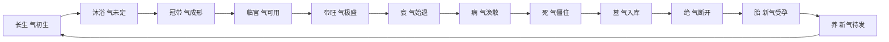
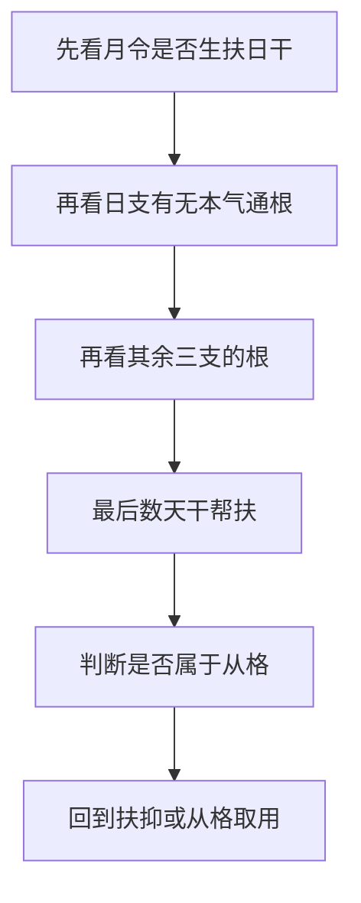

## 一、十二长生是什么

**十二长生**（twelve stages）描述五行在十二个地支上的气机强弱曲线，用的是人生的十二个阶段作比喻：长生、沐浴、冠带、临官、帝旺、衰、病、死、墓、绝、胎、养。

先纠正一个望文生义的错误：这里的「死」「绝」「墓」**不是字面意义**。它们描述的是气机状态，不是人的生死。日干在某个地支「死」，不代表这个人会死，只代表这股气在该支上最无力。

这条曲线的基本形状是：



【L2 约定】十二长生的名称与顺序是约定，不是计算结果。它之所以能流传，是因为这条曲线与四季五行的消长大体吻合：木旺于春、火旺于夏、金旺于秋、水旺于冬，土寄于四季末。

## 二、十二阶段表

每个阶段一句话，先建立手感：

| 阶段 | 气机含义 | 一句话解释 |
|------|---------|-----------|
| 长生 | 初生 | 气刚出现，生机纯但力量弱 |
| 沐浴 | 未定 | 气在洗炼，易受环境影响，又叫「败」 |
| 冠带 | 成形 | 开始有形态与规范，渐入轨道 |
| 临官 | 可用 | 力量登堂，能任事 |
| 帝旺 | 极盛 | 力量最大，同时是转折点 |
| 衰 | 始退 | 余威尚在，势头已下 |
| 病 | 涣散 | 气弱而不聚，力量使不上 |
| 死 | 僵住 | 气尽而停滞，不是人死 |
| 墓 | 入库 | 力量封存，逢冲可开 |
| 绝 | 断开 | 旧循环到头，气竭而断 |
| 胎 | 受孕 | 新气伏藏，尚未显形 |
| 养 | 待发 | 受养而长，柔但方向已定 |

两个读法要点：

1. **帝旺不是越好越妙**。旺到极处就是衰的起点，四柱里「旺极宜泄」的说法由此而来。
2. **墓与绝常被误读**。墓是「收起来」，不是「没了」；绝是「上一轮结束」，紧接着就是胎。

## 三、十干长生表

规则：**阳干顺行，阴干逆行**，都从「长生」起，按十二阶段顺序排。戊随丙、己随丁。【L2 约定】下表是固定映射，可查可复现，但映射规则本身是约定。

| 阶段 | 甲 | 乙 | 丙 | 丁 | 戊 | 己 | 庚 | 辛 | 壬 | 癸 |
|------|----|----|----|----|----|----|----|----|----|----|
| 长生 | 亥 | 午 | 寅 | 酉 | 寅 | 酉 | 巳 | 子 | 申 | 卯 |
| 沐浴 | 子 | 巳 | 卯 | 申 | 卯 | 申 | 午 | 亥 | 酉 | 寅 |
| 冠带 | 丑 | 辰 | 辰 | 未 | 辰 | 未 | 未 | 戌 | 戌 | 丑 |
| 临官 | 寅 | 卯 | 巳 | 午 | 巳 | 午 | 申 | 酉 | 亥 | 子 |
| 帝旺 | 卯 | 寅 | 午 | 巳 | 午 | 巳 | 酉 | 申 | 子 | 亥 |
| 衰 | 辰 | 丑 | 未 | 辰 | 未 | 辰 | 戌 | 未 | 丑 | 戌 |
| 病 | 巳 | 子 | 申 | 卯 | 申 | 卯 | 亥 | 午 | 寅 | 酉 |
| 死 | 午 | 亥 | 酉 | 寅 | 酉 | 寅 | 子 | 巳 | 卯 | 申 |
| 墓 | 未 | 戌 | 戌 | 丑 | 戌 | 丑 | 丑 | 辰 | 辰 | 未 |
| 绝 | 申 | 酉 | 亥 | 子 | 亥 | 子 | 寅 | 卯 | 巳 | 午 |
| 胎 | 酉 | 申 | 子 | 亥 | 子 | 亥 | 卯 | 寅 | 午 | 巳 |
| 养 | 戌 | 未 | 丑 | 戌 | 丑 | 戌 | 辰 | 丑 | 未 | 辰 |

先记五个阳干的长生位，剩下靠顺推：

```
甲长生亥、丙长生寅、戊长生寅、庚长生巳、壬长生申
乙长生午、丁长生酉、己长生酉、辛长生子、癸长生卯
```

以甲为例验算：长生亥，顺行则沐浴子、冠带丑、临官寅、帝旺卯、衰辰、病巳、死午、墓未、绝申、胎酉、养戌。与表一致。

以乙为例验算：长生午，逆行则沐浴巳、冠带辰、临官卯、帝旺寅、衰丑、病子、死亥、墓戌、绝酉、胎申、养未。与表一致。

【L2 约定】阴干是否逆行，是这套体系里最典型的分歧之一。主流子平术用「阳顺阴逆」，另有一派主张「十干皆顺」；戊己是否随丙丁，也有「戊随丙、己随丁」与「土单独起长生」两种处理。本教程采用**阳顺阴逆、戊随丙己随丁**，遇到引用其他体系时明确标注。

这个约定不是小事：乙木在午，本教程判「长生」，若改用「十干皆顺」，乙在午就成了「死」。同一个字，两个结论。

## 四、自坐与星运

**自坐**指日干坐在日支上，得到的那个长生状态。排盘表里那一列「星运」就是它。

例：1990 年 5 月 20 日那盘，日柱乙酉。查表，乙在酉为**绝**。

【L3 经验】自坐只作参考，不能单判。乙酉自坐绝，传统说法是「日主无根、配偶宫不助身」，但同一张盘里如果年支午为乙的长生、月支巳为沐浴，日主并不能算全无根气。**只看日支就下结论，是旺衰判断里最常见的偷懒。**

自坐的三种常见误用：

- 把「自坐帝旺」当成身强，其实还要看月令与其他三支
- 把「自坐死绝」当成命不好，这是把气机状态道德化
- 忽略自坐，只看月令，导致日支的根被完全抹掉

## 五、旺衰三要素

**旺衰**指日主在整张盘里是强还是弱。判断它有三个入口，合称得令、得地、得势：

| 要素 | 看什么 | 判据 | 权重感觉 |
|------|--------|------|---------|
| 得令 | 月支 | 月令五行生扶日干，或与日干同类 | 最高 |
| 得地 | 四支藏干 | 地支藏有与日干同五行之干，即**通根** | 次高，日支最重 |
| 得势 | 天干 | 比劫、印星的数量与位置 | 辅助 |

**通根**是这里的关键术语：日干在某个地支的藏干里找到同五行的字，就叫在那个支上有根。根分三等：

- **本气根**：地支本气与日干同五行，最实。如甲木见寅。
- **中气根**：中气与日干同五行，次之。如甲木见亥，亥中藏甲。
- **余气根**：余气同五行，最虚。如甲木见辰，辰中藏乙。

【L2 约定】通根分三等是规则，但「一等根值几分」是经验设定，第 07 节会看到不同流派给出的分值差得很远。

## 六、月令权重

传统认为月令占旺衰的四到五成。理由很直接：月令是出生季节，是整张盘里唯一由太阳位置决定的五行背景，其余干支都是在这个背景上做加减。

可操作的判断顺序：



【L3 经验】这个顺序是经验排序，不是定理。它的作用是防止你「先数天干有几个帮身，就宣布身强」——那种数法把月令这个最大权重项漏掉了。

月令还有一个细节：月支的藏干可能不止一个。比如月支为辰，本气戊土、中气乙木、余气癸水，对甲木日主来说，辰是「有余气根」但不是「得令」；对戊土日主来说，辰就是本气当令。同一支，对不同日干意义完全不同。

## 七、三种旺衰流派

这一节不下唯一结论。三种流派各有假设，你要做的是知道自己在用哪一套。

### 1 传统月令派

**假设**：月令为纲，季节决定一切；得令则强，失令则看通根与帮扶。

**操作**：先判月令旺相休囚死，再数通根，最后看天干。三项中两项占优，即判身强或身弱。

**优点**：规则清楚，可复现，适合教学。

**失效场景**：月令被合、被冲，或月令藏干与日干关系复杂时，一句话判不了。

### 2 气势流通派

**假设**：不看绝对强弱，看全局气势是否流通、有无阻塞。这一路源自《滴天髓》「道有体用，不可以一端论」。

**操作**：看五行从哪来、往哪去，是否形成「生—泄—克—制」的完整链条；再看寒暖燥湿是否失衡。

**优点**：能解释「身弱而贵」「身强而贫」的命例。

**缺点**：高度依赖取象与师承，可复现性差，容易变成事后解释。

### 3 量化打分派

**假设**：把每个位置赋分，加总定强弱。

一种常见赋分方案：

| 位置 | 分值 | 说明 |
|------|------|------|
| 月令本气 | 30 | 季节背景，最大单项 |
| 日支本气 | 15 | 日主坐下的直接根 |
| 其余地支本气 | 各 10 | 年支、时支 |
| 天干 | 各 10 | 透干之字 |
| 藏干中气 | 各 5 | 次根 |
| 藏干余气 | 各 3 | 微根 |

【L3 经验】这套分值本身就是经验设定。换一位老师，月令可能给 40 分，日支可能给 20 分，结论就可能从身弱翻成身强。**量化的外表不等于精确**，它只是把主观判断换成了数字，看起来更科学而已。

本教程的用法：三种流派都摆出来，做命例时先说明用哪一套，再给结论。不混用，也不假装它们等价。

## 八、从强与从弱的前置判断

扶抑法有个前提：日主有根可扶、有弱可抑。当这个前提不成立时，普通扶抑法失效，必须考虑**从格**。

两个方向：

- **从弱**：日主极弱、几乎无根，满盘克泄耗，印比又被制住。此时不宜再扶，顺着克泄耗的势力走。
- **从强**：日主极旺、满盘生扶，克泄耗之力微弱或无根。此时不宜再抑，顺着生扶的势力走。

【L3 经验】从格的成立条件各家不一，且极容易「事后认定」：断错了就说「这是从格」。本教程的处理是：只有在**日主完全无根、且帮扶之星也被制**时，才讨论从格；只要有一丝本气根，先按普通格局处理。

从格的详细判法与成格条件放在第 08 章，这里只建立一个前置意识：**旺衰判断不是只有「强/弱」两个格子，还有「不能扶、不能抑」的第三种情况。**

## 九、误判清单

| 误判 | 表现 | 后果 |
|------|------|------|
| 只看天干不看地支 | 「三个印，身强」 | 忽略地支无根，判断虚浮 |
| 把数量当强度 | 「帮扶五个，一定强」 | 月令一票否决，数量不等于力量 |
| 忽略月令 | 直接从日支起算 | 丢掉最大权重项 |
| 把十二长生当唯一标准 | 日坐帝旺就断身强 | 长生只是气机，不是总分 |
| 戊己长生照抄甲丙 | 戊长生写卯、己长生写寅 | 查表错误，后续全错 |
| 阴干顺排 | 乙在酉算成「胎」 | 阴阳顺逆搞反 |
| 把得令等同身旺 | 月令是印就断强 | 还得看印是否被财坏、日主是否受生 |
| 未判从格先取用 | 身弱无根还硬扶 | 用神取反，整盘反断 |

前六条是查表与规则错误，属于 L1 到 L2 之间；后两条是判断顺序错误，属于 L3，但后果同样严重。

## 本章小结

- 十二长生描述五行气机曲线，不是字面生死；帝旺是转折点，墓是封存，绝是旧循环结束。
- 阳干顺行、阴干逆行，戊随丙、己随丁；阴干是否逆行存在流派分歧。
- 自坐只看日支，只作参考，不能单判旺衰。
- 旺衰三要素为得令、得地、得势，月令权重最高。
- 通根分本气、中气、余气三等，本气根最实。
- 传统月令派、气势流通派、量化打分派各有假设，不可混用后假装结论唯一。
- 日主无根且帮扶被制时，先考虑从格，再谈扶抑。

**练习**

1. 写出乙木在十二支的长生状态。（答：子病、丑衰、寅帝旺、卯临官、辰冠带、巳沐浴、午长生、未养、申胎、酉绝、戌墓、亥死。）
2. 判断 1990 庚午 辛巳 乙酉 壬午 的旺衰要素，只列要素不下结论。（提示：月令巳、日支酉、通根情况、天干庚辛壬各占什么角色。）
3. 同一张盘，若把月令权重从 30 分提到 40 分，强弱结论会不会变？动手算一次。
4. 找一个「日坐帝旺」的八字，先按月令派判，再按气势流通派看，把两套说法都写下来。

下一章把静态的盘接上时间轴：大运十年一步，流年一年一换，看它们怎么与原局叠加。 [第 07 章](/docs/sizhu/07大运与流年.html)
