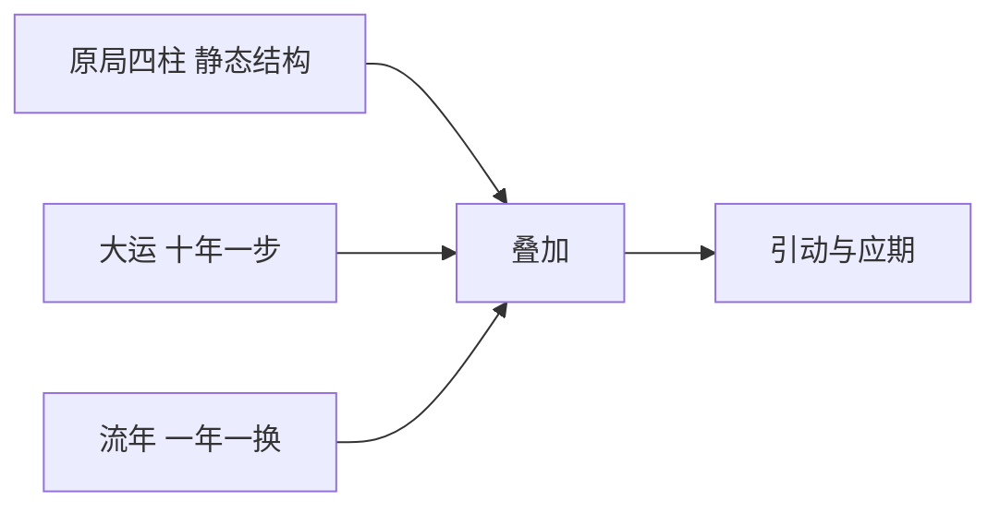
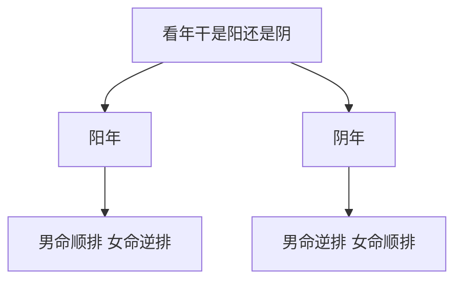

## 一、大运是什么

四柱是静态的，它只描述「出生那一刻的结构」。要谈变化，得接上时间轴，而时间轴的第一层就是**大运**。

**大运**（major luck cycle）是从月柱延伸出来的干支序列，每十年一步。它的作用不是「这十年一定发生什么」，而是「这十年环境的主旋律偏向哪一组五行」。**流年**（annual pillar）是当年干支，一年一换，作用在更细的颗粒度上。

三者的关系可以这样摆：



【L1 计算】大运的干支序列由月柱与顺逆规则唯一确定，起运岁数由出生时刻到节气时刻的距离唯一确定。给定输入，结果不该有第二种。

【L3 经验】但「这步大运好不好」不是 L1，是经验判断。同一组干支，对不同命局、不同流派，结论可以相反。这一章只解决「怎么排对」，不解决「排出来怎么断」。

## 二、顺排与逆排规则

规则只有一张表：

| 年干阴阳 | 性别 | 排法 |
|---------|------|------|
| 阳年 | 男 | 顺排 |
| 阳年 | 女 | 逆排 |
| 阴年 | 男 | 逆排 |
| 阴年 | 女 | 顺排 |

口诀：**阳男阴女顺，阴男阳女逆**。这里的「阳年」指年干为甲、丙、戊、庚、壬。



四个例子：

| 出生年 | 年柱 | 年干阴阳 | 性别 | 排法 |
|--------|------|---------|------|------|
| 1990 | 庚午 | 阳 | 男 | 顺排 |
| 1990 | 庚午 | 阳 | 女 | 逆排 |
| 1985 | 乙丑 | 阴 | 男 | 逆排 |
| 1985 | 乙丑 | 阴 | 女 | 顺排 |

【L2 约定】顺逆的根据是「阳男阴女取未来之气、阴男阳女取过去之气」，这套解释是后人为规则找的理由。规则本身是约定，但千年来执行一致，实务中不必纠结理由，照表操作。

## 三、起运岁数的算法

**起运**指第一步大运开始生效的时间点。算法分三步：

1. 顺排者，从出生时刻数到**下一个节**；逆排者，从出生时刻数到**上一个节**。
2. 把这段距离按「3 天 = 1 岁，1 天 = 4 个月，1 个时辰 = 10 天」折算。
3. 从出生时间加上折算结果，得到交运时刻。

注意是「节」，不是「中气」。立春、惊蛰、清明、立夏、芒种、小暑、立秋、白露、寒露、立冬、大雪、小寒，这十二个才是节。

### 完整算例

**输入**：1990 年 5 月 20 日 12:00 出生，男命，年柱庚午为阳年，顺排。

**找下一个节**：1990 年芒种在 6 月 6 日凌晨，与出生时刻相距约 **16 天 16 小时**。

**折算**：

```
16 天 ÷ 3 = 5 岁，余 1 天
余 1 天 → 4 个月
16 小时 → 8 个时辰 → 80 天，约 2 个多月
合计约 5 岁 6 到 7 个月，口头说 5 岁半
```

**结论**：约 5 岁半起运，交运时间在 1995 年底前后。以实际节气时刻为准，此处为近似演算。

【L2 约定】另有一派按分钟精确折算，把 3 天对应 1 岁换成 1 天对应 4 个月再细分到时辰；也有派别用「虚岁起运」直接取整。差异通常落在几个月内，但遇到交运点贴着节气或生日的命例，可能整步大运的起始年差一岁。

## 四、大运干支怎么排

从月柱出发，顺排取六十甲子的下一位，逆排取上一位，每步十年。

1990 年庚午男命，月柱辛巳，顺排八步：

| 步 | 大运 | 起始年龄 | 约起始公历 |
|----|------|---------|-----------|
| 1 | 壬午 | 5 岁 6 个月 | 1995 年底 |
| 2 | 癸未 | 15 岁 6 个月 | 2005 年底 |
| 3 | 甲申 | 25 岁 6 个月 | 2015 年底 |
| 4 | 乙酉 | 35 岁 6 个月 | 2025 年底 |
| 5 | 丙戌 | 45 岁 6 个月 | 2035 年底 |
| 6 | 丁亥 | 55 岁 6 个月 | 2045 年底 |
| 7 | 戊子 | 65 岁 6 个月 | 2055 年底 |
| 8 | 己丑 | 75 岁 6 个月 | 2065 年底 |

检查三点：

- 第一步必须紧接月柱。辛巳之后是壬午，顺排正确。
- 每一步干支都按六十甲子连续走，不能跳。
- 起运岁数只标在第一步，后续每步加十岁，不要每步都重算。

逆排则反着来。同样月柱辛巳，逆排第一步是**庚辰**，然后己卯、戊寅、丁丑，一路退回去。

## 五、流年怎么排

流年就是当年的干支，用第 03 章的年柱公式直接算：

```
年干序 = (年份 - 4) mod 10
年支序 = (年份 - 4) mod 12
```

2026 年：

```
(2026 - 4) mod 10 = 2022 mod 10 = 2 → 丙
(2026 - 4) mod 12 = 2022 mod 12 = 6 → 午
```

流年为**丙午**。

【L1 计算】流年的边界是**立春**，不是元旦，也不是春节。2026 年 2 月 3 日出生的人，若立春尚未到，流年仍算乙巳。这一点和第 03 章的年柱完全同构，错了就是错了。

流年不是孤立看的。它要先与命局四柱发生生克合冲，再与大运比对，最后才谈应事。

## 六、小运与岁运并临

**小运**（minor luck）是比大运更细的一层，一年一位，主要用于补足起运之前的空档。起法有两种：

1. 从**时柱**起，男顺女逆，一年一位。
2. 从**年柱**或**日柱**起，按同样顺逆推。

两派各有依据，现代实务中多数人只用大运与流年，小运作参考。本教程不展开，你知道有这一层即可。

**岁运并临**指大运干支与流年干支完全相同，比如大运丙午、流年又是丙午。

【L3 经验】传统认为岁运并临「应期明显」，吉事与凶事都会被放大，所以有「岁运并临，不死自己死亲人」这类吓人的断语。这句话不能当结论用：并临只是把同一组五行加倍，是否成灾，取决于这组五行在原局是喜是忌、有没有制化。**把它当「变动概率上升」可以，当「必有大祸」就是恐吓。**

## 七、大运流年与命局的作用方式

三种作用方式，每种给一句可检验的描述：

**一、补足原局缺的五行。** 原局无水，大运走亥子，水相关的十神与宫位被激活。检验方法：看这十年里，与「水」对应的六亲、行业、身体部位是否出现明显变化。

**二、加重原局已旺的五行。** 原局火旺，再走巳午，旺上加旺，容易从「有力」变成「失衡」。检验方法：这段运里是否出现典型的「过旺型」问题，比如急躁、炎症、冲突升级。

**三、引动原局的合冲刑害。** 大运字与原局某支相冲或相合，对应宫位与十神被引动。检验方法：事件是否集中在该支被冲、被合的流年，而不是整步大运均匀发生。

【L3 经验】这三种描述的共同点是「可以被现实检验」。如果一段大运里什么对应的事都没发生，那这套解释对这张盘就是失败的，不该用「时候未到」糊过去。

## 八、交运时刻

**交运**是大运正式交接的时间点，不是生日当天。

起运岁数是「出生时刻 + 折算后的时间」，所以交运点通常落在某个节气附近。比如 5 岁半起运，交运就在 1995 年底前后，而不是 1995 年 5 月 20 日生日那天。

由此产生一个说法：**交运前后半年容易有波动**。

【L3 经验】这个说法的解释是「气场切换、旧运未退新运未至」，属于经验描述，无法复现。它的实用价值只有一个：提醒你在交运年前后不要把重大决定押在「运气正好」上，而不是拿来断具体事件。

【L1 计算】交运时刻本身可以算准：起运岁数 + 出生时刻，落到具体年月日时。算不准的是「交运时会发生什么」，那是 L3。

## 九、踩坑清单

| 坑 | 表现 | 正确做法 |
|----|------|---------|
| 顺逆排反 | 阳年男命排成逆排 | 先看年干阴阳，再对性别 |
| 起运天数算成周岁 | 把 16 天直接当 16 岁 | 3 天折 1 岁，余数折月 |
| 把大运当断语 | 「走财运会发财」 | 先看财是喜是忌、有无制化 |
| 只讲大运不看流年 | 十年一句结论 | 大运定基调，流年定触发点 |
| 用农历年当流年 | 春节换流年 | 立春换流年 |
| 数错节 | 把中气当节数 | 只数十二个「节」 |
| 每步都重算起运 | 第二步又按生日推 | 起运算一次，之后每步加十岁 |
| 交运按生日算 | 5 岁半就在生日当天交运 | 交运点在节气附近 |

前两条是 L1 错误，后面多半是读法或顺序错误，但同样让整盘不可用。

## 本章小结

- 大运从月柱延伸，十年一步；流年一年一换；小运只作补充。
- 阳男阴女顺排，阴男阳女逆排，依据是年干阴阳。
- 起运顺排数到下一个节，逆排数到上一个节；3 天折 1 岁，1 天折 4 个月，1 时辰折 10 天。
- 1990 庚午男命顺排八步为壬午、癸未、甲申、乙酉、丙戌、丁亥、戊子、己丑。
- 流年以立春为界，2026 年为丙午。
- 大运流年通过补缺、加重、引动三种方式作用于原局，三种都可被现实检验。
- 交运时刻可以算准，交运时的吉凶不能；岁运并临只是加倍，不是必然灾祸。

**练习**

1. 1990 年庚午年女命，月柱辛巳，判断顺逆并写出前三步大运。（答：阳年女逆排，庚辰、己卯、戊寅。）
2. 1985 年乙丑年女命，假设生于巳月、月柱辛巳，判断顺逆并排出前四步大运。（答：阴年女顺排，壬午、癸未、甲申、乙酉。）
3. 某人顺排，出生时刻距下一个节约 9 天 8 小时，起运约几岁几个月？
4. 找一个大运与流年干支相同的年份，看看那一年是否真有明显变动，再判断「岁运并临」这个说法对这个人是否成立。

至此，排盘与时间轴都齐了。下一章进入格局，讨论月令如何取格，以及为什么同一张盘能取出不同的格。 [第 08 章](/docs/sizhu/08格局.html)
