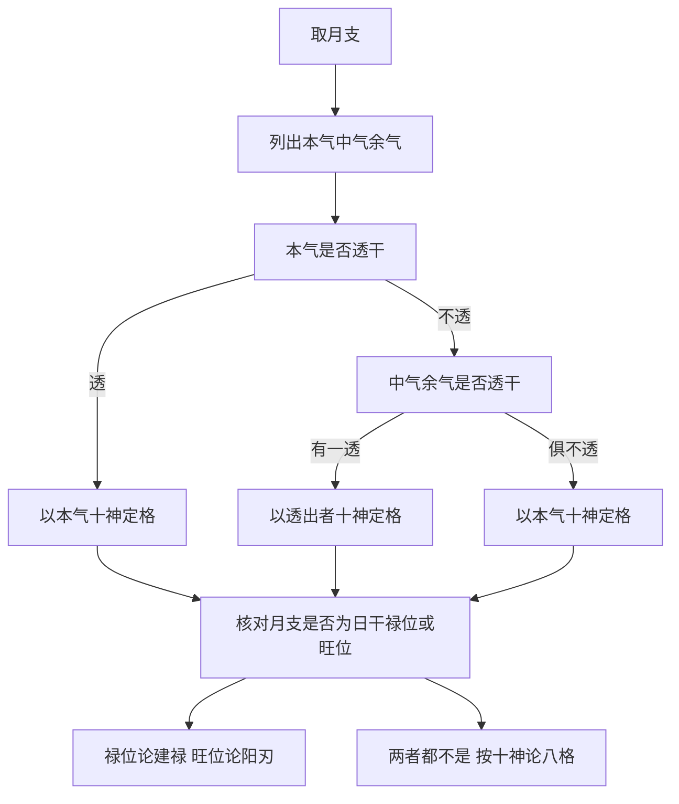

排完盘、标完十神、判完旺衰，下一步不是马上断事。先回答一个更基础的问题：这张盘靠什么运转，又怕什么被破坏。这个问题的答案就是格局。

## 一、格局是什么

**格局**（Structure / Pattern）：把整张盘归纳为一种「主导关系类型」的分类框架。它描述的是结构，不是命运的好坏。

先把它和另外两个概念分开，三者经常被混为一谈：

| 概念 | 回答的问题 | 层级 | 有没有唯一答案 |
|------|-----------|------|--------------|
| 旺衰 | 日主有力还是无力 | L3 经验 | 没有，三派判法不同 |
| 格局 | 全局以哪一路力量为主导 | 方法 L2、判断 L3 | 方法有规则，判断没有 |
| 用神 | 取哪一个字来救这张盘 | L3 经验 | 没有，取法互相冲突 |

三条定位，先立住：

1. **格局是结构描述，不是价值判断。**「正官格」不等于当官，「七杀格」不等于凶险。它说的是这张盘的主轴由「克我的那一类力量」构成，仅此而已。
2. **格局的信息量集中在「成」与「破」。** 只说「此命正官格」等于什么都没说；说「此命正官格，官星被伤官贴身克破，无救应」才有信息量。
3. **取格是 L2，判高低是 L3。** 月令取格有明确规则、可以复现，属于**约定层**；同一张盘该判上格还是破格，师承不同结论相反，属于**经验层**。

**【L2 约定】** 「用月令取格」这件事本身就是子平术的一条约定。唐代以前以年柱为主，宋以后才转到月令，徐子平一系把月令抬到提纲的位置。换一个体系，取格依据完全可以不同。
**【L3 经验】** 格局与真实人生的对应关系，本教程不做承诺。它是一套分类语言，能不能描述具体的人，是第 15 章的议题。

## 二、月令取格

**月令**（Month Command）：月柱地支，也叫月建、提纲。取格先看它，因为月令是节气所在的位置，是整张盘气最旺的一格。

先复习藏干（第 05 章给过完整表），取格只用到「本气、中气、余气」这三层：

| 地支 | 本气 | 中气 | 余气 |
|------|------|------|------|
| 寅 | 甲 | 丙 | 戊 |
| 卯 | 乙 | — | — |
| 辰 | 戊 | 乙 | 癸 |
| 巳 | 丙 | 庚 | 戊 |
| 午 | 丁 | 己 | — |
| 未 | 己 | 丁 | 乙 |
| 申 | 庚 | 壬 | 戊 |
| 酉 | 辛 | — | — |
| 戌 | 戊 | 辛 | 丁 |
| 亥 | 壬 | 甲 | — |
| 子 | 癸 | — | — |
| 丑 | 己 | 癸 | 辛 |

**取格三步**，按顺序执行，前一步成立就不往下走：

1. **本气是否透干。** 月支本气那个天干出现在年、月、时三干（日干不算），就以它相对日干的十神定格。
2. **本气不透，看中气、余气是否透干。** 中气优先于余气；中气余气同时透，两格并论，看谁有根。
3. **俱不透，以月支本气论格。** 本气虽藏于地支，仍是月令之主。

**完整示例：月支为寅**，藏甲（本气）、丙（中气）、戊（余气）。分别取日干甲与日干庚，结果不同：

| 透干情况 | 依据 | 日干甲时 | 日干庚时 |
|---------|------|---------|---------|
| 天干见甲 | 本气透 | 建禄格 | 偏财格 |
| 不见甲、见丙 | 中气透 | 食神格 | 七杀格 |
| 不见甲丙、见戊 | 余气透 | 偏财格 | 偏印格 |
| 俱不透 | 本气论 | 建禄格 | 偏财格 |

注意第一行：同样是「甲木透干」，对甲日主是建禄，对庚日主是偏财。**格名由「透出的字」与「日干」的关系决定，不是由月支单独决定。**

### 建禄与阳刃：两条特殊规则

**建禄格**：月支正好是日干的临官位（禄）。十个日干各有一个禄：甲寅、乙卯、丙巳、丁午、戊巳、己午、庚申、辛酉、壬亥、癸子。此时月支本气就是日干的比肩，按八格无法归类，单列建禄。

**阳刃格**（也叫月刃格、羊刃格）：月支是阳干的帝旺位，即甲卯、丙午、戊午、庚酉、壬子。传统认为阳干过旺需要「刃」来裁抑，故独立成格。

**【L2 约定】** 阴干有没有「刃」，各派不一致。按阳顺阴逆的长生表，乙帝旺在寅、丁己在巳、辛在申、癸在亥；但主流做法是**只给阳干立刃**，阴干的帝旺位叫「月劫」或直接归入建禄类。你看到「乙木寅月为阳刃格」的说法，那不是算错，是另一套约定。

**【L3 经验】** 建禄、阳刃两格的处理方向相反：建禄多喜财官（身有根，能任），阳刃多喜官杀制刃（刃旺，需裁抑）。这是经验规则，不是从「禄」「刃」两个名字里推出来的。

## 三、八格

**八格**：正官、七杀、正财、偏财、正印、偏印、食神、伤官。也就是除比肩、劫财之外的八种十神各成一格。比劫当令已由建禄、阳刃接管，不重复列。

下面每一格的「成格条件、喜忌、误区」**全部是经验判断**，不是计算结果。不同书对同一格的喜忌会给出相反意见，我把主流的摆出来，并标出争议处。

### 正官

成格：官星清纯（只一位、不混杂）、有财生官或有印护官、日主能任官、官星不受刑冲与伤官直克。

喜忌：喜财生官、印护官；忌伤官见官、官杀混杂、官多身弱。**【L3 经验】**

误区：见正官就断「有官职、品行端正」。正官只表示「约束性、规范性力量」，落在不同结构上，可能是职位，也可能只是守规矩。**【L3 经验】**

### 七杀

成格：杀有制（食神制杀、伤官驾杀）或有化（印星化杀），日主能敌杀。杀无制无化而身又弱，是标准的破格。

喜忌：喜食神制杀、印星化杀、阳刃合杀；忌财生杀、杀重身轻。**【L3 经验】**

误区：把七杀当凶神。有制的七杀是驱动力，无制的七杀才是压力。判断的关键在「制」与「化」，不在「杀」这个字。**【L3 经验】**

### 正财

成格：财旺身也旺、财不被比劫分夺、有官星护财（官能制劫）。

喜忌：喜身强任财、食伤生财、官星护财；忌比劫夺财、财多身弱。**【L3 经验】**

误区：财多即富。财多身弱在传统判法里叫「富屋贫人」——看得见拿不住，反而因财受累。**【L3 经验】**

### 偏财

成格：偏财透干有根、身强、无劫财争夺、有食伤为源。

喜忌：喜食伤生财、官星护财；忌比劫分夺、财星虚透无根。**【L3 经验】**

误区：把偏财等同于「横财」「情人」。偏财与正财的差别在「是否为我所固有、是否稳定」，不在道德色彩。**【L3 经验】**

### 正印

成格：印星有根、身弱得印生扶、印不被财星直破、不被合去。

喜忌：喜官杀生印（官印相生）、身弱取印；忌财星破印、印重身旺（印多则滞，反成依赖）。**【L3 经验】**

误区：印等于学历、等于母亲贤惠。印是「受纳、庇护、吸收」这一路力量，落到现实可能是学业，也可能是懒于行动。**【L3 经验】**

### 偏印

成格：偏印有制（财星制枭）或有泄（食伤流通），不直接克夺食神。

喜忌：喜财星制枭、食伤泄秀；忌枭神夺食（偏印克食神）、偏印重重无制。**【L3 经验】**

误区：偏印等于「偏门、后妈、古怪」。传统叫它「枭神」，是因为它能夺食；夺不夺，要看食神在不在、财星制不制。**【L3 经验】**

### 食神

成格：食神生财、身强食旺、食神不被偏印克夺、不被合去。

喜忌：喜财星承接、身强能食；忌枭神夺食、食多身弱（泄气太过）。**【L3 经验】**

误区：食神等于「有口福、性格温和」。食神是「输出、表达、享受」这一路力量，落到结构上是才华还是耗散，取决于身能不能承。**【L3 经验】**

### 伤官

成格：三条常见路线——伤官佩印（伤旺身弱，用印制伤）、伤官生财（伤旺有财可泄）、伤官驾杀（伤官与七杀互相制衡）。

喜忌：喜印星制伤、财星流通；忌伤官见官而无制、伤官无制而身弱。**【L3 经验】**

误区：伤官等于反叛、等于「女命克夫」。伤官见官之所以被列为忌，是因为官星被直克会破坏「正官格」的结构，不是因为伤官这个字本身带罪。**【L3 经验】**

## 四、外格与变格

八格装不下的盘，走外格。外格的风险远高于八格，因为它的成立条件更严、争议更大。

### 从格

**从格**：日主极弱、无根无援，全局力量一边倒，日主只能「顺从」那股力量。分四种：

| 格名 | 顺从对象 | 成立要点 |
|------|---------|---------|
| 从财格 | 财星 | 财旺成局、日主无根、无印比救应 |
| 从杀格 | 官杀 | 官杀成势、日主无根、无印化杀 |
| 从儿格 | 食伤 | 食伤成局、日主无根、无印夺食 |
| 从势格 | 全局最旺之势 | 财官食伤混杂而势在一方，日主无从自立 |

**三个成立条件，缺一不可**：日主极弱且地支无根；全局一边倒（不是「稍弱」，是「无法自立」）；无印星、比劫救应。

**【L3 经验】** 从格最容易出问题的地方在第三条。「有一分印比，就不能从」是传统判法的硬线，但「一分」怎么算没有标准。实战中大量所谓从格，其实是身弱用印的普通盘，被强行判成从格以套用「从格富贵」的断语。这是本教程建议对从格保持怀疑的主要原因。

### 专旺格

**专旺格**：全局只有一类五行独旺，无官杀破格，顺其旺势而不可逆。五种，名字取自《尚书·洪范》的五行之性：

| 格名 | 五行 | 常见成局 | 破格条件 |
|------|------|---------|---------|
| 曲直格 | 木 | 亥卯未三合、寅卯辰三会 | 见金（官杀）破木 |
| 炎上格 | 火 | 寅午戌三合、巳午未三会 | 见水（官杀）克火 |
| 稼穑格 | 土 | 辰戌丑未全或三见 | 见木（官杀）克土 |
| 从革格 | 金 | 巳酉丑三合、申酉戌三会 | 见火（官杀）克金 |
| 润下格 | 水 | 申子辰三合、亥子丑三会 | 见土（官杀）克水 |

成立条件同样是三条：当令（月令为本气）、成方局（三合或三会成局）、无官杀破格。**专旺格与从格的区别在于：从格是日主太弱去依附别人，专旺格是日主太旺而自成一势。**

**【L3 经验】** 专旺格最常被滥用的地方是「无官杀」这一条。天干透一位官杀、地支藏一位官杀，算不算破格？传统要求「官杀无根且被合去」才算干净，实际上多数盘都有藏干余气，严格判下来真专旺极少。

### 化气格

**化气格**：日干与相邻天干相合，且合化成功，日主性质随之改变。五组：

| 日干 | 合干 | 化神 | 常见月令配合 |
|------|------|------|------------|
| 甲 | 己 | 土 | 辰戌丑未月 |
| 乙 | 庚 | 金 | 申酉月 |
| 丙 | 辛 | 水 | 亥子月 |
| 丁 | 壬 | 木 | 寅卯月 |
| 戊 | 癸 | 火 | 巳午月 |

成立条件：**化神当令**（月令支持所化之五行）、**无争合妒合**（不是两干争合一干，也不是一干被两干争合）、**化神透干得地**（所化五行在天干有同类、在地支有根）、**日主本身无根**（有根则恋本气，不化）。

**【L3 经验】** 化气格是全部格局里争议最大的一类。它要求四个条件同时成立，而这些条件各自的判定尺度都不统一；再加上「合而不化」与「合化成功」在实战中极难区分，导致同一张盘有人判化气格、有人判普通合。本教程的处理是：**把化气格当作一种可能性列出，不用它单独下结论。** 第 10 章讲合化条件时会把这条线接上。

## 五、格局高低怎么判

判高低不看格名，看四件事：有没有**相神**、有没有救应、有没有被冲克、清不清。

**相神**：辅助格局成立、与格局配合的那个字。正官格以财、印为相神，正财格以食伤、官为相神，伤官格以印、财为相神。格局是本，相神是用。

| 维度 | 成格 | 破格 |
|------|------|------|
| 相神 | 相神有力、当位、不受克 | 无相神，或相神虚透被克 |
| 救应 | 格神受克但有救（如官被伤，有印制伤） | 格神受克无救 |
| 冲克 | 格神不逢刑冲，或冲而有力可解 | 格神被邻近之支冲、被合去 |
| 清浊 | 一神清透，杂气不混 | 官杀混杂、正偏财并透而无制 |
| 根气 | 格神与相神皆有根 | 格神虚浮无根，全靠天干撑 |

四条判读顺序：**先看格神有没有根 → 再看相神在不在 → 再看有没有被冲被合 → 最后看混杂**。前三步任何一步断了，都不必往下走。

**【L3 经验】** 这张表本身也是经验的。它给出的是思考次序，不是打分公式。同一张盘，有人认为「官被伤但有印制伤，成中有救」，有人认为「官既受伤，格局已损」，两种说法都能自圆其说——这正是 L3 的常态。

## 六、格局与旺衰的关系

先定强弱还是先定格局，是两派的分水岭。

| 派别 | 代表 | 次序 | 后果 |
|------|------|------|------|
| 格局派 | 《子平真诠》一系 | 先取月令定格，再论成败救应，旺衰服务于格局 | 结构清楚，但身弱任不起格时容易硬套 |
| 扶抑派 | 民国以来的平衡派 | 先判日主强弱，再取扶抑用神，格局退为参考 | 用神明确，但容易把格局当成装饰，丢掉整体结构 |

两派的分歧可以浓缩成一句话：**格局派问「这张盘要成什么事」，扶抑派问「日主扛不扛得住」。**

**【L3 经验】** 我自己的做法是两步都走：先用月令取格，得到一个结构假设；再判旺衰，检验这个假设是否成立。如果格局要求与扶抑要求相反（比如正官格喜财生官，而日主弱到受不起财），就以「不破坏格局的前提下扶身」为原则，而不是二选一。这个折中不是标准答案，只是把冲突显式化。
**【L3 经验】** 无论走哪条路，有一条底线：**判出来的结论要能说出它依赖哪几个字。** 说「此命正官格、官弱身强、取财生官」是可检验的；说「此命贵格」不是。

## 七、踩坑清单

| 坑 | 表现 | 后果 | 正确做法 |
|----|------|------|---------|
| 见格就断贵 | 「正官格，主贵」 | 忽略了成破与救应 | 先问相神在不在、格神有没有被冲 |
| 把从格当万能 | 身弱就判从 | 逃避了「无根无援」的硬条件 | 有一分印比救应就不从 |
| 只看月干不看月支 | 按月干定格局 | 取格基准错了，后面全错 | 格从月支出，月干只是透出的证据 |
| 忽略破格 | 只报格名，不查刑冲合 | 破格当成了成格 | 四步判读一个都不能省 |
| 把格局当职业 | 「七杀格适合军警」 | 把分类当成了职业推荐 | 格局只描述结构倾向，不指认具体行业 |
| 外格求奇 | 普通盘硬套化气、专旺 | 用稀缺格名换稀缺结论 | 外格条件不齐就退回八格 |

**最后一条经验**：格局判断的全部价值在于「知道自己漏了什么」。一份合格的格局分析，应该能明确说出「我没考虑哪几个字、为什么」。说不出这一句的，多半是在背断语。**【L3 经验】**

## 本章小结

- 格局是结构分类，不是好坏标签；取格属 L2 约定，判高低属 L3 经验。
- 月令取格三步：本气透则取本气，本气不透看中气余气，俱不透以本气论。
- 格名由「透出之字」与「日干」的关系决定，不由月支单独决定。
- 建禄、阳刃是月支为日干禄位、旺位时的特殊处理；阴干有无刃属流派分歧。
- 八格各自有成败条件，喜忌方向一律是经验规则，可以争。
- 从格、专旺、化气三类的成立条件都很严，化气格争议最大，不宜单独下结论。
- 判高低看相神、救应、冲克、清浊、根气五项；格局派与扶抑派的次序不同，后果不同。

**练习**

1. 月支为寅，日干为丙，天干不见甲、丙、戊。取什么格？（答：三者俱不透，以本气甲论；甲对丙为偏印，取偏印格。）
2. 月支为酉，日干为乙，天干透辛。取什么格？这一步有没有建禄或阳刃的特殊处理？（答：酉藏辛，本气透，辛对乙为七杀，取七杀格。酉是辛的临官，不是乙的禄或旺位，故不适用特殊处理。）
3. 拿一张你熟悉的盘，按本章三步取格，再写出相神是哪几个字。如果写不出相神，说明你的格局判断还停在格名层面。
4. 找一段「某大师」的格局分析，标出其中哪些句子是 L2 规则、哪些是 L3 判断。这一步比背八格有用。

格局定了、强弱判了，下一个问题才是真正见功力的地方：这张盘该取哪一个字来救。[第 09 章](/docs/sizhu/09用神.html)讲用神。
