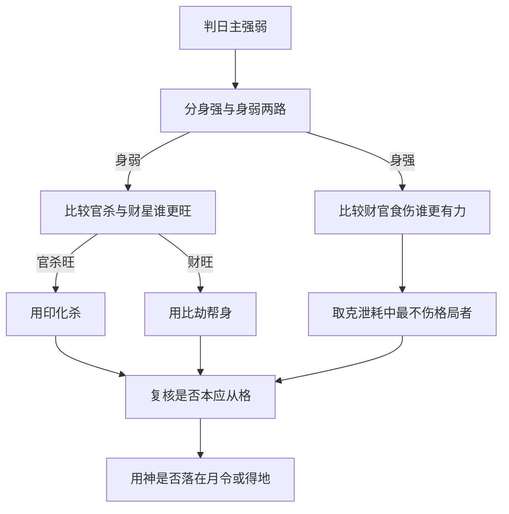
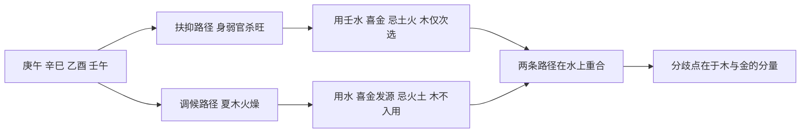

格局回答「这张盘是什么结构」，用神回答「取哪一个字来救它」。前者是诊断，后者是开方。开方比诊断更容易出错，因为药方依赖流派。

## 一、用神是什么

**用神**（Useful God）：对整张盘起关键作用、能恢复平衡或促成格局成立的那一个五行或十神。传统也写作「用神」「有用之神」，与「日主」相对而言。

**喜神**：生助用神、或与用神同气的字。
**忌神**：克用神、或助长全局病处的字。
**仇神**：生忌神、同时克喜神的字。
**闲神**：与用神关系不大、可以暂时忽略的字。

这五个概念是**相对**的，不固定在某个十神上。同一颗壬水，在身弱的盘里是救命的印，在身旺印重的盘里就是滞塞。判断用神之前先判旺衰，原因就在这里。

| 角色 | 定义 | 判断方法 |
|------|------|---------|
| 用神 | 解决问题的那一个字 | 由四种取用法得出，四种可能给不同答案 |
| 喜神 | 生用神者 | 用神的印星（五行上生它的那一行） |
| 忌神 | 克用神者，或助病者 | 用神的官杀（五行上克它的那一行） |
| 仇神 | 生忌神而克喜神者 | 忌神的印星 |
| 闲神 | 与用神无直接生克者 | 其余 |

**【L2 约定】** 这五个名字是术语约定，不是计算量。什么叫「生助」、隔一位还算不算生，各派尺度不同。先把名字对齐，再谈取法。

**【L3 经验】** 用神的取舍是四柱里分歧最大的环节。同一个八字，用神可以是水，也可以是木，还可以是「从格不需用神」。任何声称用神唯一且不容置疑的说法，都在隐藏一个师承前提。

## 二、四种取用法

四种方法不是并列的四个流派，而是**四个提问角度**。实战中常常要互相校验。下面每一种都给适用条件、判断步骤、失效场景，不给「标准答案」。

### 1 扶抑法

最通行的一路。核心一句话：**身弱则扶，身强则抑。**

| 项目 | 内容 |
|------|------|
| 适用 | 日主强弱可辨、盘面不太极端（非从格、非专旺） |
| 身弱取用 | 用印（生我）、用比劫（同我）；官杀旺先取印，财旺先取比劫 |
| 身强取用 | 用财（我克）、用官杀（克我）、用食伤（我生）；取其中最有力且不伤格局者 |
| 失效场景 | 从格（越扶越错）、专旺格（越抑越凶）、调候急症（扶抑正确但解不了寒热） |

**身弱用印与用比的区别**：官杀重，用印（化杀生身，一举两得）；财重，用比劫（夺财帮身）；食伤重，用印制伤。这三条是扶抑法内部的分工，比笼统的「身弱用印比」精确。

**【L3 经验】** 扶抑法最容易滥用的地方是「身强身弱」本身没有统一判法（第 06 章讲过三派）。强弱判错，用神全错，而且错得很自信。这是整条链上最脆弱的一环。

### 2 调候法

**调候**：调节寒暖燥湿，让日主所处的「气候」回到可用的状态。依据主要是《穷通宝鉴》一系的按月取用。

| 项目 | 内容 |
|------|------|
| 适用 | 生于极寒（亥子丑月）或极热（巳午未月）、盘面偏枯于寒湿或燥热 |
| 冬生 | 用火暖局；木需火解冻、水需土制而火解寒 |
| 夏生 | 用水润局；火需水既济、土需水润、金需水洗 |
| 失效场景 | 气候不极端时意义不大；把「某日干某月用某字」当查表，忽略盘中是否有该字与是否得力 |

《穷通宝鉴》的写法是按「十天干 × 十二月」给出用神与佐神，例如某月某干「专用癸水，无癸用壬，取庚辛为佐」。它给的是**优先顺序**，不是断言存在某个字就一定好。

**【L3 经验】** 调候法的价值在于它问的是扶抑法不问的问题：**这张盘冷不冷、燥不燥。** 冬天生的木，即便身强，也需要一点火；夏天生的金，即便身旺，也需要一点水。这一层是结构性的，不该被「身强用财官」一句话抹掉。

**【L2 约定】** 调候用神的表在各版本《穷通宝鉴》之间互有出入，个别日干的用神在两版里直接相反。引用时最好注明依据哪一版，别把某个版本的表格当成原典。

### 3 通关法

**通关**：两行相战、互不相让时，取一个能「两头都生」的五行放在中间，把对抗转成流通。

| 相战 | 通关五行 | 原理 |
|------|---------|------|
| 金克木 | 水 | 金生水、水生木 |
| 木克土 | 火 | 木生火、火生土 |
| 土克水 | 金 | 土生金、金生水 |
| 水克火 | 木 | 水生木、木生火 |
| 火克金 | 土 | 火生土、土生金 |

规律：**通关五行永远是「被克者所生」的那一行**。金木战，木生火？不，此处是金克木，木生火不能通关（火克金，反而加战）；正确取法是被克者（木）的「生我者」——水生木，金生水，故水通关。用一句话记：**取克者与被克者之间的「中间一环」，使克者之气泄于生，被克者得生而解克。**

**适用**：两个五行势均力敌、各占一半，谁也不能压服谁。此时扶抑法会陷入「扶哪边都对」的困境，通关法给出第三条路。

**失效场景**：一方明显压倒另一方时不需要通关（弱的那一方直接认输即可）；三行以上混战也没有单一通关字。

**【L3 经验】** 通关法判断「相战」的门槛很模糊。两行各两个字算不算战？一方有根一方虚透算不算战？没有量化标准，所以这条方法的实际使用率远低于它的理论重要性。

### 4 病药法

**病药**：先找出全局最大的「病」，再取能克这个病的字为「药」。这一路出自《神峰通考》一系的病药说，逻辑最直接。

| 病的类型 | 表现 | 药 |
|---------|------|-----|
| 过旺 | 一行独旺成灾（火炎、水泛、土重） | 克之、泄之 |
| 过寒过燥 | 全局气候偏枯 | 调之（火或水） |
| 被冲 | 关键之字被邻支冲散 | 合以解冲，或补其根 |
| 被合 | 关键之字被合去、羁绊 | 冲开合，或另取替代 |
| 混杂 | 官杀混杂、正偏财并透 | 去其一（合去或制去） |

病药法的好处是**它逼你说出「最坏的地方在哪」**。说不出病，就开不出药，这一步比扶抑法的强弱判断更不容易含糊。

**【L3 经验】** 「最大的病」同样由人判断。火旺的盘，有人认为是火病，有人认为是木被火焚、病在木无水；两者取药不同。病药法给了清晰的框架，没给唯一的答案。

## 三、用神不是固定标签

三件事要分开：

1. **原局用神**：这张盘本身缺的那一味，终身不变。
2. **用神得力与否**：原局有该字但没有根、被合、被冲，即「用神无力」。
3. **岁运用的喜忌**：某步大运把忌神送来，原局用神没变，但这十年不顺。

**真假与有力无力**，是两组独立判断：

| | 有力 | 无力 |
|--|------|------|
| **真神**（当令或得地） | 用神得用，盘有救 | 用神在但受制，需运助 |
| **假神**（虚透无根） | 表面有救，实则靠不住 | 用神形同虚设 |

**【L3 经验】** 「用神随大运变」这句话是两派的分歧点。一派坚持原局用神终身不变，大运只改变它的得力程度；另一派主张行运可以引出新的用神（所谓「运中取用」）。前者逻辑干净，后者更贴近实战的灵活描述。本教程倾向前者，但承认后者在实践中更常用。

**【L3 经验】** 换运之后喜忌会变，这个现象是真实的：同样的壬水，行北方水运时是助力，行南方火运时被蒸干。变的不是用神，是**用神的环境**。把这件事说成「用神变了」，容易滑向「每次不准就改一次用神」的自欺。

## 四、用神与格局的冲突

冲突发生得很频繁。经典场景：正官格喜财生官，而日主弱到受不起财官的克耗。此时格局要财，扶抑忌财。

三种处理方式，各有依据：

| 处理 | 做法 | 依据 | 代价 |
|------|------|------|------|
| 格局优先 | 仍取财为用（相神），身弱靠大运补 | 《子平真诠》一系，格局为体 | 原局无力承担，早年易受挫 |
| 扶抑优先 | 弃财取印，先保日主 | 平衡派，日主为本 | 格局降格，结构上的优势丢掉 |
| 急救优先 | 看全局是否有更急的病，先救病 | 病药、调候两路 | 可能暂时偏离格局与扶抑两方的结论 |

**我的处理原则**（明确标为经验，不是标准）：先判断这张盘的「格」还能不能立。格神被冲被合、相神全无，格局已经破了，此时以扶抑为主；格神完好、只差日主扛不住，则保留格局，用印通关，把「财生官克身」改成「官生印、印生身」。后者不是折中，是换了力量路径。

**【L3 经验】** 三种处理没有对错，只有前提。你在做咨询时选了哪一种，要说出依据；你在读别人的分析时，先看他用的是哪一派，再判断他的结论是否自洽。

## 五、取用神检查表

六步，按顺序走。每一步都写下结论，不要在心里过。

| 步骤 | 动作 | 输出 | 何时可以跳过 |
|------|------|------|------------|
| 1 定强弱 | 得令、得地、得势三项打分 | 身强 / 身弱 / 两停 | 不可跳过 |
| 2 看寒暖 | 月令是亥子丑还是巳午未，盘中有无水火 | 是否急需调候 | 春秋生人可简化 |
| 3 找相战 | 两行是否势均力敌 | 有无通关需求 | 一行独旺时可跳过 |
| 4 找病处 | 最旺、最弱、被冲、被合、混杂 | 最大的一个病 | 不可跳过 |
| 5 对照格局 | 用神与格局的相神是否一致 | 一致 / 冲突 / 无关 | 无格可论时可跳过 |
| 6 复核大运 | 用神在顺排的几步大运里是否得力 | 用神得力期与受制期 | 不可跳过 |

**【L3 经验】** 六步走完，如果三种方法给出三个不同的字，不要强行统一。把三个答案都写下来，注明各自的前提，然后选一个你认为最贴近盘面的。**能说出分歧，比假装没有分歧专业。**

## 六、常见错误

| 错误 | 表现 | 问题所在 |
|------|------|---------|
| 缺什么补什么 | 「五行缺火，用火」 | 缺失不等于需要。缺的那个字可能正是闲神甚至忌神 |
| 只数五行个数 | 「木三个火两个，木旺」 | 个数不等于力量。月令一个当令之字，抵得上失令的三个 |
| 忽略月令 | 通盘平权计算 | 月令权重最高，绕开月令的用神多半是错的 |
| 用神随运乱改 | 每年换一个用神 | 把「用神受制」误判为「用神改变」，导致结论不可证伪 |
| 喜用神等于幸运色 | 「用神是水，多穿黑色」 | 把符号层的生克当成物理因果，这是对体系的滥用 |
| 拿用神当结论 | 「用神是水，所以适合做水行业」 | 用神是结构判断，不是职业推荐，中间缺了太多环节 |

**关于「幸运色、方位、饰品」这一类延伸**：它把 L2 的五行映射直接接到现实物品上，中间没有任何可验证的环节。本教程把它归为商业包装，不列入技术内容。第 15 章会专门拆这类话术。

**【L3 经验】** 上面六条里，第一条和第四条造成的误判最多。前者让初学者把「缺」当成「需」，后者让老手在结论不准时不断修补前提，最后整套推理变成不可反驳的循环。

## 七、案例演示

**盘**：1990 年 5 月 20 日 12:00 前后，北京，男。四柱 **庚午 辛巳 乙酉 壬午**。

先把静态信息摆出来（这些是 L1 与 L2，没有争议）：

| 项目 | 内容 |
|------|------|
| 日干 | 乙木 |
| 月令 | 巳（立夏后芒种前，火当令） |
| 天干十神 | 庚 正官、辛 七杀、壬 正印 |
| 地支藏干 | 午 丁己、巳 丙庚戊、酉 辛、午 丁己 |
| 格局 | 巳本气丙不透，中气庚透，取正官格；辛七杀并透，官杀混杂 |
| 乙木之根 | 地支无寅卯亥未，无木根；日支酉为乙之绝 |
| 水之根 | 壬坐午为胎，全局无水根 |

**路径一：扶抑法。**

乙木生巳月，火当令，木处休地；地支三火一金，无一处木根；官杀庚辛并透，庚长生于巳、辛禄在酉，金有根有势；壬水印星孤立无援。判定：**身弱，官杀旺**。

身弱遇官杀旺，按扶抑分工取**印化杀**，用神为壬水。喜神为金（生水之源），忌神为土（克水、生金），仇神为火（生土、克金）。木（比劫）可以作为次一级的帮身，但乙木无根、木又生火，实际助力有限。

**路径二：调候法。**

巳月火旺土燥，乙木生于初夏，最需要水来滋润。《穷通宝鉴》一系对四月乙木的取法是「专用癸水，无癸用壬」，佐以金发水之源。用神为水，喜金，忌火土；木不在用神之列——夏木多木反而助火。

**两条路径的差异**：

| 分歧点 | 扶抑法 | 调候法 |
|--------|--------|--------|
| 核心用神 | 壬水（印化杀） | 水（润燥） |
| 对金的态度 | 矛盾：金生水是喜，金克木是忌 | 明确为喜，金能发水之源 |
| 对木的态度 | 比劫可作次选帮身 | 不入用，木多助火 |
| 对土的态度 | 忌（克水、生金） | 忌（燥土无水） |

两法在水与火土上一致，在木与金上分歧。**这个分歧不是谁算错了，而是两个问题不同**：扶抑问「日主扛不扛得住」，调候问「这张盘燥不燥」。

**【L3 经验】** 以上全部是经验判断，不是唯一解。换一位先生，可能：
- 判从杀格（前提是忽略壬水这一分印星）——本教程不采，因为印虽弱，毕竟透干且未被合去；
- 判用木（强调比劫帮身）——可以成立，但他要解释木如何不被火泄；
- 判用金（强调官杀有力、以杀为用）——需要解释身弱如何任杀。

**能说清前提的，都是合格答案；说不出前提而只说「用神是水」的，不是。**

## 本章小结

- 用神是让整张盘恢复平衡或让格局成立的那一个字；喜、忌、仇、闲是相对角色，不固定在十神上。
- 扶抑法问强弱，调候法问寒暖，通关法问相战，病药法问病处；四种是角度，不是互斥的流派。
- 扶抑法内部要细分：官杀重用印，财重用比劫，食伤重用印。
- 用神有真假、有力无力两组判断；大运改变的是用神的环境，主流做法不认为原局用神会变。
- 用神与格局冲突时，格局优先、扶抑优先、急救优先三种处理各有依据，选哪种要报出前提。
- 六步检查表的顺序不能乱：强弱 → 寒暖 → 相战 → 病处 → 格局 → 大运。
- 缺什么补什么、只数个数、忽略月令、随运改用神，是四个最常见的错误。

**练习**

1. 拿一张身弱的盘，分别用扶抑法和调候法取用神。如果两个答案不同，写出差异出现在哪个字上。
2. 金木相战、水火相战、木土相战，各自的通关五行是什么？（答：水、木、火。）
3. 用自己的话解释：为什么「用神是水」不等于「多穿黑色、多喝水」？
4. 重做本章案例，但假设壬水不出干。此时你会判从杀格吗？写出你的理由与反对理由。

用神取完，盘面还是静态的。真正让八个字动起来的，是字与字之间的那些关系：合、冲、刑、害、破。[第 10 章](/docs/sizhu/10合冲刑害.html)处理这一层。
