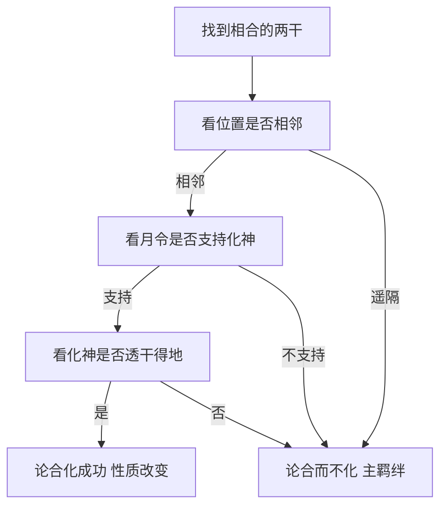
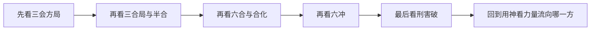

前几章把每个字单独拆开看：它是什么五行、什么十神、多旺。这一章换视角——八个字不是八个孤立的标签，它们之间有连线。连线改变力量的流向。

## 一、为什么合冲刑害重要

**合冲刑害**：四柱内部字与字之间的五种关系。合是结合与牵制，冲是对撞与破坏，刑是损伤与纠缠，害是暗损，破是拆解。

一条必须先讲清的前提：

**【L2 约定】** 合冲刑害的配对表是**人为约定**，不是从阴阳五行里唯一推导出来的。天干五合为什么是甲己而不是甲辛，古人有几种解释（声律说、河图数说、星象说），没有一种能被验证。表是死的、能背，解释是活的、可以争。

三条使用原则：

1. **关系不是吉凶。** 合不等于好事（合去用神就是坏事），冲不等于坏事（冲开墓库反而有用）。判断吉凶要看关系作用在哪个字上。
2. **关系改变力量，不直接产生事件。** 说「今年子午冲所以会搬家」是跳跃；说「子午冲，配偶宫被冲，关系进入重新协商的窗口」是在描述结构。
3. **位置决定权重。** 同样是冲，紧贴的两个支与隔了两位的两个支，力量差一个量级。这一条最容易被忽略。

**【L3 经验】** 合冲刑害落到具体人事上的解释，全部属于经验层。本章只给关系表与判断顺序，不给「冲则散、合则成」这类断语。

## 二、天干五合

| 组合 | 化神 | 备注 |
|------|------|------|
| 甲 + 己 | 土 | 阳木合阴土 |
| 乙 + 庚 | 金 | 阴木合阳金 |
| 丙 + 辛 | 水 | 阳火合阴金 |
| 丁 + 壬 | 木 | 阴火合阳水 |
| 戊 + 癸 | 火 | 阳土合阴水 |

规律：**相隔五位**（甲序 1 与己序 6 差 5），且阴阳相反。你可以用「序号差 5 且阴阳异」来复现整张表，不必死背。

### 合化与合而不化

**合化**：两干相合之后，性质真的改变，变成所化之五行。
**合而不化**（也叫合而不化、羁绊）：只是粘在一起，互相牵制，各自还是原来的五行。

判定合化成功，三个条件：

1. **月令支持化神**。甲己合土，须生在辰戌丑未月；生在寅卯月，木旺克土，化不成。
2. **化神透干得地**。所化之五行在天干有同类、在地支有根。
3. **无争合妒合**。两干争合一干（如两个甲争一个己），或一干被两干夹合，都不化。

**【L2 约定】** 「合化成功」的门槛各派不同。严格的派别要求月令、透干、得地、无争合四项全备，宽松的派别只要月令支持就算化。同一张盘，一派说「甲己化土，日主变土」，另一派说「甲己合而不化，仍是甲木」，结论天差地别。
**【L3 经验】** 实战中真正的合化很少。绝大多数情况是合而不化：两个字互相绊住，谁也不能正常发挥。判断「合而不化」比判断「合化成功」更重要，因为它更常见。

**合而不化的实际效果**：被合住的字「有心无力」。比如用神被合，用神还在，但发挥不出来；忌神被合，忌神还在，但暂时被拴住。这一层描述比「化成了什么」有用得多。

## 三、天干相冲

| 组合 | 说明 |
|------|------|
| 甲 冲 庚 | 阳木对阳金 |
| 乙 冲 辛 | 阴木对阴金 |
| 丙 冲 壬 | 阳火对阳水 |
| 丁 冲 癸 | 阴火对阴水 |
| 戊、己 | 居中，无冲 |

规律：**相隔六位**（甲序 1 与庚序 7 差 6），且阴阳相同。四组冲全部是「克」的关系：金克木、水克火。

**戊己为什么无冲**：土居中央，不参与四方之气的对冲。这是一条约定，理由是土为中枢、无对待之位。你也会看到「戊甲冲」「己乙冲」之类的说法，那是把「克」直接叫成「冲」，不是主流。

**【L2 约定】** 天干相冲在部分流派里根本不用，理由是「天干主动，动而不居，无所谓冲」。用与不用，会影响同一张盘的判断。本教程把它列出，但权重低于地支六冲。

**天干相冲与天干相克的区别**：克是单向压制（金克木），冲是双向对撞（甲庚互伤）。克的双方力量悬殊时克得动，冲的双方往往两败。

## 四、地支六合

| 组合 | 化神 | 备注 |
|------|------|------|
| 子 + 丑 | 土 | 寒土合湿土 |
| 寅 + 亥 | 木 | 木之长生合木之临官 |
| 卯 + 戌 | 火 | 木合火库 |
| 辰 + 酉 | 金 | 湿土合金 |
| 巳 + 申 | 水 | 火合金，合中带刑 |
| 午 + 未 | 土 | 又称日月合，有派论不化 |

六合的配对可以从支序读出来：寅亥、卯戌、辰酉、巳申、午未五组的支序和都是 15，子丑是首尾相接的特例。记忆锚点：子丑、午未是「首尾相合」，其余四组是「递进相合」。

**【L2 约定】** 午未合化什么，分歧最大。有派论化土，有派论化火（午未同属火土之交），有派论只合不化。巳申这一组更麻烦：既是六合，又是六破，还是三刑的一员，三重身份叠在一起。
**【L3 经验】** 六合在实战中的主要作用是「绊住」与「解冲」。合住一个字，那个字的力量被牵制；合住冲的双方之一，冲就被解开（贪合忘冲）。这两条比「合化出什么」用得多。

## 五、地支三合与三会

### 三合局

| 三合 | 五行 | 中神（帝旺） | 组成 |
|------|------|------------|------|
| 申子辰 | 水 | 子 | 长生 + 帝旺 + 墓库 |
| 亥卯未 | 木 | 卯 | 长生 + 帝旺 + 墓库 |
| 寅午戌 | 火 | 午 | 长生 + 帝旺 + 墓库 |
| 巳酉丑 | 金 | 酉 | 长生 + 帝旺 + 墓库 |

三合的结构是「十二长生」的三点：长生、帝旺、墓库，构成一个等边三角。**中神（帝旺）是三合的核心**，没有中神就不成局。

**半合**分两种，力量差很多：

| 类型 | 组成 | 说明 |
|------|------|------|
| 生地半合 | 长生 + 帝旺（申子、亥卯、寅午、巳酉） | 有中神，力量较强 |
| 墓地半合 | 帝旺 + 墓库（子辰、卯未、午戌、酉丑） | 有中神，力量次之 |
| 拱合 | 长生 + 墓库（申辰、亥未、寅戌、巳丑） | 无中神，力量最弱 |

**三合与半合的关键差别**：三合是中神在场、三方齐全，成局；半合只有两方，是「有趋势但未成局」。拱合连中神都没有，只能算一点倾向。

### 三会方局

| 三会 | 五行 | 方位 |
|------|------|------|
| 寅卯辰 | 木 | 东方 |
| 巳午未 | 火 | 南方 |
| 申酉戌 | 金 | 西方 |
| 亥子丑 | 水 | 北方 |

三会是三个**连续的地支**（同一季节的三个月）连成一方之气。它与三合的区别：

| 维度 | 三会 | 三合 |
|------|------|------|
| 构成 | 连续三支，同方位 | 隔三位，三角关系 |
| 力量 | 强 | 稍弱 |
| 性质 | 方局，季节之气 | 局，气之聚合 |
| 举例 | 寅卯辰会木 | 亥卯未合木 |

**三会力量大于三合**，是主流共识：连续的季节之气比隔位的三角聚合更实在。但两者都成立时（比如寅卯辰与亥卯未同时出现），以三会为主、三合为辅，不叠加计算。

**【L2 约定】** 「三会大于三合」是约定，不是推导。也有流派认为三合有中神、结构更稳，力量不在三会之下。
**【L3 经验】** 成局的字如果正好是用神或忌神，影响会放大；但「成局就等于某事发生」是断语，不是结构描述。

## 六、地支六冲

| 冲 | 五行属性 | 备注 |
|----|---------|------|
| 子 午 | 水火 | 纯气之冲，最烈 |
| 丑 未 | 土土 | 冲开墓库 |
| 寅 申 | 木金 | 冲中带克 |
| 卯 酉 | 木金 | 纯气之冲 |
| 辰 戌 | 土土 | 冲开墓库 |
| 巳 亥 | 火水 | 冲中带克 |

配对规律：**相隔六位**（子序 1 与午序 7 差 6），且阴阳相同。这与天干相冲是同一个结构。

### 冲的远近

| 位置 | 举例 | 力量 |
|------|------|------|
| 相邻 | 年月、月日、日时 | 最大 |
| 隔一位 | 年日、月时 | 减半 |
| 遥隔 | 年时 | 最小，常作背景看 |

**月令被冲要单独看**：月支是整张盘的提纲，被冲的后果比其他支被冲重。年支被冲影响较轻，日支被冲（配偶宫）与月支被冲（父母宫）是实战中最常被讨论的两处。

### 冲开墓库

辰、戌、丑、未是四墓库，分别藏水、火、金、木之余气。墓库平时「关着」，被冲则「打开」，库中之物得以透出。

**【L3 经验】** 「冲开墓库」是好事还是坏事，取决于库里装的是什么。库里是用神，冲开是好事；库里是忌神，冲开是坏事。没有统一答案，任何「逢冲必开、开必吉」的说法都不成立。

### 冲的力量对比

传统有一句话：**旺者冲衰，衰者拔；衰者冲旺，旺者发。**

意思是：旺的一方冲衰的一方，衰者被连根拔起；衰的一方冲旺的一方，旺者反而被激怒、气势更盛。这句话描述的是力量悬殊下的对冲结果，不是吉凶判断。

## 七、三刑

| 刑 | 名称 | 组成 |
|----|------|------|
| 寅巳申 | 无恩之刑 | 三支齐全才成 |
| 丑戌未 | 恃势之刑 | 三支齐全才成 |
| 子卯 | 无礼之刑 | 两支即成 |
| 辰辰、午午、酉酉、亥亥 | 自刑 | 同支重复 |

**刑**（Punishment）：一种带纠缠性质的损伤关系，比冲更阴、更慢、更难解。

三刑的构成有争议：

**【L2 约定】** 三刑的配对本身是约定。寅巳申为什么叫「无恩」，丑戌未为什么叫「恃势」，子卯为什么叫「无礼」，都是后人的义理附会，不是规则的一部分。
**【L3 经验】** 三刑在理论上的争议比任何一个关系都大。有派（包括部分现代命理研究者）主张**不论刑**，理由是三刑的配对缺乏内在一致性，且「刑」能产生的效果都可以用冲、合、克来解释。另一派坚持刑有其独立意义，主「官非、病伤、纠缠」。

本教程的处理：**三刑列为参考项，不单独下结论。** 看到寅巳申，先看它同时具备的其他身份——寅申是冲、巳申是合、寅巳是害，这三组关系已经足够解释大部分现象，不必再叠一层刑。

**自刑的特殊性**：辰午酉亥四个字重复出现，叫自刑。它的实际效果接近于「伏吟」（同一字重复，力量叠加而滞），理解为「同类力量堆积」比理解为「自己伤害自己」更准确。

## 八、六害与六破

### 六害

| 害 | 由来 |
|----|------|
| 子 未 | 子丑合，未冲丑，合被冲破 → 子未害 |
| 丑 午 | 子丑合，午冲子 → 丑午害 |
| 寅 巳 | 寅亥合，巳冲亥 → 寅巳害 |
| 卯 辰 | 卯戌合，辰冲戌 → 卯辰害 |
| 申 亥 | 寅亥合，申冲寅 → 申亥害 |
| 酉 戌 | 卯戌合，酉冲卯 → 酉戌害 |

**害**（Harm）：六合被第三方冲破之后产生的暗损关系。它的逻辑是「我的合作伙伴被打了，我也受损」，所以害主暗中的牵制、背后的事。

六害的配对可以由六合推出，不必死背：**找到一对六合，把其中一支的冲神拿来，就是害。**

### 六破

**破**（Destruction）：拆解、破坏原有结构的关系，力量比冲弱，比害显。六组为**子酉、卯午、辰丑、未戌、寅亥、巳申**。

**【L2 约定】** 六破的分歧最大。不同书列出的六组不完全一致；寅亥、巳申这两组在主流表里既是六合又是六破，一组关系两种身份，怎么处理没有统一说法。有的流派干脆不用六破。
**【L3 经验】** 六害与六破在实际判断中的权重很低。它们更多是用来「解释已经发生的事」，而不是「预测将要发生的事」——因为力量弱、歧义大，任何结论都可以用别的更强的关系统替代它。本教程建议：先看三会三合六合六冲，最后才轮到害与破。

## 九、优先顺序与相互作用

不给绝对结论，只给可操作的判断顺序。

五条操作规则：

1. **定局优先于定合。** 三会、三合是「成势」，六合是「结对」。先看有没有成势，再谈结对。
2. **贪合忘冲。** 冲的双方之一被合住，冲力大减，叫「合能解冲」。但解冲不等于消失，被合的字只是被绊住。
3. **冲能破合。** 合力小于冲力时，合被冲散。判断依据是位置与力量：紧贴的冲，能破隔位的合；月令的合，不易被年支的冲破。
4. **位置决定一切。** 相邻 > 隔位 > 遥隔。同样是三合，三支紧邻与三支分散在不同柱，力量差得远。
5. **一层关系不够就叠两层，别叠四层。** 一组字同时是合、是刑、是害（如寅巳申），选最强的一层解释，其余作为补充。层层叠加只会得出任何结论。

**【L3 经验】** 遇到「合中有冲」「冲中有合」的复杂局面，最实用的做法不是硬判，而是**列出所有关系，标注力量层级，然后承认结果不确定**。命理分析里最不专业的做法，是把每一层关系都算一遍，然后挑一个符合自己预设的结论。

## 十、踩坑清单

| 坑 | 表现 | 问题所在 |
|----|------|---------|
| 见合就断好 | 「六合，人缘好、婚姻美」 | 合住用神就是坏事，合住忌神才是好事 |
| 见冲就断凶 | 「子午冲，婚必不顺」 | 冲是结构变动，方向由被冲之字决定 |
| 把合化当默认结果 | 「甲己合，日主变土」 | 合化要三个条件，多数情况是合而不化 |
| 忽略位置远近 | 把年时遥冲与日时紧冲等量齐观 | 位置差两柱，力量差一个量级 |
| 把三刑当灾祸 | 「寅巳申三刑，主官非」 | 三刑本身争议极大，且这三支已有冲与害 |
| 关系堆叠 | 一张盘列出十几组关系 | 关系越多，解释力越弱，最后什么都能说通 |

**【L3 经验】** 最后一条值得单独说。一张盘里能找出的关系通常在十组以上，如果每组都算，结论会互相打架。真正有用的做法是筛出**与用神、与格局、与宫位相关的那三四组**，其余忽略。会做减法，比会查表重要。

## 本章小结

- 合冲刑害是字与字之间的关系，作用是改变力量流向，不是直接产生事件。
- 天干五合相隔五位、阴阳相反；合化成功需月令支持、化神得地、无争合，多数情况是合而不化。
- 天干四冲为甲庚、乙辛、丙壬、丁癸，戊己居中无冲。
- 地支六合六组，三合四局以中神为核心，三会四方力量大于三合。
- 六冲相隔六位；相邻力大、隔位力减；冲开墓库的吉凶取决于库中之物。
- 三刑争议最大，本教程列为参考项；六害可由六合推出，六破分歧最多。
- 判断顺序：三会 → 三合 → 六合 → 六冲 → 刑害破，位置与月令决定权重。

**练习**

1. 用「相隔五位、阴阳相反」复现天干五合表，再用「相隔六位、阴阳相同」复现天干四冲表。两张表能自己推出来，就不用背。
2. 三合局里，为什么中神不能缺？用十二长生的结构解释。（提示：长生、帝旺、墓库三点，帝旺是气之极盛处。）
3. 列出 1990 年 5 月 20 日午时那张盘 **庚午 辛巳 乙酉 壬午** 中存在的合冲关系。（答：天干日干乙与年干庚遥合，月令巳火克金，合而不化；地支巳酉为生地半合金，金气增强；年支午与时支午自刑，遥隔力弱；全局无六合、无六冲。）
4. 找一张有「合中有冲」的盘，列出所有关系后，只保留与用神相关的三组，看结论是否变清楚。

静态结构讲完了，接下来把它落到人身上：哪一柱管哪一段人生，哪一个十神代表哪一位亲人。[第 11 章](/docs/sizhu/11六亲与宫位.html)讲六亲与宫位。
