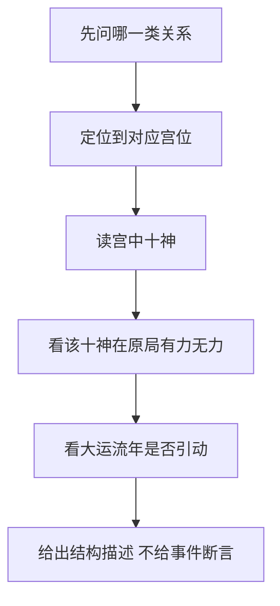

前面所有章节都在处理「这张盘是什么」。这一章换个问法：「这张盘里，谁是谁」。同一套符号，换一个投影方向，就落到具体的人身上。

## 一、宫位是什么

**宫位**（Palace）：四柱每一柱对应人生的一段时期与一类关系。年柱管祖上与幼年，月柱管父母兄弟与青年，日柱管自己与配偶，时柱管子女与晚年。

| 柱 | 宫名 | 年龄段 | 主要关系 | 次要取象 |
|----|------|--------|---------|---------|
| 年柱 | 祖上宫 | 约 0-16 岁 | 祖辈、原生家庭背景 | 故乡、远方、早年的制度环境 |
| 月柱 | 父母宫、兄弟宫 | 约 17-32 岁 | 父母、兄弟姐妹、成长环境 | 事业宫、社会关系的起点 |
| 日柱 | 日干自己、日支配偶宫 | 约 33-48 岁 | 自身、配偶 | 婚姻质量、中年状态 |
| 时柱 | 子女宫 | 约 49 岁以后 | 子女、晚辈 | 下属、成果、晚年归宿 |

三条要点：

1. **日干是「我」，其余七个字都是「我所处的关系」。** 所以六亲判断永远从日干出发，不从天干地支的字面出发。
2. **日支是配偶宫，这一点最确定。** 四宫之中，日支配偶的对应关系分歧最小，年柱与月柱谁管父母则分歧很大。
3. **年龄段是粗分段，不是精确刻度。** 「17-32 岁」是约定，不是从盘里算出来的；有人 15 岁就离家，有人 40 岁还和父母同住，宫位描述的是结构位置，不是时间表。

**【L2 约定】** 四宫的分段是空间映射，不是计算结果。为什么年柱管祖上而不是反过来？因为排盘从年、月、日、时自上而下排列，古人按「自远及近、自长及幼」的顺序赋予含义。这是一条**排序约定**，换一个体系完全可以重新分配。

**【L3 经验】** 宫位与真实家庭结构的对应，是经验层的类比。它描述「这一类关系在这张盘里处于什么状态」，不描述「你父亲具体是什么样的人」。

## 二、十神配六亲

十神表示关系的**性质**，宫位表示关系的**位置**。两者合起来，才是完整的六亲取象。

先看十神是怎么来的（第 05 章给过公式，这里只复习结论）：以日干为「我」，按生克与阴阳同异，得出比肩、劫财、食神、伤官、正财、偏财、正官、七杀、正印、偏印十个符号。

| 十神 | 男命 | 女命 |
|------|------|------|
| 比肩 | 兄弟、同辈男性 | 姐妹、同辈女性 |
| 劫财 | 姐妹、异性同辈 | 兄弟、异性同辈 |
| 食神 | 才华、晚辈；部分流派作女儿 | 女儿、子女 |
| 伤官 | 才华、晚辈；部分流派作儿子 | 儿子、子女 |
| 正财 | 妻、正当收入 | 正当收入 |
| 偏财 | 父、情人、意外之财 | 父、意外之财 |
| 正官 | 子女、职位、约束 | 夫、职位、约束 |
| 七杀 | 子女、压力、竞争 | 情人、压力、竞争 |
| 正印 | 母、学业、庇护 | 母、学业、庇护 |
| 偏印 | 继母、偏门学问 | 继母、偏门学问 |

这张表的底层逻辑只有两条：

- **男命以「我克」为妻财**，所以正财为妻；以「克我」为子女，所以官杀为子女。
- **女命以「克我」为夫**，所以正官为夫；以「我生」为子女，所以食伤为子女。

其余各星按同一逻辑推广：生我者为母（印），我克者为父与财（财），同我者为兄弟姐妹（比劫）。

六亲星在盘中的分量，看三件事：透不透干、有没有根、离日干远近。

| 状态 | 盘中的表现 | 六亲取象 |
|------|-----------|---------|
| 透干有根 | 星有力，位置显 | 这一类关系在盘中占主导，影响大 |
| 透干无根 | 有名无实 | 关系存在，但实际支撑不足 |
| 藏支有根不透 | 有力但不显 | 关系实在，但不摆在明面上 |
| 无根又不透 | 星弱 | 这一类关系在盘中不占主导 |

强弱只说明「这个符号在盘中占多少分量」，不说明「这段关系好不好」。有力可能是强支持，也可能是强压力，方向要看十神性质。

**【L2 约定】** 父母星的取法，各派不一致，而且分歧很大：

| 说法 | 父 | 母 | 依据 |
|------|----|----|------|
| 主流十神派 | 偏财 | 正印 | 财为父、印为母，与「我克」「生我」对应 |
| 部分古法 | 偏财 | 正印，但年柱亦可看父 | 宫位与星并用，年柱为祖上兼父母 |
| 宫位派 | 年干或月干 | 年支或月支 | 直接以宫位取父母，不依赖十神 |

本教程的做法：**以偏财为父、正印为母为主，宫位作为校验。** 两套说法冲突时，以宫位为准而不是以星为准，因为宫位的位置信息更稳定。

**【L2 约定】** 男命子女星的分歧同样存在。传统取官杀，理由是「克我者为子孙」的类推（子孙为后辈、为约束）；但现代一部分流派改用食伤，理由是「我生者为子女」更直观。两种取法会得出完全不同的结论，读到别人的分析先问一句他用哪一套。

**【L3 经验】** 偏印为继母、七杀为情人这类对应，属于经验层的扩展取象。它们的依据是「同类中较偏、较烈的那一个」，不是规则推出来的。用的时候标清楚，别当成定论。

## 三、宫与星要一起看

只有宫没有星，你只知道「哪一段关系」；只有星没有宫，你只知道「什么性质」。两者合起来才有信息。

**判断顺序**：

举个例子，同样是日支（配偶宫），坐的十神不同，结构描述完全不同。

| 日支十神 | 结构描述 | 前提 |
|---------|---------|------|
| 七杀 | 配偶宫被「克我、压力、竞争」这一类力量占据；关系中容易出现强势一方或外部压力 | 杀有制则转为担当，无制则偏紧张 |
| 正印 | 配偶宫被「生我、庇护、受纳」这一类力量占据；关系中容易出现照顾者与被照顾者的分工 | 印被财破则照顾变成负担 |
| 正财 | 配偶宫坐妻星本身（男命），配偶与「我」的关系同气相应 | 财被比劫夺则关系受外力干扰 |
| 比肩 | 配偶宫与「我」同气，关系偏向对等、同盟 | 比肩过旺则争，容易各持己见 |

**【L3 经验】** 这张表的每一行都是经验描述，不是判定。它说的是「这一类关系的结构与倾向」，不是「你的婚姻会怎样」。判断的粒度只能到结构，到不了事件。

再看一个宫星冲突的例子：年柱为父母宫，但年柱天干是七杀。此时「宫」说这是父母的位置，「星」说这个位置上是压力与约束。合理的描述是——**早年家庭环境带有压力性的约束**，而不是「你父亲会伤害你」。前者是结构，后者是断言。

**【L3 经验】** 宫星冲突在实战中很常见（宫位与十神指向不一致），处理原则是：**宫位定位置，十神定性质，两者冲突时以宫位为准，把十神当成这个位置上的「质地描述」。**

## 四、六亲判断的四条限制

这一节比前面所有内容都重要。四条限制，缺一条都会让分析变成算命。

**限制一：不可反推具体事件。**

「日支逢冲」是结构描述，「今年离婚」是事件断言。从结构到事件之间隔着当事人的选择、环境、偶然性。任何声称能精确到年、月、具体事件的分析，都在跨层说话。

**【L3 经验】** 可以做的推论是概率性描述：「这类结构在统计上更容易出现关系重新协商」，而且必须注明「统计」是经验样本，不是数据。

**限制二：不可断生死。**

六亲的寿夭、疾病、意外，在任何流派的四柱里都没有可靠的对应规则。传统命书里这类断语很多，它们依赖的是恐吓而非推理。本教程明确拒绝这一整类内容。

**限制三：父母星不代表父母全部。**

一颗偏财不能概括一个父亲。它只描述「你与父亲这一类关系中的某一面」——比如支持的来源、或财务的关联。同一个人在不同关系里呈现不同面貌，一颗星装不下。

**【L2 约定】** 「父母星」这个说法本身就已经把复杂的亲子关系压缩成了一个符号。压缩会丢信息，这是符号系统的固有代价，不是可以修补的技术缺陷。

**限制四：独生子女与多子女的比劫解读不同。**

比劫为兄弟姐妹，这是取象的起点。但独生子女的盘里比劫照样存在，此时它的含义要转换：同辈朋友、合作伙伴、竞争者。**不能因为盘里有三个比肩，就断定「你有三个兄弟姐妹」。** 反过来，现实中有兄弟姐妹而盘中比劫极弱，也不能推出「关系不好」。

**【L3 经验】** 这一条是六亲判断里最常见的翻车点。取象是「这一类关系」，不是「这个数量的人」。数量和现实必须靠当事人确认，不能靠盘推。

## 五、大运流年如何引动六亲

原局是静态结构，大运流年是把结构「激活」的时间变量。引动六亲，看三件事：冲宫、合宫、引动星。

### 冲配偶宫

大运或流年的地支冲日支，叫冲配偶宫。结构含义是：配偶宫被推动，关系进入重新协商的窗口。

**【L3 经验】** 可检验的描述：**若某年地支冲日支，观察该年是否出现居所变动、长期分居、或与配偶重新划分分工这三类现象。** 若三类都没有，这条规则对这一盘不成立，应当记录为反例，而不是解释成「冲得不重」。

### 合配偶宫

大运或流年的地支与日支相合，叫合配偶宫。结构含义是：配偶宫被绑定，关系中「联结」的一面被强化。

**【L3 经验】** 可检验的描述：**若某年地支合日支，观察该年是否出现关系确立、同住、或与配偶家庭往来显著增多。** 同样，没有出现就记为反例。合也可能是「被绊住」，所以在关系紧张期遇到合，表现为「想分开但分不掉」，而不是「感情变好」。

### 引动子女星

男命看官杀，女命看食伤。大运流年引动这颗星（透出、得根、被合、被冲），叫引动子女星。

**【L3 经验】** 可检验的描述：**若流年引动子女星且该星在原局有根，观察该年是否出现生育、收养、承担晚辈责任等事件；若原局无根，多为责任增加而非添丁。** 这一条必须配合现实条件（婚育意愿、年龄、家庭计划）使用，脱离现实条件的引动判断没有意义。

### 大运与流年谁更重

- **大运管十年，是背景。** 大运引动六亲，影响的是「这十年这一类关系的基调」。
- **流年管一年，是触发。** 流年引动六亲，影响的是「这一年出现的具体变动」。
- **两者叠加才有效。** 大运冲配偶宫、流年再合，是「先推开再拉回」的结构；只有流年动而大运不动，多是小波动。

**【L3 经验】** 判断时先看大运给的是哪一类环境，再看流年是否在这个环境里点火。脱离大运单看流年，等于只看日历不看季节。

### 引动的三条操作原则

1. **先看原局有没有这颗星。** 原局无星，流年引动只是「临时出现的角色」，作用有限。
2. **再看这颗星有力无力。** 无根的星被引动，多是虚应故事。
3. **最后看引动的方式。** 合是「绑定」，冲是「推动」，刑害是「纠缠」，三种方式的结构含义不同。

**【L3 经验】** 「引动」这个词本身就很模糊：透干算引动，得根算引动，被冲被合也算引动。模糊的术语容易变成「怎么解释都对」的挡箭牌。用的时候把「哪一种引动」写清楚，是这一节唯一的专业要求。

## 六、常见误读清单

| 误读 | 表现 | 问题所在 |
|------|------|---------|
| 日支逢冲就断离婚 | 「日时相冲，婚姻不保」 | 冲是结构变动，方向由被冲之字与全局决定 |
| 女命官杀多就断多夫 | 「官杀混杂，感情复杂」 | 官杀多可能只是压力多、责任多，与伴侣数量无对应 |
| 无子女星就断无子女 | 「盘中无官杀，无子」 | 子女星是取象，不是生育能力；现实条件优先 |
| 把年柱当父母唯一依据 | 「年柱克日干，与父母缘薄」 | 父母还要看月柱与父母星，单一宫位不足以定论 |
| 忽略现实家庭结构 | 独生子女盘里数比劫个数 | 取象是关系类型，不是人数统计 |
| 用六亲断生死 | 「某星受克，主长辈大凶」 | 跨层断言，无可靠规则支撑，且有害 |

**【L3 经验】** 这张表里的每一条，背后都是同一个错误：**把符号层的结构直接翻译成现实层的事件。** 六亲判断的专业边界是「描述关系结构」，越界的部分不是更高明的技术，是没有依据的猜测。

**一句自检**：写完一段六亲分析后，问自己「这句话如果错了，怎么证明它错」。答不出来的，删掉。

## 本章小结

- 四宫分段：年柱祖上幼年、月柱父母兄弟青年、日柱自己与配偶、时柱子女晚年；这是 L2 的空间映射约定。
- 日支为配偶宫，是四宫中对应关系最确定的一个；父母宫在年柱还是月柱，各派分歧较大。
- 十神配六亲的底层逻辑只有两条：男命以我克为妻财、克我为子女；女命以克我为夫、我生为子女。
- 父母星的取法有十神派与宫位派两套，冲突时以宫位为准更稳。
- 宫位定位置、十神定性质；宫星冲突时用宫位定位、用十神描述质地。
- 六亲判断有四条硬限制：不可反推具体事件、不可断生死、一颗星不代表一个人、比劫不等于兄弟姐妹的具体人数。
- 大运流年通过冲宫、合宫、引动星三个途径激活六亲，每一条都要给出可检验的描述并记录反例。

**练习**

1. 写出男命与女命各自的配偶星、子女星、父母星，并说明每一条的推导依据。（提示：从「我克、克我、我生、生我」四组关系出发。）
2. 日支坐正印与日支坐七杀，结构描述有什么不同？各写一句，不许出现具体事件。
3. 找一张有「日支被冲」的盘，查那一年实际发生了什么。如果没有出现居所变动、分居、重新分工中的任何一项，把这一年记为反例。
4. 用本章的四条限制，逐条检查你之前写过的（或读过的）一段六亲分析，标出越界的地方。

六亲讲完，四柱的骨架就齐了。下一章处理一个绕不开的话题：神煞——那些听起来最玄、权重却最低的东西。[第 12 章](/docs/sizhu/12神煞.html)讲神煞。
