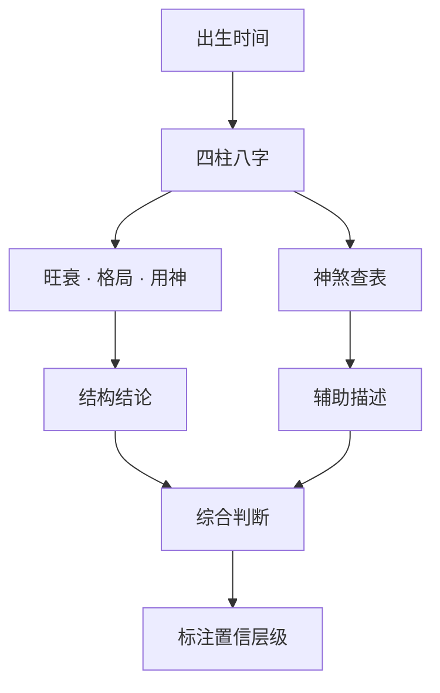

## 一、神煞是什么

神煞是「吉神」与「凶煞」的合称。一句话定义：**按出生时刻的干支字面组合查表得到的辅助标记，不参与五行生克的推导**。

它和前面几章讲的东西不是一类：

| | 十神、旺衰、格局 | 神煞 |
|---|---|---|
| 生成方式 | 由日干与其余干支的生克关系推出 | 由「某支见到某个字」直接查表 |
| 是否参与力量比较 | 是 | 否，只有「有」与「无」 |
| 能否解释「为什么」 | 能，有生克链条 | 不能，只有传承 |

三个特征值得先记住：

1. **神煞是索引，不是推理。** 你不需要知道这个人为什么「贵人」，只需要知道他的日干是甲，四支里有没有丑未。这种操作门槛极低，所以它在民间流传得最广，也最容易被滥用。
2. **来源极杂。** 有从禄命法来的（禄、刃、贵人），有从星命与择日来的（天乙、文昌、华盖），也有从民俗直接搬进来的（孤辰寡宿、小儿关煞）。它们不是在同一套公理下长出来的，所以彼此之间没有统一性。
3. **数量没有上限。** 常见命书列神煞上百种，随便一张盘都能查出四五个。数量一多，「总能对上一条」就成了必然。

**【L2 约定】神煞整体属于规则映射层。** 查法本身可以复现——同一个人拿同一张表，查出来的字一样；但「为什么是这个字」，没有推导，只有师承。所以**「神煞查得准」只能证明你会查表，不能证明它断得准**。

再补一句本章的立场：**神煞不改变旺衰，旺衰决定神煞有没有资格说话。**

## 二、常用神煞查法表

先看基准。同一张盘，用年支查还是用日支查，结果可能完全不同，这是神煞分歧的第一个来源：

| 神煞 | 以什么为基准 | 查哪里 |
|------|-------------|--------|
| 天乙贵人 | 日干为主，年干为辅 | 四支 |
| 文昌 | 日干 | 四支 |
| 禄神 | 日干 | 四支 |
| 羊刃 | 日干 | 四支 |
| 桃花 | 年支或日支 | 其余三支 |
| 驿马 | 年支或日支 | 其余三支 |
| 华盖 | 年支或日支 | 其余三支 |
| 孤辰寡宿 | 年支 | 其余三支 |
| 亡神劫煞 | 年支或日支 | 其余三支 |

### 天乙贵人

口诀：**甲戊庚牛羊，乙己鼠猴乡，丙丁猪鸡位，壬癸兔蛇藏，六辛逢马虎。**

| 日干 | 甲 | 乙 | 丙 | 丁 | 戊 | 己 | 庚 | 辛 | 壬 | 癸 |
|---|---|---|---|---|---|---|---|---|---|---|
| 贵人所见 | 丑未 | 子申 | 亥酉 | 亥酉 | 丑未 | 子申 | 丑未 | 午寅 | 卯巳 | 卯巳 |

两点必须说明：

- **版本差异存在。** 有的书写「甲戊兼牛羊」，把庚排除在外；有的书把「庚」换成「己」。这不是谁抄错了，是传本不同。你跟随哪本书，就一路跟到底，别混用。
- **天乙是神煞里少数被普遍认为「有分量」的一个**，因为它被用来解释「关键时刻有人帮」。但请注意，这种描述几乎是人人可得的：谁的职业生涯里没有一两个帮过忙的人？

### 文昌、禄神、羊刃

| 日干 | 甲 | 乙 | 丙 | 丁 | 戊 | 己 | 庚 | 辛 | 壬 | 癸 |
|---|---|---|---|---|---|---|---|---|---|---|
| 文昌 | 巳 | 午 | 申 | 酉 | 申 | 酉 | 亥 | 子 | 寅 | 卯 |
| 禄神 | 寅 | 卯 | 巳 | 午 | 巳 | 午 | 申 | 酉 | 亥 | 子 |
| 羊刃 | 卯 | 争议 | 午 | 争议 | 午 | 争议 | 酉 | 争议 | 子 | 争议 |

**禄神**不是随意指定的：它就是十二长生的**临官**位。甲木长生在亥，顺行到临官是寅；丙戊长生在寅，临官在巳。所以禄是「气到壮年」的那个刻度，有明确的构造依据。

**羊刃**是阳干的**帝旺**位，也就是禄前一位：甲禄寅、刃卯；丙戊禄巳、刃午；庚禄申、刃酉；壬禄亥、刃子。这一组五个阳干没有争议。

**阴干有没有刃，各派不同**，这是神煞里最典型的约定分歧：

- 一派取「禄前一位」：乙辰、丁未、己未、辛戌、癸丑。
- 一派按阴干逆行取帝旺：乙寅、丁巳、己巳、辛申、癸亥。
- 一派干脆认为阴干无刃，只有阳干论刃。

**【L2 约定】三派各有体系内的道理，没有一派能被证伪。** 你在写盘时选一派即可，但必须写明选了哪一派——不写明，读者就不知道你那个「刃」是从哪来的。

### 桃花、驿马、华盖

这三者都按三合局查，是最常用的一组：

| 年支或日支所属三合局 | 桃花 | 驿马 | 华盖 |
|---|---|---|---|
| 申子辰（水局） | 酉 | 寅 | 辰 |
| 寅午戌（火局） | 卯 | 申 | 戌 |
| 巳酉丑（金局） | 午 | 亥 | 丑 |
| 亥卯未（木局） | 子 | 巳 | 未 |

注意这张表可以被统一解释，这是神煞里少有的「有结构」的部分：

- **桃花取沐浴位。** 申子辰水局，长生在申，沐浴在酉。沐浴是气刚出生、形体未定的位置，古人用它比附情欲与人际吸引。
- **驿马取冲长生位。** 申子辰长生在申，冲申者为寅。所以驿马的本质是「把长生的起点撞动」，比附迁移与奔波。
- **华盖取墓库位。** 申子辰的墓在辰。墓是收藏、封闭的位置，比附孤高与独处。
- 顺带说，**亡神取临官位、劫煞取绝位**，也是同一条长生曲线上的刻度。

**这说明神煞不是乱点的，它是十二长生曲线的第二套索引。但「有结构」不等于「有预测力」**，它只说明这套符号内部自洽，不说明它对应真实人生。

### 孤辰寡宿

孤辰寡宿按年支所在的四组（三会）查，与三合局是两套分组，不要混用：

| 年支 | 孤辰 | 寡宿 |
|---|---|---|
| 亥子丑 | 寅 | 戌 |
| 寅卯辰 | 巳 | 丑 |
| 巳午未 | 申 | 辰 |
| 申酉戌 | 亥 | 未 |

### 亡神劫煞

亡神与劫煞按三合局查，取的是该局长生曲线的两个刻度——亡神在临官，劫煞在绝：

| 年支或日支所属三合局 | 亡神 | 劫煞 |
|---|---|---|
| 申子辰（水局） | 亥 | 巳 |
| 寅午戌（火局） | 巳 | 亥 |
| 巳酉丑（金局） | 申 | 寅 |
| 亥卯未（木局） | 寅 | 申 |

这两组只作简表，原因是**查法分歧比前面几组大得多**：

- 孤辰寡宿有以年支查、有以日支查，还有按「男孤女寡」分别取不同字的。
- 亡神劫煞虽有三合局这条构造依据，但各书错位一到两位的情况很常见。
- 附带的断语问题更大：「男怕孤辰女怕寡宿」是**性别偏见**，不是技术结论。本教程不采用。

**【L3 经验】这两组我建议直接不用。** 分歧大、断语重、无法验证，三个缺点全占了。

## 三、神煞的权重

先给结论：**神煞是调味料，不是主菜。** 它在整个判断里能改变的是措辞，不是方向。

| 层级 | 判断项 | 教学用相对刻度 | 说明 |
|------|--------|---------------|------|
| 1 | 月令 | 40 | 决定旺衰基调，几乎不可逆 |
| 2 | 通根 | 25 | 天干有没有根，决定能不能担财官 |
| 3 | 格局 | 15 | 决定这套结构的用法与高低 |
| 4 | 十神组合 | 10 | 决定具体表现方式 |
| 5 | 刑冲合害 | 7 | 决定宫位稳定度与触发点 |
| 6 | 神煞 | 3 | 只做修饰 |

**【L3 经验】这张表的数字是教学用的相对刻度，不是统计结果。** 我给不出任何一份「神煞准确率」的实证数据，因为不存在这样的数据。这张表要表达的是排序，不是精度。

排序的理由很实在：

1. **神煞只有两值。** 有就是有，没有就是没有，它不参与力量比较。一个「天乙贵人」在没有根、没有印的盘上，救不了身弱。
2. **神煞不区分程度。** 月令有旺相休囚死，神煞没有。羊刃在卯和在酉，对甲木的意义完全不同，可神煞表只告诉你「有刃」。
3. **神煞不能解释机制。** 说「他有贵人所以顺利」，等于说「他顺利因为他顺利」。十神至少能给出「官生印、印生身」这样一条链条。

所以判断顺序必须是：**先定旺衰，再取格局与用神，再看十神与宫位，再看合冲，最后才轮到神煞。** 反过来做，就是拿修辞当论证。

## 四、为什么我建议少用神煞

三条理由，一条比一条重要。

**第一，查法分歧大。** 天乙有传本差异，阴干羊刃有三派，孤辰寡宿有年支日支两说，桃花驿马的基准也不统一。同一张盘，两个师傅报出来的神煞能差一半。**一个连「查什么」都没统一的工具，没法作为判断依据。**

**第二，容易事后附会。** 一张盘常能查出五到十个神煞，而每个神煞都有吉凶两读：桃花可以是人缘好，也可以是感情乱；驿马可以是出差，也可以是漂泊；华盖可以是文艺，也可以是孤僻。先知道结果，再从这十几个标签里挑一个「应验」的，命中率接近百分之百。**这是选择效应，不是预测力。**

**第三，断语吓人且不可检验。** 「羊刃逢冲见血光」「桃花带煞主淫」「孤辰寡宿主一生孤独」——这些话的共同点是：说得很重，无法反驳，也不给成立条件。它们唯一稳定的功能是制造恐惧，而恐惧是卖「化解」的前提。

**凡是让你害怕、又不能被验证的话，都应该先放下。** 这一条不只适用于神煞，适用于整本书。

## 五、神煞的正确用法

只有一条原则：**结构先行，神煞后置；神煞只能加形容词，不能换主语。**

意思是，神煞可以修饰结论的措辞，不能改变结论的方向。看例子：

| 已成立的结构 | 命中的神煞 | 可以说 | 不能说 |
|---|---|---|---|
| 财星透干、身能担、有冲 | 驿马 | 走动求财，异地或跨区域的机会更多 | 必出国、必发财 |
| 只有驿马，财星弱 | 驿马 | 坐不住，喜欢跑动，工作形态偏流动 | 必有迁移之喜 |
| 印星有力、官星不破 | 文昌 | 读书路径顺，适合走资质与考试 | 必考取、必高学历 |
| 单见文昌 | 文昌 | 对文字、条理敏感 | 必以文为业 |
| 合多、人缘结构好 | 桃花 | 亲和力强，容易被人记住 | 必有外遇 |
| 单见桃花 | 桃花 | 外貌或气质有吸引力 | 感情必乱 |
| 身旺、官杀有力 | 羊刃 | 性子硬，扛得住压力，敢拍板 | 必有血光 |
| 单见羊刃 | 羊刃 | 不提 | 任何具体事件 |
| 印重、食伤收敛 | 华盖 | 喜独处，对玄学、艺术、宗教有兴趣 | 必孤独终老 |

判断标准一句话：**删掉神煞，结论还站得住吗？** 站得住，神煞只是修辞；站不住，说明这个结论本来就是靠神煞撑着的，那是空中楼阁。

图里这条路径的顺序不能颠倒。神煞与结构是**并联**的输入，但权重极不对称：结构决定方向，神煞只决定用词。

## 六、踩坑清单

| 坑 | 典型表现 | 后果 | 正确做法 |
|---|---|---|---|
| 先查神煞再定旺衰 | 一上手就报「你有三个贵人两个桃花」 | 结论被标签绑架 | 先排盘、定旺衰、取用神 |
| 用神煞反推格局 | 「有羊刃所以是羊刃格」 | 概念混用，格局不成立 | 格从月令取，刃只是标记 |
| 年支日支混用 | 同一盘一会儿按年支查、一会儿按日支查 | 神煞名单前后矛盾 | 先声明基准，全程统一 |
| 阴干羊刃不声明 | 直接说「乙木羊刃在辰」 | 读者无法复核 | 写明采用哪一派 |
| 把神煞当结论 | 「桃花在时支，必晚婚风流」 | 断语膨胀，不可检验 | 只作修饰，不下断语 |
| 神煞冲突就当吉凶抵消 | 「贵人与劫煞同柱，一吉一凶打平」 | 无规则可言，纯属编 | 神煞不参与力量比较，不抵消 |
| 拿神煞安慰人 | 「你命带天乙，总会有人帮」 | 巴纳姆式空话 | 说清结构，不给虚假保证 |
| 用凶煞收费化解 | 「你有血光之灾，需请符」 | 制造恐惧牟利 | 直接说明这是话术 |

## 七、本章小结

- 神煞是按字面组合查表得到的**辅助标记**，不参与五行推理，属于 **L2 约定层**。
- 天乙、文昌、禄神、桃花、驿马、华盖的查法已给表；**禄是临官位，阳干羊刃是帝旺位**，其余多取三合局的沐浴、墓库、冲长生等刻度。
- 分歧集中在基准选择（年支还是日支）、阴干羊刃、以及孤辰寡宿的起法。**选一派，并写明选了哪一派。**
- 权重排序是 **月令 > 通根 > 格局 > 十神组合 > 刑冲合害 > 神煞**，神煞只占最后的修饰位。
- 三条少用理由：查法分歧、事后附会、断语不可检验。
- 正确用法只有一条：**结构先行，神煞后置；只加形容词，不换主语。**

**练习**

1. 用本章的表，给「庚午 辛巳 乙酉 壬午」这张盘查一遍天乙、文昌、禄神、桃花、驿马、华盖，并列成表。注意桃花与驿马要用年支和日支各查一次，看结果差多少。
2. 找出你手边任意一本命书里的神煞表，与本章对照，列出至少三处不一致。判断每一处属于「传本差异」还是「起法不同」。
3. 把「羊刃逢冲必见血光」改写成一句可检验的话，并写出它需要哪些条件才算成立。
4. 拿一张你熟悉的盘，先只按旺衰与格局写三条结论，再把神煞全部加进去。比较两次结论的方向有没有变化。如果变了，说明你第一次的判断不牢。

神煞这一章讲的是「什么东西不该当主菜」。下一章进入具体专题：事业、婚姻、健康——那里才是把结构翻译成人话的地方，也是最容易说过头的地方。

[第 13 章](/docs/sizhu/13专题事业婚姻健康.html)
