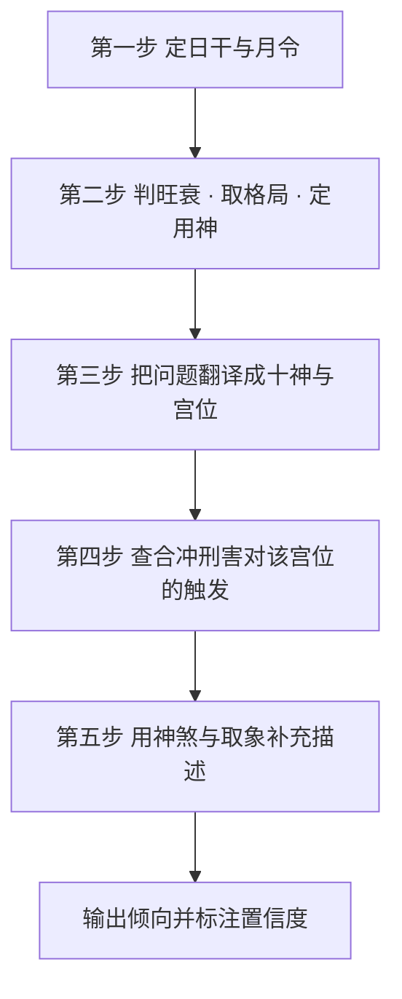

## 一、先立规矩

专题分析不是另立一套体系，它是在结构层之上的应用。**同一个盘，旺衰、格局、用神的结论先定下来，事业婚姻健康才有得谈。** 跳过结构直接谈专题，等于背断语。

所以本章的每一条结论，都必须能回到五条线索：

| 线索 | 回答的问题 | 可靠性 |
|---|---|---|
| 旺衰 | 日主有没有力量承担 | L3，但依据明确，可复核 |
| 格局 | 这套结构该怎么用 | L3，流派分歧最大 |
| 用神 | 缺什么、忌什么 | L3，随流派变 |
| 宫位 | 问题落在哪一段关系上 | L2 定位 + L3 判读 |
| 十神 | 这件事以什么形式出现 | L2 映射 + L3 组合 |

**【L3 经验】这五条里，只有「宫位」和「十神」的映射部分接近 L2，其余三条全是经验。** 认清这一点，你才不会把「我说你适合做管理」当成事实陈述。

三条底线，先说清楚：

1. **只谈倾向，不谈事件。**「倾向于在有层级的组织里更顺」可以说，「明年三月会升职」不可以说。
2. **只谈结构，不谈宿命。** 结构描述的是起点与偏好，不是终点。
3. **不替代专业意见。** 健康不替代医生，婚姻不替代沟通，事业不替代行业研究。

## 二、事业财运

### 四个十神的分工

| 十神 | 看什么 | 常见表现 |
|---|---|---|
| 官杀 | 职位、责任、压力、约束 | 官杀有力且身能担，位置稳；身弱官杀重，压力大于位置 |
| 财星 | 资源、结果、可变现的东西 | 财透有根，务实；财藏，钱不外露；财多身弱，机会多扛不住 |
| 食伤 | 技能、表达、创造、输出 | 食伤旺，靠手艺与口才；食伤生财，是技术变现的典型链条 |
| 印 | 学历、资质、靠山、缓冲 | 印有力，路径依赖考试与认证；印重，想得多动得慢 |

**关键不是「有没有」，而是「担不担得起」。** 官杀旺而身弱，位置是别人的；财旺而身弱，钱是过路的。这一句是全章最实用的判断。

### 三种常见结构

**第一种：官印相生。** 官杀有力，印星透出通关，日主有根。典型路径是体制、管理、大机构——先取得资格，再获得位置，靠规则保护自己。这种结构最怕印被财破，破了就是「拿位置换钱」，位置和钱都保不住。

**第二种：食伤生财。** 食伤有力生财，财有根，身不弱。典型路径是技术、专业服务、生意——靠输出换资源。这种结构最怕比劫夺财，也怕印重克食伤（想得多做得少）。

**第三种：财官旺而身弱。** 财官都旺，日主无根无印。看起来机会很多，实际上每一个都接不住。**这是最容易被误判成「好命」的结构**，因为财官旺在字面上像「有钱有势」。判断的关键只有一条：日主有没有根、有没有印。没有，就是压力。

### 行业取象只作参考

| 五行 | 常见取象行业 | 备注 |
|---|---|---|
| 木 | 教育、出版、林木、纺织、成长型行业 | 各书差异大 |
| 火 | 能源、电子、传媒、餐饮、演艺 | 有的书把电子归金 |
| 土 | 地产、建筑、农业、仓储、中介 | 相对稳定 |
| 金 | 金融、机械、五金、法务、军警 | 有的书把金融归水 |
| 水 | 物流、贸易、旅游、水产、流动性行业 | 有的书把贸易归木 |

**【L3 经验】「五行对应行业」是本章可信度最低的一张表。** 不同书里，金融可以归金（钱属金）、归水（流动）、归土（信用）；电子可以归火（电）、归金（器）。差异不是细节，是根本。所以我只把它当**启发式**：如果你想不出方向，拿这张表当联想清单；如果你已经有方向，别用它来否定自己。

## 三、婚姻

婚姻的判读有四条线索，缺一条都不完整。

**第一条：配偶星。** 男命以财星为配偶星（正财偏财都算），女命以官杀为配偶星（正官七杀都算）。配偶星的有无、强弱、透藏，决定「这件事在这张盘里占多大位置」。

**第二条：配偶宫。** 日支为配偶宫，是「关系本身」的位置。配偶宫坐什么十神，往往比配偶星更能说明关系的形态：坐比劫偏平等独立，坐官杀偏压力与约束，坐食伤偏表达与挑剔，坐印偏照顾与依赖。

**第三条：合冲刑害。** 看配偶宫与其余三支的关系。合多，牵绊多；冲多，变动多；刑多，磨合多。**注意这是「稳定度」的信号，不是「结局」的判决。**

**第四条：大运流年的触发。** 结构是底噪，岁运是触发。原局有冲而未被引动，可能几十年都不显；原局无冲而岁运来冲，也会动。**这一条最容易被忽略，也最容易被拿来事后解释。**

### 晚婚倾向的四个常见结构

| 结构 | 机制 | 强度 |
|---|---|---|
| 配偶宫逢冲 | 关系位置本身不稳，容易反复调整 | 中 |
| 配偶星弱或藏而不透 | 这件事在盘里权重低，优先级靠后 | 中 |
| 比劫夺财（男命） | 竞争多，资源被分，择偶成本高 | 中低 |
| 食伤克官（女命） | 标准高、挑剔、不愿将就 | 中低 |

**【L3 经验】这四条全部是倾向，不是必然。** 它们的共同逻辑是「这件事的优先级被别的结构压住了」，而不是「结不了婚」。现实里，一个人的婚恋时点受城市、职业、家庭、性格成熟度影响，四柱能提供的只是一个「偏好权重」。

### 三种常见误读

**误读一：日支逢冲等于离婚。** 错。冲是「动」，动可以是搬家、异地、工作变动、关系磨合，也可以是分手。冲还要看有无合解、冲的双方力量、以及岁运是否引动。**把「动」直接读成「散」，是断语膨胀的典型。**

**误读二：官杀多等于多婚。** 错。官杀多首先说明「约束与压力多」，女命可能表现为事业压力大、上级多、责任感重。它和婚姻次数之间没有稳定映射。**古代命书把女性的社会关系全部压缩到婚姻里解释，这是时代局限，不是技术结论。**

**误读三：桃花等于出轨。** 错。桃花的基本含义是「被注意到」，可以是外貌、亲和力、人缘、观众缘。它需要与合冲、配偶宫状态、以及具体的十神组合一起看，才有一点讨论空间。**单见桃花下断语，是最常见的耍流氓。**

## 四、健康

### 五行与脏腑的对应

| 五行 | 脏腑 | 常见取象 |
|---|---|---|
| 木 | 肝、胆、筋、目 | 疏泄、情绪郁结 |
| 火 | 心、小肠、血脉、舌 | 循环、睡眠、炎症 |
| 土 | 脾、胃、肌肉、口 | 消化、代谢、湿 |
| 金 | 肺、大肠、皮毛、鼻 | 呼吸、皮肤、干燥 |
| 水 | 肾、膀胱、骨、耳 | 泌尿、内分泌、寒 |

这张表是**类比映射**，不是解剖学结论。它的来源是古代脏腑学说，与四柱共用一套五行语言，所以被搬了进来。

### 四种失衡方式

1. **过旺。** 某一行力量过强而无所制，对应「亢」。比如火旺无水，取象上偏躁、偏炎症。
2. **过弱。** 某一行被克泄太过而无生扶，对应「虚」。比如木弱金旺，取象上偏郁、偏筋。
3. **被冲。** 该行所在的地支被冲，对应「动而不稳」。冲不一定坏，但意味着这一块容易反复。
4. **被合。** 该行被合住或合化，对应「滞」。合住之后气不通，取象上偏积累。

**【L3 经验】这四种方式只能给出「哪一块容易吃力」的方向，给不出任何具体病症。** 而且同一个结构在不同人身上表现完全不同，因为现实变量（作息、职业、遗传、医疗条件）远大于八字变量。

> **免责声明**
>
> 四柱不能用于诊断疾病。本章健康部分只讨论「结构倾向」与「生活方式提醒」，不构成任何医疗建议。
>
> 任何身体不适，请就医。不要把排盘结果当作症状解释，不要因为「命里火旺」就自行判断血压，不要因为「命里水弱」就长期服用所谓的补肾之物。**延误就诊的代价，远大于任何一条命理结论的价值。**
>
> 如果你在读到某段健康分析后感到焦虑，正确的处理是关掉页面，而不是去找人「化解」。

可以说的，只有生活方式层面的模糊提醒：结构偏燥的人，注意睡眠与情绪；结构偏湿的人，注意饮食与运动；某一行被冲的人，注意该行对应的生活习惯别长期透支。**这些话和「多喝水、早点睡」是一个级别，不要给它加权重。**

## 五、把三条线索串起来的方法

专题分析有一个固定顺序，顺序错了结论就散：

**第一步：定日干与月令。** 这是唯一有唯一答案的一步，算错就全错。

**第二步：判旺衰、取格局、定用神。** 三条都是 L3，但必须写出来，因为后面所有结论都要挂在它们上面。你可以不同意我的判断，但你要能看见我的依据。

**第三步：把问题翻译成十神与宫位。** 「事业」翻译成官杀、财、食伤、印；「婚姻」翻译成配偶星与日支；「健康」翻译成五行偏枯。**这一步是技术活，也是最能看出功底的地方**——翻错了，后面全跑偏。

**第四步：查合冲刑害对该宫位的触发。** 只查与目标宫位直接相关的，不要全盘罗列。罗列一堆冲合，等于什么都没说。

**第五步：神煞与取象补充。** 只加形容词，不换主语。这一步可以省略，省略了结论不变，那就说明它本来就不重要。

**输出时标注置信度**：哪一条是从旺衰直接推的（相对可靠），哪一条是从取象联想的（可信度低），哪一条只是神煞修饰（可忽略）。**不标注置信度的分析，读者无法判断该信几分。**

## 六、案例演示

用「1990 年 5 月 20 日 12:00 北京，男」这张盘：**庚午 辛巳 乙酉 壬午**。

### 先排清楚

| 项目 | 年柱 | 月柱 | 日柱 | 时柱 |
|---|---|---|---|---|
| 天干 | 庚 | 辛 | 乙 | 壬 |
| 地支 | 午 | 巳 | 酉 | 午 |
| 天干十神 | 正官 | 七杀 | 日主 | 正印 |
| 藏干十神 | 丁食神 己偏财 | 丙伤官 戊正财 庚正官 | 辛七杀 | 丁食神 己偏财 |

### 事业这一段

**结构：**

- **旺衰**：身弱。依据是乙木生巳月，火旺泄气；地支两午一巳，火势成片；天干庚辛并透克身；四支中无木之根；壬水正印透时干，但坐午无根，生身之力有限。**【L3 经验】**
- **格局**：官杀混杂。月令巳本气丙火伤官不透，中气庚金正官透于年干，有取正官格之说；但辛七杀同在月干，庚辛并见，实为官杀混杂。**【L3 经验】**
- **用神**：以水化杀生身为主，木帮身为辅；忌金土火再增。**【L3 经验】**依据是身弱而官杀重，唯一能卸掉压力的通道是印。

**结论一（事业倾向）：** 更适合在有明确层级、明确考核的组织里做事，靠资质、证书、上级认可获得位置；不适合一上来就独立创业。原因是身弱而财官俱旺——**财官是「要承担的东西」，身弱是「承担力不足」，两者相配就是压力大于收益**。这一条是从旺衰与十神直接推的，属于本章里相对可靠的一类。

**结论二（职业形态）：** 官杀混杂且都透干，职业路径可能不止一条，容易身兼多职或在两个体系之间来回；压力感长期偏高。这一条的依据是「庚辛并见」这个结构，置信度低于上一条。

**哪一步是经验判断：** 「身弱不宜创业」是经验规则，不是计算。同样一张盘，如果按「从杀格」论（金旺而从），结论会完全相反——**这就是流派差异的实际后果，不是我在含糊其辞。**

### 婚姻这一段

**结构：**

- **配偶星**：男命以财为妻。财星为戊（巳中，正财）、己（午中，偏财），**两处都藏而不透**。
- **配偶宫**：日支酉，藏辛，七杀。
- **宫位关系**：月支巳与日支酉为半合（巳酉丑缺丑），时支午与日支酉无合无冲。

**结论一（关系形态）：** 感情表达不外露，倾向于用做事、给资源来表达在意，而不是用语言。依据是财星藏而不透——**「藏」在四柱里对应「有但不显」**，所以不是没有，而是不摆出来。这一条从取象推来，属于 **【L3 经验】**，置信度中等。

**结论二（择偶与相处）：** 择偶偏被动，关系里容易有压力感，或者对方性格偏强。依据是配偶宫坐七杀——**七杀在宫位里代表「约束与压迫感」**。这一条置信度偏低，因为「坐杀」只描述关系的基调，不决定具体的人。**必须写成倾向，不能写成「你老婆一定强势」。**

**晚婚倾向：** 财星不透 + 配偶宫坐杀，两条都指向「这件事优先级不高、且关系里摩擦成本偏高」。**是倾向，不是必然。**

**哪一步是经验判断：** 「财星不透=不擅表达」和「配偶宫坐杀=对方强势」都是取象联想，不是推导。换一个流派，完全可以说「财藏为守财，主顾家」。**两种说法都不可验证，这就是 L3 的边界。**

## 七、踩坑清单

| 坑 | 典型表现 | 后果 | 正确做法 |
|---|---|---|---|
| 跳过结构谈专题 | 上来就说「你婚姻不好」 | 结论无依据 | 先走五步流程 |
| 把倾向说成事件 | 「你 32 岁会离婚」 | 不可检验，制造恐惧 | 只谈倾向与条件 |
| 财官旺就当好命 | 见财官多就断富贵 | 忽略身弱担不起 | 先看日主有没有根与印 |
| 官杀多就断多婚 | 女命见官杀混杂即断 | 把压力读成感情 | 官杀先论压力与责任 |
| 日支逢冲就断离婚 | 见一冲即下结论 | 断语膨胀 | 冲是动，不是散 |
| 桃花单见就断外遇 | 见子午卯酉即断 | 最常见的话术 | 桃花只论被注意 |
| 行业表当铁律 | 「你五行属水只能做物流」 | 限制人生选择 | 只作联想清单 |
| 用健康分析吓人 | 「你火旺必心脏病」 | 延误就医，责任重大 | 明确免责，只谈生活方式 |

## 八、本章小结

- 专题分析是结构层的应用，**任何结论都要能回到旺衰、格局、用神、宫位、十神五条线索**。
- 事业的核心不是「有没有财官」，而是「**日主担不担得起**」；官印相生、食伤生财、财官旺身弱，是三种最常见也最容易被误判的结构。
- 五行对应行业只作启发式，**【L3 经验】**，各书差异极大，不能用来否定具体选择。
- 婚姻看四条：配偶星、配偶宫、合冲刑害、岁运触发。**晚婚的四种结构都是倾向，不是必然。**
- 三种误读要背下来：日支逢冲不等于离婚、官杀多不等于多婚、桃花不等于出轨。
- 健康部分只谈结构倾向与生活方式，**四柱不能用于诊断，任何不适应就医**。
- 五步流程的顺序不能颠倒，输出时必须标注置信度。

**练习**

1. 用五步流程，给自己或熟人做一次事业向的分析。要求：每条结论后面写出它来自哪一步，并标注是 L2 还是 L3。
2. 「财官旺身弱」为什么最容易被误判成好命？用「担得起」这个标准解释一遍。
3. 找一句你听过的婚姻断语，把它拆成「结构依据 + 取象联想 + 事件预言」三段，指出哪一段是可以讨论的。
4. 本章案例里，如果把格局改判为「从杀格」，事业与婚姻的结论会怎么变？写出两条具体差异。

专题讲完，方法论也齐了。下一章不再讲新规则，只做一件事：把六个完整的盘从头到尾走一遍，让推理链暴露在光下——包括它在哪一步开始变软。

[第 14 章](/docs/sizhu/14命例实战.html)
