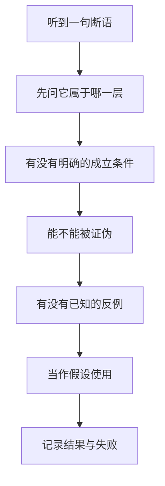

## 一、先把问题摆明

「四柱能不能预测」这句话太糙，没法讨论。它至少包含三个可以分开的主张：

| 主张 | 内容 | 我的判断 |
|---|---|---|
| A | 出生时刻可以唯一换算成四组干支 | **真**。这是历法问题，可独立验算 |
| B | 干支结构与人的人格、际遇存在稳定对应 | **未经证实**。这是核心经验主张，样本与机制都缺 |
| C | 该对应可以被规则化到可重复操作，并具有预测力 | **基本不成立**。判读不可复现，预测无登记 |

三者的可信度差别极大，而市面上绝大多数论述把它们捆在一起卖。**把 A 的确定性借给 C，是这门生意最基本的操作。**

那它属于哪类命题？

- 不是数学命题。数学有公理系统和证明，四柱没有；它的规则是约定，不是定理。
- 不是物理命题。物理有机制、有量纲、有可重复实验；四柱没有机制，只有类比。
- 也不是无意义的胡说。它有明确的操作程序、有内部一致的符号系统、有可检验的候选项——只是从来没人认真检验。

比较接近的类比是**一套解释框架加上一套人格类型学**。它能组织经验、提供词汇、给出叙事，但它不产出可验证的预言。这个定位既不抬高它，也不贬低它。

要让「四柱能预测」成为一个可以被检验的命题，需要三样东西：可操作的量化定义、可重复的判读流程、以及事前登记并可失败的预测记录。三样都缺。**缺的不是努力，是这套体系从来没打算让自己失败。**

## 二、不是科学，也不等于全是骗局

先把三分法摆清楚。这三层的可信度、理由和「能被什么推翻」，完全不同：

| 层级 | 内容 | 可信度 | 理由 | 什么能推翻它 |
|---|---|---|---|---|
| L1 计算 | 节气、干支、日柱、时柱、大运 | 高 | 可独立验算，交叉核对即可 | 算错，或历法定义变更 |
| L2 约定 | 藏干表、十神、长生、刑冲合害、神煞 | 中，仅内部一致 | 规则明确、可复现，但选哪套无外部依据 | 无需推翻，换流派即换结论 |
| L3 经验 | 旺衰、格局、用神、具体断语 | 低 | 依赖师承与样本，不可复现 | **没有任何东西能推翻它** |

注意第三行最后那一格。**L1 与 L2 都有明确的失效方式，L3 没有。** 这不是严谨，这是缺口。

接下来要反对两种极端，它们都很常见。

**极端一：「流传千年，必有道理」。** 这是诉诸传统。流传久只能证明它有功能——有人需要它、它好用、它能维持秩序与安慰（详见第五节）。功能不证明真。针灸的某些疗效可以用生理机制解释，星相学的流行不能用星相学解释。**时间长度不是证据。**

**极端二：「不科学就是骗局」。** 这是范畴错误。不科学的东西可以是有价值的文化实践：诗、棋、宗教仪式、围棋定式，都不科学，也都不是骗局。「骗」需要另一个要件：**明知不实而收费，或制造恐惧牟利。** 一个老人按黄历挑日子搬家，不真，但不是骗；一个大师说「你有血光之灾，交钱可解」，不真，且是骗。**区分「不真」与「骗」，比一棍子打死更有用。**

也顺便拒绝第三种态度：「宁可信其有」。这句话看似谦逊，其实回避了成本——付费的成本、焦虑的成本、以及因为一句断语而放弃某个选择的成本。**不判断，本身也是一种判断，而且是最贵的那种。**

## 三、四个必须承认的问题

不空谈，每个都给机制。

### 问题一：不可证伪

可证伪的意思是：**你必须事先说出「观察到什么，我就错了」。** 四柱的常见断语做不到这一点，原因有三：

1. **断语模糊。** 「中年有波折」「婚姻有磨合」「财上需谨慎」——这类话在任何人的一生里都成立，因此不携带信息。
2. **符号多义。** 一个「冲」可以解释为搬家、换工作、异地、亲人离世、关系变动、手术。一个符号对应十种事件，事后挑一个对上，永远能对上。
3. **可解释空间大。** 八个字之间能拉出的关系有几十种：生克、透藏、合冲、刑害、宫位、神煞。**任何一个结果，都能在盘里找到支持它的三条线索。** 这不是预测，这是在解空间里做搜索。

「伤官见官，为祸百端」是典型：升职受阻是它，与领导吵架是它，辞职是它，打官司也是它。**一个能解释一切的说法，等于什么都没说。**

### 问题二：幸存者偏差

机制很简单：**传播链条只保留命中，删掉落空。**

一个人被说中，会讲给十个人听；一个人没被说中，通常沉默，因为讲了显得自己傻，或者懒得讲。于是你听到的所有案例，都是筛过的。**分母被删掉了，剩下的分子看起来就是 100%。**

举个结构性的例子（数字只为说明，不是统计）：一千个人各被告知「你今年会有一次重要变动」。一年后，总有一部分人确实搬家、换岗、分手、生病、升学——这就是基线率。这些人成为传播者，其余人沉默。于是「他算得真准」被反复讲述，而真实命中率从来没人计算。**你要问的第一个问题永远是：分母是多少。**

### 问题三：巴纳姆效应

1940 年代末，福勒做过一个实验：给全班学生同一份「个性分析」，内容是从星座与人格手册里拼出来的通用句子。学生平均给它打四分以上（满分五分），认为「非常像我」。

四柱断性格的句式高度类似：

- 「你外表随和，内心其实很固执。」
- 「你有能力，但常被人误解。」
- 「你不轻易服人，一旦认了就很难改。」
- 「你重感情，只是不擅长表达。」

这些话的共同点是**基线率高**——大多数人都能认领。再加上人倾向于接受正面描述、忽略不准的部分（选择性接受），命中感就被制造出来了。**不是他说得准，是这些句子对谁都准。**

### 问题四：确认偏误与自我实现

确认偏误：应验的记住，落空的忘掉。这不需要恶意，是记忆的正常工作方式。

更麻烦的是自我实现。被告知「今年犯小人」，人会变得更警觉，更容易把中性的行为读成敌意，于是冲突真的增加；被告知「今年不宜投资」，人会回避机会，于是收益真的没出现；被告知「你命里婚姻不稳」，人在关系里更容易疑神疑鬼，于是关系真的出问题。

**这一条最危险，因为预测改变了被预测的对象。** 一旦如此，事后验证就彻底失效——你无法分清是盘准，还是盘把人推向了那个结果。

## 四、流派分歧是结构性的还是可以调和的

三个真实的分歧，都属于「无法用多算几次解决」的那一类。

**分歧一：旺衰标准。** 月令是不是绝对第一、得地得势怎么折算、从格的门槛在哪里。影响的不是细节，是**用神方向**：身弱要扶，从格要弃，两者相反。为什么不可调和？因为**没有独立于判读的「旺衰」测量**。旺衰本身就是判读结果，用判读去校验判读，是循环论证。

**分歧二：取格方式。** 一派以月令本气取格，看重透干；一派以用神定格，认为格局与用神是一件事。影响格局名称、高低，以及整张盘的用法。两派的经典依据不同，读的不是同一批书，**因此不是「算得细不细」的差别，是「从哪条公理出发」的差别**。

**分歧三：早晚子时。** 23 点到 24 点出生，日柱算当天还是次日。这一条理论上可以裁决——它取决于历法上「日」的边界定义，属于 L1 与 L2 的交界。但传统上两派并行，各写各的书。影响极大：**日柱一换，日主、配偶宫、全部十神都变**，命例六就是活例子。前两个分歧动摇的是结论，这一个动摇的是地基。

为什么「多算几次」解决不了？

1. **这些不是随机误差，是系统性分歧。** 随机误差可以靠增加样本平均掉，系统性分歧不会——它来自不同的起点，多算只会得到更多互相矛盾的结论。
2. **用「准确率」裁决也不行。** 那需要事前预测、对照组、失败登记，而这三样在行业里都不存在。没有分母，就没有准确率。
3. **所以分歧是结构性的。** 它不是因为大家算得不够多、功夫不够深，而是因为**这套体系内部没有裁决机制**。没有裁决机制的知识传统，只能靠权威和师承维持秩序，不能靠事实收敛。

## 五、它为什么还能流传

这一段是描述，不是辩护。**解释一个东西为什么有人用，不等于说它是对的。**

**第一，它提供解释框架。** 人遇到混乱经验时需要语言。「我今年不顺」是散的，「我今年走官杀运，压力大」是有结构的。后者未必真，但它把模糊的痛苦安放进一个有序的格子里，认知负荷立刻下降。**框架的价值在于组织，不在于真伪。**

**第二，它降低焦虑。** 不确定性最难熬。给出一个说法——哪怕是坏说法——往往比悬着更让人安定。这也是为什么「化解」卖得动：人买的不是效果，是「我做了点什么」的掌控感。

**第三，它组织了大量民间社会经验。** 「伤官旺的人不服管」「印重的人想得多做得慢」这类话，剥掉符号外壳，其实是某种性格原型的民间总结。它们可能来自长期的观察积累，只是被错误地归因到出生时刻上。**经验可能是真的，归因可能是错的。** 这两件事要分开看。

**第四，它是文化认同。** 婚丧嫁娶、择日、取名、家族记忆，都缠在这套符号里。对它提质疑，在很多场合等于对长辈提质疑。**这也是为什么讨论它时，情绪往往大于论证。**

把话说透：**有功能，不等于为真。** 安慰剂有效，不等于药有效。你可以承认它安慰了人，同时坚持它没有预测力——这两句话不矛盾。反过来，用「它能安慰人」去堵批评，也不是论证。

## 六、怎么用而不被伤害

五条，可执行。

**第一，不用于医疗与重大决策。** 身体不适就医，不要用五行偏枯解释症状；投资、诉讼、婚姻、职业的断崖式选择，不要以盘为依据。**这些领域的错误代价，远大于任何一条命理建议可能带来的收益。**

**第二，不付费买「化解」。** 识别话术只需要看一个结构：**先制造恐惧，再声称只有他能解除，价格与恐惧强度挂钩。** 这个结构出现在哪个领域，哪个领域就是生意，不是学问。

**第三，不把断语当自我标签。** 「我就是伤官旺，所以脾气差」——这句话的功能是免罪，不是解释。标签一旦内化，人会主动向它靠拢，这叫自我标签化，比算命本身伤害更大。

**第四，不拿它评价他人。** 招聘看八字、择偶看八字、给孩子贴「命硬」的标签，都是把不可申辩的判断强加给别人。**对方连反驳的入口都没有，这是不公平，不是传统。**

**第五，保留「这可能不成立」的余地。** 把每个结论写成假设，而不是事实。「倾向于」「在这个结构下更可能」不是软弱，是准确。**谁要求你无条件相信，谁就在要求你放弃判断。**

## 七、怎么学才不跑偏

**路径只有一条：先历法，后规则，再判断。**

1. **历法（L1）**：节气、干支、日柱、时柱、真太阳时。这一段必须能算对，而且要能用第二种工具交叉验证。算不对，后面全是沙上建塔。
2. **规则（L2）**：藏干、十神、长生、刑冲合害、神煞。这一段要能复现——同一张盘，你和别人用同一套表，结果必须一致。
3. **判断（L3）**：旺衰、格局、用神、断语。这一段要承认自己在猜，并且说清猜的依据。

顺序颠倒的人，一上手就在猜，而且把猜当成算。**这是绝大多数「大师」的真实水平：L1 靠软件，L2 靠背书，L3 靠话术。**

每学一条断语，做三件事：

| 动作 | 具体做法 | 目的 |
|---|---|---|
| 找反例 | 至少找一个结构相同但结果不符的人或盘 | 破除「必然」 |
| 标层级 | 这条属于 L1、L2 还是 L3 | 知道自己几斤几两 |
| 写条件 | 在什么结构下才成立，什么情况下失效 | 把断言变成假设 |

最后给一条硬标准：**可复现。** 同样的输入、同样的规则，别人能不能得到同样的输出？能，才算知识；不能，只是手感。手感可以卖钱，但不能叫学问。

再加一条自己的规矩：**建立失败记录。** 每次做出判断，写下来，标日期，事后核对。不记失败的人，永远会觉得自己的命中率很高。

## 八、给不同读者的建议

**纯文化兴趣。** 不必学排盘。读源流、读术语、读它如何反映时代——尤其是它怎么处理性别、阶层与身体。这套文本里的偏见和它的技术一样值得读。把它当文化史材料，你会收获很多；当预测工具，你会失望。

**想读懂命书。** 先过 L1，排盘必须自己会，否则你永远只能听别人说。再熟 L2 的表，因为那是所有命书的公共索引。然后**只读一本，读透**，不要混读——混读的结果是把三套公理揉成一套，谁的话都能引，自己的结论却站不住。读到断语时，随时反问：成立条件是什么，反例在哪里。

**想从业。** 这一条要说重一点。

- **法律风险。** 不得作绝对化预测与效果承诺。「你有血光之灾」「三个月内必复婚」「交钱可改运」这类表述，可能触及虚假宣传甚至诈骗的边界。医疗、投资、法律意见都有专门资质要求，不能越界提供。具体边界以当地法律与平台规则为准，**别拿「传统文化」当免责条款。**
- **伦理风险。** 不制造恐惧，不给未成年人下断语，不介入他人的重大决定，不替代心理与医疗服务。遇到明显处于心理危机的人，正确做法是转介专业人士，不是加卖一道「化解」。
- **商业底线。** 明码标价，说清这是解释性咨询而不是预测，给出退款机制。**你可以卖一套语言，不能卖一个保证。**

这三条做不到，就别从业。不是道德说教，是这门生意最容易踩的三条线。

## 九、本章小结

- 「四柱能预测」必须拆成三个主张：**排盘可算（真）、结构对应（未经证实）、预测力（基本不成立）**，三者可信度完全不同。
- 四柱**不是科学，也不等于全是骗局**。它是一套有内部规则的解释框架；「不真」与「骗」是两个不同的判断。
- 四个问题都有机制：**不可证伪、幸存者偏差、巴纳姆效应、确认偏误与自我实现**。它们不靠道德批评就能成立。
- 三处分歧是**结构性**的：旺衰标准、取格方式、早晚子时。它们出自不同的公理集，多算不会收敛，因为体系内没有裁决机制。
- 它流传下来，是因为**解释、安慰、经验组织与文化认同**四种功能。这是描述，不是辩护；有功能不等于为真。
- 用法五条，核心是**不用于医疗与重大决策、不买化解、不当标签、不评价他人、保留怀疑余地**。
- 学习路径只有一条：**先历法，后规则，再判断**；每条断语做三件事：找反例、标层级、写条件；唯一硬标准是**可复现**。

**练习**

1. 把「你今年犯小人，事业有阻滞」改写成一句可检验的命题。要求包含：可观察的指标、时间范围、以及「什么情况下算错」。
2. 找三条你听过的命理断语，分别标出它属于 L1、L2 还是 L3，并写出它的成立条件。写不出条件的，划掉。
3. 用本章的四个问题逐条检查一个你相信的说法，再用幸存者偏差、巴纳姆效应、自我实现三条机制，解释「为什么有人算得很准」。不许用「他们被骗了」这种说法。
4. 回看你读这本书之前对四柱的印象，写下一条你现在不再相信的说法，以及一条你认为仍然站得住的说法。

全书到这里结束。如果只带走一句话，我希望是这句：**算得准的部分必须算对，讲得清的部分要标出约定，讲不清的部分要承认在猜。** 三层不混，你就不会被任何人牵着走。
