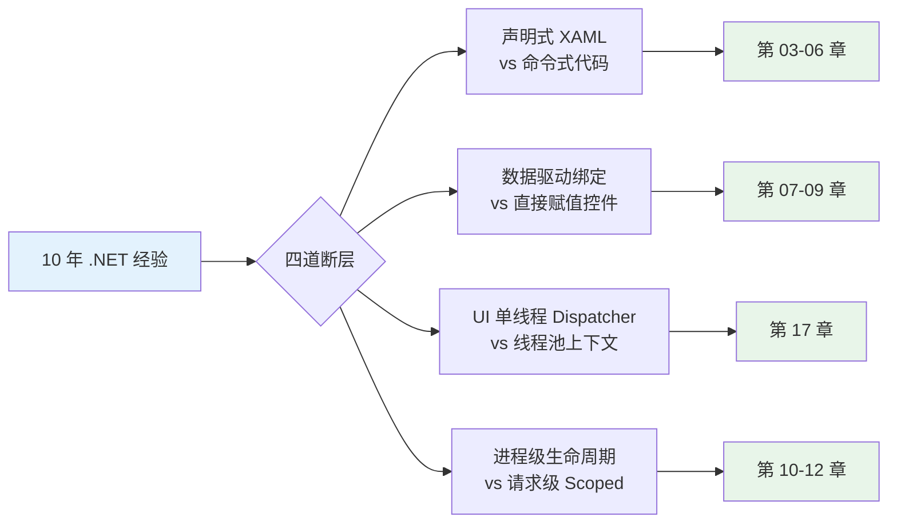
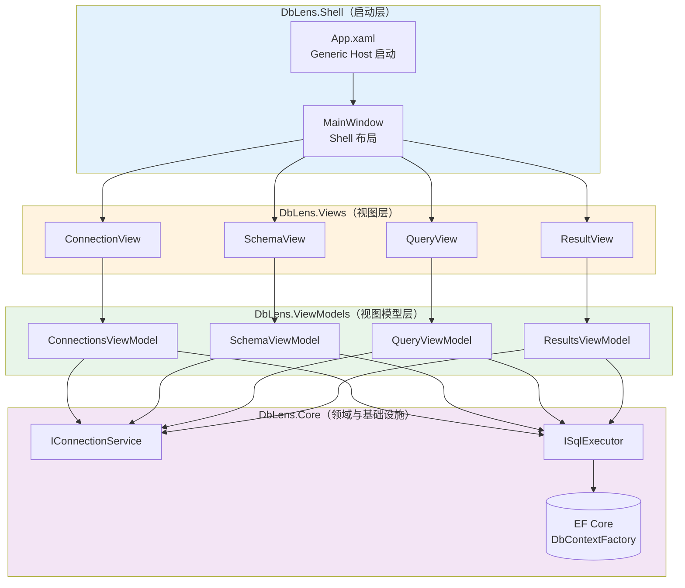

# WPF 给 .NET 老兵的实战课

这不是一本从 `Console.WriteLine` 讲起的 C# 教程。你写了十年 .NET，`async/await`、LINQ、泛型、反射、依赖注入、EF Core 你都熟。你真正缺的是 WPF 那一套**完全不同的界面世界观**：声明式的 XAML、数据驱动的绑定、单线程的 UI、没有请求管道的进程生命周期。

所以本教程只做一件事：**把你已有的服务端认知，精确映射到桌面端**。每一章都有一张「ASP.NET Core / EF Core ↔ WPF」对照表，讲清楚哪些经验可以直接搬，哪些必须丢。

## 你会踩到的四道断层

## 贯穿示例：DbLens

全书只做一个项目：**DbLens**，一个轻量的数据库查询客户端。它不是玩具——连接管理、表结构浏览、SQL 编辑、结果网格、导出、插件式数据源都在里面。

每章的功能都往 DbLens 上加，最后一章结束你应该能 `dotnet publish` 出一个可直接分发运行的桌面程序。

**技术栈**：.NET 10（LTS）、WPF、C# 14、[CommunityToolkit.Mvvm](https://learn.microsoft.com/dotnet/communitytoolkit/mvvm/)、Microsoft.Extensions.Hosting（DI + 配置 + 日志）、EF Core 10 + SQLite。全部是微软一方或官方推荐的库，不引第三方 UI 框架——手写一遍你才知道模板和样式在干什么。

**章节演进路线**：

- 01-06：理解 WPF 的渲染、布局、控件与事件模型，搭出 DbLens 的静态外壳
- 07-09：把静态外壳变成一个能连库、能查表的 MVVM 应用
- 10-13：接上 DI、Host、EF Core，做出可导航的多页面 Shell 与暗色主题
- 14-16：自定义结果网格控件、上万行结果的虚拟化、加载动画
- 17-18：异步查询不卡界面、内存泄漏排查、发布单文件 exe

## 目录

### 基础篇：先建立正确的心智模型

| 序号 | 章节 | 核心内容 |
|------|------|---------|
| 01 | [定位与心智模型](/docs/wpf/01定位与心智模型.html) | WPF 的渲染栈、与 WinForms/MAUI/WinUI 的取舍、四道断层 |
| 02 | [环境与第一个项目](/docs/wpf/02环境与第一个项目.html) | `dotnet new wpf`、项目结构、App/Window 启动流程、BAML |
| 03 | [XAML 与对象图](/docs/wpf/03XAML与对象图.html) | XAML 即构造函数调用、命名空间映射、x: 指令、标记扩展 |
| 04 | [布局系统](/docs/wpf/04布局系统.html) | Measure/Arrange 两趟、Grid 三件套、DIP 与 DPI、布局性能 |
| 05 | [控件与内容模型](/docs/wpf/05控件与内容模型.html) | UIElement→FrameworkElement→Control 继承链、三种模板 |
| 06 | [路由事件与命令](/docs/wpf/06路由事件与命令.html) | 冒泡/隧道事件、Handled、ICommand 与 CanExecute |

### MVVM 篇：WPF 真正的生产力

| 序号 | 章节 | 核心内容 |
|------|------|---------|
| 07 | [数据绑定全解](/docs/wpf/07数据绑定全解.html) | Binding 四要素、UpdateSourceTrigger、Converter、多路绑定、绑定诊断 |
| 08 | [属性通知与集合](/docs/wpf/08属性通知与集合.html) | INotifyPropertyChanged、ObservableCollection、验证与错误提示 |
| 09 | [MVVM 落地](/docs/wpf/09MVVM落地.html) | CommunityToolkit 源生成器、命令、设计时数据、ViewModel 边界 |

### 工程化篇：把它做成一个真项目

| 序号 | 章节 | 核心内容 |
|------|------|---------|
| 10 | [依赖注入与 Host](/docs/wpf/10依赖注入与Host.html) | Generic Host 托管 WPF、Scoped 在桌面端的含义、配置与日志 |
| 11 | [EF Core 数据访问](/docs/wpf/11EFCore数据访问.html) | IDbContextFactory、异步查询、动态结果集、Schema 读取 |
| 12 | [导航与窗口管理](/docs/wpf/12导航与窗口管理.html) | ContentControl + DataTemplate、INavigationService、模态对话框 |
| 13 | [资源、样式与主题](/docs/wpf/13资源样式与主题.html) | 资源查找顺序、Style/Trigger、暗色主题切换、内置 Fluent 主题的取舍 |

### 进阶篇：性能与交付

| 序号 | 章节 | 核心内容 |
|------|------|---------|
| 14 | [自定义控件与依赖属性](/docs/wpf/14自定义控件与依赖属性.html) | DefaultStyleKey、Generic.xaml、依赖属性原理、附加属性 |
| 15 | [集合视图与虚拟化](/docs/wpf/15集合视图与虚拟化.html) | ICollectionView、筛选排序分组、DataGrid 大数据量 |
| 16 | [动画与视觉状态](/docs/wpf/16动画与视觉状态.html) | Storyboard、缓动、VisualStateManager、动画性能 |
| 17 | [异步与 UI 线程](/docs/wpf/17异步与UI线程.html) | Dispatcher、SynchronizationContext、死锁、后台任务与取消 |
| 18 | [诊断、性能与发布](/docs/wpf/18诊断性能与发布.html) | 可视化树诊断、内存泄漏、启动优化、单文件发布 |

## 阅读约定

- **环境**：.NET 10 SDK 及以上，Windows 10/11。Visual Studio 2022 或 Rider 均可，命令行部分统一给 `dotnet` 命令。
- **代码风格**：XAML 用 4 空格缩进，`x:Class` 与文件名一致；C# 用文件范围命名空间（`namespace DbLens.Core;`）。
- **省略说明**：`using` 指令只在必要处保留，XAML 里的 `xmlns` 同理。
- **对应关系**：每章开头的对照表用 `.NET 服务端` / `WPF` 两列，方便你建立映射。
- **不适合谁**：WPF 完全零基础且没有 C# 经验的人。这套教程默认你会写泛型、会用 `Task`、知道什么是接口注入。

如果只想尽快上手干活：01 → 02 → 04 → 06 → 07 → 09 → 10 → 12，这八章能让你写出结构不烂的 WPF 应用；剩下的等真遇到性能或自定义控件需求再回来查。
