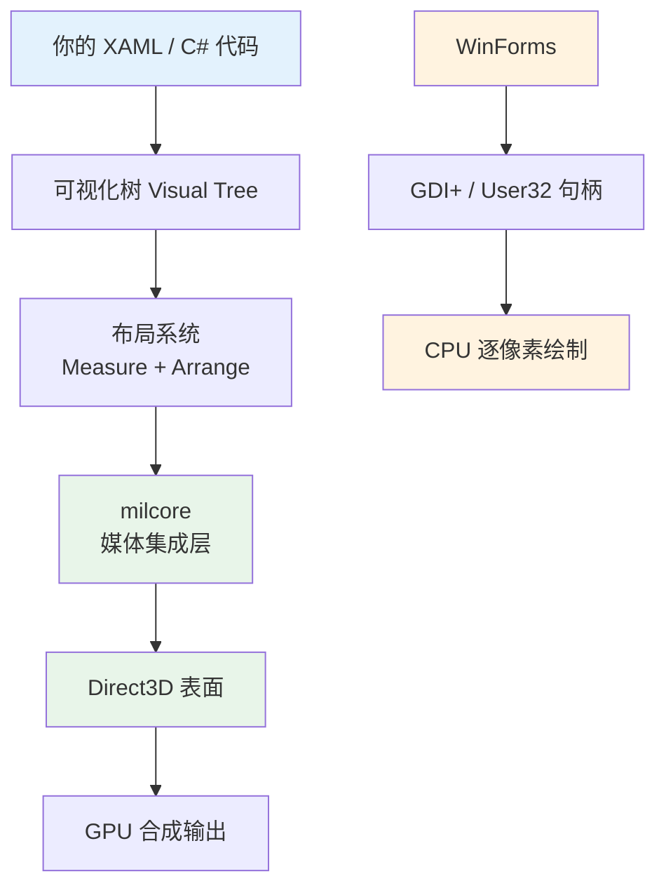

## 一、先给结论：WPF 不是"带控件的 ASP.NET"

你写 ASP.NET Core 时，脑子里有一套稳定的循环：

> 请求进来 → 中间件管道 → 控制器解析参数 → 调用服务 → 返回结果 → 请求结束，作用域销毁

WPF 里没有这套东西。它没有请求，只有一个**长期存活的进程**和一个**单线程的 UI 循环**。你写的每一个对象，从 `App` 到某个按钮的 `Style`，都活在同一个进程里，生命周期从几毫秒到几小时不等，全靠你自己管。

这不是"少了点功能"，而是评价标准换了。服务端评价代码的标准是**吞吐量、并发安全、可水平扩展**；桌面端评价代码的标准是**启动速度、内存占用、交互响应、视觉正确性**。同一个人写这两种代码，直觉经常是反的。

举个最小的例子。服务端你认为天经地义的事：

```csharp
// ASP.NET Core：一次请求一个 DbContext，用完就丢，线程池随便调度
builder.Services.AddDbContext<AppDbContext>(opt => opt.UseSqlite(cs));
```

在 WPF 里直接照搬会出问题：桌面应用的"作用域"是整个进程，`DbContext` 变成长期存活、被多个线程碰、追踪实体无限膨胀、最终内存和并发双爆。第 11 章会用 `IDbContextFactory` 解决，但你现在就要建立一个意识：**服务端的生命周期经验在桌面端基本作废**。

## 二、WPF 的渲染栈：为什么它看起来和 WinForms 不是一个时代

WPF 诞生于 2006 年，核心目标是"用 GPU 画界面"。它的绘制走的是 **milcore**（Media Integration Layer Core），一层把可视化树翻译成 Direct3D 图元的合成引擎。



两个关键差异：

**1. 保留模式（retained mode）而非立即模式（immediate mode）**

WinForms 是立即模式：`OnPaint` 里拿个 `Graphics` 对象，每次重绘你都要把整个界面重新画一遍，窗口被遮挡再恢复，再画一遍。

WPF 是保留模式：你只描述"界面上有什么"，构建出一棵**可视化树**。之后无论缩放、遮挡、动画、透明度变化，引擎自己知道该重绘哪一块。**你不再写绘制代码，你写的是结构描述。**

这就是为什么 WPF 里没有 `OnPaint`，也是为什么 XAML 能存在——如果界面只是"结构的持久化描述"，那它就能被序列化成标记语言。

**2. 所有尺寸都是逻辑单位（DIP），不是像素**

WPF 里 `Width="100"` 不是 100 像素，是 100 DIP（Device Independent Pixel），1 DIP = 1/96 英寸。系统缩放 150% 时，实际渲染成 150 物理像素。WinForms 时代的"高 DPI 糊成一团"，在 WPF 里基本不是问题——前提是你别用像素去算布局。

## 三、和另外五个框架比一比

| 框架 | 渲染方式 | 语言/生态 | 适合谁 | 主要问题 |
|------|---------|----------|--------|---------|
| **WPF** | 保留模式 + DirectX | C# / XAML | Windows 内网工具、业务客户端、需要深度定制 | 只支持 Windows；生态老化但稳定 |
| WinForms | 立即模式 + GDI+ | C# / 设计器 | 极简工具、老系统维护 | 高 DPI 与自定义外观能力弱 |
| WinUI 3 | 保留模式 + DirectX + Fluent | C# / XAML | 要现代 Fluent 外观的商店应用 | 生态与文档远不如 WPF；部署链路重 |
| MAUI | 平台原生控件映射 | C# / XAML | 一套代码多端 | Windows 端就是 WinUI 3，桌面场景弱 |
| Avalonia | 自绘 + Skia | C# / XAML | 要跨平台又不想丢 XAML 心智 | 生态小，第三方控件少 |
| Electron / Tauri | WebView | Web 技术栈 | 前端团队做桌面 | 内存开销大，和 .NET 后端割裂 |

给你一个 2026 年的实用判断：

- **只做 Windows、要长期维护的业务工具** → WPF。它是这个场景下最省心的选择，十年积累的控件、模板、绑定机制没有替代品。
- **要上 Microsoft Store、追 Fluent 风格** → WinUI 3。但做好心理准备，很多 WPF 里的常规操作在 WinUI 3 里要绕路。
- **要跨平台** → Avalonia，或者干脆 MAUI（如果移动端是主战场）。
- **团队是前端背景** → Electron/Tauri，别硬上 WPF。

DbLens 选择 WPF 的理由很朴素：它要访问本地文件、要直连数据库、要展示上万行表格、要单文件分发——这四条 WPF 全占优势。

## 四、四道断层

这是全书的主线，先集中说清楚，后面每章只展开一道。

### 断层一：声明式 XAML vs 命令式代码

在 ASP.NET Core 里，你要一个表格，通常是拼 HTML 字符串或者写 Razor 模板：

```csharp
// 服务端思维：代码执行产生结果
var html = "<table>";
foreach (var row in rows)
    html += $"<tr><td>{row.Name}</td></tr>";
html += "</table>";
```

WPF 里，你写的是**一棵对象的构造过程**：

```xml
<DataGrid ItemsSource="{Binding Tables}">
    <DataGrid.Columns>
        <DataGridTextColumn Header="表名" Binding="{Binding Name}" />
    </DataGrid.Columns>
</DataGrid>
```

关键区别：XAML 不是"模板字符串"，它是**编译产物**。`<DataGrid>` 会被编译成 `new DataGrid()`，属性会被编译成属性赋值，整个 XAML 最终变成 BAML（二进制资源）嵌进程序集。所以 XAML 里写错属性名，是**编译期报错**，不是运行时才发现。

### 断层二：数据驱动 vs 直接赋值控件

这是最容易犯的错。WinForms 出身的写法（被戏称为"code-behind 一把梭"）：

```csharp
// 反模式：手动同步
txtName.Text = user.Name;
btnSave.IsEnabled = user.Name.Length > 0;
// 用户改了 txtName，得自己再写事件回写到 user
```

WPF 的写法是**只声明关系，不搬运数据**：

```xml
<TextBox Text="{Binding User.Name, UpdateSourceTrigger=PropertyChanged}" />
<Button Content="保存"
        Command="{Binding SaveCommand}"
        IsEnabled="{Binding SaveCommand.CanExecute}" />
```

你描述的是"TextBox 的 Text 跟着 `User.Name` 走"，而不是"什么时候把 `user.Name` 赋给 TextBox"。谁改谁、什么时候改、改完通知谁，全交给绑定引擎。

代价是：**你必须让对象具备"可通知"能力**（`INotifyPropertyChanged`），否则引擎不知道值变了。这就是第 08 章的内容。

### 断层三：UI 单线程 vs 线程池上下文

ASP.NET Core 里你不知道也不关心代码跑在哪个线程上，`await` 之后换线程是常态，`HttpContext` 靠 AsyncLocal 流转。

WPF 里所有 UI 元素都属于**创建它的那个 STA 线程**（通常就是主线程），并且是 `DispatcherObject`。跨线程碰 UI 元素会直接抛 `InvalidOperationException`：

> The calling thread cannot access this object because a different thread owns it.

正确姿势是回到 Dispatcher：

```csharp
// 后台线程查询完，更新 UI 必须回来
var rows = await Task.Run(() => ExecuteSql(sql));   // 这里已经在 UI 上下文
Rows.Clear();
foreach (var r in rows) Rows.Add(r);                // 安全，await 已回到 UI 线程
```

`await` 在这里的语义和服务端**不同**：WPF 的 `SynchronizationContext` 会把续体投递回 UI 线程。所以 `await` 之后可以直接碰控件，但如果你在 UI 线程上 `Task.Wait()` 或者 `.Result`，就会**互相等待死锁**——UI 线程等任务，任务等 UI 线程释放。第 17 章专门讲。

### 断层四：进程级生命周期 vs 请求级 Scoped

| 概念 | ASP.NET Core | WPF |
|------|-------------|-----|
| 作用域边界 | 一次 HTTP 请求 | 进程启动到退出（或你自己划的窗口/会话边界） |
| Scoped 的实际含义 | 每请求一个实例 | 几乎没有意义，要么 Singleton 要么 Transient |
| 配置来源 | `appsettings.json` + 环境变量 | 同样可用，第 10 章接 Host |
| 日志 | `ILogger<T>` | 同样可用，但输出到文件/调试窗口才有意义 |
| 异常处理 | 中间件统一兜底 | `Application.DispatcherUnhandledException` + 每处 `try` |
| 优雅关闭 | `IHostedService.StopAsync` | `Application.Exit` / `Window.Closing` |

一句话：**桌面端没有"请求"这个天然的隔离单位，你必须自己设计边界**。DbLens 里我们划成"一个连接会话"——打开连接创建一个 `DbContext`，关闭连接销毁它，这比硬套 Scoped 合理得多。

## 五、先跑起来看一眼

在往下读之前，先确认你的机器能编译 WPF：

```powershell
dotnet --list-sdks        # 需要 8.0 或以上
dotnet new wpf -n Demo
cd Demo
dotnet run
```

如果弹出一个空窗口，环境就没问题。如果报 `NETSDK1100`（在非 Windows 上构建 Windows 应用），检查 `TargetFramework` 是否为 `net10.0-windows`。

## 六、本章小结

- WPF 是**保留模式 + GPU 合成**的渲染框架，界面是"可视化树"，不是"每次重绘的像素"。
- 四处经验会失效：命令式界面构建、手动赋值控件、跨线程随性操作、请求级生命周期。
- 选型上，Windows-only 的业务客户端选 WPF 不会错；跨平台看 Avalonia，追 Fluent 看 WinUI 3。
- 全书用一个数据库查询客户端 DbLens 贯穿，每章往上加一层能力。

**练习**：用 `dotnet new wpf` 建一个空项目，在 `MainWindow.xaml` 里放一个 `Button`，点击后把 `Content` 改成当前时间。然后试着在按钮点击事件里开一个线程去改 `Content`，观察抛出的异常——这就是断层三的第一次碰壁。

下一章把项目结构、启动流程和 XAML 编译链路讲清楚。
