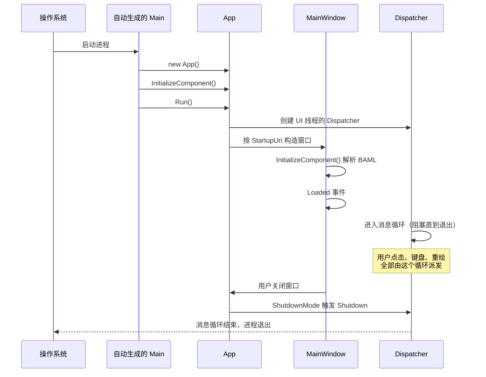
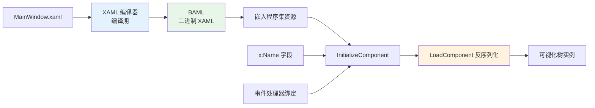

## 一、装什么

| 组件 | 版本要求 | 说明 |
|------|---------|------|
| .NET SDK | 10.0+ | `dotnet --list-sdks` 确认；WPF 只支持 `net10.0-windows` 这类带 `-windows` 的 TFM |
| Windows SDK | 随 VS 安装 | 用 Rider 或纯 CLI 时通常已够，`.NET 10 SDK` 自带 WPF 目标包 |
| 编辑器 | VS 2022 / Rider | VS 需勾选「.NET 桌面开发」工作负载，Rider 开箱可用 |

```powershell
dotnet --info
# 关注两行：Host version 与 Windows SDK 是否出现
```

不需要单独装 .NET Framework。WPF 自 .NET Core 3.0 起就是 .NET 的一部分，DbLens 全程 `.NET 10`。

## 二、最小项目长什么样

```powershell
dotnet new wpf -n DbLens.Shell -o src/DbLens.Shell
```

生成的四个文件，正好对应 WPF 应用的四个支柱：

```
src/DbLens.Shell/
├── App.xaml            ← 应用级资源与启动配置（声明）
├── App.xaml.cs         ← 应用入口类的分部类（代码）
├── MainWindow.xaml     ← 一个窗口的可视化树（声明）
├── MainWindow.xaml.cs  ← 窗口的分部类（代码）
├── AssemblyInfo.cs     ← 主题/资源程序集特性
└── DbLens.Shell.csproj
```

### 2.1 csproj：只有两行是 WPF 特有的

```xml
<Project Sdk="Microsoft.NET.Sdk">
  <PropertyGroup>
    <OutputType>WinExe</OutputType>
    <TargetFramework>net10.0-windows</TargetFramework>
    <Nullable>enable</Nullable>
    <ImplicitUsings>enable</ImplicitUsings>
    <UseWPF>true</UseWPF>
    <AssemblyName>DbLens</AssemblyName>
    <RootNamespace>DbLens</RootNamespace>
  </PropertyGroup>
</Project>
```

- `OutputType=WinExe`：不弹控制台窗口。调成 `Exe` 会多一个黑框，调试 `Console.WriteLine` 时有用。
- `TargetFramework=net10.0-windows`：`-windows` 后缀是硬性要求，否则 `UseWPF` 的 SDK 目标不会导入，编译直接报 `NETSDK1136`。
- `UseWPF=true`：这一行才是真正把 XAML 编译、`PresentationFramework`、`WindowsBase` 等引用全部拉进来的开关。你不需要手写任何 `<Reference Include="PresentationCore" />`。

### 2.2 App.xaml：进程级的"Startup"

如果你熟悉 `Program.cs` 里的 `WebApplication.CreateBuilder`，可以把 `App.xaml` 理解成它的声明版：

```xml
<Application x:Class="DbLens.App"
             xmlns="http://schemas.microsoft.com/winfx/2006/xaml/presentation"
             xmlns:x="http://schemas.microsoft.com/winfx/2006/xaml"
             StartupUri="MainWindow.xaml">
    <Application.Resources>
        <!-- 全局资源会挂到这里，第 13 章大量使用 -->
    </Application.Resources>
</Application>
```

`StartupUri` 是"启动时自动 new 一个窗口并 `Show()`"的语法糖。第 10 章接入 Generic Host 后我们会**删掉它**，改为在 `OnStartup` 里手工创建窗口——因为那时候窗口需要从 DI 容器解析。

```csharp
namespace DbLens;

public partial class App : Application
{
    // 现在可以是空的，启动逻辑由 XAML 的 StartupUri 承担
}
```

### 2.3 MainWindow：`x:Class` 是两者的粘合点

```xml
<Window x:Class="DbLens.MainWindow"
        xmlns="http://schemas.microsoft.com/winfx/2006/xaml/presentation"
        xmlns:x="http://schemas.microsoft.com/winfx/2006/xaml"
        Title="DbLens" Height="720" Width="1200"
        WindowStartupLocation="CenterScreen">
    <Grid>
        <TextBlock Text="Hello DbLens" HorizontalAlignment="Center" VerticalAlignment="Center" />
    </Grid>
</Window>
```

```csharp
namespace DbLens;

public partial class MainWindow : Window
{
    public MainWindow()
    {
        InitializeComponent();
    }
}
```

两点必须理解：

1. **`x:Class` 决定 XAML 编译后挂到哪个类上**。XAML 不是模板，它会被翻译成一个编译期生成的 `partial` 类（`MainWindow.g.cs`），里面包含所有 `x:Name` 字段和 `InitializeComponent()` 方法。
2. **`InitializeComponent()` 不能省**。它内部调用 `Application.LoadComponent(this, resourceLocator)`，把 BAML 反序列化成可视化树挂到 `this` 上。漏掉它，窗口是空的、`x:Name` 字段全是 null。

## 三、启动流程：从 `Main` 到窗口显示

WPF 会**自动生成 `Main` 方法**，你不需要写。编译后在 `obj/` 下能找到它：

```csharp
// obj/Debug/net10.0-windows/App.g.cs（自动生成，不要手改）
[STAThread]
public static void Main()
{
    DbLens.App app = new DbLens.App();
    app.InitializeComponent();
    app.Run();
}
```

注意 `[STAThread]`：WPF 的 UI 线程必须是单线程单元（Single-Threaded Apartment），这是 COM 互操作（拖放、剪贴板、Shell 集成）的要求。自己写 `Main` 时漏了这个特性，运行时会抛 `The calling thread must be STA`。



`Run()` 之后的代码在窗口关闭前**不会执行**，因为它内部是个阻塞的消息泵。想要"启动后做点事又不想阻塞"，别在 `Run()` 后面写，用 `Loaded` 事件或 `Dispatcher.BeginInvoke`。

默认 `ShutdownMode` 是 `OnLastWindowClose`：最后一个窗口关闭即退出进程。如果做成托盘应用（无可见窗口），要改成 `OnExplicitShutdown`，否则关了主窗口直接退出。

## 四、XAML 是怎么变成界面的



这条链路解释了三个日常现象：

- **XAML 里属性名写错是编译错误**，因为在编译期就有类型检查（比 Xamarin/MAUI 早期的纯运行时解析强得多）。
- **改 XAML 后必须重新编译**，BAML 是嵌入资源，不是运行时读的文件。热重载（Hot Reload）就是绕开这条链路的调试特例。
- **反序列化是有成本的**，大页面首次显示慢，一半是在解析 BAML，另一半在布局。

## 五、搭起 DbLens 的骨架

02 章只建两个项目，视图和 ViewModel 先放在 Shell 里，第 09 章再拆出去——**不要一上来就分四个项目**，那是给自己找麻烦。

```powershell
dotnet new sln -n DbLens
dotnet new wpf -n DbLens.Shell -o src/DbLens.Shell
dotnet new classlib -n DbLens.Core -o src/DbLens.Core

dotnet sln add src/DbLens.Shell/DbLens.Shell.csproj
dotnet sln add src/DbLens.Core/DbLens.Core.csproj
dotnet add src/DbLens.Shell reference src/DbLens.Core
```

```
DbLens/
├── DbLens.sln
└── src/
    ├── DbLens.Core/                 ← 无 UI 依赖：领域模型、接口、EF Core
    │   ├── Models/
    │   ├── Services/
    │   └── DbLens.Core.csproj       (net10.0)
    └── DbLens.Shell/                ← 只做界面
        ├── Views/
        ├── ViewModels/
        ├── App.xaml
        └── DbLens.Shell.csproj      (net10.0-windows, UseWPF)
```

**依赖方向必须单向**：Shell → Core，Core 永远不引用 Shell。这条规则在服务端你一定遵守，在桌面端同样成立，而且更重要——它直接决定了 ViewModel 能不能被单元测试。`Core` 用 `net10.0` 而不是 `net10.0-windows`，这是物理上的保证：它**编译不出**对 `System.Windows` 的引用。

## 六、第一次运行和常见坑

```powershell
dotnet run --project src/DbLens.Shell
```

| 现象 | 原因 | 处理 |
|------|------|------|
| `NETSDK1136` | TFM 少了 `-windows` | 改成 `net10.0-windows` |
| 窗口空白、`x:Name` 为 null | 漏了 `InitializeComponent()` | 构造函数里补上 |
| 设计器报"调用的目标发生异常" | 设计时尝试实例化依赖 DI 的 VM | 第 09 章用 `d:DataContext` 解决 |
| 中文乱码 | md/xaml 文件不是 UTF-8 | 保存为 UTF-8（无 BOM 亦可） |
| 双击 exe 闪退无提示 | 未捕获异常 | 第 18 章接 `DispatcherUnhandledException` |
| 高 DPI 下模糊 | 缺少 DPI 感知清单 | 添加 `app.manifest` 并声明 PerMonitorV2 |

顺手把 DPI 清单加上，省得以后返工：

```xml
<!-- app.manifest 片段 -->
<application xmlns="urn:schemas-microsoft-com:asm.v3">
  <windowsSettings>
    <dpiAware xmlns="http://schemas.microsoft.com/SMI/2005/WindowsSettings">true/pm</dpiAware>
    <dpiAwareness xmlns="http://schemas.microsoft.com/SMI/2016/WindowsSettings">PerMonitorV2</dpiAwareness>
  </windowsSettings>
</application>
```

## 七、本章小结

- 一个 WPF 应用 = `App`（进程级配置与消息循环）+ 若干 `Window`（顶级可视化树）。
- `Main` 是编译器生成的，带 `[STAThread]`，内部顺序是 `new App` → `InitializeComponent` → `Run`。
- XAML 编译成 BAML 嵌入程序集，运行时由 `LoadComponent` 反序列化——所以它是编译期检查的。
- 项目依赖保持 Shell → Core 单向，Core 目标框架不带 `-windows`，用编译约束倒逼分层。
- `StartupUri` 只是语法糖，接入 DI 后会被手工创建窗口取代。

**练习**：把 `MainWindow` 的 `ShutdownMode` 改成 `OnExplicitShutdown`，观察关闭窗口后进程是否还在（任务管理器里看）。再用 `Application.Current.Shutdown()` 手动退出——体会"窗口关闭"和"进程结束"是两件独立的事。

下一章进入 XAML，把它当成"对象图的序列化格式"来拆解。
