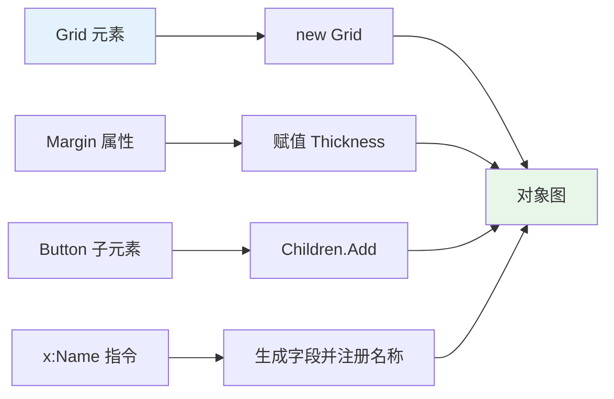
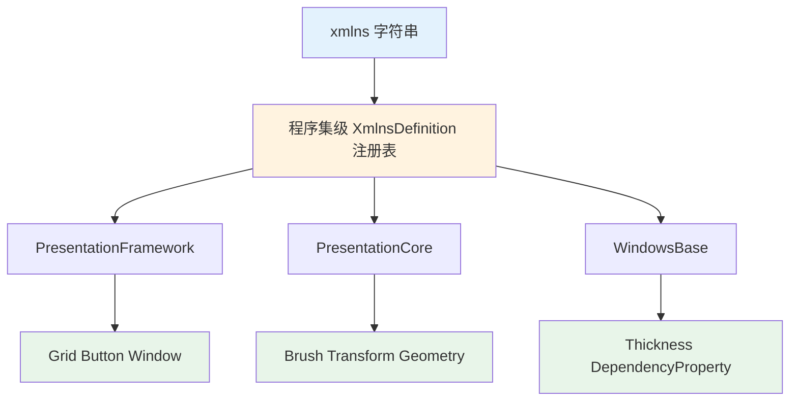

## 一、把 XAML 读成构造调用序列

第 01 章讲断层一时给过一个结论：XAML 不是模板字符串，它会被编译成 `new DataGrid()`。这一章要把这个直觉彻底拆掉：**XAML 是一棵对象图的构造过程被序列化后的样子**，它从头到尾就是命令式代码。

看这段最普通的界面：

```xml
<Grid Margin="8">
    <Button x:Name="ExecuteButton" Content="执行" Width="120" />
</Grid>
```

它和下面的 C# 是同一件事，执行顺序都一致：

```csharp
var grid = new Grid();
grid.Margin = new Thickness(8);

var executeButton = new Button();
executeButton.Content = "执行";
executeButton.Width = 120;
grid.Children.Add(executeButton);
```

对应关系只有三条：

1. **XML 元素 = 一次 `new`**。元素名必须是某个可实例化的 CLR 类型。
2. **XML 属性 = 一次属性赋值**。属性名必须真的存在于该类型上，或者是一个附加属性（见第五节）。
3. **子元素 = 往内容属性里添加**。具体加到哪个属性，由该类型的 `ContentProperty` 决定（见第四节）。



这个视角能直接解释几个日常现象。

**子元素的书写顺序就是绘制顺序。** `Panel.Children` 是一个有序集合，后加进去的元素画在上面。你在 `Grid` 里放两个重叠的 `Border`，谁写在后面谁遮住谁——不是"样式层级"决定的，是 `Add` 的先后决定的。

**`x:Name` 不是一个属性，它不参与对象赋值。** 它告诉编译器"给这个实例生成一个字段"，字段名就是这个名字。第 02 章说过 `InitializeComponent` 里会填充这些字段。

| .NET 服务端 | WPF | 差异要点 |
|------|-----|---------|
| Razor 视图，运行时拼字符串 | XAML，编译期构造对象 | 属性名写错是编译错误，不是运行时异常 |
| `appsettings.json` 的强类型绑定 | TypeConverter 把字符串转成属性值 | 转换发生在解析 XAML 时，用不变文化 |
| DI 容器里的类型注册表 | xmlns + `XmlnsDefinition` | 用字符串 key 映射到程序集和 CLR 命名空间 |
| 中间件的扩展方法 | MarkupExtension | 在解析期"计算出一个值"而不是返回对象本身 |
| 源生成器生成 partial 成员 | `x:Class` 配合 `.g.cs` | 生成的是字段、`InitializeComponent` 和事件挂接 |

## 二、属性元素语法：XAML 里唯一的嵌套写法

`Margin="8"` 这种写法叫属性语法（attribute syntax），值是一段字符串。当值是一个复杂对象、字符串表达不了时，就要用属性元素语法：

```xml
<Button Content="执行">
    <Button.Background>
        <SolidColorBrush Color="#2196F3" />
    </Button.Background>
</Button>
```

等价的 C#：

```csharp
var button = new Button { Content = "执行" };
button.Background = new SolidColorBrush((Color)ColorConverter.ConvertFromString("#2196F3"));
```

这里最容易产生的误读是：`<Button.Background>` 看起来像 `Button` 的一个子元素，于是有人写成 `<Button><Background>...</Background></Button>`，编译直接失败。正确的心智模型是：**`类型.属性名` 是一个赋值目标，尖括号里包着的是"要赋给它的那个对象"**。点号左边的类型必须是当前元素的类型或它的基类，这样编译器才知道你说的是哪个属性。

什么时候**必须**用属性元素语法：值是没有 TypeConverter 的复杂对象（`LinearGradientBrush`、`Geometry`）；需要给嵌套对象设 `x:Name` 或挂事件；需要往集合属性里塞多个对象（`Grid.RowDefinitions`）；需要组合 `x:Static`、`x:Type` 这类指令。

内联写法每次都 `new` 一个新实例，而 `{StaticResource}` 取到的是同一个实例——这个差别在第 13 章讲主题时会变成关键。

## 三、xmlns 不是网址，是程序集里的命名空间索引

每个 XAML 文件开头都有这两行，多数人复制粘贴十年也没想过它们是什么：

```xml
xmlns="http://schemas.microsoft.com/winfx/2006/xaml/presentation"
xmlns:x="http://schemas.microsoft.com/winfx/2006/xaml"
```

这两个字符串**不会被下载**，它们只是字典的 key。WPF 的几个程序集在编译时用 `XmlnsDefinitionAttribute` 把自己注册到第一个 key 上：

```csharp
[assembly: XmlnsDefinition("http://schemas.microsoft.com/winfx/2006/xaml/presentation",
    "System.Windows.Controls")]
[assembly: XmlnsDefinition("http://schemas.microsoft.com/winfx/2006/xaml/presentation",
    "System.Windows.Media")]
```

所以默认 xmlns 能同时找到 `Grid`（在 `System.Windows.Controls`）、`SolidColorBrush`（在 `System.Windows.Media`）、`Thickness`（在 `System.Windows`）——它们来自不同程序集、不同 CLR 命名空间，但都注册到了同一个 key 下。XAML 编译器拿到 key 之后，展开成"程序集 + 命名空间"的清单，再按元素名去找类型。



`x:` 前缀对应的是第二个 key，它注册的是 `System.Windows.Markup` 里的类型——`MarkupExtension`、`StaticExtension`、`TypeExtension` 这些。换句话说，**不带前缀的是"某个控件的命名空间"，带 `x:` 的是"XAML 语言本身的命名空间"**。这就是为什么 `x:Class`、`x:Name` 这类东西看起来不像控件，因为它们确实不是控件，是语言指令。

引用自己的类型要写 `clr-namespace`：

```xml
<Window x:Class="DbLens.MainWindow"
        xmlns="http://schemas.microsoft.com/winfx/2006/xaml/presentation"
        xmlns:x="http://schemas.microsoft.com/winfx/2006/xaml"
        xmlns:views="clr-namespace:DbLens.Views"
        xmlns:core="clr-namespace:DbLens.Core.Models;assembly=DbLens.Core">
```

规则只有一条：**同程序集可省略 `assembly=`，跨程序集必须写程序集名（不带 `.dll`），并且大小写敏感**。

## 四、内容属性：为什么子元素可以直接放

`<Button>确定</Button>` 这行能成立，是因为 `ContentControl` 上标了 `[ContentProperty(nameof(Content))]`。XAML 解析器遇到一个没有属性名的子元素时，会去查当前类型的 `ContentProperty`，然后把子元素交给那个属性：如果属性是集合就 `Add`，否则直接赋值。

所以：

```xml
<Button>确定</Button>
<Button Content="确定" />
```

完全等价，都是 `button.Content = "确定"`。而：

```xml
<Button>
    <TextBlock Text="确定" />
</Button>
```

是 `button.Content = textBlock`。`Content` 的类型是 `object`，字符串和控件都收得下，这就是"按钮里能放任意内容"的全部秘密。

内置类型的内容属性就那几个，记住就能预测 XAML 怎么写：

| 类型 | ContentProperty | 值类型 | 子元素的去向 |
|------|-----------------|--------|-------------|
| `ContentControl`（`Button`、`Label`、`TabItem`） | `Content` | `object` | 直接赋值 |
| `ItemsControl`（`ListBox`、`TreeView`、`Menu`） | `Items` | `ItemCollection` | 逐个 `Add` |
| `Panel`（`Grid`、`StackPanel`、`Canvas`） | `Children` | `UIElementCollection` | 逐个 `Add` |
| `TextBlock` | `Inlines` | `InlineCollection` | 逐个 `Add` |
| `Border` | `Child` | `UIElement` | 直接赋值 |

`Grid` 里能直接放子元素，走的是第三行；`Border` 里只能放一个子元素，走的是第五行——多放一个直接编译报错。

## 五、x: 指令速查

`x:` 开头的都不是控件属性，而是给编译器的指令。真正需要背的就七个：

| 指令 | 作用 | 等价 C# |
|------|------|---------|
| `x:Class` | 指定 XAML 挂到哪个 CLR 类 | `partial class` 的另一半 |
| `x:Name` | 生成字段并注册到名称作用域 | 私有字段 + `FindName` |
| `x:Key` | 资源字典的键 | `dictionary["key"]` |
| `x:Static` | 引用静态字段、属性或常量 | `Type.Member` |
| `x:Type` | 得到 `Type` 对象 | `typeof(T)` |
| `x:Array` | 在 XAML 里构造数组 | `new T[] { ... }` |
| `x:Null` | 显式赋 `null` | `null` |

`x:Static` 的典型用法是把系统画刷的 key 传给动态资源，这在写主题时很常见：

```xml
<Setter Property="Background"
        Value="{DynamicResource {x:Static SystemColors.ControlBrushKey}}" />
```

`x:Type` 一般出现在 `Style` 和 `DataTemplate` 上：

```xml
<Style TargetType="{x:Type Button}">
    <Setter Property="Padding" Value="12,4" />
</Style>
```

`x:Array` 用得少，但必要时能省掉一个转换器：`Type` 指定元素类型，子元素就是数组项。`x:Null` 则用来显式清空属性，调试"是没赋值还是赋了空对象"时很好用。

## 六、TypeConverter：字符串到对象的翻译官

`Width="100"` 里 `100` 是字符串，`Width` 是 `double`。这中间的转换由 **TypeConverter** 完成，流程是固定的：

1. XAML 解析器拿到字符串，查到目标属性的类型。
2. 通过 `TypeDescriptor.GetConverter(targetType)` 找到对应转换器。
3. 调 `ConvertFromInvariantString` 得到强类型值。
4. 赋值。

注意最后一步用的是**不变文化**。`"1.5"` 在任何系统区域设置下都解析成一点五，不会因为逗号小数点的差异炸掉——这和服务端 `double.Parse(s)` 随环境漂移的经验正好相反。

内置转换器覆盖了日常写法：

| 文本 | 目标类型 | 转换器 | 结果 |
|------|---------|--------|------|
| `100` | `double` | `LengthConverter` | `100` |
| `Auto` | `double` | `LengthConverter` | `double.NaN` |
| `10` | `Thickness` | `ThicknessConverter` | 四边都是 10 |
| `10,5` | `Thickness` | `ThicknessConverter` | 左右 10，上下 5 |
| `10,5,10,5` | `Thickness` | `ThicknessConverter` | 左 10 上 5 右 10 下 5 |
| `2*` | `GridLength` | `GridLengthConverter` | 两倍星号 |
| `#2196F3` | `Brush` | `BrushConverter` | 对应的 `SolidColorBrush` |
| `Collapsed` | `Visibility` | 枚举转换器 | `Visibility.Collapsed` |

最常被误记的是 `Margin="10,5"`：它不是"左边 10、上边 5"，而是"水平 10、垂直 5"，会被复制成 `Thickness(10, 5, 10, 5)`。只有四个值时才是左、上、右、下，`Padding` 同理。

`GridLength` 的 `"2*"` 也值得多说一句：它不是字符串里塞了个乘号，`GridLengthConverter` 会识别 `*` 后缀并生成 `GridLength(2, GridUnitType.Star)`。第 04 章讲 Grid 分配空间时，这个值就是权重。

如果转换失败，错误发生在**编译期**：`Width="abc"` 在 Build 阶段就报错。

## 七、标记扩展：不是值，是"取值的函数"

`{Binding Name}` 这种带花括号的写法叫标记扩展。它的本质是：**编译器看到 `{Xxx ...}`，会 `new` 一个 `XxxExtension` 对象，然后调用它的 `ProvideValue`，把返回值赋给属性**。

`Binding` 本身就是一个标记扩展（`BindingBase` 继承自 `MarkupExtension`），`{StaticResource}` 对应 `StaticResourceExtension`，`{DynamicResource}` 对应 `DynamicResourceExtension`。所以你写：

```xml
<TextBlock Text="{Binding Name}" />
```

翻译过来是：

```csharp
var binding = new Binding { Path = new PropertyPath("Name") };
textBlock.SetBinding(TextBlock.TextProperty, binding);
```

`ProvideValue` 的调用时机是**解析 BAML 的时候**，也就是运行时。这解释了为什么 `{Binding}` 能拿到当时才存在的 `DataContext`，而 `x:Static` 可以在编译期就确定。

自己写一个最小的标记扩展，比读十遍文档管用：

```csharp
using System;
using System.Windows.Markup;

namespace DbLens.Markup;

/// <summary>输出当前年份，可用于关于对话框。</summary>
[MarkupExtensionReturnType(typeof(string))]
public sealed class BuildYearExtension : MarkupExtension
{
    public override object ProvideValue(IServiceProvider serviceProvider)
        => DateTime.Now.Year.ToString();
}
```

```xml
<TextBlock Text="{mk:BuildYear}" />
```

使用时声明 `xmlns:mk="clr-namespace:DbLens.Markup"` 即可。两个约定要记住：

- **类名必须以 `Extension` 结尾**，XAML 里才能省略后缀。写成 `BuildYear` 的话，标记里得写 `{mk:BuildYearExtension}`。
- 标记里的位置参数会传给构造函数，命名参数会赋给属性。`{Binding Name}` 等价于 `{Binding Path=Name}`，靠的就是接收 `string path` 的构造函数。

## 八、附加属性：点号为什么能出现在属性名里

XML 的属性名允许包含 `.` 和 `-`，所以 `Grid.Row="1"` 在语法上是合法的，不需要转义。XAML 解析器看到点号，会把它拆成"类型 + 属性"，然后调用：

```csharp
Grid.SetRow(button, 1);
```

也就是说，`Grid.Row` 不是 `Button` 的属性，是 `Grid` 提供的**附加属性**（attached property）。`Grid` 里必须成对提供静态的 `SetRow` / `GetRow`，并且注册一个附加依赖属性：

```csharp
public static readonly DependencyProperty RowProperty =
    DependencyProperty.RegisterAttached(
        "Row", typeof(int), typeof(Grid),
        new PropertyMetadata(0));

public static int GetRow(UIElement element) => (int)element.GetValue(RowProperty);

public static void SetRow(UIElement element, int value) => element.SetValue(RowProperty, value);
```

设计上很巧妙：**值存在子元素自己的属性表里，语义却由父面板解释**。同一个 `Button` 可以同时带 `Grid.Row` 和 `Canvas.Left`，换父容器也不用重新登记位置。

常用的附加属性就几组：`Grid.Row` / `Grid.Column` / `Grid.RowSpan` / `Grid.ColumnSpan`、`DockPanel.Dock`、`Canvas.Left` / `Canvas.Top`、`Panel.ZIndex`，以及 `ScrollViewer` 的滚动条可见性。最后这组让父级行为由子元素声明，是附加属性最典型的用法。

依赖属性的完整机制（元数据、继承、只读、强制值）在第 14 章展开，现在只需要会用。

## 九、编译产物：BAML 与 `x:Name` 字段

第 02 章讲过 XAML → BAML → `LoadComponent` 的链路，这里补上编译器的另一半工作：生成分部类。

`x:Name="RootGrid"` 会在 `MainWindow.g.cs` 里变成一个字段，默认是 `internal`：

```csharp
// obj/Debug/net10.0-windows/MainWindow.g.cs（自动生成，结构已简化）
public partial class MainWindow : Window
{
    internal Grid RootGrid;
    private bool _contentLoaded;

    public void InitializeComponent()
    {
        if (_contentLoaded) return;
        _contentLoaded = true;
        var locator = new Uri("/DbLens;component/mainwindow.xaml", UriKind.Relative);
        Application.LoadComponent(this, locator);
    }

    private void Connect(int connectionId, object target)
    {
        // 按 connectionId 把解析出来的元素赋给上面的字段
    }
}
```

这段代码解释了三件事：`x:Name` 生成的字段就是同一个类的成员，所以 code-behind 里能直接用；`Connect` 里会生成 `RootGrid.Click += OnExecuteClick;` 这样的挂接代码，方法签名对不上就编译失败；`g.cs` 和你的 `.xaml.cs` 必须是同一个 `partial` 类，改 `x:Class` 就会分家。

字段默认 `internal` 是有意为之：视图不该被别的程序集直接操作内部控件。真要暴露，用 `x:FieldModifier="public"`，但大多数时候这说明你的分层出了问题。

## 十、什么时候该写 code-behind

这是老兵最容易翻车的地方。写了十年 MVC，你习惯了"Controller 收参数、调服务、返回结果"，到了 WPF 就很自然地把 `.xaml.cs` 当 Controller 用：按钮事件里查数据库、拼 SQL、算业务规则。这样写出来的东西只能靠手点来验证。

判断标准很简单：**这段代码能不能在一个没有 UI 的控制台项目里被单元测试？能，它就不该待在 `.xaml.cs` 里。**

| 适合放 code-behind | 不适合放 |
|------|---------|
| 焦点转移、选中项同步 | 数据库访问、HTTP 调用 |
| 窗口关闭前的确认 | 业务规则、金额计算 |
| 拖放、剪贴板、文件对话框 | 校验逻辑（该在 ViewModel 或领域层） |
| 第三方控件的互操作 | 页面状态、列表数据 |
| 纯视觉的动画触发 | 任何需要被复用的逻辑 |

DbLens 里 `QueryView.xaml.cs` 只干三件事：打开文件对话框导入 SQL、在编辑器里定位错误行、响应 `Ctrl+滚轮` 缩放字号。执行查询、保存历史、格式化结果全在 ViewModel，第 09 章会把它们变成命令。

## 十一、踩坑清单

| 现象 | 原因 | 处理 |
|------|------|------|
| 属性名拼错，编译报"成员不存在" | XAML 在编译期做类型检查，且大小写敏感 | 按 CLR 属性名改，注意 `Content` 不是 `content` |
| `{Binding}` 显示成字面量文本 | 漏了花括号，被当普通字符串 | 属性值以 `{` 开头才会走标记扩展 |
| `{StaticResource Accent}` 找不到资源 | 资源定义在引用之后，查找只向上、不向后 | 把资源提到更上层，或改用 `{DynamicResource}` |
| 属性值里的 `&` 编译报错 | XML 实体未转义 | 写成 `&amp;` |
| 自写标记扩展在 XAML 里找不到 | 类名没加 `Extension` 后缀 | 改名，或标记里写全名 |
| 模板里的元素 `FindName` 返回 null | 元素属于模板的名称作用域 | 用 `Template.FindName` 或遍历可视化树（第 05 章） |

## 十二、本章小结

- XAML 元素是 `new`、属性是赋值、子元素是往 `ContentProperty` 里加，整份文件就是一段有序的构造脚本。
- `xmlns` 是程序集级 `XmlnsDefinition` 注册表的 key；`x:` 是 XAML 语言自己的命名空间，不是控件的。
- `{...}` 是标记扩展，本质是 `new XxxExtension().ProvideValue()`；TypeConverter 则负责字符串到强类型值的翻译，两者都在解析 BAML 时执行。
- 附加属性用 `类型.属性` 的语法设置，值存在子元素上、语义由父容器解释。
- code-behind 只放视图自身的行为，能进控制台单测的逻辑一律搬走。

**练习**：一、写一个 `MarkupExtension`，叫 `EnvExtension`，接收一个环境变量名并返回其值，在 `TextBlock` 里显示 `DOTNET_ENVIRONMENT`；再把它改成带默认值的命名参数版本（`{local:Env DOTNET_ENVIRONMENT, Fallback=Production}`）。二、在 `Grid` 里放三个重叠的 `Border`，只调整它们在 XAML 里的书写顺序，观察遮挡关系的变化，验证"顺序即绘制顺序"。

下一章讲布局，看看这棵对象图是怎么被测量、被分配空间的。
