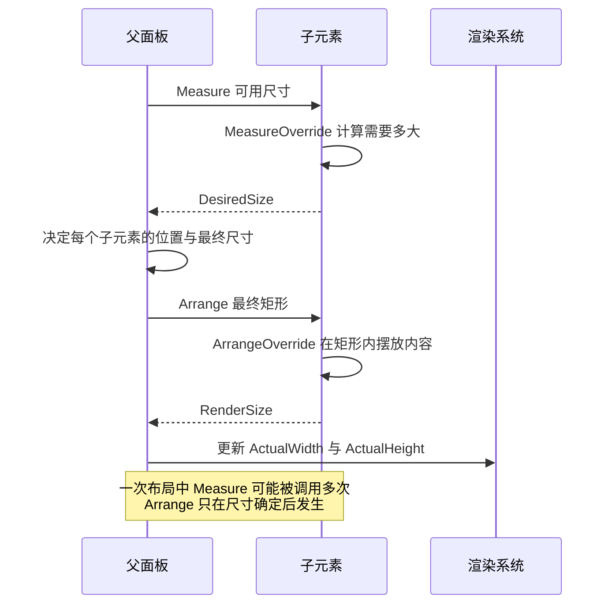
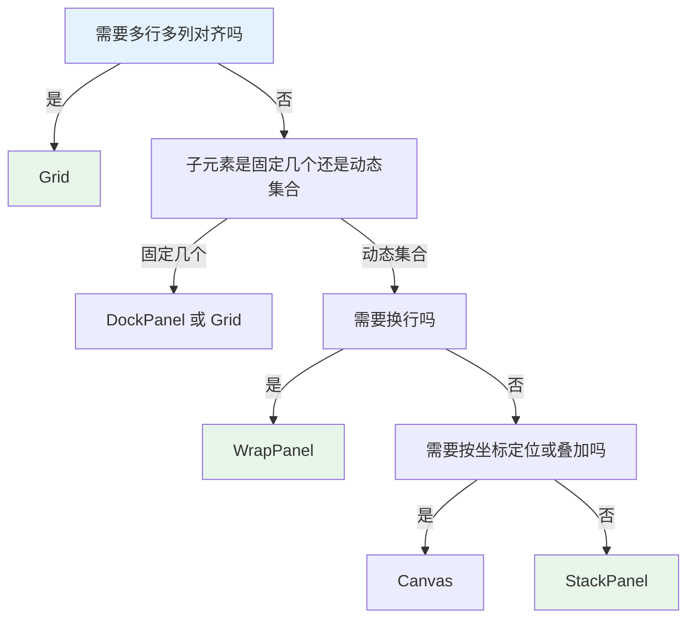
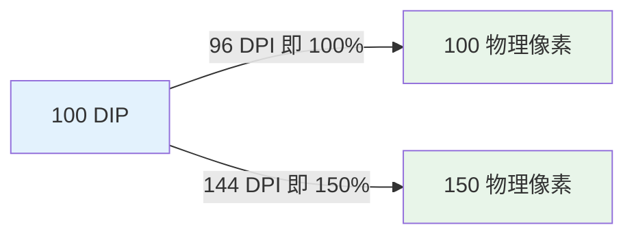

## 一、布局不是"设置坐标"

WinForms 出身的程序员对布局的直觉是：给控件设 `Location` 和 `Size`，它就待在那儿。WPF 没有这套东西——`FrameworkElement` 上根本没有 `Location`，`Left` / `Top` 只存在于 `Canvas` 的附加属性里，而 `Canvas` 恰恰是最不推荐用的容器。

WPF 的布局是**父容器与子元素的一次协商**：父容器说"我最多给你这么大"，你回答"我需要这么大"，父容器再决定最终占哪块。你只实现"需要多大"和"在给定矩形里怎么摆内容"。

这个模型和 CSS 的 flex / grid 很像，但它发生在**桌面窗口的固定视口**里，没有浏览器那种"内容撑高页面"的兜底。窗口尺寸固定，溢出必须显式处理。这一章要解决的就是：让约束收敛，以及 `Grid` 怎么分配空间。

| .NET 服务端 / Web | WPF | 差异要点 |
|------|-----|---------|
| CSS flex / grid 由浏览器算 | Measure / Arrange 由 WPF 布局系统算 | 算法类似，但没有文档流和自动滚动兜底 |
| 响应式断点 | `Grid` 星号 + `MinWidth` | 尺寸是连续计算的，不是离散档位 |
| 页面高度由内容撑开 | 窗口高度固定 | 溢出必须显式处理 |
| CSS px 与设备无关 | DIP，1/96 英寸 | 缩放时由系统统一换算 |
| 服务端拼 HTML 字符串 | 保留模式可视化树 | 布局结果会缓存，失效才重算 |

## 二、两趟：Measure 与 Arrange

每一个 `FrameworkElement` 参与布局时，都会经历两个方法：

```csharp
public void Measure(Size availableSize);   // 第一趟：你需要多大
public void Arrange(Rect finalRect);       // 第二趟：你被分到这块，自己摆
```

`Measure` 传入父容器能给的最大空间，执行完读 `DesiredSize`。`Arrange` 传入最终矩形，执行完读 `RenderSize`，而 `ActualWidth` / `ActualHeight` 就是 `RenderSize` 的宽高。**你从来没有直接设置过 `ActualWidth`，它是布局算出来的结果。**



为什么非要两趟？因为**父容器必须先知道所有子元素想要多大，才能决定怎么分空间**。`Grid` 要先把 `Auto` 列量出来，才知道剩下的给星号列分多少；`StackPanel` 要累加所有子元素的高度，才知道自己总共需要多高。反过来，子元素也不能自己决定位置——它不知道旁边还有谁。

这就带来两个必须记住的推论。

**第一，`Measure` 可能被调用多次，不能有副作用。** 父容器为了算 `Auto` 尺寸，常常先用无限大测一遍、再用实际约束测一遍。在 `MeasureOverride` 里改状态或发请求，就会看到莫名其妙的重入。

**第二，`DesiredSize` 是"我想要"，不是"我得到"。** 你想要 500 宽，父容器只给 300，`Arrange` 就只给你 300。所以 `ActualWidth` 常常小于 `DesiredSize.Width`。判断"控件为什么被压扁"，要看父容器给了多少，而不是子元素报了多少。

`DesiredSize` 里**包含 `Margin`**。父容器调 `Measure` 时已经把你的 `Margin` 从可用空间里扣掉，回填时再把你报的尺寸加上 `Margin`。这也是为什么 `ActualWidth`（不含 margin）和 `DesiredSize.Width`（含 margin）经常差一圈。

失效与重算由这几个方法触发：

```csharp
element.InvalidateMeasure();    // 尺寸可能变了，需要重新测量
element.InvalidateArrange();    // 尺寸没变但位置要重排
element.UpdateLayout();         // 强制立刻走完一趟（少用，会打断批处理）
```

布局是**延迟批处理**的：连续改十个属性，框架只在下一个渲染周期跑一次布局，不会改一个算一次。这是动画能保持流畅的原因之一。反过来，如果你读 `ActualWidth` 发现还是旧值，那是布局还没跑——`UpdateLayout()` 能强制同步，但更常见的做法是把依赖布局结果的代码放到 `Loaded` 之后。

## 三、Margin 与 Padding

这两个概念在 CSS 里叫 margin / padding，含义一致，但 WPF 里有个坑：**不是所有控件都有 `Padding`**。

| 属性 | 含义 | 谁有 | 举例 |
|------|------|------|------|
| `Margin` | 元素**外面**的留白，影响自己在父容器里占的槽 | 所有 `FrameworkElement` | 两个按钮之间的间距 |
| `Padding` | 元素**里面**的留白，影响内容和边框的距离 | `Control`、`Border`、`TextBlock` 等 | 按钮文字离边框的距离 |

`Grid` 没有 `Padding`。给 `Grid` 写 `Padding="8"` 会直接编译失败，正确做法是外面套一个 `Border`，或者给子元素加 `Margin`。`StackPanel` 也没有。判断方法：看它是否继承自 `Control`，或者本身是 `Border`、`TextBlock` 这类有内边距语义的元素。

`Margin` 允许负值。`Margin="-10,0,0,0"` 会让元素往左溢出，用来做重叠效果，但溢出部分不参与父容器的尺寸计算。

## 四、对齐与尺寸：谁是建议，谁是命令

`Width` / `Height` 是**建议**，`HorizontalAlignment` / `VerticalAlignment` 决定**在分到的槽里怎么摆**。两者的组合决定了最终行为：

| `Width` | `HorizontalAlignment` | 结果 |
|---------|----------------------|------|
| 未设置 | `Stretch`（默认） | 填满父容器给的槽 |
| 未设置 | `Left` / `Center` / `Right` | 按 `DesiredSize` 的宽度摆放，不拉伸 |
| 已设置 | `Stretch` | `Width` 生效，视觉上等同居中 |
| 已设置 | `Left` | 靠左，`Width` 生效 |

很多人第一次遇到"我设了 `Width` 怎么不靠左"就是第三行：`Stretch` 遇到固定尺寸会让位，元素按固定宽度居中。想靠左就显式写 `HorizontalAlignment="Left"`。

`MinWidth` / `MaxWidth` 是硬约束，优先级高于 `Width` 和 `Stretch`。做可拖拽分栏时，`MinWidth` 比 `Width` 重要得多——它决定了用户能不能把某一栏拖到 0 像素。

## 五、Grid：把空间分配讲透

`Grid` 是 WPF 里唯一值得花时间学透的容器，其余都是它的补充。它的核心是三个尺寸模式：

```xml
<Grid>
    <Grid.ColumnDefinitions>
        <ColumnDefinition Width="240" />        <!-- 固定：永远 240 -->
        <ColumnDefinition Width="Auto" />       <!-- 自动：内容想要多宽就多宽 -->
        <ColumnDefinition Width="2*" />         <!-- 星号：按权重分剩余空间 -->
        <ColumnDefinition Width="1*" />
    </Grid.ColumnDefinitions>
</Grid>
```

分配顺序是固定的：

1. 先满足所有固定值。
2. 再测量所有 `Auto`，取内容期望的尺寸（这一列/行的子元素会用无限大约束去测）。
3. 剩下的空间按星号权重分。上面例子是 2:1，如果总剩余 600，两列分别拿 400 和 200。

**星号不是百分比**。`2*` 和 `1*` 是相对权重，加一个 `3*` 进去，比例就变成 2:1:3。想让某列占 1/3，写 `1*` 且别的列也写 `1*`，而不是写 `33%`。

**星号在无限空间里会退化成 `Auto`**。这是最重要的一条：如果 `Grid` 的可用宽度无限大（典型场景是被放进了水平 `ScrollViewer` 或水平 `StackPanel`），星号列没有剩余空间可分，只能按内容尺寸排。于是"明明写了 `*`，列却被撑得特别宽、还出现了横向滚动条"。原因不在 `Grid`，在约束不收敛。

`Grid.RowSpan` / `Grid.ColumnSpan` 用来跨行跨列，做工具条、状态栏、分割线时很常用。跨行跨列会让 `Auto` 尺寸的计算变复杂，别在大表格里滥用。

`SharedSizeGroup` 解决"多个 Grid 的列宽要对齐"的问题。默认情况下每个 `Grid` 独立算尺寸，两列都写 `Auto` 也会各算各的。要让它们共享，得在共同的祖先上打开作用域：

```xml
<Grid Grid.IsSharedSizeScope="True">
    <Grid.ColumnDefinitions>
        <ColumnDefinition Width="Auto" SharedSizeGroup="LabelColumn" />
    </Grid.ColumnDefinitions>
</Grid>
```

注意 `SharedSizeGroup` **只对 `Auto` 生效**。它适合表单标签对齐，不适合大列表——共享尺寸会引入额外的跨容器测量。

`ShowGridLines="True"` 是调试属性，能画出网格线，但颜色和线型都改不了。只在调布局时临时打开，提交前删掉。

最后是性能：**嵌套过深是布局最大的开销来源**。每一层 `Grid` 都会多一次测量与排列，`Auto` 列还会引发多轮测量。五层嵌套的卡片出现在滚动列表里两百次，就会明显卡顿。能用一层 `Grid` 加 `RowSpan` 解决，就别套三层 `StackPanel`。

## 六、其他 Panel 与选择口诀

| 容器 | 测量行为 | 适合 | 不要用来 |
|------|---------|------|---------|
| `Grid` | 按行列分配，最可控 | 主界面骨架、表单、任何需要对齐的布局 | 纯线性排列（杀鸡用牛刀） |
| `StackPanel` | 沿方向无限约束子元素 | 工具条按钮、垂直表单、少量项 | 承载大量数据（无虚拟化） |
| `DockPanel` | 按 `Dock` 依次占用边缘 | 上下左右贴边的框架 | 需要精确比例的中部区域 |
| `WrapPanel` | 按可用宽度换行 | 标签云、筛选芯片 | 数据量大且需滚动 |
| `UniformGrid` | 每格等分 | 九宫格、键盘、色板 | 内容尺寸差异大的场景 |
| `Canvas` | 不约束子元素，按坐标摆放 | 画板、覆盖层、拖拽画布 | 常规界面布局 |

`DockPanel` 有个容易忘的默认值：`LastChildFill="True"`。最后一个子元素会填满剩余空间，不管你有没有写 `Dock`。所以主体内容要写在最后。

`Canvas` 为什么尽量不用：它不参与约束协商，子元素尺寸不会反过来影响 `Canvas`，也没有自动滚动，窗口一大一小就全乱。更关键的是，它放弃了对齐、边距、`Stretch`，等于退回 WinForms 的绝对定位。



## 七、ScrollViewer 的无限约束

`ScrollViewer` 的测量方式很特殊：为了让内容能滚动，它必须先把子元素放到**无限大**的空间里测一遍，拿到内容的完整期望尺寸，再决定滚动范围。

这个"无限"会一路传下去。如果里面是一个垂直 `StackPanel`，它会用无限高度测量每个子元素，所有子元素全部实例化、全部测量，因为 `StackPanel` 没有"只创建可见项"的概念。结果就是：**放一万行数据，它真的会造一万个元素**，启动几秒钟，内存几百兆。

虚拟化（`VirtualizingStackPanel`）能解决这个问题，但前提是**有有限的视口**——它要知道"现在能显示 20 行"，才敢只创建 25 个容器。而 `ScrollViewer` 里的 `StackPanel` 把视口约束弄丢了，虚拟化无从谈起。

所以在 WPF 里遇到"数据量大就卡"，先检查三件事：容器是不是 `StackPanel` 或 `Canvas`（它们不虚拟化）；`ItemsControl` 的 `ItemsPanel` 是不是 `VirtualizingStackPanel`；外层 `ScrollViewer` 的 `CanContentScroll` 是不是 `true`。第 15 章会把这些展开成完整的诊断流程。现在只需要建立一个条件反射：**看到 `ScrollViewer` 里套 `StackPanel`，就知道这里迟早要出事**。

## 八、Viewbox、DIP 与像素对齐

`Viewbox` 的作用是把子元素整体缩放以填满自己。它的实现不是重新布局，而是测完子元素后加一个缩放变换。默认 `Stretch="Uniform"`，等比缩放。

它很容易被滥用。`Viewbox` 会连文字一起缩放，14 号字在 150% 缩放后看起来会糊。做"大屏看板按比例缩放"可以用，做正常业务界面不要用——用户调整窗口大小时，按钮不该跟着变大变小。

`Width="100"` 的单位是 DIP。第 01 章说过 1 DIP = 1/96 英寸，缩放 150% 时渲染成 150 物理像素：



两个像素级属性值得在根元素上打开：

```xml
<Window UseLayoutRounding="True" SnapsToDevicePixels="True" ...>
```

`UseLayoutRounding` 让布局结果对齐到物理像素边界，能消除"1 像素边框看着模糊"的问题。`SnapsToDevicePixels` 影响渲染阶段的边缘对齐，主要针对细线和边框。两者都打开基本没有副作用，代价是极窄的线会被取整。

## 九、把 DbLens 的主界面搭起来

把第 02 章的空窗口填成 Shell：上方工具条、左侧连接树、中间 SQL 编辑区、下方结果区、底部状态栏，两条分隔条。

```xml
<Window x:Class="DbLens.MainWindow"
        xmlns="http://schemas.microsoft.com/winfx/2006/xaml/presentation"
        xmlns:x="http://schemas.microsoft.com/winfx/2006/xaml"
        Title="DbLens" Height="760" Width="1280"
        WindowStartupLocation="CenterScreen"
        UseLayoutRounding="True">

    <Grid>
        <Grid.RowDefinitions>
            <RowDefinition Height="Auto" />
            <RowDefinition Height="*" />
            <RowDefinition Height="Auto" />
        </Grid.RowDefinitions>

        <!-- 工具条 -->
        <ToolBarTray Grid.Row="0">
            <ToolBar>
                <Button Content="新建连接" />
                <Button Content="执行" />
                <Separator />
                <TextBlock Text="未选择连接" VerticalAlignment="Center" Margin="8,0" />
            </ToolBar>
        </ToolBarTray>

        <!-- 主体：左树 + 分隔条 + 右侧上下分区 -->
        <Grid Grid.Row="1">
            <Grid.ColumnDefinitions>
                <ColumnDefinition Width="240" MinWidth="160" />
                <ColumnDefinition Width="Auto" />
                <ColumnDefinition Width="*" MinWidth="320" />
            </Grid.ColumnDefinitions>

            <TreeView Grid.Column="0" BorderThickness="0" />

            <GridSplitter Grid.Column="1" Width="4"
                          HorizontalAlignment="Stretch" VerticalAlignment="Stretch"
                          ResizeDirection="Columns"
                          ResizeBehavior="PreviousAndNext"
                          Background="Transparent" />

            <Grid Grid.Column="2">
                <Grid.RowDefinitions>
                    <RowDefinition Height="2*" MinHeight="120" />
                    <RowDefinition Height="Auto" />
                    <RowDefinition Height="*" MinHeight="100" />
                </Grid.RowDefinitions>

                <!-- SQL 编辑区 -->
                <TextBox Grid.Row="0"
                         AcceptsReturn="True" AcceptsTab="True"
                         FontFamily="Cascadia Mono" FontSize="14"
                         TextWrapping="NoWrap"
                         VerticalScrollBarVisibility="Auto"
                         HorizontalScrollBarVisibility="Auto" />

                <GridSplitter Grid.Row="1" Height="4"
                              HorizontalAlignment="Stretch" VerticalAlignment="Stretch"
                              ResizeDirection="Rows"
                              ResizeBehavior="PreviousAndNext"
                              Background="Transparent" />

                <!-- 结果区 -->
                <DataGrid Grid.Row="2"
                          AutoGenerateColumns="True"
                          IsReadOnly="True"
                          CanUserAddRows="False" />
            </Grid>
        </Grid>

        <StatusBar Grid.Row="2">
            <StatusBarItem Content="就绪" />
        </StatusBar>
    </Grid>
</Window>
```

这段 XAML 用到了前面讲的几乎所有点：

- 外层三行是 `Auto` / `*` / `Auto`，工具条和状态栏按内容高度，中间吃满剩余——最经典的 Shell 骨架。
- 左侧 240 固定宽，中间分隔条 `Auto`，右侧 `*` 吃掉剩下的。给两侧加 `MinWidth`，用户就拖不坏。
- **两个 `GridSplitter` 都设了 `Background="Transparent"`**。背景默认是 `null`，`null` 不参与命中测试，用户点上去没反应，看起来就是"拖不动"。

## 十、踩坑清单

| 现象 | 原因 | 处理 |
|------|------|------|
| 设了 `Width` 却不靠左 | `HorizontalAlignment` 默认 `Stretch`，遇固定尺寸退化为居中 | 显式设 `Left` |
| 星号列在滚动区域里变成很宽 | 可用宽度无限，`*` 退化成 `Auto` | 给上层确定宽度，或改用 `Grid` 行布局 |
| `GridSplitter` 拖不动 | `Background` 为 `null`，不参与命中测试 | 设 `Background="Transparent"` |
| `Grid` 写 `Padding` 编译失败 | `Grid` 没有 `Padding` | 外套 `Border`，或给子元素加 `Margin` |
| 边框发虚、1 像素线像 2 像素 | 布局落在半像素 | 根元素开 `UseLayoutRounding` |
| 行高被撑得很大 | `Auto` 行里的文本不换行 | 设 `TextWrapping` 或限制宽度 |
| 布局改完 `ActualWidth` 还是旧值 | 布局批处理尚未执行 | 读之前 `UpdateLayout()`，或改到 `Loaded` 后处理 |

## 十一、本章小结

- 布局是两趟协商：`Measure` 报 `DesiredSize`，`Arrange` 拿 `RenderSize`，`ActualWidth` 是结果而非输入。
- `DesiredSize` 含 `Margin`，`ActualWidth` 不含；被压扁时要看父容器给了多少。
- `Grid` 按"固定 → `Auto` → 星号权重"分配；星号在无限约束下退化为 `Auto`。
- `StackPanel` 沿排列方向无限约束子元素，`ScrollViewer` 也会传递无限约束，两者叠加会杀死虚拟化。
- `Margin` 在元素外、`Padding` 在元素内，`Grid` 没有 `Padding`；主界面用 `Grid` + `MinWidth` + `GridSplitter` 最稳。

**练习**：一、把上面的 DbLens 主界面改成"结果区在右、编辑器在左"的左右布局，要求两侧都能拖拽且都不能被拖到 200 像素以下。二、故意把外层 `Grid` 换成垂直 `StackPanel`，再运行一次，观察 SQL 编辑区的滚动条为什么消失——用 `Measure` 的约束解释这个现象。

下一章看这棵树上的控件到底是怎么被"画"出来的，以及模板为什么能换掉一个控件的全部外观。
