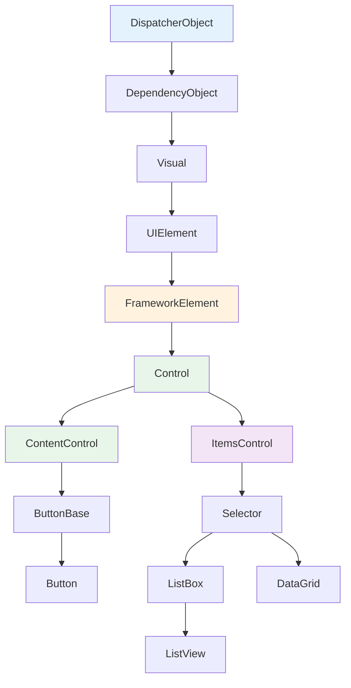
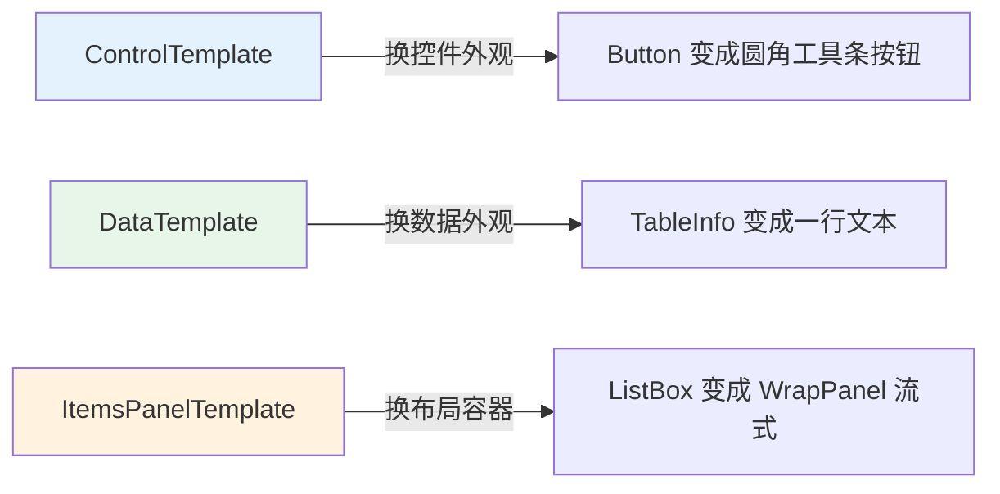
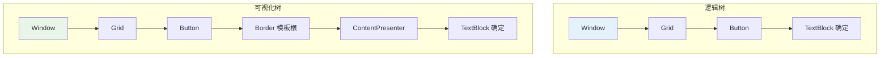

## 一、控件不是画出来的零件

从 WinForms 过来的人对"控件"的理解通常是：一个矩形区域，内部有一段绘制代码，负责把自己画成按钮的样子。所以第一次看到 WPF 里"按钮可以是一个圆角矩形加图标，也可以是一段视频"，本能反应是"这得自定义绘制吧"。

不是。WPF 的控件是**语义容器**：`Button` 只负责"我是可点击的、我有内容、我有命令"，至于长什么样，由它的 `Template` 决定。这一章要解决的就是控件的能力来源与内容模型。你写 `<Button Content="执行" />` 时，框架做的事是：构造一个 `Button` 对象，把 `"执行"` 塞进 `Content`，然后套上主题里那套默认模板，模板里有 `Border`、有 `ContentPresenter`、有触发器。**外观是模板的产物，不是控件的本体。**

这个设计带来两个直接后果。好消息是：换外观不用改控件，写个 `ControlTemplate` 就能把按钮变成任何形状。坏消息是：控件的"能力"分散在继承链的每一层上，你不清楚某属性从哪来，就很难判断它该在哪一层被覆盖。

| .NET 服务端 | WPF | 差异要点 |
|------|-----|---------|
| Controller 返回 `ViewResult` | `ContentControl` + `ContentTemplate` | 内容与呈现分离 |
| 集合序列化成 JSON | `ItemsControl` + `ItemsSource` | 容器由框架生成 |
| ViewComponent 复用片段 | `DataTemplate` / `UserControl` | 一个换数据外观，一个换结构 |
| 基类 `ControllerBase` 提供上下文 | `FrameworkElement` 提供 `DataContext` | 上下文沿树向下继承 |
| 抽象基类约束子类契约 | 中间基类（`HeaderedContentControl` 等） | 复用属性与模板契约，不是业务抽象 |

## 二、继承链：每一层加了什么能力

WPF 里几乎所有可见元素都走这条链：



每一层只加一类能力，记住这个分层比背 API 有用得多。

**`DispatcherObject`：线程亲和。** 它持有创建自己的 `Dispatcher`，提供 `CheckAccess()` / `VerifyAccess()`。第 01 章的断层三就源于这一层——跨线程碰 UI 会抛异常，判断依据就在这里。所有派生类都继承这个约束。

**`DependencyObject`：依赖属性。** `GetValue` / `SetValue`，以及附加属性的存储。这一层让属性可以支持样式、绑定、动画、继承、默认值，第 14 章会拆开讲。你现在只需要知道：**WPF 里绝大多数属性不是普通 CLR 属性，而是依赖属性**。

**`Visual`：渲染节点。** 它把自己接进可视化树，提供变换、裁剪、透明度、命中测试的底层能力。`Visual` 没有布局概念，也没有样式，它只是"能被画出来的东西"。

**`UIElement`：布局输入与输入事件。** `Measure` / `Arrange` / `DesiredSize` 在这一层；鼠标、键盘、触控、拖放这些输入事件也在这一层；路由事件机制同样在这里落地。`IsEnabled`、`Visibility`、`Focusable`、`IsHitTestVisible` 也都是 `UIElement` 的。

**`FrameworkElement`：布局参数与数据上下文。** `Width` / `Height` / `Margin` / `MinWidth` / `HorizontalAlignment`、`ActualWidth`、`DataContext`、`Style`、`Resources`、`Name`、`Tag`、`Loaded` / `Unloaded`。第 04 章的布局协商全是这一层定义的。日常写 ViewModel 绑定，靠的也是这一层的 `DataContext`。

**`Control`：可模板化的外观。** `Template`、`Background`、`BorderBrush`、`BorderThickness`、`Padding`、`Foreground`、`FontFamily`、`FontSize`、`IsTabStop`、`TabIndex`。到了这一层，元素才有"换模板"的能力，也才有"默认样式来自主题"这件事。

**`ContentControl`：单一内容。** `Content`、`ContentTemplate`、`ContentTemplateSelector`、`HasContent`。

**`ItemsControl`：集合内容。** `Items`、`ItemsSource`、`ItemTemplate`、`ItemsPanel`、`ItemContainerStyle`、`ItemContainerGenerator`。

一个实用的判断方法：**问"这个属性在哪一层"就知道它能不能被样式批量设置、能不能被模板里的 `TemplateBinding` 引用**。`IsEnabled` 在 `UIElement`，所有元素都有；`Padding` 在 `Control`，`Grid` 就没有；`Content` 在 `ContentControl`，`ItemsControl` 没有。

## 三、ContentControl：内容是一个对象

`Content` 的类型是 `object`，不是 `string`。这一点决定了它的全部灵活性：

```xml
<!-- 内容是字符串 -->
<Button Content="执行" />

<!-- 内容是一个对象，由 DataTemplate 决定怎么显示 -->
<Button Content="{Binding SelectedConnection}" Command="{Binding ConnectCommand}">
    <Button.ContentTemplate>
        <DataTemplate>
            <StackPanel Orientation="Horizontal">
                <Ellipse Width="8" Height="8" Fill="#4CAF50" Margin="0,0,6,0" />
                <TextBlock Text="{Binding Name}" />
                <TextBlock Text="{Binding Database}"
                           Foreground="#757575" Margin="4,0,0,0" />
            </StackPanel>
        </DataTemplate>
    </Button.ContentTemplate>
</Button>

<!-- 内容是一个完整的面板 -->
<Button>
    <StackPanel Orientation="Horizontal">
        <TextBlock Text="执行" />
        <TextBlock Text="F5" Foreground="#9E9E9E" Margin="8,0,0,0" />
    </StackPanel>
</Button>
```

如果没有 `ContentTemplate`，`ContentPresenter` 会退化成"把对象 `ToString()` 显示出来"。所以绑定一个自定义类型却不给模板，按钮上就会出现 `DbLens.Core.Models.ConnectionProfile` 这种字符串——新手经常以为是绑定失败，其实绑定成功了，只是没有"怎么显示"的规则。

`ContentTemplate` 的查找顺序值得记一下：先看 `ContentTemplate`，再看 `ContentTemplateSelector`，最后才回退到隐式 `DataTemplate`（按内容类型匹配）和 `ToString`。第 07 章讲数据模板匹配时会再回到这条链。

`Button` 里能放任意内容，是因为 `ButtonBase` 继承自 `ContentControl`，而 `ContentPresenter` 在处理 `UIElement` 类型的内容时，会直接把它挂进可视化树。所以"按钮里放一个 `Grid`"不是特殊能力，是内容模型的自然结果。

## 四、ItemsControl：三件套

`ItemsControl` 处理"一组数据"，比 `ContentControl` 多两个维度：**每一项怎么显示**、**这些项放在什么容器里**。三件套就是答案：

```xml
<ListBox ItemsSource="{Binding Tables}">
    <!-- 每一项的外观 -->
    <ListBox.ItemTemplate>
        <DataTemplate>
            <StackPanel Margin="0,2">
                <TextBlock Text="{Binding Name}" FontWeight="SemiBold" />
                <TextBlock Text="{Binding RowCount, StringFormat={}{0:N0} 行}"
                           Foreground="#757575" FontSize="11" />
            </StackPanel>
        </DataTemplate>
    </ListBox.ItemTemplate>

    <!-- 承载所有项的容器 -->
    <ListBox.ItemsPanel>
        <ItemsPanelTemplate>
            <VirtualizingStackPanel />
        </ItemsPanelTemplate>
    </ListBox.ItemsPanel>
</ListBox>
```

`ItemsSource` 接收任何 `IEnumerable`。赋值之后 `Items` 集合就变成只读视图，你不能再往 `Items` 里 `Add`——两者是互斥的。要动态增删，用 `ObservableCollection<T>` 作为 `ItemsSource`，第 08 章讲集合通知。

`ItemsControl` 自己不创建 `ListBoxItem`，这件事由 `ItemContainerGenerator` 做。你给的 `DataTemplate` 会被套进容器里，容器再被放进 `ItemsPanel`。所以"我的数据项为什么点不中/选不中"，答案往往在容器层，而不是模板层。

`ListBox` / `ListView` / `DataGrid` 的关系是层层加码：

| 类型 | 在 `ItemsControl` 之上加了什么 | DbLens 里的用途 | 为什么不用更简单的 |
|------|------------------------------|----------------|------------------|
| `ItemsControl` | 只有生成，没有选中 | 筛选芯片、状态标签组 | 不需要选中语义 |
| `ListBox` | `Selector`：选中项、`SelectionChanged` | 连接列表、查询历史 | 单选/多选是核心交互 |
| `ListView` | `View` 属性 + `GridView` 列 | 早期表结构列表 | 要多列但对编辑无要求 |
| `DataGrid` | 列、排序、编辑、复制、行虚拟化 | 查询结果集 | 需要列宽、排序、单元格操作 |

结论很直接：**结果集用 `DataGrid`，连接列表用 `ListBox`，纯展示用 `ItemsControl`**。别用 `ListView` 去做 `DataGrid` 的活，它没有单元格编辑、没有列排序，最后你会写一堆补丁。

## 五、中间基类：为什么要有它们

除了主线，WPF 还有一层"中间基类"，它们不直接出现在界面里，但决定了常用控件的形态：

| 基类 | 加了什么 | 派生控件 |
|------|---------|---------|
| `HeaderedContentControl` | `Header` + `Content` 两套内容 | `TabItem`、`GroupBox`、`Expander` |
| `HeaderedItemsControl` | `Header` + `Items` | `MenuItem`、`TreeViewItem`、`ToolBar` |
| `RangeBase` | `Minimum` / `Maximum` / `Value` / `ValueChanged` | `Slider`、`ProgressBar`、`ScrollBar` |
| `Selector` | 选中状态与选择事件 | `ListBox`、`ComboBox`、`ListView` |
| `ButtonBase` | `Click` 事件、按下状态、`Command` | `Button`、`RepeatButton`、`ToggleButton` |

这些基类的存在意义是**模板契约复用**：`TabItem` 和 `GroupBox` 的视觉完全不同，但它们都需要"一个标题 + 一块内容"，于是共用 `Header` 和 `Content` 两个属性，主题里的模板只要各写各的布局就行。你自定义控件时也应该这样考虑：先找有没有合适的中间基类，而不是直接从 `Control` 起手。第 14 章会用到这条经验。

## 六、三种模板：各换各的东西

WPF 里叫"模板"的有三个，职责完全不重叠，混淆它们是初学阶段最常见的错误。

**`ControlTemplate` 换控件的外观。** 它替换的是控件"长什么样"，内容和逻辑都还在：

```xml
<Style x:Key="ToolbarButton" TargetType="{x:Type Button}">
    <Setter Property="Background" Value="#2196F3" />
    <Setter Property="Foreground" Value="White" />
    <Setter Property="Padding" Value="12,5" />
    <Setter Property="Template">
        <Setter.Value>
            <ControlTemplate TargetType="{x:Type Button}">
                <Border x:Name="Root"
                        Background="{TemplateBinding Background}"
                        CornerRadius="3"
                        Padding="{TemplateBinding Padding}">
                    <ContentPresenter HorizontalAlignment="Center"
                                      VerticalAlignment="Center" />
                </Border>
                <ControlTemplate.Triggers>
                    <Trigger Property="IsMouseOver" Value="True">
                        <Setter TargetName="Root" Property="Background" Value="#1976D2" />
                    </Trigger>
                    <Trigger Property="IsEnabled" Value="False">
                        <Setter TargetName="Root" Property="Opacity" Value="0.4" />
                    </Trigger>
                </ControlTemplate.Triggers>
            </ControlTemplate>
        </Setter.Value>
    </Setter>
</Style>
```

要点：`TemplateBinding` 把控件上的属性单向引到模板内部；`ContentPresenter` 负责把 `Content` 放进来——**漏了它，按钮就是空白的**，这是自定义模板的第一大坑。触发器在模板内部响应控件状态，替代了 WinForms 里手写 `MouseEnter` 改颜色。

**`DataTemplate` 换数据的外观。** 它描述"一个业务对象应该长什么样"，和控件无关：

```xml
<DataTemplate x:Key="TableItemTemplate" DataType="{x:Type core:TableInfo}">
    <StackPanel Orientation="Horizontal">
        <TextBlock Text="{Binding Schema}" Foreground="#9E9E9E" />
        <TextBlock Text="." Foreground="#9E9E9E" />
        <TextBlock Text="{Binding Name}" FontWeight="SemiBold" />
    </StackPanel>
</DataTemplate>
```

它可以用在 `ContentTemplate`、`ItemTemplate`、`DataGridTemplateColumn.CellTemplate` 上，也可以只写 `DataType` 不写 `x:Key`，变成"遇到这个类型就自动套用"的隐式模板。

**`ItemsPanelTemplate` 换项的布局容器。** 它只决定"这些项放在什么面板里"：

```xml
<ItemsControl ItemsSource="{Binding SchemaChips}">
    <ItemsControl.ItemsPanel>
        <ItemsPanelTemplate>
            <WrapPanel />
        </ItemsPanelTemplate>
    </ItemsControl.ItemsPanel>
</ItemsControl>
```

三者可以叠加：`ItemsPanelTemplate` 决定外壳怎么排，`ItemTemplate` 决定每项长什么样，`ControlTemplate` 决定承载它们的那个控件（比如 `ListBox`）长什么样。



## 七、逻辑树与可视化树

你在 XAML 里写的结构是**逻辑树**：`Window` → `Grid` → `Button`。运行时真正参与渲染的是**可视化树**：`Button` 展开成 `Border` → `ContentPresenter` → `TextBlock`，外面还可能有 `AdornerDecorator`。



这个区别解释了一个高频疑问：`x:Name` 明明写了，`FindName("Xxx")` 却返回 `null`。原因是**名称作用域**。`x:Name` 注册在它所在的那份 XAML 的名称作用域里；`ControlTemplate` 是另一份独立的 XAML，里面的名字不在窗口的作用域中。所以：

```csharp
// 窗口里的元素，这样找得到
var grid = (Grid)FindName("RootGrid");

// 模板里的元素，得通过模板找
var border = button.Template.FindName("Root", button) as Border;

// 或者遍历可视化树
var presenter = FindVisualChild<ContentPresenter>(button);

static T? FindVisualChild<T>(DependencyObject parent) where T : DependencyObject
{
    for (var i = 0; i < VisualTreeHelper.GetChildrenCount(parent); i++)
    {
        var child = VisualTreeHelper.GetChild(parent, i);
        if (child is T match) return match;
        var found = FindVisualChild<T>(child);
        if (found is not null) return found;
    }
    return null;
}
```

`Template.FindName` 还有个前提：模板已经应用过（控件已经加载并完成 `ApplyTemplate`），否则内部元素还没生成。这也是为什么在构造函数里找模板元素总是失败，得等 `Loaded`。

这条会一路用到第 14 章（自定义控件的 `PART_` 契约）和第 18 章（可视化树诊断）。

## 八、DbLens 的控件选型

控件很多，但在 DbLens 里真正需要做决定的就这几个：

| 控件 | 位置 | 选择理由 |
|------|------|---------|
| `TextBox` | SQL 编辑区 | 初版用它最省事：多行、可选中、支持等宽字体；第 14 章再换成带行号的自定义控件 |
| `ComboBox` | 连接选择 | 单选且允许 `IsEditable` 临时输入过滤 |
| `CheckBox` | "仅显示前 100 行" | 纯二元状态，不需要命令 |
| `DataGrid` | 结果区 | 列自动生成、排序、复制、行虚拟化都是现成的 |
| `TabControl` | 多查询页 | 内容模型天生适合放多个 `View`，第 12 章做导航 |
| `TreeView` | 连接与表结构 | 层级数据 + 按需展开 |
| `Menu` | 主菜单 | `HeaderedItemsControl`，天然支持子菜单和命令 |
| `StatusBar` | 底部状态 | 本质是 `ItemsControl`，方便追加多个状态项 |

反过来，几个"看起来能用"的控件要克制：`ListView` 不要拿来当表格用（列排序和编辑都没有）；`ItemsControl` 不要拿来做大数据列表（没有虚拟化）；`Expander` 不要用来做主要导航（折叠状态不受 ViewModel 控制，除非你额外绑定 `IsExpanded`）。

## 九、为什么不要把业务塞进 Control

写惯了服务端的人，看到 `Control` 这个基类很容易产生"那我就继承它写个 `QueryGrid`，把执行 SQL 的逻辑放进去"的冲动。这条路是错的，原因不是"不优雅"，而是三个具体问题：

1. **不可测。** `Control` 需要 `Dispatcher` 和 STA 线程才能实例化，单元测试里造不出来。
2. **不可复用。** 业务逻辑和 `DataGrid` 绑死后，换个皮肤或换个数据源就得改控件本身。
3. **不可组合。** WPF 的模板机制假设控件是"哑"的，逻辑越重，模板越难写，主题切换越容易崩。

正确的分层是：

- **`UserControl`**：把多个控件组合成一个可复用的视图片段，比如"连接卡片"。它可以有 code-behind，但只处理视图行为。
- **`DataTemplate`**：只为"数据长什么样"负责，逻辑全在 ViewModel。
- **自定义 `Control`**：只在需要全新交互语义时写（比如带行号和高亮的 SQL 编辑器），并且它必须是通用的、不含 DbLens 业务知识的。第 14 章会用一个自定义结果网格演示这条边界。

## 十、踩坑清单

| 现象 | 原因 | 处理 |
|------|------|------|
| 按钮上显示类名 | `Content` 是对象，没有模板时回退 `ToString()` | 加 `ContentTemplate` |
| `ItemsSource` 赋值后 `Items.Add` 抛异常 | 两者互斥 | 用 `ObservableCollection<T>` 作为数据源 |
| `ControlTemplate` 里内容不见了 | 漏了 `ContentPresenter` | 模板里补上，并放在正确位置 |
| 模板里的元素 `FindName` 为 null | 名称作用域不同，或模板未应用 | `Template.FindName` + 确保已 `Loaded` |
| 换成 `WrapPanel` 后长列表卡顿 | 失去虚拟化 | 数据量大时保留 `VirtualizingStackPanel` |
| 自定义 `Control` 跑起来一片空白 | 没有默认样式，`DefaultStyleKey` 未设置 | 第 14 章：写 `Themes/Generic.xaml` 并设 `DefaultStyleKey` |
| `ListBox` 里按钮点击后选中项不对 | 鼠标事件被 `ListBoxItem` 先处理 | 用命令 + `CommandParameter`，或 `PreviewMouseDown`（第 06 章） |

## 十一、本章小结

- 控件是语义容器，外观来自 `ControlTemplate`；属性能力按继承链分层，知道属性在哪一层就知道它能不能被样式或模板使用。
- `ContentControl` 的 `Content` 是 `object`，靠 `ContentTemplate` 决定显示方式，否则回退 `ToString()`。
- `ItemsControl` 的三件套是 `ItemsSource`、`ItemTemplate`、`ItemsPanelTemplate`；容器由 `ItemContainerGenerator` 生成。
- 三种模板职责分明：换外观用 `ControlTemplate`，换数据外观用 `DataTemplate`，换布局容器用 `ItemsPanelTemplate`。
- 逻辑树是你写的结构，可视化树是模板展开后的结果；模板内部元素属于独立名称作用域，`FindName` 找不到是正常现象。
- 业务逻辑放 ViewModel，视图复用优先用 `UserControl` 和 `DataTemplate`，自定义 `Control` 只承载通用交互。

**练习**：一、通过 `ItemContainerStyle` 给 `ListBoxItem` 写一个 `ControlTemplate`，去掉默认的选中蓝底，改成左侧 3 像素竖条表示选中，用 `Trigger` 响应 `IsSelected`。二、把 `SchemaChips` 的 `ItemsPanel` 换成 `WrapPanel`，在窗口里放 200 个条目，再用 `VirtualizingStackPanel` 对比一次启动耗时，解释差异。

下一章讲事件与命令：这棵树上的点击是怎么传到父容器的，以及为什么业务动作不该写在事件处理器里。
