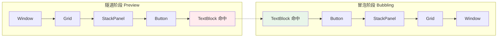
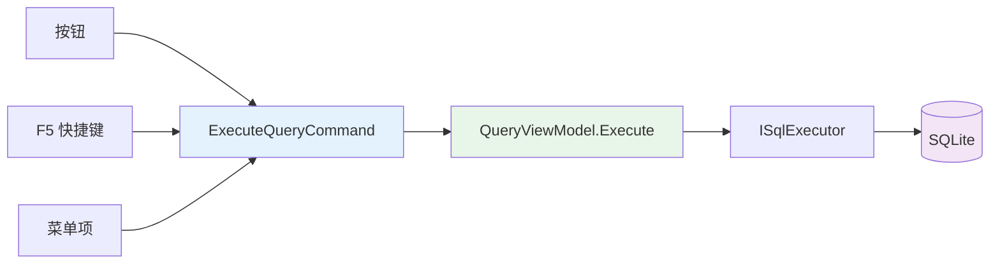

## 一、事件在树上走，而不是只在一个对象上

WinForms 的事件是"点对点"的：谁订阅谁收到，一个 `Button.Click` 处理完就结束了，不存在"事件继续往外传"这回事。所以从 WinForms 或服务端走过来的人，第一次在 `Grid` 上挂 `MouseDown` 却发现点按钮也能触发，会以为是 bug。

本章讲两件事：事件怎么在树上走，业务动作为什么该用命令。核心设计是：**路由事件（routed event）不是对象上的通知，而是沿着元素树传播的一条路径**。事件的发起者只是路径的起点，沿途每个元素都有机会处理它。

路由策略只有三种：

| 策略 | 传播方向 | 典型事件 | 用途 |
|------|---------|---------|------|
| `Direct` | 只到发起者自己 | `MouseEnter`、`Loaded`、`ToolTipOpening` | 语义上就只属于某个元素 |
| `Bubbling` | 从发起者向上到根 | `MouseDown`、`Click`、`KeyDown` | 让父容器统一处理子元素的行为 |
| `Tunneling` | 从根向下到发起者 | `PreviewMouseDown`、`PreviewKeyDown` | 在子元素处理之前拦截 |

冒泡事件占绝大多数，所以你写在窗口上的处理器能收到深层子元素的事件。隧道事件统一加 `Preview` 前缀，这不是命名习惯，是约定——WPF 自带的隧道事件都长这样。

## 二、为什么先隧道后冒泡

一次鼠标点击，实际会经过两轮路由：先把 `PreviewMouseDown` 从 `Window` 一路隧道到被点中的最内层元素，再把 `MouseDown` 从那个元素一路冒泡回 `Window`。



先隧道后冒泡的顺序是有意设计的：**父容器需要"抢先看一眼"的机会**。典型场景是全局拦截——主窗口希望无论焦点在哪个输入框，`Esc` 都能关闭补全弹窗；如果只有冒泡，`TextBox` 会先把 `KeyDown` 处理掉，窗口就没机会了。隧道阶段在父级先跑，可以提前决定"这个事件到此为止"。

反过来说，冒泡适合"子元素做默认行为，父容器统一收尾"。`DataGrid` 里点了一个按钮，按钮自己处理完，事件继续冒到 `DataGrid`、再到窗口，父级可以做统计、埋点、关闭浮层。

## 三、Handled 与 Source：三个必须分清的概念

**`e.Handled = true` 是"我处理过了，别往下传了"。** 冒泡链上后续的处理器不会再被调用，隧道链同理。注意它是**协作式**的：框架不会强制阻止，任何用 `AddHandler(..., handledEventsToo: true)` 注册的处理器照样能收到。

```csharp
public MainWindow()
{
    InitializeComponent();

    // 即使子元素已经 e.Handled = true，这里依然会执行
    AddHandler(Mouse.PreviewMouseDownEvent,
        new MouseButtonEventHandler(OnAnyMouseDown),
        handledEventsToo: true);
}

private void OnAnyMouseDown(object sender, MouseButtonEventArgs e)
{
    // 全局收起补全弹层，不受子元素是否 Handled 影响
    CompletionPopup.IsOpen = false;
}
```

`handledEventsToo` 是一个很容易被忽略的重载，但它在做"全局行为"时几乎是唯一正确的选择。第 18 章排查"某个点击为什么没生效"时，会反过来用到它——加上它还能收到，说明事件被下游吃掉了。

**`e.Source` 是路由的发起者，`e.OriginalSource` 是最初被命中的元素。** 对输入事件来说，`OriginalSource` 是命中测试得到的最内层可视元素（比如按钮模板里的 `TextBlock`），`Source` 则是事件在路由起点上的那个元素。控件自己 `RaiseEvent` 的语义事件（如 `Click`），两者通常是同一个。区分它们的实际意义是：**判断"用户点在哪"用 `OriginalSource`，判断"谁发起的行为"用 `Source`**。如果代码里对 `Source` 做了强制转换却偶尔崩溃，多半是把深层元素当成了控件本身。

**`e.Handled` 只影响后续处理器，不改变事件已经走过的路径。** 这一点在写"点击空白处关闭弹窗"时特别重要：你得判断 `OriginalSource` 是不是弹窗内部，而不是指望 `Handled`。

## 四、DbLens：DataGrid 里的按钮怎么拿到行数据

这是路由事件最常被问的问题。结果集里每行有个"预览"按钮，点击后要拿到这一行对应的 `TableInfo`。最直觉的写法是沿可视化树往上找 `DataGridRow`，再读 `Item`——能用，但非常脆：模板一改、列一换就断。

正确的做法是利用**绑定上下文本来就跟着行走**这个事实：

```xml
<DataGrid ItemsSource="{Binding Tables}" AutoGenerateColumns="False">
    <DataGrid.Columns>
        <DataGridTextColumn Header="表名" Binding="{Binding Name}" />
        <DataGridTemplateColumn Header="操作" Width="90">
            <DataGridTemplateColumn.CellTemplate>
                <DataTemplate>
                    <Button Content="预览"
                            Padding="8,2"
                            Command="{Binding DataContext.PreviewTableCommand,
                                              RelativeSource={RelativeSource AncestorType=DataGrid}}"
                            CommandParameter="{Binding}" />
                </DataTemplate>
            </DataGridTemplateColumn.CellTemplate>
        </DataGridTemplateColumn>
    </DataGrid.Columns>
</DataGrid>
```

`DataTemplate` 里的 `DataContext` 是行对象，所以 `CommandParameter="{Binding}"` 传进去的就是 `TableInfo`。命令本身在 ViewModel 上，而 ViewModel 在 `DataGrid` 的 `DataContext` 上，所以用 `RelativeSource AncestorType=DataGrid` 取祖先的数据上下文。

如果非要用事件处理器，也可以，但只取 `DataContext`，**不要遍历树**：

```csharp
private void OnPreviewClick(object sender, RoutedEventArgs e)
{
    if (sender is FrameworkElement { DataContext: TableInfo table })
    {
        StatusText.Text = $"预览 {table.Schema}.{table.Name}";
    }
}
```

为什么点击会冒泡到外层？因为 `Button.Click` 是冒泡事件。如果你在 `DataGrid` 上挂了 `Click`，行内按钮的点击也会到那儿。这既是能力也是陷阱——第 15 章会讲它如何干扰行选中。

## 五、自定义路由事件

只有写控件时才需要自定义路由事件。它的注册方式和依赖属性很像，都是静态字段 + 实例包装：

```csharp
using System.Windows;
using System.Windows.Controls;

namespace DbLens.Views.Controls;

public class QueryEditor : Control
{
    public static readonly RoutedEvent QueryExecutedEvent = EventManager.RegisterRoutedEvent(
        nameof(QueryExecuted),
        RoutingStrategy.Bubble,
        typeof(RoutedEventHandler),
        typeof(QueryEditor));

    public event RoutedEventHandler QueryExecuted
    {
        add => AddHandler(QueryExecutedEvent, value);
        remove => RemoveHandler(QueryExecutedEvent, value);
    }

    protected virtual void OnQueryExecuted()
        => RaiseEvent(new RoutedEventArgs(QueryExecutedEvent, this));
}
```

三个参数分别是：事件名、路由策略、处理器委托类型，最后一个参数是注册所有者的类型。注册好后，订阅方在 XAML 里就像用普通事件一样：

```xml
<controls:QueryEditor QueryExecuted="OnQueryExecuted" />
```

适用场景很窄，但判断标准清晰：**当这个行为需要被父容器感知，而不仅是控件自己知道时**。比如编辑器抛"查询已执行"，外层 Shell 可以据此记录历史、刷新状态栏；如果只用一个普通 CLR 事件，父容器得逐层手动转发，很快就乱了。反过来，如果事件只用于控件内部状态切换，用普通事件甚至直接改属性就够了。

## 六、为什么"按钮点击里写业务"是反模式

服务端程序员最容易复制的一个坏习惯：把 `Click` 处理器当 Controller action 用。

```csharp
// 反模式
private async void OnExecuteClick(object sender, RoutedEventArgs e)
{
    var sql = SqlEditor.Text;
    if (string.IsNullOrWhiteSpace(sql)) return;

    ExecuteButton.IsEnabled = false;
    try
    {
        var rows = await _executor.QueryAsync(sql);
        ResultGrid.ItemsSource = rows;
        StatusText.Text = $"返回 {rows.Count} 行";
    }
    finally
    {
        ExecuteButton.IsEnabled = true;
    }
}
```

这段代码能跑，但它同时踩了四个坑：**不能单元测试**（要造窗口、跑 STA 线程）、**不能被第二个入口复用**（菜单、快捷键、工具栏都得复制一遍）、**状态散落在控件上**（`IsEnabled` 是视图状态，业务层不知道查询在进行中）、**异常处理没地方统一做**。

命令（`ICommand`）解决的就是"意图"这一层：把"执行查询"变成一个可被多个输入源触发的对象，视图只负责触发，不负责决定能不能触发。

| 事件处理器 | 命令 |
|-----------|------|
| 绑定在具体控件上，换控件就断 | 与控件无关，菜单/按钮/快捷键共用 |
| 可用性写在 `IsEnabled` 上 | `CanExecute` 表达，视图自动同步 |
| 必须实例化窗口才能测 | 可以直接 `new` 出来断言 |
| 多个入口复制逻辑 | 一个命令实例挂多处 |

## 七、ICommand 三件套

`ICommand` 只有三个成员：

```csharp
public interface ICommand
{
    bool CanExecute(object? parameter);
    void Execute(object? parameter);
    event EventHandler? CanExecuteChanged;
}
```

- `Execute`：真正的动作。
- `CanExecute`：现在能不能执行。`Button` 会把它映射成自己的 `IsEnabled`，**不需要你额外绑定 `IsEnabled`**。
- `CanExecuteChanged`：通知视图"重新问一次 `CanExecute`"。

手写一个最小实现，不到二十行，理解它比直接用库更有价值：

```csharp
using System;
using System.Windows.Input;

namespace DbLens.Commands;

public sealed class RelayCommand<T> : ICommand
{
    private readonly Action<T?> _execute;
    private readonly Func<T?, bool>? _canExecute;

    public RelayCommand(Action<T?> execute, Func<T?, bool>? canExecute = null)
        => (_execute, _canExecute) = (execute, canExecute);

    public event EventHandler? CanExecuteChanged
    {
        add => CommandManager.RequerySuggested += value;
        remove => CommandManager.RequerySuggested -= value;
    }

    public bool CanExecute(object? parameter) => _canExecute?.Invoke(Cast(parameter)) ?? true;
    public void Execute(object? parameter) => _execute(Cast(parameter));
    private static T? Cast(object? p) => p is T value ? value : default;
}
```

在 ViewModel 里用起来是这样的：

```csharp
using System.Threading.Tasks;
using System.Windows.Input;
using DbLens.Commands;
using DbLens.Core.Services;

namespace DbLens.ViewModels;

public sealed class QueryViewModel
{
    private readonly ISqlExecutor _executor;

    public QueryViewModel(ISqlExecutor executor)
    {
        _executor = executor;

        ExecuteQueryCommand = new RelayCommand<object?>(
            async _ => { await _executor.ExecuteAsync(QueryText); },
            _ => !string.IsNullOrWhiteSpace(QueryText));
    }

    public string QueryText { get; set; } = "SELECT name FROM sqlite_master;";

    public ICommand ExecuteQueryCommand { get; }
}
```

这里面已经埋了两个未来的点：`async` lambda 会被编译成 `async void`，异常没有出口——第 09 章换成 `AsyncRelayCommand` 后会解决；`RelayCommand` 本身也活不过第 09 章，CommunityToolkit 的 `[RelayCommand]` 源生成器会替你写这些代码，还顺便生成 `CanExecute` 的刷新逻辑。

## 八、CommandParameter 与 CanExecute 的刷新

命令参数是弱类型的 `object`，这是 `ICommand` 接口的历史包袱。当同一个命令需要区分"对谁操作"时，才需要传参。第四节那个行内预览按钮就是标准用法：

```xml
<Button Content="预览"
        Command="{Binding DataContext.PreviewTableCommand,
                          RelativeSource={RelativeSource AncestorType=DataGrid}}"
        CommandParameter="{Binding}" />
```

而"执行查询"这类命令不需要参数，它直接读 ViewModel 上的 `QueryText`，所以按钮和快捷键共用一个实例就够了。

在 `RelayCommand<T>` 里用 `parameter is T` 做一次安全转换，传错类型不会抛异常，只是变成 `default`。这也意味着**参数为 `null` 时 `CanExecute` 必须能处理**，否则按钮一加载就是灰的——这是"命令不触发"的第一大原因。

`CanExecuteChanged` 的刷新是另一个高频坑。上面用 `CommandManager.RequerySuggested` 订阅，它是 WPF 的一个全局事件，会在**输入、焦点变化、窗口激活**等时机自动触发，于是"输入框里打字，执行按钮自动亮起"看起来是免费的。

但它有两个明确的边界：

1. **后台状态变化不会触发。** 异步查询结束、定时器刷新、别的线程改了集合，这些都不在 `RequerySuggested` 的触发条件里。必须回 UI 线程显式调用：

```csharp
CommandManager.InvalidateRequerySuggested();
```

注意它是**异步投递**的，调用之后立刻读 `CanExecute` 可能还是旧值；而且它会对窗口内所有命令触发一轮重新求值，所以 `CanExecute` 里不要做数据库查询、文件 IO 这类重活。

2. **触发频率不可控。** 每次按键、每次焦点切换都会问一遍。如果 `CanExecute` 里做 LINQ 遍历大集合，输入会明显变卡。轻量判断放进去，重量判断用缓存字段。

第 09 章会用 CommunityToolkit 的 `NotifyCanExecuteChangedFor` 替代这套全局事件，届时的刷新是精确的、可控的。

## 九、InputBindings：把按键翻译成命令

有了命令，快捷键就是纯声明。DbLens 要求 `F5` 和 `Ctrl+Enter` 都执行查询：

```xml
<Window.InputBindings>
    <KeyBinding Key="F5" Command="{Binding ExecuteQueryCommand}" />
</Window.InputBindings>
```

`KeyBinding` 会在窗口内任意位置生效，只要焦点还在这个窗口里。但 `Ctrl+Enter` 要小心：`TextBox` 在 `AcceptsReturn="True"` 时会消费回车键，窗口级的绑定可能轮不到。这种情况把绑定挂到编辑器自己身上：

```xml
<TextBox Text="{Binding QueryText, UpdateSourceTrigger=PropertyChanged}"
         AcceptsReturn="True" AcceptsTab="True">
    <TextBox.InputBindings>
        <KeyBinding Key="Enter" Modifiers="Control"
                    Command="{Binding ExecuteQueryCommand}" />
    </TextBox.InputBindings>
</TextBox>
```

`MouseBinding` 同理，适合"中键关闭标签页"这类操作：

```xml
<MouseBinding MouseAction="MiddleClick" Command="{Binding CloseTabCommand}" />
```

`InputBindings` 是在输入路由的后期被求值的，所以它**不能保证优先于控件自身的键盘处理**。真正的全局快捷键（比如应用级 `Ctrl+S`）更适合放在 `Window.InputBindings` 上，并且避免和编辑器的内置行为冲突。

## 十、和 ASP.NET Core 的类比，以及类比的边界

这两个类比能建立直觉，但都不能硬套。先看哪些能对上：

| ASP.NET Core | WPF | 能对上 | 对不上 |
|------|-----|--------|--------|
| 中间件管道 | 路由事件 | 沿链传播、可短路、父子多层处理 | 没有 `next` 委托，`Handled` 只是协作约定，且全程同步 |
| 授权过滤器 | `CanExecute` | 决定动作是否允许 | 驱动的是 `IsEnabled`，不是返回 403 |
| MediatR 的 `IRequestHandler` | `ICommand` | 意图化、单一入口、可脱离宿主单测 | 参数是 `object`，没有 pipeline behaviors 和自动 DI |
| 请求级作用域 | 元素树 | 都有明确边界 | 树是静态结构，不随操作重建 |

**路由事件 ≈ 中间件管道**：父级可以抢先介入，`e.Handled = true` 相当于短路；但每个订阅者独立执行，不存在"调用下一个"，也不能 `await`。

**ICommand ≈ MediatR**：都是把意图封装成对象、一个执行入口；但 `ICommand` 是 UI 契约，`CanExecute` 驱动控件可用性，没有强类型请求/响应。**把命令当 MediatR 用，很快会写出一堆手工拼装的"命令总线"。**



三个输入源，一个命令，一个执行点——这张图就是"为什么用命令"的全部答案。

## 十一、踩坑清单

| 现象 | 原因 | 处理 |
|------|------|------|
| 点按钮时外层容器也响应 | 路由事件冒泡到祖先 | 需要独占就 `e.Handled = true` |
| 父容器加了 `MouseDown` 但点按钮没反应 | 子控件已把事件标记为 Handled | `AddHandler(..., handledEventsToo: true)` |
| `e.Source` 不是以为的那个控件 | 输入事件的 `Source` 是最内层命中元素 | 用 `OriginalSource`，或直接取 `DataContext` |
| 命令按钮一直是灰的 | `CommandParameter` 为 null，`CanExecute` 返回 false | 检查参数绑定，`CanExecute` 容忍 null |
| 命令可用性不随异步结果更新 | 后台变化不触发 `RequerySuggested` | UI 线程调 `CommandManager.InvalidateRequerySuggested()` |
| `Ctrl+Enter` 不触发 | `TextBox` 先消费了回车键 | 把 `KeyBinding` 放进该控件的 `InputBindings` |
| 自定义事件订阅不到 | CLR 事件包装没走 `AddHandler`，或注册 owner 类型不对 | 用 `AddHandler` / `RemoveHandler` 包装，`RaiseEvent` 传对实例 |

## 十二、本章小结

- 路由事件沿元素树传播：隧道从根向下（`Preview` 前缀），冒泡从发起者向上，先隧道后冒泡。
- `e.Handled` 是协作式短路，`handledEventsToo` 可以绕过；`OriginalSource` 是最初命中的元素，`Source` 是路由发起者。
- 行内按钮拿行数据靠 `DataContext` 和绑定，不要沿可视化树找 `DataGridRow`。
- 事件处理器只适合视图自身行为；业务动作用 `ICommand`，`CanExecute` 直接驱动控件可用性，且天然可单测。
- `CommandManager.RequerySuggested` 只覆盖输入与焦点变化，异步状态必须显式 `InvalidateRequerySuggested`。
- `InputBindings` 让 `F5` / `Ctrl+Enter` 与按钮共用同一个命令，但要注意焦点控件的按键消费。

**练习**：一、把 DbLens 的"执行"按钮、`F5`、`Ctrl+Enter` 三个入口接到同一个 `RelayCommand` 上，并让按钮在 SQL 为空时自动变灰。二、给 `QueryEditor` 加一个 `QueryCancelled` 路由事件，在 `MainWindow` 上同时用 XAML 事件语法和 `AddHandler(..., handledEventsToo: true)` 订阅，验证两种方式都能收到。

下一篇进入 MVVM，先讲数据绑定：`{Binding}` 到底绑的是什么、什么时候更新、为什么需要 `INotifyPropertyChanged`。
