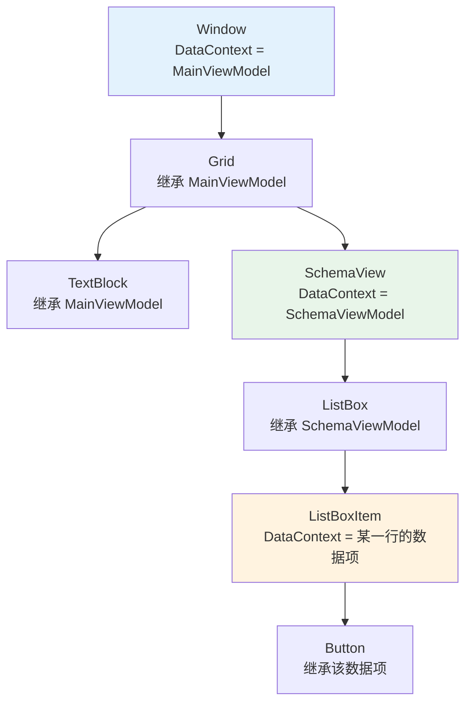

## 一、绑定到底在解决什么

第 01 章的断层二说过：WPF 里你不搬运数据，只声明关系。这条关系就是 `Binding`：

```xml
<TextBox Text="{Binding Connection.Host}" />
```

这句话的完整含义是：

> 目标对象是 `TextBox.Text`（依赖属性），源对象是当前 `DataContext` 的 `Connection` 属性的 `Host` 属性，默认双向，值变了互相通知。

把它拆成四个要素，所有绑定问题都能定位：

| 要素 | 含义 | 出错时的典型症状 |
|------|------|-----------------|
| **目标（Target）** | 必须是依赖属性，通常是控件的某个属性 | "我绑了但界面不动"——目标不是 DP |
| **源（Source）** | 从哪拿数据，默认是 `DataContext` | `DataContext` 为 null |
| **路径（Path）** | 在源对象上取哪个属性 | 输出窗口刷 `BindingExpression path error` |
| **模式（Mode）** | 数据流向：OneWay / TwoWay / OneTime | 改了界面但 VM 没变 |

服务端你处理的是"一次性的数据快照"（序列化成 JSON 就完事），绑定处理的是"持续存在的关系"。这个差别决定了：**源对象必须能通知变化，目标必须是依赖属性**。两个条件缺一个，绑定就是死的。

## 二、DataContext：WPF 的隐式参数传递

`DataContext` 是 `FrameworkElement` 上的一个依赖属性，并且**沿可视化树向下继承**。它的地位相当于 ASP.NET Core 里的 `HttpContext`——一个贯穿整条链路的上下文，只不过 WPF 里它是"数据上下文"。

```xml
<Window x:Class="DbLens.MainWindow"
        xmlns="http://schemas.microsoft.com/winfx/2006/xaml/presentation"
        xmlns:x="http://schemas.microsoft.com/winfx/2006/xaml"
        xmlns:vm="clr-namespace:DbLens.ViewModels">
    <Window.DataContext>
        <vm:MainViewModel />
    </Window.DataContext>

    <Grid>
        <!-- 这里所有子元素的 DataContext 都是 MainViewModel -->
        <TextBlock Text="{Binding Title}" />
        <views:SchemaView DataContext="{Binding Schema}" />  <!-- 到这里换成子 VM -->
    </Grid>
</Window>
```



三个必须记住的规则：

1. **只有 `FrameworkElement` 及其子类有 `DataContext`**。`DataGridTextColumn` 不是可视元素，所以它**不继承** DataContext，列上的绑定必须显式指定 `Binding`（这也是列绑定容易失效的头号原因）。
2. **`ItemsControl` 的每一项自动把 DataContext 设成数据项本身**。所以 `ItemTemplate` 里直接写 `{Binding Name}` 就行，不用管外层。
3. **显式赋值会覆盖继承**。`<views:SchemaView DataContext="{Binding Schema}" />` 之后，该元素子树就换上下文了。

`DataContext` 最常见的失败场景是"设晚了"或"设错了对象"。排查方法：在 XAML 里临时加一句 `<TextBlock Text="{Binding}" />`，它会显示当前 DataContext 的类型全名，比猜快得多。

## 三、源的四条路

| 写法 | 用途 | 示例 |
|------|------|------|
| 不加（默认） | 用继承来的 DataContext | `{Binding Name}` |
| `ElementName` | 绑定到另一个命名元素的属性 | `{Binding ElementName=SearchBox, Path=Text}` |
| `RelativeSource` | 相对当前元素找源（自身 / 祖先 / 模板父级） | `{Binding RelativeSource={RelativeSource AncestorType=DataGrid}, Path=SelectedItem}` |
| `Source` | 直接指定一个对象（资源、静态值） | `{Binding Source={StaticResource Config}, Path=Timeout}` |

`RelativeSource` 有三种模式，用错了基本不报错、只是不生效：

```xml
<!-- 绑定到自身：常用于把自身属性传给 Converter -->
<ProgressBar Value="{Binding RelativeSource={RelativeSource Self}, Path=Tag}" />

<!-- 绑定到最近的某种祖先：DataGrid 的行里拿整行的选中项 -->
<Button Command="{Binding DataContext.DeleteCommand,
                  RelativeSource={RelativeSource AncestorType=DataGrid}}"
        CommandParameter="{Binding}" />

<!-- 绑定到模板的宿主控件：只能在 ControlTemplate / DataTemplate 内部用 -->
<Border Background="{Binding RelativeSource={RelativeSource TemplatedParent}, Path=Background}" />
```

`ItemTemplate` 里想调外层的命令（不是当前行的数据），就要走 `RelativeSource AncestorType=...` 往上找。这是 WPF 里最常被搜索的一个问题，理解了"DataContext 被行数据替换过"就不会再困惑。

## 四、模式的五个值

| 模式 | 流向 | 典型场景 |
|------|------|---------|
| `OneWay` | 源 → 目标 | 只读展示、状态显示 |
| `TwoWay` | 双向 | `TextBox.Text`、`CheckBox.IsChecked`、`Slider.Value` |
| `OneTime` | 只在初始化时读一次 | 静态数据、性能敏感且永不变化的字段 |
| `OneWayToSource` | 目标 → 源 | 少见，如把控件尺寸写回 VM |
| `Default` | 由目标的元数据决定 | 不写时的默认值 |

`TextBox.Text`、`CheckBox.IsChecked` 等可编辑控件的 `BindsTwoWayByDefault` 是 `true`，所以一般不写 `Mode`。但如果你自定义了一个依赖属性却忘了在元数据里声明 `FrameworkPropertyMetadataOptions.BindsTwoWayByDefault`，绑定就只会单向下发——这是第 14 章自己写控件时会踩的坑。

### 4.1 UpdateSourceTrigger 决定"什么时候回写"

这是服务端思维最容易忽略的一点：

| 值 | 回写时机 | 场景 |
|----|---------|------|
| `PropertyChanged` | 每敲一个字符 | 实时搜索、实时校验 |
| `LostFocus` | 焦点离开时（TextBox 默认） | 普通表单，避免每键都触发查询 |
| `Explicit` | 手动调用 `BindingExpression.UpdateSource()` | 批量提交、需要二次确认的场景 |

```xml
<TextBox Text="{Binding Filter, UpdateSourceTrigger=PropertyChanged, Delay=300}" />
```

`Delay` 是 .NET 4.5 之后有的属性，单位毫秒。**搜索框的标准组合就是 PropertyChanged + Delay**：既不用等到失焦，也不会每个键都打一次数据库。这比自己在 VM 里塞 `Timer` 干净得多。

## 五、格式化与容错

```xml
<TextBlock Text="{Binding RowCount, StringFormat={}{0:N0} 行}" />
<TextBlock Text="{Binding LastLogin, StringFormat='yyyy-MM-dd HH:mm'}" />
<TextBox Text="{Binding Host, TargetNullValue='未设置'}" />
<TextBlock Text="{Binding Port, FallbackValue='-'}" />
```

- `StringFormat`：注意格式串里如果有 `{` 开头，前面要加 `{}` 转义。
- `TargetNullValue`：源为 `null` 时显示什么。
- `FallbackValue`：**绑定失败**（路径不存在、类型不匹配）时显示什么。这两个不是一回事，很多线上"空白"问题就是分不清。

## 六、Converter：只在需要"变形"时用

Converter 的职责是**值转换**，不是业务逻辑。写多了说明你的 ViewModel 暴露的属性还不够"视图友好"。

```csharp
namespace DbLens.Converters;

/// <summary>把 null / 空字符串转成 Visibility</summary>
public sealed class NullToVisibilityConverter : IValueConverter
{
    public object Convert(object? value, Type targetType, object? parameter, CultureInfo culture)
        => value is null || value is string { Length: 0 } ? Visibility.Collapsed : Visibility.Visible;

    public object ConvertBack(object? value, Type targetType, object? parameter, CultureInfo culture)
        => throw new NotSupportedException();
}
```

```xml
<Window.Resources>
    <conv:NullToVisibilityConverter x:Key="NullToVisibility" />
</Window.Resources>

<TextBlock Text="连接失败" Visibility="{Binding ErrorMessage, Converter={StaticResource NullToVisibility}}" />
```

**别忘了在 App 或 Window 里声明 `xmlns:conv="clr-namespace:DbLens.Converters"`**，否则编译期就报错——这是好事，比运行时静默失败强。

### 6.1 MultiBinding：多输入一个输出

需要"几列都有值才启用按钮"这类逻辑时，用 `IMultiValueConverter`：

```csharp
public sealed class AllNotNullConverter : IMultiValueConverter
{
    public object Convert(object[] values, Type targetType, object parameter, CultureInfo culture)
        => values.All(v => v is not null and not "" ) && values.Length > 0;

    public object[] ConvertBack(object value, Type[] targetTypes, object parameter, CultureInfo culture)
        => throw new NotSupportedException();
}
```

```xml
<Button Content="执行查询" IsEnabled="{Binding IsReady}">
    <Button.CommandParameter>
        <MultiBinding Converter="{StaticResource AllNotNull}">
            <Binding Path="SelectedConnection" />
            <Binding Path="SqlText" />
        </MultiBinding>
    </Button.CommandParameter>
</Button>
```

但要说清楚：**能用 VM 里的 `IsReady` 计算属性解决的，别用 MultiBinding**。多路绑定难调试、断了不报错。它适合的是"纯视图层面"的启用条件。

## 七、绑定的三个硬约束

### 7.1 目标必须是依赖属性

```csharp
// 这样写，绑定引擎会直接报错：目标不是 DependencyProperty
public string Title2 { get; set; } = "x";   // 普通属性
```

绑定引擎只能通过 `DependencyProperty` 的机制去写值（这样才有优先级、样式覆盖、动画插值）。**自定义控件要用绑定，属性就必须是 DP**——这就是第 14 章存在的理由。

### 7.2 源必须能通知

```csharp
// 没有 INotifyPropertyChanged，第一次显示之后永远不会更新
public class ConnectionDto
{
    public string Host { get; set; } = "";
}
```

绑定引擎在初始化时读一次，之后**靠 `PropertyChanged` 事件才知道值变了**。它不会轮询。这就是第 08 章的内容。

### 7.3 绑定失败是静默的

这是新手最大的效率杀手。路径写错、类型不匹配、DataContext 为 null——界面就是空白，没有任何异常弹出来。

打开诊断只需要一个附加属性：

```xml
xmlns:diag="clr-namespace:System.Diagnostics;assembly=WindowsBase"

<TextBlock Text="{Binding Host, diag:PresentationTraceSources.TraceLevel=High}" />
```

详细输出会打到 Visual Studio 的「输出」窗口，形如：

```
System.Windows.Data Error: 40 : BindingExpression path error: 'Hots' property not found
on 'object' ''ConnectionDto' (HashCode=12345)'. BindingExpression:Path=Hots;
DataItem='ConnectionDto'; target element is 'TextBlock'...
```

`Error: 40` 就是路径解析失败的固定错误码，记住它能省下大量时间。第 18 章会系统讲解绑定诊断，这里先建立"绑定坏了要看输出窗口"的习惯。

## 八、在 DbLens 里用一遍

这是 DbLens 的查询页，一条 SQL 从输入到结果显示，全靠绑定串起来：

```xml
<Grid>
    <Grid.RowDefinitions>
        <RowDefinition Height="Auto" />
        <RowDefinition Height="*" />
        <RowDefinition Height="Auto" />
        <RowDefinition Height="2*" />
        <RowDefinition Height="Auto" />
    </Grid.RowDefinitions>

    <!-- 连接选择：ComboBox 的 DisplayMemberPath 让对象直接可读 -->
    <ComboBox Grid.Row="0"
              ItemsSource="{Binding Connections}"
              SelectedItem="{Binding SelectedConnection}"
              DisplayMemberPath="Name" />

    <!-- SQL 编辑：PropertyChanged 让拦截器实时更新"能否执行" -->
    <TextBox Grid.Row="1"
             Text="{Binding SqlText, UpdateSourceTrigger=PropertyChanged, Delay=200}"
             AcceptsReturn="True"
             VerticalScrollBarVisibility="Auto"
             FontFamily="Cascadia Mono, Consolas" />

    <StackPanel Grid.Row="2" Orientation="Horizontal">
        <Button Content="执行 (F5)" Command="{Binding ExecuteCommand}" />
        <TextBlock Text="{Binding ElapsedText}" Margin="12,0,0,0" />
    </StackPanel>

    <!-- 结果：只读表格，DataGrid 自动虚拟化 -->
    <DataGrid Grid.Row="3"
              ItemsSource="{Binding Rows}"
              AutoGenerateColumns="False"
              IsReadOnly="True"
              EnableRowVirtualization="True" />

    <StatusBar Grid.Row="4">
        <StatusBarItem Content="{Binding StatusMessage}" />
        <StatusBarItem Content="{Binding RowCount, StringFormat={}{0:N0} 行}" />
    </StatusBar>
</Grid>
```

注意几处刻意的选择：

- `ComboBox` 绑的是对象本身（`SelectedItem`），不是字符串。这样 VM 拿到的是完整连接对象，而不是"用户选中的文本"。
- `AutoGenerateColumns=False`：结果列是运行时才知道的，要在代码里动态生成（第 11、15 章）。
- `IsReadOnly=True`：目标属性只读，避免 TwoWay 绑定把用户编辑结果写回一个不可变的 `DataRowView`。

对应的 ViewModel 属性名就是绑定的"契约"，改名字会静默弄坏界面。这不是毛病，是设计：**XAML 里的绑定路径就是 View 与 VM 之间的接口**。

## 九、踩坑清单

| 现象 | 原因 | 处理 |
|------|------|------|
| 界面一直空白，无异常 | `DataContext` 为 null | 加 `<TextBlock Text="{Binding}"/>` 看当前上下文 |
| 路径写错但不报错 | 绑定失败是静默的 | 用 `PresentationTraceSources.TraceLevel=High` 看输出 |
| 数据改了界面不变 | 源没实现 `INotifyPropertyChanged` | 见第 08 章 |
| 输入框每键入一个字就查库 | 默认 `LostFocus` 被改成了 `PropertyChanged` 却没 `Delay` | 补 `Delay=300` |
| DataGrid 列绑定无效 | 列不是可视元素，不继承 DataContext | 在 `Binding` 里显式写整条路径 |
| `ItemTemplate` 里的命令找不到 | DataContext 已被替换成行数据 | 用 `RelativeSource AncestorType=ItemsControl` 找外层 |
| 给普通 CLR 属性设绑定报错 | 目标不是依赖属性 | 改成 DP（第 14 章） |
| `StringFormat` 里 `{0}` 报错 | `{` 被当成标记扩展 | 写成 `StringFormat={}{0} 行` |

## 十、本章小结

- 绑定 = 目标 DP + 源对象 + 路径 + 模式，四要素定位一切问题。
- `DataContext` 沿树继承，`ItemsControl` 的每一项会把 DataContext 换成数据项；列、`ItemTemplate` 里要往上找源。
- 源不能通知就永远不更新，目标不是 DP 就直接失败。
- `UpdateSourceTrigger` 和 `Delay` 决定性能与体验，搜索框用 `PropertyChanged + Delay`。
- `TargetNullValue`（源为 null）和 `FallbackValue`（绑定失败）是两件事。
- 绑定错误静默，必须主动开 `PresentationTraceSources` 看输出窗口。

**练习**：在 DbLens 的查询页加一个关键字过滤框，`UpdateSourceTrigger=PropertyChanged`、`Delay=300`，过滤结果显示在状态栏（先不真正过滤表格，只显示关键字的长度和前 20 个字符）。然后把 `Binding` 的路径故意写错一个字母，打开 trace 观察输出窗口的 `Error: 40`——亲手见一次，以后就不会浪费时间。

下一章解决"数据变了界面不知道"的问题：属性通知与集合。
