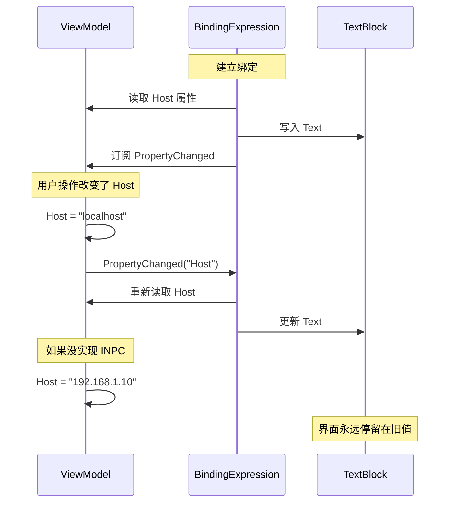

## 一、绑定引擎不是"轮询"的

第 07 章留下一个硬约束：源对象必须能通知。现在说清楚它背后的机制。

绑定建立时，`BindingExpression` 会做两件事：

1. 从源对象上**读一次**值，写入目标属性；
2. 检查源对象是否实现 `INotifyPropertyChanged`，如果是，就订阅它的 `PropertyChanged` 事件。



**没有事件，就没有更新**。绑定引擎不会定时去比对，这也是 WPF 能在复杂界面上保持低开销的原因——它只在被明确告知时才工作。

## 二、手写一个正确的通知实现

```csharp
using System.ComponentModel;
using System.Runtime.CompilerServices;

namespace DbLens.ViewModels;

public abstract class ObservableObject : INotifyPropertyChanged
{
    public event PropertyChangedEventHandler? PropertyChanged;

    protected void OnPropertyChanged([CallerMemberName] string? propertyName = null)
        => PropertyChanged?.Invoke(this, new PropertyChangedEventArgs(propertyName));

    protected bool SetProperty<T>(ref T field, T value, [CallerMemberName] string? propertyName = null)
    {
        if (EqualityComparer<T>.Default.Equals(field, value)) return false;
        field = value;
        OnPropertyChanged(propertyName);
        return true;
    }
}
```

使用：

```csharp
public sealed class ConnectionViewModel : ObservableObject
{
    private string _host = "localhost";

    public string Host
    {
        get => _host;
        set
        {
            if (!SetProperty(ref _host, value)) return;
            // 派生属性跟着变，必须手动通知
            OnPropertyChanged(nameof(DisplayName));
            OnPropertyChanged(nameof(IsValid));
        }
    }

    public string DisplayName => $"{Host}:{Port}";
    public bool IsValid => !string.IsNullOrWhiteSpace(Host);
}
```

三个细节：

- `[CallerMemberName]` 让编译器自动填属性名，杜绝"字符串拼错"这类低级错误。
- `SetProperty` 里的**相等判断是必须的**，它挡住了"赋值相同值仍然通知"造成的无意义刷新和死循环。
- **派生属性不会自动通知**。`DisplayName` 依赖 `Host`，改了 `Host` 必须手工通知 `DisplayName`。这是 WPF 里最隐蔽的 bug 之一：界面某些字段更新了、某些没更新。

## 三、嵌套对象：通知链会断

```csharp
public sealed class QueryViewModel : ObservableObject
{
    public ConnectionViewModel Connection { get; set; } = new();
}
```

```xml
<TextBlock Text="{Binding Connection.Host}" />
```

这里绑定的是 `Connection.Host`。`Host` 变了会通知（因为 `ConnectionViewModel` 实现了 INPC），但如果你**把 `Connection` 整个替换成一个新对象**：

```csharp
Connection = new ConnectionViewModel { Host = "10.0.0.5" };
```

`QueryViewModel` 必须通知 `Connection`，否则绑定还挂着旧对象，界面纹丝不动。这就是"嵌套属性不更新"的两类原因：

| 你改了什么 | 需要谁通知 |
|-----------|-----------|
| 子对象的属性值 | 子对象通知该属性 |
| **替换**子对象本身 | 父对象通知该子属性 |

**规律**：绑定路径上有几段，每一段的持有者都可能在替换对象，谁替换谁通知。

## 四、ObservableCollection：集合的增量通知

`List<T>` 装进去，界面能显示，但增删改不会反映——因为它不实现 `INotifyCollectionChanged`。

```csharp
public sealed class QueryViewModel : ObservableObject
{
    public ObservableCollection<ResultRow> Rows { get; } = new();

    public void Append(IEnumerable<ResultRow> rows)
    {
        foreach (var row in rows) Rows.Add(row);
    }
}
```

`ObservableCollection<T>` 在 `Add/Remove/Clear/Move` 时触发 `CollectionChanged`，`ItemsControl` 据此只更新受影响的容器——这是 WPF 列表能撑住大量数据的基础。

### 4.1 批量添加的隐藏代价

```csharp
// 一万行 = 一万次 CollectionChanged = 一万次布局失效
foreach (var row in rows) Rows.Add(row);

// 正确做法：整体替换，一次通知
Rows = new ObservableCollection<ResultRow>(rows);
```

整体替换要求 `Rows` 是**有 setter 的属性**并触发 `PropertyChanged`，而且会重建所有行容器、丢失当前选中项和滚动位置。按场景选：

| 场景 | 做法 |
|------|------|
| 全量刷新（新一次查询结果） | 整体替换 `Rows`，简单直接 |
| 增量追加（流式加载、分页） | `AddRange` 抑制通知后发一次 Reset |
| 单行修改（编辑单元格） | 行对象实现 INPC，通知到单元格 |

### 4.2 抑制中间通知的 AddRange

```csharp
public sealed class RangeObservableCollection<T> : ObservableCollection<T>
{
    private bool _suppress;

    public void AddRange(IEnumerable<T> items)
    {
        _suppress = true;
        try
        {
            foreach (var item in items) Items.Add(item);
        }
        finally
        {
            _suppress = false;
        }
        OnPropertyChanged(new PropertyChangedEventArgs("Count"));
        OnPropertyChanged(new PropertyChangedEventArgs("Item[]"));
        OnCollectionChanged(new NotifyCollectionChangedEventArgs(NotifyCollectionChangedAction.Reset));
    }

    protected override void OnCollectionChanged(NotifyCollectionChangedEventArgs e)
    {
        if (!_suppress) base.OnCollectionChanged(e);
    }
}
```

这是 WPF 里少数值得手写的集合类型。**注意它发的是 Reset**，意味着所有容器重建——对十万行数据仍然会卡，那种场景要看第 15 章的虚拟化。

### 4.3 跨线程修改集合 = 必崩

`ObservableCollection` 在 `CollectionChanged` 里会直接操作 `ItemsControl` 的生成器。如果通知发生在后台线程：

> This type of CollectionView does not support changes to its SourceCollection from a thread different from the Dispatcher thread.

服务端你随手在 `Task.Run` 里往集合加数据，桌面端就会炸。两种解法：

```csharp
// 方案一：把结果先收进普通 List，await 回来后再填集合
var rows = await Task.Run(() => Execute(sql));
Rows.Clear();
foreach (var r in rows) Rows.Add(r);   // 这里已在 UI 线程

// 方案二：必须后台推送时，回到 Dispatcher
Application.Current.Dispatcher.Invoke(() => Rows.Add(row));
```

第 17 章会从 `SynchronizationContext` 层面解释为什么 `await` 之后就回 UI 线程了。

## 五、INotifyPropertyChanging：给"变更追踪"用的

这个接口只比 INPC 多一个"即将改变"事件。WPF 的绑定本身**不需要**它，但 EF Core 的变更追踪代理、以及一些撤销/重做框架需要：

```csharp
public sealed class TableSchema : INotifyPropertyChanging, INotifyPropertyChanged
{
    private string _name = "";

    public event PropertyChangingEventHandler? PropertyChanging;
    public event PropertyChangedEventHandler? PropertyChanged;

    public string Name
    {
        get => _name;
        set
        {
            PropertyChanging?.Invoke(this, new PropertyChangingEventArgs(nameof(Name)));
            _name = value;
            PropertyChanged?.Invoke(this, new PropertyChangedEventArgs(nameof(Name)));
        }
    }
}
```

在 `PropertyChanging` 里拿到旧值、在 `PropertyChanged` 里拿到新值，是它的唯一用途。**只在你真的要记录变更前后值时实现它**，否则是纯开销。

## 六、验证：INotifyDataErrorInfo

服务端你用 `FluentValidation` 或 `DataAnnotations`，校验完返回 400。桌面端校验要**实时、就地**显示在控件旁边，接口是 `INotifyDataErrorInfo`（注意不是旧的 `IDataErrorInfo`，后者只支持同步验证，且不能通知多个错误）。

```csharp
using System.Collections;
using System.ComponentModel;
using DbLens.Core.Models;

namespace DbLens.ViewModels;

public sealed class ConnectionEditorViewModel : ObservableObject, INotifyDataErrorInfo
{
    private readonly Dictionary<string, List<string>> _errors = new();
    private string _host = "";
    private int _port = 1433;

    public event EventHandler<DataErrorsChangedEventArgs>? ErrorsChanged;

    public bool HasErrors => _errors.Count > 0;

    public IEnumerable GetErrors(string? propertyName)
        => propertyName is not null && _errors.TryGetValue(propertyName, out var list)
            ? list
            : Array.Empty<string>();

    public string Host
    {
        get => _host;
        set
        {
            if (!SetProperty(ref _host, value)) return;
            ValidateHost();
        }
    }

    public int Port
    {
        get => _port;
        set
        {
            if (!SetProperty(ref _port, value)) return;
            ValidatePort();
        }
    }

    private void ValidateHost()
    {
        var message = string.IsNullOrWhiteSpace(Host) ? "主机不能为空" : null;
        SetError(nameof(Host), message);
    }

    private void ValidatePort()
        => SetError(nameof(Port), Port is <= 0 or > 65535 ? "端口需在 1-65535 之间" : null);

    private void SetError(string propertyName, string? message)
    {
        var hadError = _errors.ContainsKey(propertyName);
        if (message is null)
        {
            if (!hadError) return;
            _errors.Remove(propertyName);
        }
        else
        {
            if (_errors.TryGetValue(propertyName, out var existing) && existing.Contains(message)) return;
            _errors[propertyName] = [message];
        }

        ErrorsChanged?.Invoke(this, new DataErrorsChangedEventArgs(propertyName));
        OnPropertyChanged(nameof(HasErrors));
    }
}
```

XAML 侧：

```xml
<TextBox Text="{Binding Host, UpdateSourceTrigger=PropertyChanged, ValidatesOnNotifyDataErrors=True}" />
<Button Content="保存" IsEnabled="{Binding HasErrors, Converter={StaticResource InverseBool}}" />
```

`ValidatesOnNotifyDataErrors` 在 .NET 4.5 之后默认就是 `true`，写出来只是为了明确意图。

默认的错误提示是一个红框，通常不够用。自定义提示需要在 `Style` 里换 `Validation.ErrorTemplate`：

```xml
<Style TargetType="TextBox">
    <Setter Property="Validation.ErrorTemplate">
        <Setter.Value>
            <ControlTemplate>
                <DockPanel>
                    <!-- (Validation.Errors)/ErrorContent 取当前第一个错误信息 -->
                    <TextBlock DockPanel.Dock="Bottom" Margin="2,2,0,0"
                               Foreground="#D93025" FontSize="11"
                               Text="{Binding ElementName=adorned,
                                      Path=AdornedElement.(Validation.Errors)/ErrorContent}" />
                    <Border BorderBrush="#D93025" BorderThickness="1">
                        <AdornedElementPlaceholder x:Name="adorned" />
                    </Border>
                </DockPanel>
            </ControlTemplate>
        </Setter.Value>
    </Setter>
</Style>
```

这套东西自动生效的前提是：绑定路径上的属性**必须触发 `ErrorsChanged`**，且错误集合里存的是**给用户看的文案**，不是异常堆栈。

## 七、CommunityToolkit 能省掉多少

上面的手写实现，`CommunityToolkit.Mvvm` 用两个特性就替代了：

```csharp
public sealed partial class ConnectionViewModel : ObservableObject
{
    [ObservableProperty]
    private string _host = "localhost";

    [ObservableProperty]
    [NotifyPropertyChangedFor(nameof(DisplayName))]
    [NotifyCanExecuteChangedFor(nameof(ConnectCommand))]
    private int _port = 1433;

    public string DisplayName => $"{Host}:{Port}";
}
```

源生成器在编译期补上属性、字段通知、派生属性通知。原理和边界在第 09 章展开。**但你现在必须能手写**——否则遇到"通知没发"的问题，你不知道该看哪里。

## 八、DbLens 里的真实取舍

| 数据 | 类型 | 原因 |
|------|------|------|
| 连接列表 | `ObservableCollection<ConnectionViewModel>` | 用户会增删连接，需要增量通知 |
| 查询结果 | 整次替换 `ObservableCollection<ResultRow>` | 全量刷新，整体替换避免一万次通知 |
| 单元格值 | 行对象 + INPC | 编辑后要把变更回写并标黄 |
| 连接状态（Connecting / Connected / Error） | 枚举属性 + INPC | 驱动图标和颜色（第 13 章用 DataTrigger） |

## 九、踩坑清单

| 现象 | 原因 | 处理 |
|------|------|------|
| 只有部分字段更新 | 派生属性没通知 | 改主属性时 `OnPropertyChanged(nameof(派生))` |
| 整个对象替换后界面不变 | 父对象没通知该属性 | 替换时通知属性名 |
| 一万行加载卡死 | 逐条 `Add` 触发一万次通知 | 整体替换或 `AddRange` |
| 后台线程更新列表崩溃 | 跨线程操作 `ObservableCollection` | `await` 回来再填，或 `Dispatcher.Invoke` |
| 红框提示是英文异常信息 | 错误集合里放了 `ex.Message` | 存用户可读的校验文案 |
| 验证不触发 | 属性没发 `ErrorsChanged` | 校验方法里统一走 `SetError` |
| `SetProperty` 后界面没变 | 字段名与属性名不一致 | 用 `[CallerMemberName]`，别手写字符串 |
| 无限循环刷新 | 在 `PropertyChanged` 里又改同一个属性且不做相等判断 | `SetProperty` 的相等判断必须有 |

## 十、本章小结

- 绑定只认事件：没有 `INotifyPropertyChanged`，界面永远不会更新。
- `SetProperty` + `[CallerMemberName]` 是标准写法；派生属性必须手工通知。
- 嵌套路径上"谁替换对象，谁负责通知"。
- `ObservableCollection` 提供增量通知，但逐条添加的代价是一万次 UI 更新；跨线程修改必崩。
- 验证用 `INotifyDataErrorInfo`，错误集合存用户文案，`Validation.ErrorTemplate` 决定显示方式。
- CommunityToolkit 的源生成器能消除样板代码，但原理必须先手写一遍。

**练习**：给 `ConnectionEditorViewModel` 加一个"连接测试"状态属性（`Idle/Running/Success/Failed`），在 `TestAsync` 命令里模拟 2 秒耗时后切换状态，界面上用三个 `TextBlock` 配合 `DataTrigger` 显示不同颜色。注意：模拟延迟必须用 `await Task.Delay`，不能用 `Thread.Sleep`——试试用 `Thread.Sleep` 看看界面会变成什么样。

下一章把这些零件装成一个完整的 MVVM 应用。
