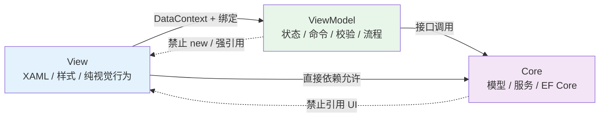

## 一、MVVM 不是框架，是一条依赖规则

网上把 MVVM 讲得像宗教，其实它只有一条硬规则：

> **ViewModel 不能引用任何 View 类型**（`Window`、`UserControl`、`MessageBox`、`MessageDialog` 都算）。

其余都是推论：

| 层 | 职责 | 允许依赖 | 禁止依赖 |
|----|------|---------|---------|
| View（XAML） | 布局、样式、纯视觉行为 | VM、资源 | 业务逻辑、数据访问 |
| ViewModel | 状态、命令、校验、流程编排 | Model、服务接口、`ICommand` | `Window`、`MessageBox`、`Dispatcher` |
| Model / Core | 领域模型、数据访问 | 无 UI 依赖 | 任何 `System.Windows` |

为什么这条线这么重要？因为**它是唯一能让桌面 UI 逻辑被单元测试的边界**。服务端你早就习惯了"Controller 薄、Service 厚、Service 可测"，MVVM 的 VM 就是那个 Service：它应该能在没有窗口、没有消息循环的测试进程里跑起来。



实线箭头是允许的依赖方向，虚线是绝对禁止的方向。注意 `View → Core` 直接依赖通常也是允许的（比如绑定 Model 类型做只读展示），但 `Core → View` 和 `VM → View` 一旦出现，分层就失效了。

你在第 02 章建的 `DbLens.Core` 目标是 `net10.0`（不带 `-windows`），这是物理防线：**Core 项目根本编译不出对 `System.Windows` 的引用**。VM 虽然暂时在 Shell 项目里，但它只要不写 `MessageBox`，就一样可测。

## 二、装包

```powershell
dotnet add src/DbLens.Shell package CommunityToolkit.Mvvm
```

它只做三件事，没有运行时框架、没有容器、没有约定扫描：

1. `ObservableObject`：INPC 的标准实现
2. `[ObservableProperty]`：编译期生成属性与通知
3. `[RelayCommand]`：编译期生成 `ICommand` 实现

源码生成器（source generator）意味着**没有反射、没有运行时开销**，生成的代码你可以直接看（VS 里展开 `Dependencies → Analyzers` 或 F12 跳转）。

## 三、[ObservableProperty]：从字段生成属性

```csharp
using CommunityToolkit.Mvvm.ComponentModel;

namespace DbLens.ViewModels;

public sealed partial class QueryViewModel : ObservableObject
{
    [ObservableProperty]
    private string _sqlText = "SELECT * FROM sqlite_master;";

    [ObservableProperty]
    [NotifyPropertyChangedFor(nameof(HasSql))]
    [NotifyCanExecuteChangedFor(nameof(ExecuteCommand))]
    private string _selectedDatabase = "";
}
```

四条硬规则：

1. **类必须是 `partial`**，否则生成器无法往同一个类里补代码。
2. **字段名必须以 `_` 开头**，生成属性时去掉下划线并把首字母大写：`_sqlText` → `SqlText`。所以 XAML 里绑 `{Binding SqlText}`，绑 `_sqlText` 是错的。
3. 字段**不要**写成 `public`，生成器只处理私有/受保护字段。
4. 想加钩子，实现 `OnSqlTextChanging(string value)` / `OnSqlTextChanged(string value)`，生成器会自动调用。

生成的等价代码大致是：

```csharp
public string SqlText
{
    get => _sqlText;
    set
    {
        if (EqualityComparer<string>.Default.Equals(_sqlText, value)) return;
        OnSqlTextChanging(value);
        OnPropertyChanging();
        _sqlText = value;
        OnSqlTextChanged(value);
        OnPropertyChanged();
        OnPropertyChanged(nameof(HasSql));
        ExecuteCommand.NotifyCanExecuteChanged();
    }
}
```

所以第 08 章讲的三个"必须手工做的事"——相等判断、派生属性通知、命令可用性刷新——现在用特性声明即可：

| 需求 | 第 08 章手写 | Toolkit 声明 |
|------|-------------|-------------|
| 派生属性跟着变 | `OnPropertyChanged(nameof(X))` | `[NotifyPropertyChangedFor(nameof(X))]` |
| 命令可用性刷新 | `Command.NotifyCanExecuteChanged()` | `[NotifyCanExecuteChangedFor(nameof(XxxCommand))]` |
| 属性变化时做副作用 | setter 里写 | `OnXxxChanged` 钩子 |

**注意字段命名带来的坑**：`_host` → `Host`，`_sqlText` → `SqlText`，`_id` → `Id`。如果你的模型里有 `ID` 这种全大写缩写，生成的是 `Id`，XAML 里写 `{Binding ID}` 会静默失败。

## 四、[RelayCommand]：从方法生成命令

```csharp
[RelayCommand]
private void ClearResults()
{
    Rows.Clear();
    StatusMessage = "已清空";
}
```

生成 `ClearResultsCommand`（`IRelayCommand`）。

异步版本：

```csharp
[RelayCommand(IncludeCancelCommand = true)]
private async Task ExecuteAsync(CancellationToken token)
{
    IsBusy = true;
    try
    {
        var rows = await _sqlExecutor.ExecuteAsync(SqlText, token);
        Rows = new ObservableCollection<ResultRow>(rows);
    }
    catch (OperationCanceledException)
    {
        StatusMessage = "已取消";
    }
    finally
    {
        IsBusy = false;
    }
}
```

生成两个命令：`ExecuteCommand`（`AsyncRelayCommand`，执行期间 `CanExecute` 自动为 false）和 `ExecuteCancelCommand`（取消）。`CancellationToken` 参数会被自动注入。

```xml
<Button Content="执行 (F5)" Command="{Binding ExecuteCommand}" />
<Button Content="取消" Command="{Binding ExecuteCancelCommand}" />
```

### 4.1 CanExecute 的三种写法

```csharp
// 写法一：同名方法 CanXxx，自动关联
private bool CanExecute() => !string.IsNullOrWhiteSpace(SqlText) && SelectedConnection is not null;

// 写法二：显式指定
[RelayCommand(CanExecute = nameof(HasConnection))]
private async Task ExecuteAsync(CancellationToken token) { ... }
private bool HasConnection() => SelectedConnection is not null;

// 写法三：配合属性通知刷新
[ObservableProperty]
[NotifyCanExecuteChangedFor(nameof(ExecuteCommand))]
private ConnectionViewModel? _selectedConnection;
```

**`CanExecute` 不会自动重复求值**。它只在两种时机被询问：命令被创建时、你调用 `NotifyCanExecuteChanged()` 时。忘了刷新，按钮就一直灰着——这是 MVVM 里最常见的 bug。用 `[NotifyCanExecuteChangedFor]` 挂在相关属性上，能覆盖 90% 场景。

### 4.2 带参数的命令

```csharp
[RelayCommand]
private void RemoveConnection(ConnectionViewModel? connection)
{
    if (connection is null) return;
    Connections.Remove(connection);
}
```

```xml
<Button Content="删除"
        Command="{Binding DataContext.RemoveConnectionCommand,
                  RelativeSource={RelativeSource AncestorType=ItemsControl}}"
        CommandParameter="{Binding}" />
```

`CommandParameter="{Binding}"` 表示"把当前这一行的数据对象传进去"。注意命令要从外层 VM 找——`ItemTemplate` 里的 DataContext 是行数据，不是 VM（第 07 章讲过）。

## 五、View 与 VM 怎么接上

有两种方式，选错了后期会很痛。

**方式一：XAML 里 new（适合小型页面、设计时友好）**

```xml
<Window.DataContext>
    <vm:MainViewModel />
</Window.DataContext>
```

要求 VM 有无参构造函数。接 DI 之后基本会被淘汰。

**方式二：构造注入（第 10 章之后的标准做法）**

```csharp
public partial class MainWindow : Window
{
    public MainWindow(MainViewModel viewModel)
    {
        InitializeComponent();
        DataContext = viewModel;
    }
}
```

**`DataContext` 必须在 `InitializeComponent()` 之后赋值吗？** 不必，顺序反过来也行，但要注意：如果 VM 构造函数里做了耗时操作，先设 DataContext 会让窗口在构造期就触发绑定求值。习惯上放在 `InitializeComponent()` 之后，语义更清晰。

### 5.1 设计时数据：别让设计器炸

`DataContext` 构造注入后，VS 设计器会尝试 `new MainWindow()`，参数没有 → 报"调用的目标发生异常"。解决办法是给设计器一份假数据：

```xml
<Window x:Class="DbLens.Views.QueryView"
        xmlns="http://schemas.microsoft.com/winfx/2006/xaml/presentation"
        xmlns:x="http://schemas.microsoft.com/winfx/2006/xaml"
        xmlns:d="http://schemas.microsoft.com/expression/blend/2008"
        xmlns:mc="http://schemas.openxmlformats.org/markup-compatibility/2006"
        xmlns:vm="clr-namespace:DbLens.ViewModels"
        mc:Ignorable="d"
        d:DataContext="{d:DesignInstance Type=vm:QueryViewModel, IsDesignTimeCreatable=True}"
        d:DesignHeight="600" d:DesignWidth="900">
```

`d:` 前缀的属性**只在设计器里生效，运行时完全被忽略**。`IsDesignTimeCreatable=True` 要求 VM 有无参构造；没有的话去掉这个参数，设计器只做类型提示（不显示真实数据）。

VM 里也可以给设计时准备假数据（推荐）：

```csharp
public QueryViewModel()
{
    if (DesignerProperties.GetIsInDesignMode(new DependencyObject()))
    {
        Connections.Add(new ConnectionViewModel { Name = "本地 SQLite", Host = "demo.db" });
        SqlText = "SELECT * FROM Users;";
    }
}
```

但注意：**这行代码在 VM 里引入了 `System.Windows`**（`DesignerProperties` 属于 `PresentationFramework`）。追求纯净的做法是提供一个 `QueryViewModelDesignTime : QueryViewModel` 子类，放在 Shell 项目里，XAML 里 `d:DataContext` 指向子类。取舍看你是否要坚持"VM 零 WPF 依赖"。

## 六、VM 之间的通信

主窗口有连接列表，查询页要感知"当前连接变了"。ViewModel 之间不该互相持有引用（否则内存泄漏 + 强耦合），用 `WeakReferenceMessenger`：

```csharp
// 消息定义（Core 或 Shell 都可以，只要双方都能引用）
public sealed record ConnectionChangedMessage(ConnectionViewModel Connection);

// 发送方
WeakReferenceMessenger.Default.Send(new ConnectionChangedMessage(vm));

// 接收方
public sealed partial class QueryViewModel : ObservableRecipient, IRecipient<ConnectionChangedMessage>
{
    public QueryViewModel()
    {
        IsActive = true;   // 必须为 true 才会真正注册
    }

    public void Receive(ConnectionChangedMessage message)
    {
        SelectedConnection = message.Connection;
        StatusMessage = $"已切换到 {message.Connection.Name}";
    }
}
```

`WeakReference` 是关键：接收方被回收时订阅自动失效，不会因为忘了注销而泄漏。第 18 章讲内存泄漏时你会明白这有多重要。

## 七、什么时候该写 code-behind

MVVM 不是"禁用代码后置"。以下这些属于**纯视觉行为**，写在 code-behind 里是完全正确的：

```csharp
// 日志追加时自动滚到底部——只有 View 知道 ScrollViewer 在哪
private void OnLogAppended(object sender, TextChangedEventArgs e)
    => LogBox.ScrollToEnd();

// 鼠标拖拽、焦点转移、窗口位置记忆
// 动画的启停（第 16 章）
```

判断标准很简单：**这段逻辑离开这个 View 就没有意义吗？** 是，就写在 code-behind；不是，就下沉到 VM。

## 八、把 DbLens 的查询页拼起来

前面几章的零件，到这里装成一个能跑的 VM：

```csharp
using System.Collections.ObjectModel;
using CommunityToolkit.Mvvm.ComponentModel;
using CommunityToolkit.Mvvm.Input;
using DbLens.Core.Models;
using DbLens.Core.Services;

namespace DbLens.ViewModels;

public sealed partial class QueryViewModel : ObservableObject
{
    private readonly ISqlExecutor _executor;

    public QueryViewModel(ISqlExecutor executor)
    {
        _executor = executor;
        Connections = [];
    }

    public ObservableCollection<ConnectionViewModel> Connections { get; }

    [ObservableProperty]
    [NotifyCanExecuteChangedFor(nameof(ExecuteCommand))]
    private ConnectionViewModel? _selectedConnection;

    [ObservableProperty]
    [NotifyCanExecuteChangedFor(nameof(ExecuteCommand))]
    private string _sqlText = "SELECT name, type FROM sqlite_master;";

    [ObservableProperty]
    private ObservableCollection<ResultRow> _rows = [];

    [ObservableProperty]
    private string _statusMessage = "就绪";

    [ObservableProperty]
    private bool _isBusy;

    public int RowCount => Rows.Count;

    private bool CanExecute()
        => SelectedConnection is not null && !string.IsNullOrWhiteSpace(SqlText) && !IsBusy;

    [RelayCommand(CanExecute = nameof(CanExecute))]
    private async Task ExecuteAsync(CancellationToken token)
    {
        IsBusy = true;
        StatusMessage = "执行中…";
        var sw = System.Diagnostics.Stopwatch.StartNew();
        try
        {
            var result = await _executor.ExecuteAsync(SelectedConnection!.ConnectionString, SqlText, token);
            Rows = new ObservableCollection<ResultRow>(result.Rows);
            OnPropertyChanged(nameof(RowCount));
            StatusMessage = $"{result.Rows.Count} 行，耗时 {sw.ElapsedMilliseconds} ms";
        }
        catch (OperationCanceledException)
        {
            StatusMessage = "已取消";
        }
        catch (Exception ex)
        {
            StatusMessage = $"失败：{ex.Message}";
        }
        finally
        {
            sw.Stop();
            IsBusy = false;
        }
    }
}
```

这个类**没有任何 `System.Windows` 引用**（`ObservableCollection` 在 `System.Collections.ObjectModel`，`ICommand` 的生成也是纯 BCL），所以可以直接测：

```csharp
[Fact]
public async Task Execute_SetsRows_FromExecutor()
{
    var executor = new FakeSqlExecutor([new ResultRow(new Dictionary<string, object?> { ["id"] = 1 })]);
    var vm = new QueryViewModel(executor) { SelectedConnection = new() { ConnectionString = "Data Source=:memory:" } };

    await vm.ExecuteCommand.ExecuteAsync(null);

    Assert.Single(vm.Rows);
    Assert.Contains("1 行", vm.StatusMessage);
}
```

用 xUnit + 一个手写的 Fake，不需要任何 UI 测试框架。**能这样测，说明 MVVM 的边界守住了。**

## 九、项目要不要拆

在第 02 章我们只建了 Shell 和 Core。什么时候把 Views / ViewModels 拆成独立项目？

| 情况 | 建议 |
|------|------|
| 只有一个应用、单人维护 | 不拆，Shell 里用文件夹分开就够 |
| 有多个宿主（主程序 + 工具箱 + 插件） | 拆 `DbLens.ViewModels`、`DbLens.Views` |
| 要强制"VM 零 WPF 依赖" | 拆，且 VM 项目目标框架设为 `net10.0` |

拆项目不是为了显得专业。如果拆了之后 VM 项目仍然引用 `PresentationFramework`，那只是多了一层目录。

## 十、踩坑清单

| 现象 | 原因 | 处理 |
|------|------|------|
| 生成器报 `MVVMTK00xx` 错误 | 类没加 `partial` | 补 `partial` |
| XAML 绑 `SqlText` 却拿到空 | 生成属性名规则不对 | 字段 `_sqlText` → 属性 `SqlText` |
| 按钮一直禁用 | `CanExecute` 没被重新求值 | 加 `[NotifyCanExecuteChangedFor]` |
| 异步命令重复点击 | 命令执行期间未禁用 | `AsyncRelayCommand` 默认会禁用，检查是否手工重入 |
| `ItemTemplate` 里命令找不到 | DataContext 是行数据 | `RelativeSource AncestorType=ItemsControl` 找外层 |
| 设计器报"调用的目标发生异常" | VM 需要构造参数 | 加 `d:DataContext` + 设计时子类 |
| 消息收不到 | `IsActive` 没设 true | 构造函数里 `IsActive = true` |
| 内存越用越多 | VM 之间强引用、事件没退订 | 用 `WeakReferenceMessenger`（第 18 章详述） |

## 十一、本章小结

- MVVM 的唯一硬规则：VM 不引用 View，其余都是推论。
- `[ObservableProperty]` 从 `_field` 生成 `Field` 属性，类必须 `partial`，派生通知用 `[NotifyPropertyChangedFor]`。
- `[RelayCommand]` 从方法生成命令，`CanExecute` 要主动刷新，`AsyncRelayCommand` 自动处理执行中禁用与取消。
- View 通过构造注入拿 VM，`DataContext` 在 `InitializeComponent()` 之后设置。
- ViewModel 间通信用 `WeakReferenceMessenger`，避免强引用泄漏。
- 纯视觉行为写 code-behind 是对的，MVVM 不是禁令。
- 能被单元测试实例化并断言的 VM，才说明边界真的守住了。

**练习**：给 `QueryViewModel` 加一个 `FormatSqlCommand`，把 SQL 关键字统一大写并把逗号后补空格（别引第三方格式化库，简单 `Regex.Replace` 即可），再给它加 `CanExecute`：只有 SQL 非空时才可用。然后在 VM 里加一条断言级测试：执行空 SQL 时命令不可执行。

到这里，前端的"界面层"已经讲完。接下来把它做成真项目：依赖注入、数据库、导航、主题。
