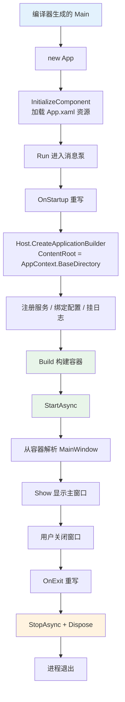

## 一、`new MainWindow()` 能跑多远

第 02 章里，WPF 的启动只有两条语句：XAML 上的 `StartupUri` 负责 new 一个窗口并 `Show()`，编译器生成的 `Main` 负责 `new App()` 再 `Run()`。整个过程没有容器、没有配置、没有日志——它跟 `dotnet new console` 的骨架其实是同一套东西，只是多了一个消息泵。

现在把 DbLens 的需求塞进去：`MainWindow` 要显示连接列表，列表来自 `IConnectionService`；`ConnectionService` 要读 `IConnectionStore`；`IConnectionStore` 需要知道用户目录在哪、需要 `ILogger`；查询页还要 `IDbContextFactory<DbLensDbContext>`。如果全靠构造函数里 `new`，你会写出这样一段代码：

```csharp
// 反模式：把容器该干的活搬进窗口构造函数
public MainWindow()
{
    InitializeComponent();

    var options = new DbContextOptionsBuilder<DbLensDbContext>()
        .UseSqlite("Data Source=dblens.db")
        .Options;

    var db = new DbLensDbContext(options);
    var store = new JsonConnectionStore(Path.Combine(Environment.CurrentDirectory, "connections.json"));
    var connections = new ConnectionService(store);
    var vm = new MainViewModel(connections);

    DataContext = vm;
}
```

编译能过，运行能跑。问题有四个，而且全是你熟悉的：

1. **依赖链一改，所有调用点重写**。`ConnectionService` 明天多要一个 `ILogger<ConnectionService>`，你得回来改这里，还要改查询窗口那一份。
2. **没法替换**。想给 `MainViewModel` 写单元测试，就得真的落一个 SQLite 文件，因为 `DbContext` 在构造函数里就造出来了。
3. **没法共享**。`MainWindow` 造一个 `ConnectionService`，第 12 章打开的查询窗口再 new 一个，两份连接状态各自为政。
4. **没人负责释放**。那个 `DbContext` 谁 `Dispose`？窗口关了就泄漏。

服务端这四条由容器和请求作用域替你解决。桌面端这些工作一样要做，只是**没有现成的"请求"帮你划边界**。所以本章的目标很具体：装 `Microsoft.Extensions.Hosting`，让容器接管对象构建，然后自己定义生命周期边界。

| .NET 服务端 | WPF 桌面端 | 差异要点 |
|---|---|---|
| `WebApplication.CreateBuilder(args)` | `Host.CreateApplicationBuilder(args)` | 没有 Kestrel、没有中间件、没有路由表 |
| 中间件管道处理请求 | 无对应物 | 界面是长期存活的对象树，不是一次请求 |
| Scoped = 一次 HTTP 请求 | 无天然作用域 | 想用 Scoped 必须自己 `CreateScope()` |
| `app.Run()` 监听端口 | `Application.Run()` 跑消息泵 | 都是阻塞，一个等 HTTP，一个等用户输入 |
| `IOptions<T>`、`ILogger<T>` | 完全相同 | ContentRoot 与输出目标必须重设 |
| 异常中间件兜底 | `DispatcherUnhandledException` | 只覆盖 UI 线程，后台线程要另接 |
| `IHostedService` 后台任务 | 依然可用 | 退出顺序需要自己协调 |
| 进程退出由容器管理 | `Application.Exit` 先发生 | Host 不会自动停止，得手动桥接 |

## 二、把 Host 挂到 `App` 上

先装包。WPF 项目引用 `Microsoft.Extensions.Hosting` 完全正常，它会带进 DI、配置、日志三件套：

```powershell
dotnet add src/DbLens.Shell package Microsoft.Extensions.Hosting --version 10.*
```

构建器有两种写法。`Host.CreateDefaultBuilder()` 是老 API，靠一串 `ConfigureServices`、`ConfigureAppConfiguration` 链式调用；`Host.CreateApplicationBuilder()` 是 .NET 8 引入的最小宿主，配置、日志、DI 默认就绪，而且没有那层 `IHostBuilder` 的延迟构建。新项目一律用后者，本章代码也用它，.NET 10 下写法没有任何变化。



完整的 `App.xaml.cs`：

```csharp
using System.IO;
using System.Windows;
using System.Windows.Threading;
using DbLens.Core.Data;
using DbLens.Core.Services;
using DbLens.Infrastructure;
using DbLens.ViewModels;
using Microsoft.EntityFrameworkCore;
using Microsoft.Extensions.DependencyInjection;
using Microsoft.Extensions.Hosting;
using Microsoft.Extensions.Logging;

namespace DbLens;

public partial class App : Application
{
    private IHost? _host;

    protected override async void OnStartup(StartupEventArgs e)
    {
        base.OnStartup(e);

        var builder = Host.CreateApplicationBuilder(new HostApplicationBuilderSettings
        {
            // 关键：工作目录不等于 exe 目录，配置文件必须按 exe 目录找
            ContentRootPath = AppContext.BaseDirectory,
            Args = e.Args
        });

        builder.Services.Configure<UiOptions>(builder.Configuration.GetSection("Ui"));

        builder.Services.AddSingleton<IConnectionStore, JsonConnectionStore>();
        builder.Services.AddSingleton<IConnectionService, ConnectionService>();
        builder.Services.AddSingleton<MainViewModel>();
        builder.Services.AddSingleton<MainWindow>();

        builder.Services.AddDbContextFactory<DbLensDbContext>(options =>
            options.UseSqlite(builder.Configuration.GetConnectionString("Default")));

        builder.Logging.AddDebug();
        builder.Logging.AddProvider(new FileLoggerProvider(
            Path.Combine(AppContext.BaseDirectory, "logs", $"dblens-{DateTime.Now:yyyyMMdd}.log")));

        _host = builder.Build();

        // StartAsync 会启动所有 IHostedService，顺序在窗口显示之前
        await _host.StartAsync();

        var window = _host.Services.GetRequiredService<MainWindow>();

        // 指定主窗口 + ShutdownMode，窗口关闭即退出进程
        MainWindow = window;
        ShutdownMode = System.Windows.ShutdownMode.OnMainWindowClose;
        window.Show();
    }

    protected override async void OnExit(ExitEventArgs e)
    {
        if (_host is not null)
        {
            await _host.StopAsync(TimeSpan.FromSeconds(3));
            _host.Dispose();
            _host = null;
        }

        base.OnExit(e);
    }
}
```

`OnStartup` 和 `OnExit` 都是 `void`，这里写成 `async void` 是唯一合理的例外——它们是框架回调，没有返回值可以 `await`。`OnStartup` 里不 `await` 也没问题，因为消息泵还没真正开始转；`OnExit` 里要当心，`await` 之后的续体可能来不及执行（见踩坑清单）。

### 2.1 必须删掉 `StartupUri`

`App.xaml` 里那行 `StartupUri="MainWindow.xaml"` 现在必须删掉：

```xml
<Application x:Class="DbLens.App"
             xmlns="http://schemas.microsoft.com/winfx/2006/xaml/presentation"
             xmlns:x="http://schemas.microsoft.com/winfx/2006/xaml">
    <Application.Resources>
        <!-- 资源和 DataTemplate 第 12、13 章往里加 -->
    </Application.Resources>
</Application>
```

原因不是"风格问题"，而是两个硬冲突：

- `StartupUri` 用**无参构造函数**创建窗口，这条路径绕开了容器。而 `MainWindow` 的构造函数要接收 `MainViewModel`，两者直接对不上。
- 就算你给 `MainWindow` 补一个无参构造，`StartupUri` 也会自己 new 一个，然后你在 `OnStartup` 里又从容器解析一个——**开两个窗口**，其中一个没有任何依赖注入。

`StartupUri` 是"没有容器时代"的语法糖，接入 Host 之后它的职责被 `GetRequiredService<MainWindow>()` 完全取代。

## 三、注册什么，注册成什么生命周期

生命周期是本章最容易照搬错误的地方。

| 生命周期 | Web 里的实际含义 | 桌面端的实际含义 | DbLens 里的用法 |
|---|---|---|---|
| Singleton | 整个应用一个实例，跨请求共享 | 整个进程一个实例，和"应用级"等价 | `MainWindow`、`MainViewModel`、各 Service |
| Scoped | 每个 HTTP 请求一个，请求结束释放 | **没有对应边界**，只在手动 `CreateScope()` 内有效 | 一次"连接会话"（见第 11 章） |
| Transient | 每次解析都新建 | 同左；注意每 `GetRequiredService` 一次就 new 一次 | 页面级 ViewModel、对话框 ViewModel |

结论可以写死：**桌面端 99% 的注册是 Singleton 或 Transient。** Scoped 只有在你自己划出的自定义作用域里才有意义。比如 DbLens 的"打开一个连接 → 浏览表结构 → 关掉连接"这个周期，你可以选择用作用域来表达：

```csharp
public sealed class ConnectionSessionFactory(IServiceScopeFactory scopeFactory)
{
    public IDisposable BeginSession()
        => scopeFactory.CreateScope();
}
```

但更直接的做法是用 EF Core 的 `IDbContextFactory` 手动管理上下文，第 11 章讲。这里只要记住一件事：容器不会因为你没写 `using var scope` 就自动帮你回收任何东西，根容器里的 Singleton 活到进程退出。

`Transient` 还有一个容易被忽略的细节：它不解决"我只想要一个"的问题。如果你在 `NavigateTo` 里每次解析页面 ViewModel，页面状态就会在返回时丢光——导航栈要自己保存实例，第 12 章正是这么做的。

## 四、配置：`ContentRoot` 不是 exe 目录

`Host.CreateApplicationBuilder()` 默认把 `ContentRootPath` 设成 `Directory.GetCurrentDirectory()`。从资源管理器双击 exe，这个值确实是 exe 所在目录；但从快捷方式、计划任务、或者别的进程 `Process.Start` 起来时，它可能是 `C:\Windows\System32`，甚至是 `C:\`。这时候 `appsettings.json` 找不到，`optional: true` 又让它静默跳过，你最终会在一个"配置全是默认值"的应用里排查半天。

所以上一节代码里显式写了 `ContentRootPath = AppContext.BaseDirectory`。同时配置文件本身要复制到输出目录，否则开发时能用、发布后消失：

```xml
<ItemGroup>
  <None Update="appsettings.json">
    <CopyToOutputDirectory>PreserveNewest</CopyToOutputDirectory>
  </None>
</ItemGroup>
```

```json
{
  "ConnectionStrings": {
    "Default": "Data Source=C:/Users/Public/DbLens/dblens.db"
  },
  "Ui": {
    "PageSize": 200,
    "CommandTimeoutSeconds": 30
  },
  "Logging": {
    "LogLevel": {
      "Default": "Information",
      "Microsoft.EntityFrameworkCore": "Warning"
    }
  }
}
```

```csharp
public sealed class UiOptions
{
    public int PageSize { get; set; } = 200;
    public int CommandTimeoutSeconds { get; set; } = 30;
}
```

两个桌面端特有的坑：

- **SQLite 连接串不展开环境变量**。`Data Source=%APPDATA%\DbLens\dblens.db` 会被当成字面量路径。要么在代码里 `Environment.GetFolderPath(SpecialFolder.ApplicationData)` 拼出绝对路径，要么 `Environment.ExpandEnvironmentVariables` 先展开再交给 `UseSqlite`。
- **不要注入 `IOptionsSnapshot<T>`**。它是 Scoped 注册的，而从根容器解析 Scoped 在开启作用域校验时会直接抛 `Cannot resolve scoped service from root provider`。桌面端要"改配置立即生效"，用 `IOptionsMonitor<T>`，它的 `CurrentValue` 会跟随 `reloadOnChange` 更新。

`appsettings.Development.json` 只有在 `DOTNET_ENVIRONMENT=Development` 时才加载。VS 的调试配置里默认设了 `ASPNETCORE_ENVIRONMENT` 和 `DOTNET_ENVIRONMENT`，命令行启动则需要自己设环境变量，否则永远读到 Production 那份。

## 五、日志要落到文件里

`builder.Logging.AddDebug()` 的输出只进 VS 的"输出"窗口或 DebugView。用户双击 exe 闪退时，你手上什么都没有。桌面应用的日志必须有文件落点。

不引第三方的话，一个够用的 `ILoggerProvider` 长这样：

```csharp
using System.IO;
using Microsoft.Extensions.Logging;

namespace DbLens.Infrastructure;

public sealed class FileLoggerProvider : ILoggerProvider
{
    private readonly StreamWriter _writer;
    private readonly object _gate = new();

    public FileLoggerProvider(string path)
    {
        Directory.CreateDirectory(Path.GetDirectoryName(path)!);
        _writer = new StreamWriter(
            new FileStream(path, FileMode.Append, FileAccess.Write, FileShare.Read))
        {
            AutoFlush = true
        };
    }

    public ILogger CreateLogger(string categoryName) => new FileLogger(this, categoryName);

    public void Dispose()
    {
        lock (_gate) _writer.Dispose();
    }

    private sealed class FileLogger(FileLoggerProvider owner, string category) : ILogger
    {
        public IDisposable? BeginScope<TState>(TState state) where TState : notnull => null;

        public bool IsEnabled(LogLevel logLevel) => logLevel >= LogLevel.Information;

        public void Log<TState>(LogLevel logLevel, EventId eventId, TState state,
            Exception? exception, Func<TState, Exception?, string> formatter)
        {
            if (!IsEnabled(logLevel)) return;

            var line = $"{DateTime.Now:yyyy-MM-dd HH:mm:ss.fff} [{logLevel}] {category} {formatter(state, exception)}";
            if (exception is not null) line += Environment.NewLine + exception;

            lock (owner._gate) owner._writer.WriteLine(line);
        }
    }
}
```

它只做三件事：按天分文件、加锁、异常带堆栈。没有滚动清理、没有结构化字段，真要上生产就换 Serilog：

```powershell
dotnet add src/DbLens.Shell package Serilog.Extensions.Logging --version 8.*
dotnet add src/DbLens.Shell package Serilog.Sinks.File --version 6.*
```

```csharp
builder.Logging.AddSerilog(new Serilog.LoggerConfiguration()
    .MinimumLevel.Information()
    .WriteTo.File(
        Path.Combine(AppContext.BaseDirectory, "logs", "dblens-.log"),
        rollingInterval: Serilog.RollingInterval.Day,
        retainedFileCountLimit: 14)
    .CreateLogger());
```

## 六、退出与异常兜底

`IHostApplicationLifetime` 有三个回调和两个 `CancellationToken`：`ApplicationStarted`、`ApplicationStopping`、`ApplicationStopped`。它们由 `StartAsync` / `StopAsync` 驱动，和 WPF 自己的退出流程**是两套**：

- 用户点关闭 → WPF 的 `Shutdown` → `OnExit`。如果你不在 `OnExit` 里调 `StopAsync`，宿主根本不知道要停，`ApplicationStopping` 永远不会触发。
- 反过来，`lifetime.StopApplication()` 只会请求停止宿主，它**不会关窗口、不会结束进程**。这是从服务端迁移过来最容易误解的一点：`StopApplication` 在 Web 里等于 `app.Run()` 返回，在 WPF 里什么视觉变化都没有。

```csharp
var lifetime = _host.Services.GetRequiredService<IHostApplicationLifetime>();
lifetime.ApplicationStopping.Register(() =>
    _host.Services.GetRequiredService<ILogger<App>>().LogInformation("宿主停止中，开始释放资源"));
```

`ShutdownMode` 决定"什么时候算退出"，三个取值：

| 值 | 触发条件 | 适用场景 |
|---|---|---|
| `OnLastWindowClose`（默认） | 最后一个窗口关闭 | 多窗口工具 |
| `OnMainWindowClose` | `Application.MainWindow` 关闭 | 有明确主窗口的 Shell 应用（DbLens） |
| `OnExplicitShutdown` | 只有显式调用 `Shutdown()` | 托盘常驻、后台服务型应用 |

全局兜底要挂三个点，它们覆盖的异常类型完全不同：

```csharp
public App()
{
    DispatcherUnhandledException += OnDispatcherException;
    AppDomain.CurrentDomain.UnhandledException += OnDomainException;
    TaskScheduler.UnobservedTaskException += OnUnobservedTaskException;
}

private void OnDispatcherException(object sender, DispatcherUnhandledExceptionEventArgs e)
{
    _host?.Services.GetService<ILogger<App>>()?.LogError(e.Exception, "UI 线程未处理异常");

    MessageBox.Show($"发生未处理的错误：{e.Exception.Message}", "DbLens",
        MessageBoxButton.OK, MessageBoxImage.Error);

    // 标记已处理只是让进程别立刻死，对象状态可能已经不一致
    e.Handled = true;
}

private void OnDomainException(object sender, UnhandledExceptionEventArgs e)
    => _host?.Services.GetService<ILogger<App>>()
        ?.LogCritical(e.ExceptionObject as Exception, "非 UI 线程未处理异常，进程即将终止");

private void OnUnobservedTaskException(object? sender, UnobservedTaskExceptionEventArgs e)
{
    _host?.Services.GetService<ILogger<App>>()?.LogError(e.Exception, "未被观察的 Task 异常");
    e.SetObserved();   // 阻止 .NET 把它升级成进程终止
}
```

要知道三者的边界：`DispatcherUnhandledException` 只管 UI 线程；`AppDomain.UnhandledException` 能拿到后台线程的异常但**拦不住**进程退出，只能记日志；`TaskScheduler.UnobservedTaskException` 要等 GC 回收那个 `Task` 才触发，可能延迟几十秒，且它只对"没人 `await` 也没人读 `Exception`"的任务生效。

## 七、设计器为什么会炸

WPF 设计器为了拿到 `Application.Resources`，会创建 `App` 的实例并调用 `InitializeComponent()`，但**不会调用 `Run()`，也不会走 `OnStartup`**。这意味着两件事：

- 容器在设计时根本不存在，所有从容器解析出来的对象在设计器里都是 null；
- `App` 的构造函数和字段初始化器**会**执行。所以别把 `Host.CreateApplicationBuilder().Build()` 写在字段初始化器或构造函数里——设计器每刷新一次就建一个宿主，还可能因为读不到配置文件直接抛异常。

真正会让设计器报"调用的目标发生异常"的是窗口/控件的构造函数。设计器预览一个 XAML 根元素时，用的是它的无参构造函数。如果你把 `MainWindow` 写成只接受 `MainViewModel`，设计器就预览不了它。

处理办法分两种，第 09 章已经埋了伏笔：

- **参与 `DataTemplate` 的 View 一律保持无参构造**，`DataContext` 由绑定或模板注入。这样设计器天然能实例化它们，再配 `d:DataContext` 就能看到设计时数据（第 12 章展开）。
- **只有 `MainWindow` 带参**，它是外壳、不参与模板，预览不了不影响开发。实在要看，临时加一个无参重载并在里面塞 `d:DesignInstance` 的数据，别提交。

## 八、踩坑清单

| 现象 | 原因 | 处理 |
|---|---|---|
| 启动后出现两个窗口 | 保留了 `StartupUri`，同时手工解析了 `MainWindow` | 删掉 `App.xaml` 的 `StartupUri` |
| 配置全部是默认值，`appsettings.json` 像没读 | `ContentRootPath` 是当前工作目录，不是 exe 目录 | `ContentRootPath = AppContext.BaseDirectory`，并设 `CopyToOutputDirectory` |
| 发布后提示找不到 `appsettings.json` | 文件没被复制到输出目录 | csproj 里加 `None Update` + `PreserveNewest` |
| `Cannot resolve scoped service from root provider` | 从根容器解析了 `IOptionsSnapshot` 或 Scoped 服务 | 改用 `IOptionsMonitor`，或 `CreateScope()` |
| 关闭窗口后宿主还在、日志没 flush | `OnExit` 没调 `StopAsync`，或 `async void` 的续体没执行 | 在 `OnExit` 里同步等待，或在 `Closing` 阶段提前完成清理 |
| 调 `StopApplication()` 窗口没关 | 它只停宿主，不管 WPF 窗口 | 先 `Shutdown()`，或自己关闭窗口 |
| 用户机器上闪退，日志一片空白 | 只用 `AddDebug()`，输出进的是调试器 | 加文件日志 Provider，并挂三个全局异常点 |
| 设计器打开窗口报"调用的目标发生异常" | 窗口只有带参构造函数，或构造函数里建了 Host | View 保持无参构造，Host 只在 `OnStartup` 里建 |
| `e.Handled = true` 之后界面行为错乱 | 异常被吞，对象状态已不一致 | 记录日志并提示用户重启，不要长期吞异常 |

## 九、本章小结

- WPF 默认没有 DI，`StartupUri` 用无参构造 new 窗口，接入容器后必须删掉它，改为 `GetRequiredService<MainWindow>()`。
- 桌面端没有"请求"，`Scoped` 失去天然边界；默认全部 Singleton 或 Transient，需要边界就自己 `CreateScope()`。
- `Host.CreateApplicationBuilder` 的 `ContentRoot` 默认是工作目录，必须显式指向 `AppContext.BaseDirectory`，配置文件要复制到输出目录。
- `ILogger` 加上文件 Provider 才有意义，`AddDebug` 的输出在用户机器上是不可见的。
- Host 的 `IHostApplicationLifetime` 与 WPF 的 `Application.Exit` 是两套流程，需要在 `OnExit` 里手动 `StopAsync`。
- 设计器会执行 `App` 的构造函数但不执行 `OnStartup`，所以 Host 的构建必须放在 `OnStartup`，View 的构造函数要保持无参。

**练习**：给 `App` 加一个 `IHostedService`，在 `StartAsync` 里启动一个每 30 秒写一次心跳日志的循环，在 `StopAsync` 里用传入的 `CancellationToken` 结束循环。然后分别测试：正常关闭窗口、任务管理器强杀进程，观察日志里心跳是否停止、`StopAsync` 是否被调用。再改成 `ShutdownMode.OnExplicitShutdown`，看看关掉窗口后心跳还在不在。

下一章处理数据层：为什么 `AddDbContext` 在桌面端是错的，以及怎么执行用户随手敲的任意 SQL。
