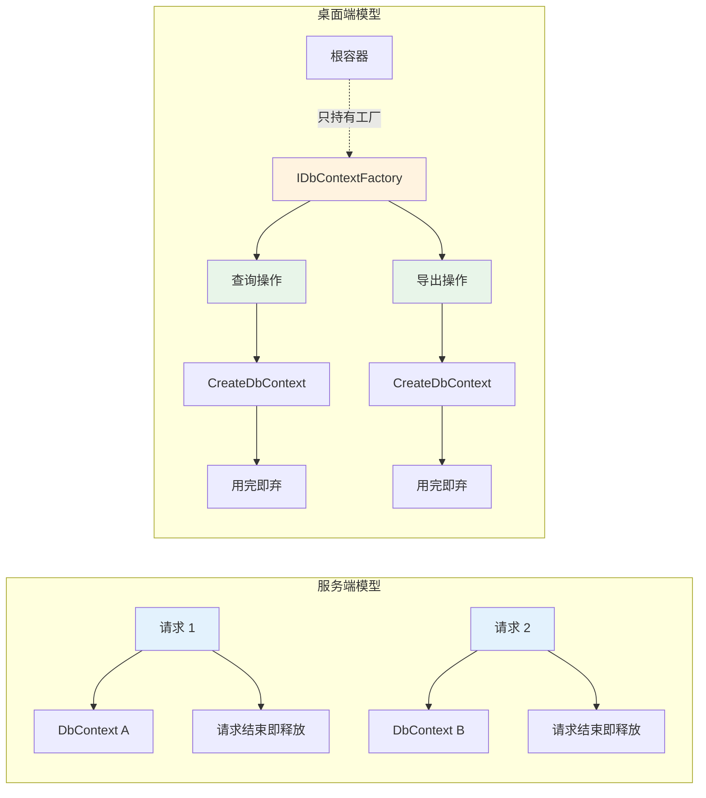

## 一、`AddDbContext` 在桌面端是错的

第 10 章的注册代码里出现了 `AddDbContextFactory<DbLensDbContext>()`，而不是你在服务端写了十年的 `AddDbContext`。这不是洁癖，是四个具体的故障。

| 服务端前提 | 桌面端现实 | 后果 |
|---|---|---|
| Scoped 随请求销毁 | 根容器里的实例活到进程退出 | 配置漂移、内存不释放 |
| 一个请求一个线程 | 同一上下文被 UI 与后台导出同时使用 | `InvalidOperationException`：上下文不支持并发 |
| 请求内实体数量有限 | 一次会话里连续查询上千条 | 变更追踪器膨胀，内存和查询变慢 |
| 请求结束即回收 | 用户把窗口开一整天 | 连接长期占用，SQLite 文件可能被锁 |

逐条说清楚：

**长生命周期**。`AddDbContext` 默认注册为 Scoped，在 Web 里这个 Scope 由框架创建和销毁。WPF 没有请求，你从根容器解析出来的 `DbContext` 是"永久对象"，它会一直记住见过的实体。用户改了三张表的数据，追踪器里可能存着十几万条实例。

**跨线程**。`DbContext` 不是线程安全的。DbLens 里"查询"和"导出 CSV"可能同时跑，如果共用同一个上下文，第二个操作会撞上 `A second operation was started on this context instance before a previous operation completed`。这不是"偶尔才发生"，是并发下必然发生。

**追踪膨胀**。`ChangeTracker` 对每条加载的实体做快照，用来生成 `UPDATE`。你只是想显示数据，却付了追踪的代价。只读查询一律 `AsNoTracking()`。

**并发复用**。即使你锁住上下文串行化访问，也把一个本该并行的查询工具变成了单线程。桌面端的正确模型是"每个操作拿一个新上下文"。



## 二、`AddDbContextFactory` 的标准姿势

工厂注册成 Singleton，`DbContext` 每次现造、用完即弃：

```csharp
builder.Services.AddDbContextFactory<DbLensDbContext>(options =>
    options.UseSqlite(builder.Configuration.GetConnectionString("Default")));
```

```csharp
public sealed class SavedQueryService(IDbContextFactory<DbLensDbContext> factory)
{
    public async Task<List<SavedQuery>> ListAsync(CancellationToken ct)
    {
        await using var db = await factory.CreateDbContextAsync(ct);

        return await db.SavedQueries
            .AsNoTracking()
            .OrderByDescending(q => q.LastRunAt)
            .ToListAsync(ct);
    }

    public async Task AddAsync(SavedQuery query, CancellationToken ct)
    {
        await using var db = await factory.CreateDbContextAsync(ct);

        db.SavedQueries.Add(query);
        await db.SaveChangesAsync(ct);
    }
}
```

三个细节：

- `CreateDbContextAsync` 有同步版本 `CreateDbContext()`，但它会同步打开连接，UI 线程上别用。异步版本在内部按需异步初始化，这是桌面端唯一的正确入口。
- `await using` 而不是 `using`，因为 `DbContext.DisposeAsync` 会异步释放连接。SQLite 影响不大，但换 PostgreSQL 时就是实打实的差别。
- 一个方法一个上下文。不要把它存到字段里"复用一下省点开销"——初始化开销远小于并发故障的成本。

`DbContextOptionsBuilder` 里 `UseSqlite` 的连接串从配置来，但正因为它来自配置，桌面端还有一个额外问题：用户切换连接时，工厂的 Options 已经缓存了。所以 DbLens 把数据库分成两类：

- **本地库**（`%AppData%\DbLens\dblens.db`）：保存查询历史、收藏、窗口布局。走 `IDbContextFactory`，路径固定，生命周期长。
- **用户连接的目标库**：随时切换，走 `IDbProvider` + 裸 `DbConnection`，见本章后半部分。

把这两者混成一个 `DbContext` 是很多桌面数据库工具后期的技术债来源。

## 三、连接定义不要硬编码

连接串写死在代码里的项目，用户第一次换机器就会来找你。放到用户目录下：

```csharp
using System.IO;
using System.Text.Json;
using Microsoft.Extensions.Logging;

namespace DbLens.Core.Services;

public sealed record ConnectionProfile(
    string Id,
    string Name,
    string Provider,
    string ConnectionString,
    DateTime LastUsedAt);

public interface IConnectionStore
{
    Task<IReadOnlyList<ConnectionProfile>> LoadAsync(CancellationToken ct = default);
    Task SaveAsync(IReadOnlyList<ConnectionProfile> profiles, CancellationToken ct = default);
}

public sealed class JsonConnectionStore : IConnectionStore
{
    private static readonly JsonSerializerOptions JsonOptions = new() { WriteIndented = true };

    private readonly ILogger<JsonConnectionStore> _logger;
    private readonly string _path;

    public JsonConnectionStore(ILogger<JsonConnectionStore> logger)
    {
        _logger = logger;

        var dir = Path.Combine(
            Environment.GetFolderPath(Environment.SpecialFolder.ApplicationData),
            "DbLens");
        Directory.CreateDirectory(dir);

        _path = Path.Combine(dir, "connections.json");
    }

    public async Task<IReadOnlyList<ConnectionProfile>> LoadAsync(CancellationToken ct = default)
    {
        if (!File.Exists(_path)) return [];

        try
        {
            await using var stream = File.OpenRead(_path);
            return await JsonSerializer.DeserializeAsync<List<ConnectionProfile>>(stream, JsonOptions, ct)
                   ?? [];
        }
        catch (JsonException ex)
        {
            // 文件被手工改坏时不能让应用起不来，退回空列表
            _logger.LogWarning(ex, "connections.json 解析失败，已忽略该文件");
            return [];
        }
    }

    public async Task SaveAsync(IReadOnlyList<ConnectionProfile> profiles, CancellationToken ct = default)
    {
        // 先写临时文件再替换，避免写一半断电把原文件破坏
        var temp = _path + ".tmp";

        await using (var stream = File.Create(temp))
        {
            await JsonSerializer.SerializeAsync(stream, profiles, JsonOptions, ct);
        }

        File.Move(temp, _path, overwrite: true);
        _logger.LogInformation("已保存 {Count} 个连接定义", profiles.Count);
    }
}
```

`%AppData%` 是 Roaming，会跟随域账户漫游；连接串里有密码时这一点很危险。DbLens 的做法是把密码扔进 Windows 凭据管理器（`CredentialManager`）或用 DPAPI 加密后再写文件，`connections.json` 里只存一个引用。日志里永远不要输出 `ConnectionString` 原值，那等于把密码写进磁盘明文。

EF Core 10 + SQLite 的包引用：

```powershell
dotnet add src/DbLens.Core package Microsoft.EntityFrameworkCore.Sqlite --version 10.*
```

包加在 `DbLens.Core` 而不是 Shell，因为 `DbLensDbContext` 属于无 UI 依赖的那一层，第 02 章的分层约束在这里第一次发挥作用。

## 四、用户敲的 SQL 不是实体查询

`FromSqlRaw` 和 `Database.SqlQuery<T>` 都要求编译期知道结果类型：前者必须落在 `DbSet<TEntity>` 上，后者虽然能映射到任意 POCO，但 `T` 依然是你在代码里写死的。而 DbLens 的核心场景恰恰相反——用户在编辑器里敲了 `SELECT * FROM Orders o JOIN Customers c ON ...`，列有几列、叫什么、什么类型，**只有执行完才知道**。

EF Core 10 的 `Database.SqlQuery<T>` 支持映射到未注册的 POCO，这对"已知列集合"的报表很有用：

```csharp
public sealed class OrderSummary
{
    public long OrderId { get; set; }
    public string CustomerName { get; set; } = "";
    public decimal Total { get; set; }
}

var rows = await db.Database
    .SqlQuery<OrderSummary>($"SELECT ...")
    .ToListAsync(ct);
```

但它解决不了动态列。要执行任意 SQL，回到最底层的 ADO.NET：

```csharp
using System.Data;
using System.Data.Common;
using Microsoft.Extensions.Options;

public sealed record QueryResult(DataTable Table, TimeSpan Elapsed);

public sealed class SqlExecutor(IDbProvider provider, IOptions<UiOptions> options)
{
    public async Task<QueryResult> ExecuteAsync(string sql, CancellationToken ct)
    {
        var sw = System.Diagnostics.Stopwatch.StartNew();

        await using var connection = provider.CreateConnection();
        await connection.OpenAsync(ct);

        await using var command = connection.CreateCommand();
        command.CommandText = sql;
        command.CommandTimeout = options.Value.CommandTimeoutSeconds;

        await using var reader = await command.ExecuteReaderAsync(ct);

        var table = new DataTable();

        // 先按结果集的元数据建列
        for (var i = 0; i < reader.FieldCount; i++)
        {
            var name = reader.GetName(i);

            // SELECT a.id, b.id 会出现重名列，DataTable 不允许
            if (table.Columns.Contains(name)) name = $"{name}_{i}";

            // GetFieldType 对 SQLite 是"声明类型优先"，表达式列可能返回 object
            var type = reader.GetFieldType(i) ?? typeof(object);
            table.Columns.Add(name, type);
        }

        while (await reader.ReadAsync(ct))
        {
            var values = new object?[reader.FieldCount];

            for (var i = 0; i < reader.FieldCount; i++)
            {
                values[i] = await reader.IsDBNullAsync(i, ct)
                    ? DBNull.Value          // DataTable 里 null 要写成 DBNull.Value
                    : reader.GetValue(i);
            }

            table.Rows.Add(values);
        }

        sw.Stop();
        return new QueryResult(table, sw.Elapsed);
    }
}
```

几个必须知道的细节：

- **`DBNull.Value` 不是 `null`**。`DataRow` 里塞 `null` 表示"未设置"，读取时 `IsNull` 判断会走不同分支；数据库里的 NULL 要映射成 `DBNull.Value`。
- **`GetFieldType` 可能返回 `object`**。SQLite 是动态类型，`SELECT COUNT(*)`、`SELECT a || b` 这类表达式列的声明类型可能是空，这时列类型就是 `object`，`DataTable` 接受任意值，代价是丢了类型信息。要拿更准确的元数据可用 `reader.GetColumnSchema()` 读 `DataTypeName`，再自己映射。
- **一次 `ExecuteReaderAsync` 只返回第一个结果集**。多语句脚本要用 `NextResultAsync` 循环。
- **非查询语句不要走这条路**。`INSERT`/`UPDATE` 用 `ExecuteNonQueryAsync`，返回值是受影响行数，`DataTable` 会是空的。

这套代码放在 `DbLens.Core`，ViewModel 拿到 `QueryResult` 后把它转成自己的行集合。Core 里出现 `System.Data` 是可以接受的，出现 `System.Windows` 不行。

## 五、异步，以及 `ConfigureAwait`

WPF 的 `await` 语义和服务端不同：UI 线程上的 `SynchronizationContext` 会把续体投递回 UI 线程。这带来一条规则和一条例外。

**规则**：ViewModel 里 `await` 之后可以直接更新 `ObservableCollection`，因为已经回到 UI 线程了。反过来，如果你在 `Task.Run` 里更新集合，就会抛"另一个线程拥有该对象"。

**例外（在类库代码里）**：`DbLens.Core` 的所有 `await` 都该写 `ConfigureAwait(false)`。它不关心线程上下文，不回 UI 线程能少一次调度，也避免了调用方在 UI 线程上同步阻塞导致的死锁。ViewModel 里的 `await` 则**不要**加 `ConfigureAwait(false)`，否则后续代码跑在线程池上，碰控件就炸。

常用 API 的选择：

| API | 场景 | 注意 |
|---|---|---|
| `ToListAsync(ct)` | 结果集已知大小、需要完整列表 | 一次性分配，几十万行会吃掉大量内存 |
| `AsNoTracking()` | 只读展示 | 不生成快照，查询更快、内存更小 |
| `AsAsyncEnumerable()` | 流式处理大结果 | 逐条 `await foreach`，不能与 `ToListAsync` 混用 |
| `ExecuteReaderAsync(ct)` | 任意 SQL、需要元数据 | 见上一节 |
| `ExecuteNonQueryAsync(ct)` | DDL、DML | 返回受影响行数 |
| `ExecuteScalarAsync(ct)` | `COUNT(*)`、`PRAGMA` 单值 | 返回 `object?`，要自己判 `DBNull` |

`AsAsyncEnumerable` 在真实项目里经常被用错：

```csharp
await foreach (var row in db.SavedQueries.AsNoTracking().AsAsyncEnumerable().WithCancellation(ct))
{
    // 这里每读一条才拉一条，适合边读边写文件
    await writer.WriteLineAsync(row.Sql);
}
```

它保持连接打开的时间更长，不适合"读一半就去做别的事"的场景。DbLens 的导出功能用它，查询页显示则用 `ToListAsync` + 分批追加。

## 六、读 Schema

SQLite 没有 `information_schema`，元数据在 `sqlite_master` 和 `PRAGMA` 里：

```sql
-- 所有表和视图
SELECT name, type
FROM sqlite_master
WHERE type IN ('table', 'view')
  AND name NOT LIKE 'sqlite_%'
ORDER BY name;

-- 某张表的列
PRAGMA table_info("Orders");
```

`PRAGMA table_info` 返回六列：`cid`、`name`、`type`、`notnull`、`dflt_value`、`pk`。注意 `PRAGMA` **不支持参数化**，表名只能拼进 SQL，所以必须转义引号：

```csharp
public sealed record ColumnInfo(string Name, string StoreType, bool NotNull, bool IsPrimaryKey);

public sealed class SqliteSchemaReader(IDbProvider provider)
{
    public async Task<IReadOnlyList<ColumnInfo>> GetColumnsAsync(string table, CancellationToken ct)
    {
        await using var connection = provider.CreateConnection();
        await connection.OpenAsync(ct);

        await using var command = connection.CreateCommand();

        // PRAGMA 无法参数化，用双引号包裹并转义内部引号
        var quoted = table.Replace("\"", "\"\"");
        command.CommandText = $"PRAGMA table_info(\"{quoted}\")";

        await using var reader = await command.ExecuteReaderAsync(ct);

        var columns = new List<ColumnInfo>();
        while (await reader.ReadAsync(ct))
        {
            columns.Add(new ColumnInfo(
                Name: reader.GetString(1),
                StoreType: reader.GetString(2),
                NotNull: reader.GetInt32(3) == 1,
                IsPrimaryKey: reader.GetInt32(5) > 0));
        }

        return columns;
    }
}
```

`StoreType` 是 SQLite 的声明类型（`INTEGER`、`TEXT`、`REAL`、`BLOB` 或用户写的 `VARCHAR(50)`），不是 .NET 类型。展示给用户时直接显示原样最合适——数据库客户端不该替用户做类型翻译。

## 七、大数据量：超时、取消、分批

三个控制点，缺一个都会让用户觉得"这软件卡死了"：

**`CommandTimeout`**。默认 30 秒，长查询会直接抛超时。DbLens 把它做成可配置项，落到 `UiOptions` 里，按查询类型给不同值。

**取消**。用户点了"取消"，要能真的中断 SQLite 正在执行的语句：

```csharp
await using var command = connection.CreateCommand();
command.CommandText = sql;

using var registration = ct.Register(() =>
{
    try
    {
        command.Cancel();   // SQLite 内部走 sqlite3_interrupt
    }
    catch (InvalidOperationException)
    {
        // 命令已经结束，取消是空操作
    }
});
```

`Cancel()` 之后 `ExecuteReaderAsync` 会抛异常，SQLite 的报错文本是 `interrupted`。捕获它并当成"用户取消"处理，不要弹红色错误框。

**分批**。`DataTable.Rows.Add` 十万次会明显卡顿。做法是攒满 500 行往 UI 推一次，中间 `await Task.Yield()` 让 Dispatcher 有机会处理重绘和取消按钮：

```csharp
var batch = new List<object?[]>(500);

while (await reader.ReadAsync(ct))
{
    batch.Add(ReadRow(reader));

    if (batch.Count >= 500)
    {
        AppendToGrid(batch);
        batch.Clear();
        await Task.Yield();
    }
}
```

## 八、`IDbProvider`：为第二种数据库留门

DbLens 现在只支持 SQLite，但把 SQLite 的类型细节写进 ViewModel 会让以后加 PostgreSQL 变成重写。抽一层最薄的接口：

```csharp
using System.Data.Common;

namespace DbLens.Core.Data;

public interface IDbProvider
{
    string Name { get; }
    DbConnection CreateConnection();
    string QuoteIdentifier(string identifier);
    Task<IReadOnlyList<string>> GetTableNamesAsync(CancellationToken ct);
}
```

```csharp
public sealed class SqliteProvider(IConnectionService connections) : IDbProvider
{
    public string Name => "SQLite";

    public DbConnection CreateConnection()
    {
        var profile = connections.Active
            ?? throw new InvalidOperationException("尚未选择连接");

        return new SqliteConnection(profile.ConnectionString);
    }

    public string QuoteIdentifier(string identifier)
        => $"\"{identifier.Replace("\"", "\"\"")}\"";

    public async Task<IReadOnlyList<string>> GetTableNamesAsync(CancellationToken ct)
    {
        await using var connection = CreateConnection();
        await connection.OpenAsync(ct);

        await using var command = connection.CreateCommand();
        command.CommandText =
            "SELECT name FROM sqlite_master WHERE type = 'table' AND name NOT LIKE 'sqlite_%' ORDER BY name";

        await using var reader = await command.ExecuteReaderAsync(ct);

        var names = new List<string>();
        while (await reader.ReadAsync(ct)) names.Add(reader.GetString(0));
        return names;
    }
}
```

PostgreSQL 版本换 `NpgsqlConnection`，`GetTableNamesAsync` 查 `information_schema.tables`，`QuoteIdentifier` 用双引号（和 SQLite 一样）。SqlExecutor、SchemaReader 一行都不用改——因为它们只依赖 `DbConnection`、`DbCommand`、`DbDataReader` 这些抽象。

## 九、把异常翻译成人话

`SqliteException.Message` 是给开发者看的，直接弹给用户等于让他去搜英文。按 `SqliteErrorCode` 分类：

```csharp
using Microsoft.Data.Sqlite;

public static class DbErrorTranslator
{
    public static string ToUserMessage(SqliteException ex) => ex.SqliteErrorCode switch
    {
        1 => "SQL 语法错误，或者引用的表/列不存在。",
        5 => "数据库正被其他程序占用，请稍后重试。",
        14 => "无法打开数据库文件，请检查路径是否存在、是否有读写权限。",
        19 => "违反约束（唯一、非空或外键），请检查数据。",
        23 => "该数据库需要密码，或当前用户没有权限。",
        26 => "选择的文件不是合法的 SQLite 数据库。",
        _ => $"数据库返回错误（{ex.SqliteErrorCode}）：{ex.Message}"
    };
}
```

调用侧永远是"日志记完整异常，界面显示翻译后的句子"：

```csharp
catch (SqliteException ex)
{
    _logger.LogError(ex, "执行 SQL 失败，语句长度 {Length}", sql.Length);
    ErrorMessage = DbErrorTranslator.ToUserMessage(ex);
}
```

注意日志里不要写完整 SQL 参数值——那里可能有用户数据。记长度、记耗时、记错误码就够了。

## 十、踩坑清单

| 现象 | 原因 | 处理 |
|---|---|---|
| `A second operation was started on this context instance` | 共用了一个 `DbContext`，并发执行两个操作 | 用 `IDbContextFactory`，一操作一上下文 |
| 内存一路涨、越查越慢 | 长生命周期上下文的变更追踪器积累实体 | 只读查询加 `AsNoTracking()`，不要缓存上下文 |
| 切换连接后仍连旧库 | 工厂的 Options 在首次构建时就固定了 | 目标库走 `IDbProvider`，不要复用本地 DbContext |
| `DataTable` 出现重名列报错 | `SELECT a.id, b.id` 同名列 | 建列时检测重名并加序号后缀 |
| 结果里 NULL 变成"未设置" | 用 `null` 而不是 `DBNull.Value` | `IsDBNullAsync` 后写 `DBNull.Value` |
| 列类型全是 `object` | SQLite 表达式列没有声明类型 | 接受它，或用 `GetColumnSchema().DataTypeName` |
| 取消按钮点了没反应 | 只取消了 `CancellationToken`，没有中断命令 | `ct.Register(() => command.Cancel())` |
| `PRAGMA` 查表报语法错 | 表名含引号或特殊字符，且没转义 | 双引号包裹 + `Replace("\"", "\"\"")` |
| 语法错误弹出一大段英文 | 直接把 `SqliteException.Message` 显示给用户 | 按错误码翻译，原文只进日志 |
| 发布后启动报"数据库文件不存在" | 用了相对路径，工作目录不是 exe 目录 | 用 `AppContext.BaseDirectory` 或 `SpecialFolder.ApplicationData` 拼绝对路径 |

## 十一、本章小结

- 桌面端没有请求作用域，`AddDbContext` 会导致长生命周期、跨线程、追踪膨胀与并发复用四个问题，标准答案是 `IDbContextFactory` + 一次操作一个上下文。
- 本地应用数据与用户的目标库要分开：前者用 `DbContextFactory`，后者用 `IDbProvider` + 裸连接，因为连接是运行时可变的。
- `FromSqlRaw` / `SqlQuery<T>` 都需要编译期确定的类型，动态列只能走 `DbCommand` + `DbDataReader` + `DataTable`。
- `DBNull.Value`、重名列、`object` 列类型是动态结果集的三个固定坑，处理方式就是几十行代码。
- 类库里的 `await` 加 `ConfigureAwait(false)`，ViewModel 里不加，这是两种线程语义的分界线。
- `CommandTimeout`、`CancellationToken` + `command.Cancel()`、分批追加，是让大结果集"看起来不卡"的三件套。
- 错误信息分两层：日志留原文，界面给人话。

**练习**：给 `SqlExecutor` 加一个 `ExecuteScalarAsync` 方法，用它实现"统计当前库有多少张表"。然后把 `UiOptions.CommandTimeoutSeconds` 配成 1，执行一条用 `WITH RECURSIVE` 生成百万行的慢查询，验证超时异常是否被正确翻译、取消按钮是否能中断它。注意观察 `OperationCanceledException` 与 `SqliteException`（`interrupted`）两种不同的抛出形式，都要处理。

下一章解决界面结构：没有路由的 WPF 怎么搭出一套够用的导航。
