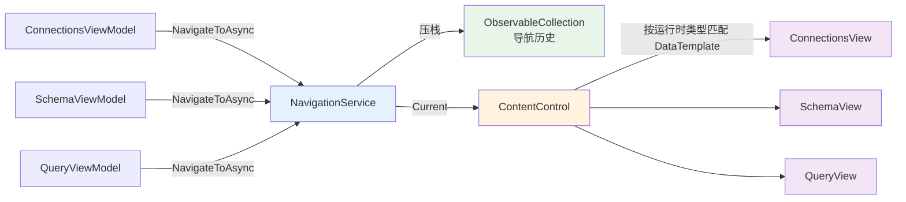
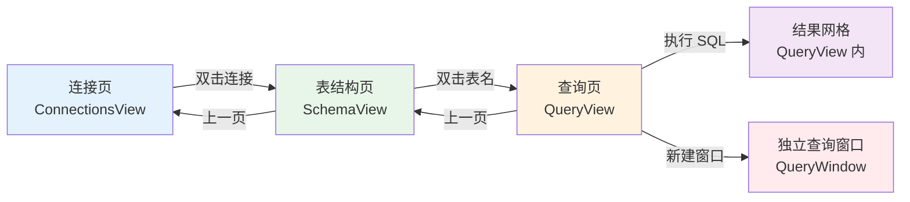

## 一、WPF 没有路由，但也不需要路由

ASP.NET Core 里"去哪一页"是一个 URL 问题，框架帮你做三件事：匹配路由、创建控制器、把结果渲染出去。WPF 里没有 URL，也没有控制器工厂，所以很多人第一反应是"一个页面开一个 `Window`"，用 `Show()` 叠起来。

这条路能走通，但叠三层就崩：

- 主窗口被一堆子窗口盖住，任务栏里出现五六个图标，用户不知道哪个是主界面。
- 每个窗口都要自己复制一套菜单、状态栏、工具栏，改一次样式改五处。
- 窗口之间通信靠 `Owner` 和事件互相引用，ViewModel 开始认识 View。
- 关闭顺序、焦点、模态关系全靠人肉维护。

正确的做法是把界面拆成"**一个外壳 + 若干页面**"，外壳叫 Shell，页面装在 `ContentControl` 里。这和服务端的布局页（Layout）是同一个思路，只不过渲染单元从 HTML 片段变成了可视化树。

| .NET 服务端 | WPF 导航 | 差异 |
|---|---|---|
| 路由表 `MapControllerRoute` | 无 | 导航目标由代码显式指定，不存在 URL 匹配 |
| `RedirectToAction` | `NavigateToAsync<TViewModel>()` | 直接给 ViewModel 类型，不经过字符串 |
| View 由视图引擎按名字查找 | `DataTemplate` 按**运行时类型**匹配 | 类型安全，编译期可查 |
| 布局页 + `@RenderBody()` | Shell 窗口 + `ContentControl` | 完全一致的心智模型 |
| 返回上一页靠浏览器历史 | 自己维护导航栈 | 需要实现 `GoBack()` |
| 302 重定向 + 请求上下文 | 无请求，页面实例常驻 | 返回时状态还在，但也可能过期 |



## 二、`DataTemplate` 是"按类型选视图"的工厂

先看这个机制本身，它是整个导航方案的地基。

`ContentControl` 拿到一个 `Content` 对象后，会去资源树里找 `DataTemplate`，条件是 `DataType` 等于这个对象的**运行时类型**。找到就把模板实例化，并把 `Content` 设成模板根元素的 `DataContext`。

所以映射关系只需要写一次：

```xml
<Application x:Class="DbLens.App"
             xmlns="http://schemas.microsoft.com/winfx/2006/xaml/presentation"
             xmlns:x="http://schemas.microsoft.com/winfx/2006/xaml"
             xmlns:vm="clr-namespace:DbLens.ViewModels"
             xmlns:v="clr-namespace:DbLens.Views">
    <Application.Resources>
        <DataTemplate DataType="{x:Type vm:ConnectionsViewModel}">
            <v:ConnectionsView />
        </DataTemplate>

        <DataTemplate DataType="{x:Type vm:SchemaViewModel}">
            <v:SchemaView />
        </DataTemplate>

        <DataTemplate DataType="{x:Type vm:QueryViewModel}">
            <v:QueryView />
        </DataTemplate>
    </Application.Resources>
</Application>
```

三个必须理解的点：

1. **`DataType` 匹配的是实例的真实类型**。声明成 `ViewModelBase` 变量无所谓，运行时是 `SchemaViewModel` 就选 `SchemaView`。
2. **`DataContext` 自动继承**。模板里的 `SchemaView` 不需要构造函数参数，也不需要谁给它的 `DataContext` 赋值——`ContentControl` 会把 `Content` 对象塞进继承链。这正是第 10 章要求的"View 保持无参构造"，设计器也因此能预览。
3. **没有匹配的模板就退化成 `ToString()`**。界面上会直接显示类型全名，像 `DbLens.ViewModels.SchemaViewModel`。看到这行字，第一反应就是 DataTemplate 没写或 `DataType` 写错了。

这套机制的本质是"**类型到 UI 的工厂，注册在资源字典里**"。它比 `switch (vm) { case ... }` 好在哪？好在新增页面时只加一个模板，Shell 一行不用改。第 13 章会把这些模板挪进独立的资源字典，但机制不变。

## 三、`INavigationService` 的最小实现

先定下所有页面的基类：

```csharp
using CommunityToolkit.Mvvm.ComponentModel;

namespace DbLens.ViewModels;

public abstract class ViewModelBase : ObservableObject
{
    public virtual string Title => GetType().Name.Replace("ViewModel", "");

    // 每次被导航进入时调用，页面自己决定要不要加载数据
    public virtual Task OnNavigatedToAsync(CancellationToken ct) => Task.CompletedTask;
}
```

导航服务只有四个成员：当前页、能否后退、去哪、后退。

```csharp
using System.Collections.ObjectModel;
using CommunityToolkit.Mvvm.ComponentModel;
using DbLens.ViewModels;
using Microsoft.Extensions.DependencyInjection;

namespace DbLens.Services;

public interface INavigationService
{
    ViewModelBase? Current { get; }
    bool CanGoBack { get; }
    Task NavigateToAsync<TViewModel>(CancellationToken ct = default) where TViewModel : ViewModelBase;
    Task NavigateToAsync(Type viewModelType, CancellationToken ct = default);
    bool GoBack();
}
```

```csharp
public sealed class NavigationService(IServiceProvider services) : ObservableObject, INavigationService
{
    // 用 ObservableCollection 而不是 Stack，是为了让面包屑能直接绑
    private readonly ObservableCollection<ViewModelBase> _history = [];

    public ViewModelBase? Current => _history.Count == 0 ? null : _history[^1];

    public bool CanGoBack => _history.Count > 1;

    public Task NavigateToAsync<TViewModel>(CancellationToken ct = default)
        where TViewModel : ViewModelBase
        => NavigateAsync(typeof(TViewModel), ct);

    public Task NavigateToAsync(Type viewModelType, CancellationToken ct = default)
        => NavigateAsync(viewModelType, ct);

    public bool GoBack()
    {
        if (!CanGoBack) return false;

        _history.RemoveAt(_history.Count - 1);
        RaiseCurrentChanged();
        return true;
    }

    private async Task NavigateAsync(Type viewModelType, CancellationToken ct)
    {
        // 已经在当前页，不重复入栈（ListBox 选中项回弹时会触发）
        if (Current?.GetType() == viewModelType) return;

        var next = (ViewModelBase)services.GetRequiredService(viewModelType);
        await next.OnNavigatedToAsync(ct);

        _history.Add(next);
        RaiseCurrentChanged();
    }

    private void RaiseCurrentChanged()
    {
        OnPropertyChanged(nameof(Current));
        OnPropertyChanged(nameof(CanGoBack));
    }
}
```

这里做了一次**服务定位**（`services.GetRequiredService`），也就是在运行时按类型取实例。服务端你被教导"不要用 Service Locator"，但导航和对话框是它的合理场景：要创建哪个类型，只有运行时才知道。把定位收在这两个服务内部，其它 ViewModel 仍然只吃构造函数注入，边界就守住了。

还有一个必须在设计上承认的事实：**ViewModel 每次导航都是新实例，View 也是新建的**。WPF 不会复用页面。好处是状态干净，坏处是"返回"看到的其实是旧的 ViewModel 实例——导航栈里存着它，所以状态还在，但数据可能已经过期。页面需要刷新时，自己提供一个 `RefreshCommand`，别指望 `OnNavigatedToAsync` 会被再调一次。

### 3.1 Shell 长什么样

```xml
<Window x:Class="DbLens.MainWindow"
        xmlns="http://schemas.microsoft.com/winfx/2006/xaml/presentation"
        xmlns:x="http://schemas.microsoft.com/winfx/2006/xaml"
        Title="DbLens" Height="760" Width="1280"
        WindowStartupLocation="CenterScreen">
    <Grid>
        <Grid.ColumnDefinitions>
            <ColumnDefinition Width="200" />
            <ColumnDefinition Width="*" />
        </Grid.ColumnDefinitions>

        <!-- 左侧导航：选中高亮由 ListBox 的默认模板提供，第 13 章重写 -->
        <ListBox Grid.Column="0"
                 ItemsSource="{Binding NavItems}"
                 SelectedItem="{Binding SelectedNavItem}"
                 DisplayMemberPath="Title"
                 Background="#F5F6F8"
                 BorderThickness="0" />

        <!-- 右侧页面容器：Content 一变，DataTemplate 就换视图 -->
        <ContentControl Grid.Column="1" Content="{Binding Navigation.Current}" />
    </Grid>
</Window>
```

```csharp
public sealed record NavItem(string Title, Type ViewModelType);

public sealed partial class MainViewModel : ObservableObject
{
    private readonly INavigationService _navigation;

    public MainViewModel(INavigationService navigation)
    {
        _navigation = navigation;
    }

    public INavigationService Navigation => _navigation;

    public IReadOnlyList<NavItem> NavItems { get; } =
    [
        new("连接", typeof(ConnectionsViewModel)),
        new("表结构", typeof(SchemaViewModel)),
        new("查询", typeof(QueryViewModel))
    ];

    [ObservableProperty]
    private NavItem? _selectedNavItem;

    partial void OnSelectedNavItemChanged(NavItem? value)
    {
        if (value is null) return;

        // 选中项变化是 fire-and-forget，异常交给全局兜底
        _ = _navigation.NavigateToAsync(value.ViewModelType);
    }
}
```

注意 `Navigation` 属性不是 `[ObservableProperty]`，它永远指向同一个服务实例，不需要通知。而 `Navigation.Current` 变化时 `ContentControl.Content` 能更新，靠的是 `NavigationService` 自己发的 `PropertyChanged`——绑定引擎会沿着路径一路监听。

## 四、注册进容器：页面一律 Transient

第 10 章的注册表往后补几行：

```csharp
builder.Services.AddSingleton<INavigationService, NavigationService>();
builder.Services.AddSingleton<MainViewModel>();

// 页面级 ViewModel：每次导航都要新实例，必须 Transient
builder.Services.AddTransient<ConnectionsViewModel>();
builder.Services.AddTransient<SchemaViewModel>();
builder.Services.AddTransient<QueryViewModel>();

builder.Services.AddTransient<ConnectionEditorViewModel>();
```

注册成 Singleton 会出现一个很隐蔽的 bug：第二次导航到"表结构"时，`OnNavigatedToAsync` 拿到的是上次那个实例，页面显示的还是上一个库的表。Transient 每次给新的，问题消失。

对应的 View 不需要注册——它们由 DataTemplate 创建，`new` 的活儿交给 XAML 引擎。

## 五、模态对话框

对话框也是"按类型选视图"，但它需要一个 `Window` 来承载，而 `Window` 不能被塞进 `ContentControl`。所以另开一个服务：

```csharp
using System.Windows;
using DbLens.ViewModels;

namespace DbLens.Services;

public interface IDialogService
{
    bool? ShowDialog<TWindow>(ViewModelBase viewModel) where TWindow : Window, new();
    bool Confirm(string title, string message);
}

public sealed class DialogService : IDialogService
{
    public bool? ShowDialog<TWindow>(ViewModelBase viewModel) where TWindow : Window, new()
    {
        var window = new TWindow
        {
            // 没有这行，对话框会出现在主窗口后面，居中也会相对屏幕
            Owner = Application.Current.MainWindow!,
            DataContext = viewModel,
            WindowStartupLocation = WindowStartupLocation.CenterOwner
        };

        return window.ShowDialog();
    }

    public bool Confirm(string title, string message)
        => MessageBox.Show(
               Application.Current.MainWindow!,
               message, title,
               MessageBoxButton.YesNo,
               MessageBoxImage.Question) == MessageBoxResult.Yes;
}
```

`ShowDialog()` 返回 `bool?`：`true` 表示用户点了确定，`false` 表示取消，`null` 表示窗口被直接关闭（点右上角 X 或按 Esc 且没设过 `DialogResult`）。这三种状态都是合法语义，别用 `== true` 一概而论，更不要把它当异常处理。

对话框窗口的 XAML 头部固定这么写：

```xml
<Window x:Class="DbLens.Views.ConnectionEditorWindow"
        xmlns="http://schemas.microsoft.com/winfx/2006/xaml/presentation"
        xmlns:x="http://schemas.microsoft.com/winfx/2006/xaml"
        Title="编辑连接" Width="480" SizeToContent="Height"
        WindowStartupLocation="CenterOwner"
        ShowInTaskbar="False"
        ResizeMode="NoResize">
    <StackPanel Margin="20">
        <TextBox Text="{Binding Name, UpdateSourceTrigger=PropertyChanged}" />
        <Button Content="保存" IsDefault="True" Click="OnSaveClick" HorizontalAlignment="Right" />
    </StackPanel>
</Window>
```

```csharp
public partial class ConnectionEditorWindow : Window
{
    public ConnectionEditorWindow() => InitializeComponent();

    private void OnSaveClick(object sender, RoutedEventArgs e)
    {
        // 只有 ShowDialog 打开的窗口才能设 DialogResult
        DialogResult = true;
    }
}
```

`IsDefault="True"` 让回车等于点保存，`IsCancel` 在按钮上则等于 Esc。这两个附加行为在桌面端是用户预期的一部分，漏了会显得"这软件不好用"。

调用侧：

```csharp
[RelayCommand]
private async Task EditConnectionAsync(ConnectionProfile profile)
{
    var editor = new ConnectionEditorViewModel(profile);

    if (_dialogs.ShowDialog<ConnectionEditorWindow>(editor) != true) return;

    await _connections.SaveAsync(editor.ToProfile());
}
```

## 六、关闭确认：`Closing` 不是异步的

`Window.Closing` 的参数 `CancelEventArgs` 只有一个 `Cancel` 布尔值，没有 `await` 的位置。而"要不要保存"这件事往往需要异步落盘。

标准解法的核心是**拦下来，异步做完，再关一次**：

```csharp
public partial class MainWindow : Window
{
    private bool _closeConfirmed;

    public MainWindow(MainViewModel viewModel)
    {
        InitializeComponent();
        DataContext = viewModel;
    }

    private async void OnClosing(object sender, CancelEventArgs e)
    {
        if (_closeConfirmed) return;
        if (DataContext is not MainViewModel vm || !vm.HasUnsavedChanges) return;

        e.Cancel = true;   // 这一轮先不放行

        if (!vm.ConfirmDiscard())
        {
            vm.SelectedNavItem = null;   // 用户改主意，保持原状
            return;
        }

        if (vm.NeedsSave) await vm.SaveAsync();

        _closeConfirmed = true;

        // 走一次 Dispatcher，避免在 Closing 栈里重入 Close
        Dispatcher.BeginInvoke(new Action(Close));
    }
}
```

XAML 里挂上事件：`Closing="OnClosing"`。三个要点：

- **`async void` 在这里是唯一写法**，事件处理器没有可等待的返回类型。它在第一个 `await` 处返回，`e.Cancel = true` 已经生效，窗口留下来了。
- **重入保护必须有**。第二次 `Close()` 会再触发 `Closing`，`_closeConfirmed` 就是放行开关。
- **`Dispatcher.BeginInvoke` 不是装饰**。如果保存是同步完成的（比如没有脏数据），直接在 `Closing` 栈里调 `Close()` 会重入同一个事件，行为取决于 WPF 内部实现，别赌。

`ShutdownMode = OnMainWindowClose` 时，主窗口关闭就等于退出进程，所以这段逻辑也是"退出前保存"的唯一机会。用户从任务管理器强杀进程则无解，那是另一个话题。

## 七、多窗口：`Application.Current.Windows`

有时候必须开第二个窗口，比如"把当前查询结果单独开一个窗口对照着看"。DbLens 允许同时开多个查询窗口。

```csharp
public sealed class QueryWindowService(IServiceProvider services)
{
    public void Open(Guid sessionId, string title)
    {
        var existing = Application.Current.Windows
            .OfType<QueryWindow>()
            .FirstOrDefault(w => w.Tag is Guid id && id == sessionId);

        if (existing is not null)
        {
            // 已经开着就激活，不要开第二个
            if (existing.WindowState == WindowState.Minimized)
                existing.WindowState = WindowState.Normal;

            existing.Activate();
            return;
        }

        var window = services.GetRequiredService<QueryWindow>();
        window.Tag = sessionId;
        window.Title = $"查询 - {title}";
        window.Show();   // 非模态
    }
}
```

`Application.Current.Windows` 是一个 `WindowCollection`，只包含**当前打开**的窗口，关闭后自动移除。所以"判断是否已打开"可以直接遍历它，不需要自己维护列表。

几个边界：

- `Show()` 非模态，主窗口可以继续操作；`ShowDialog()` 模态，会禁用 Owner。查询窗口用前者。
- `Window.Tag` 是 `object`，拿来放业务标识很方便，但它是 UI 层的字段，别让它成为 ViewModel 之间通信的主渠道。
- 注册成 `Transient`，关掉的窗口实例就没人引用了；注册成 Singleton 则每次 `Show()` 都是同一个窗口对象，关闭后再 `Show()` 会抛 `Cannot set Visibility or call Show, ShowDialog, or WindowInteropHelper.EnsureHandle after a Window has closed`。
- 托盘应用要把 `ShutdownMode` 改成 `OnExplicitShutdown`，否则关掉查询窗口最后一个实例就退出进程了。

## 八、DbLens 的实际导航结构

```xml
<!-- App.xaml.cs 里 OnStartup 最后：启动即进连接页 -->
var shell = _host.Services.GetRequiredService<MainWindow>();
shell.Show();
await _host.Services.GetRequiredService<INavigationService>()
    .NavigateToAsync<ConnectionsViewModel>();
```

三层结构，返回栈最多三层：



左侧导航的选中高亮和当前页是**两条独立的状态**：用户从连接页双击进入表结构页时，`SelectedNavItem` 不会自动变成"表结构"。修法是让 `MainViewModel` 订阅 `Navigation.PropertyChanged`，在 `Current` 变化时反查 `NavItems` 里的类型并回写 `SelectedNavItem`：

```csharp
public MainViewModel(INavigationService navigation)
{
    _navigation = navigation;
    _navigation.PropertyChanged += (_, e) =>
    {
        if (e.PropertyName != nameof(INavigationService.Current)) return;

        var match = NavItems.FirstOrDefault(i => i.ViewModelType == _navigation.Current?.GetType());
        if (match is not null) SelectedNavItem = match;
    };
}
```

注意这里会触发 `OnSelectedNavItemChanged` → 又一次 `NavigateToAsync`，但导航服务里有"同类型不入栈"的短路，所以不会无限循环。这类回环是导航实现里最常见的死循环来源，短路判断必须写在解析实例之前。

## 九、踩坑清单

| 现象 | 原因 | 处理 |
|---|---|---|
| 界面上显示 `DbLens.ViewModels.SchemaViewModel` | 没有匹配的 `DataTemplate`，退化成了 `ToString()` | 检查 `DataType` 的 `x:Type` 是否写错、资源是否合并进 App |
| 页面一片空白，没有任何报错 | `ContentControl.Content` 没绑上，或者 `Current` 为 null | 启动时先导航一页；检查绑定路径是否拼错 |
| 第二次进入同一页面数据不刷新 | ViewModel 注册成了 Singleton | 页面级 ViewModel 全部 `Transient` |
| 导航栈无限增长 | 选中项回写触发了再次导航，没有同类型短路 | `NavigateAsync` 开头判断 `Current.GetType()` |
| 对话框跑到主窗口后面 | 没设 `Owner` | `Owner = Application.Current.MainWindow` |
| 设 `Owner` 抛 `Cannot set Owner property to a window that has not been shown` | 主窗口还没 `Show()` 就弹了对话框 | 在 `OnStartup` 里先 `Show()` 再导航 |
| `DialogResult` 抛 `InvalidOperationException` | 用 `Show()` 打开的窗口设置了 `DialogResult` | 只有 `ShowDialog()` 才能设 |
| 点 X 后窗口白屏、无法再操作 | `Closing` 里 `e.Cancel = true` 之后没有再次关闭 | 保存完设标志位并重新 `Close()` |
| 关闭后再次 `Show()` 抛异常 | 窗口被注册成 Singleton 并复用 | 窗口用 Transient，或每次新建 |
| 页面反复切换后内存不降 | ViewModel 订阅了长生命周期对象的事件没退订 | 给 `ViewModelBase` 加 `OnNavigatedFrom` 并在里面退订，或改用弱事件 |

## 十、本章小结

- 不要用多个 `Window` 堆页面，主窗口 + `ContentControl` 承载页面是唯一可持续的结构。
- `DataTemplate` 的 `DataType` 按**运行时类型**匹配，本质是注册在资源字典里的视图工厂，`DataContext` 会自动继承，所以 View 保持无参构造。
- `NavigationService` 只需要一个历史集合 + `Current` + `GoBack()`，用 `ObservableCollection` 是为了面包屑能直接绑。
- 页面级 ViewModel 一律 `Transient`，注册成 Singleton 会带来"数据不刷新"这类难查的 bug。
- 导航与对话框服务是服务定位的合理场景，但要把定位收在服务内部，ViewModel 仍然只吃构造函数注入。
- 模态对话框必须设 `Owner`，`ShowDialog()` 的 `bool?` 三种状态都要处理；`Closing` 不支持异步，靠"拦下 → 异步 → 再关一次"。
- 多窗口靠 `Application.Current.Windows` 去重，窗口本身注册成 `Transient`。

**练习**：给 `INavigationService` 加一个 `NavigateToAsync<TViewModel>(object parameter)` 重载，让"表结构页"能接收选中的连接。实现方式可以是给 `ViewModelBase` 加一个 `OnNavigatedToAsync(object? parameter)` 虚方法。然后测两件事：从表结构页返回连接页再前进，`SchemaViewModel` 是不是新实例；以及 `CanGoBack` 在栈深度为 1 时的绑定是否正确。

下一章是工程化篇的收尾：资源、样式、模板与暗色主题。
