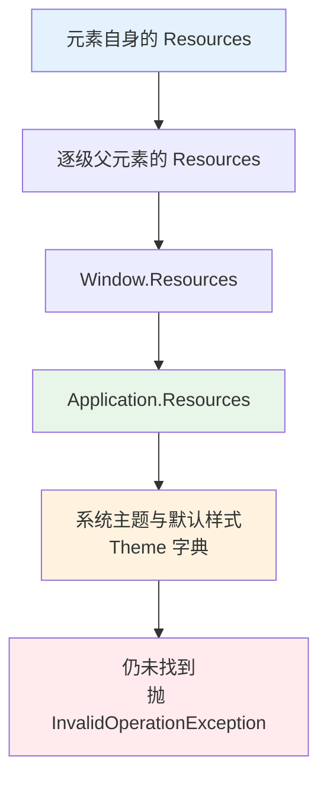

## 一、资源不是变量，是查找

写 CSS 时，`--accent` 是编译期就确定的变量；写 WPF 时，`{StaticResource Brush.Accent}` 是**运行时沿着元素树往上找**的一次查询。这个差别决定了后面所有的行为：为什么换个位置就找不到资源、为什么主题切换必须用 `DynamicResource`、为什么合并字典的先后顺序会影响结果。

先建立和 CSS 的对应关系，你能立刻定位到熟悉的坐标：

| CSS | WPF | 关键差异 |
|---|---|---|
| `--accent: #2F6FED` | `<SolidColorBrush x:Key="Brush.Accent" ... />` | WPF 存的是对象，不是字符串值 |
| `class="btn primary"` | `Style="{StaticResource Button.Primary}"` | 没有层叠、没有优先级权重，只有"显式 > 隐式" |
| `.btn { ... }` | `<Style TargetType="Button">`（无 `x:Key`） | 隐式样式，自动作用于该类型的所有实例 |
| 组件内部的 DOM 结构 | `ControlTemplate` | 模板替换整棵视觉树，不是加 class |
| `@import "base.css"` | `MergedDictionaries` | 后合并的同名键覆盖先合并的 |
| `:hover` | `<Trigger Property="IsMouseOver">` | WPF 分属性、数据、事件三种触发 |
| `!important` | 无 | 本地值（直接写在元素上）优先于样式 Setter |

最后一行的"本地值优先"必须记住：`<Button Background="Red" Style="{StaticResource Button.Primary}">` 里，红色赢。样式里的 `Setter` 优先级低于元素上直接写的属性值，这一点和 CSS 的 `!important` 恰好相反——**就近的那个总是赢**。

再补一张服务端视角的对照，避免把"资源"只理解成 CSS 变量：

| .NET 服务端 | WPF | 差异 |
|---|---|---|
| `wwwroot` 里的静态文件，运行时读磁盘 | 资源编译进程序集（BAML / `.resources`） | 改样式必须重新编译，没有"刷新浏览器" |
| 按环境加载不同的 CSS 文件 | 替换 `MergedDictionaries` | 不用重启进程，`DynamicResource` 当场更新 |
| `IOptions<T>` 提供默认值 | `Style` 的 `Setter` 提供默认值 | 元素上直接写的本地值优先于样式 |
| `AddSingleton` 决定用哪个实现 | 就近的同名键遮蔽上层资源 | 都是"注册 + 查找"，但 WPF 是沿树逐级查 |

## 二、资源的查找顺序



三条推论，全是日常会撞上的：

- **作用域越小越优先**。在 `SchemaView` 里定义 `Brush.Accent`，它只影响这棵子树，而且会遮住 App 里的同名键。调试"颜色不对"时，先看是不是某层写了同名资源。
- **找不到就抛异常**，不是静默失败。异常信息是 `Cannot find resource named 'X'. Resource names are case sensitive.`——注意后半句，`brush.accent` 和 `Brush.Accent` 是两个键。
- **系统主题永远兜底**。你不写任何 `Button` 样式，按钮也有样子，因为默认样式在主题字典里。

## 三、`StaticResource` 还是 `DynamicResource`

这是本章最重要的一次选择，选错的表现是"切了主题但界面没变"。

| 维度 | `StaticResource` | `DynamicResource` |
|---|---|---|
| 解析时机 | 加载 XAML 时一次性查表 | 每次用到时查表，并监听变化 |
| 能否响应运行时替换 | 不能 | 能 |
| 性能 | 略好（无监听开销） | 略差（要维护引用） |
| 能否引用后定义的资源 | 不能（同字典内必须在前面） | 能 |
| 能否用于 `Style` 的 `Setter.Value` 里的复杂对象 | 能 | 只能用于依赖属性 |
| 典型用途 | `Style`、`DataTemplate`、一次性查找 | 颜色、画刷、字号等主题相关值 |

判断规则很简单：**这个东西会不会在运行时被换掉？** 会，就必须 `DynamicResource`；不会，用 `StaticResource` 更省。

主题切换只换画刷，所以所有 `Foreground`、`Background`、`BorderBrush` 一律 `DynamicResource`。而 `Style="{StaticResource Button.Primary}"` 用静态引用没问题——样式对象本身不换，换的是它里面 Setter 引用的画刷，那些 Setter 内部已经是动态引用了。

## 四、把资源拆成字典

全塞进 `App.xaml` 会变成两千行。按职责拆三个文件：

```
src/DbLens.Shell/
└── Themes/
    ├── Light.xaml      ← 只有颜色和画刷
    ├── Dark.xaml       ← 只有颜色和画刷，键名与 Light 完全一致
    └── Controls.xaml   ← Style、ControlTemplate，全部用 DynamicResource 引用画刷
```

`Light.xaml`：

```xml
<ResourceDictionary xmlns="http://schemas.microsoft.com/winfx/2006/xaml/presentation"
                    xmlns:x="http://schemas.microsoft.com/winfx/2006/xaml"
                    xmlns:sys="clr-namespace:System;assembly=System.Runtime">

    <!-- 用哨兵键标识当前主题，切换时靠它识别旧字典 -->
    <sys:String x:Key="Theme.Name">Light</sys:String>

    <Color x:Key="Color.Surface">#FFFFFFFF</Color>
    <Color x:Key="Color.SurfaceAlt">#FFF5F6F8</Color>
    <Color x:Key="Color.Content">#FF1B1F24</Color>
    <Color x:Key="Color.ContentMuted">#FF6B7280</Color>
    <Color x:Key="Color.Accent">#FF2F6FED</Color>
    <Color x:Key="Color.AccentContent">#FFFFFFFF</Color>
    <Color x:Key="Color.Border">#FFDDE1E7</Color>
    <Color x:Key="Color.Disabled">#FFB9BFC9</Color>

    <SolidColorBrush x:Key="Brush.Surface" Color="{StaticResource Color.Surface}" />
    <SolidColorBrush x:Key="Brush.SurfaceAlt" Color="{StaticResource Color.SurfaceAlt}" />
    <SolidColorBrush x:Key="Brush.Content" Color="{StaticResource Color.Content}" />
    <SolidColorBrush x:Key="Brush.ContentMuted" Color="{StaticResource Color.ContentMuted}" />
    <SolidColorBrush x:Key="Brush.Accent" Color="{StaticResource Color.Accent}" />
    <SolidColorBrush x:Key="Brush.AccentContent" Color="{StaticResource Color.AccentContent}" />
    <SolidColorBrush x:Key="Brush.Border" Color="{StaticResource Color.Border}" />
    <SolidColorBrush x:Key="Brush.Disabled" Color="{StaticResource Color.Disabled}" />

    <CornerRadius x:Key="Size.Radius">6</CornerRadius>
    <Thickness x:Key="Size.Padding">12,6</Thickness>
    <sys:Double x:Key="Size.Icon">16</sys:Double>
    <sys:Double x:Key="Size.Title">18</sys:Double>
</ResourceDictionary>
```

`Dark.xaml` 是同一份键名、不同取值，一个都不能少——少一个键，切过去就是"找不到资源"异常，或者更糟：`DynamicResource` 会退回到上一层找到的 Light 值，界面变成半明半暗。

合并进 `App.xaml` 时有个语法细节：**一旦用了 `MergedDictionaries`，`ResourceDictionary` 必须显式写出来**，不能直接往 `Application.Resources` 里塞内容。

```xml
<Application x:Class="DbLens.App"
             xmlns="http://schemas.microsoft.com/winfx/2006/xaml/presentation"
             xmlns:x="http://schemas.microsoft.com/winfx/2006/xaml"
             xmlns:vm="clr-namespace:DbLens.ViewModels"
             xmlns:v="clr-namespace:DbLens.Views">
    <Application.Resources>
        <ResourceDictionary>
            <ResourceDictionary.MergedDictionaries>
                <!-- 顺序有意义：主题字典在前，控件样式在后 -->
                <ResourceDictionary Source="Themes/Light.xaml" />
                <ResourceDictionary Source="Themes/Controls.xaml" />
            </ResourceDictionary.MergedDictionaries>

            <!-- 第 12 章的导航映射留在这里 -->
            <DataTemplate DataType="{x:Type vm:SchemaViewModel}">
                <v:SchemaView />
            </DataTemplate>
        </ResourceDictionary>
    </Application.Resources>
</Application>
```

查找 `MergedDictionaries` 时是**从后往前**的：后合并的优先。所以 `Controls.xaml` 放在最后，它里面若定义了同名键会覆盖主题字典。这正好符合意图——样式应该能覆盖基础色板，反过来不该发生。

## 五、`Style`：没有层叠，只有继承和覆盖

```xml
<!-- Controls.xaml 里 -->
<Style x:Key="Text.Title" TargetType="TextBlock">
    <Setter Property="FontSize" Value="{DynamicResource Size.Title}" />
    <Setter Property="FontWeight" Value="SemiBold" />
    <Setter Property="Foreground" Value="{DynamicResource Brush.Content}" />
</Style>

<Style x:Key="Text.Muted" TargetType="TextBlock" BasedOn="{StaticResource Text.Title}">
    <Setter Property="FontSize" Value="12" />
    <Setter Property="FontWeight" Value="Normal" />
    <Setter Property="Foreground" Value="{DynamicResource Brush.ContentMuted}" />
</Style>

<!-- 隐式样式：不写 x:Key，所有 TextBlock 自动应用 -->
<Style TargetType="TextBlock">
    <Setter Property="Foreground" Value="{DynamicResource Brush.Content}" />
    <Setter Property="TextOptions.TextFormattingMode" Value="Ideal" />
</Style>
```

四条规则：

- **`BasedOn` 是单继承**，只能有一个父样式，和 CSS 多 class 叠加完全不同。要复用两组属性，只能抽一个公共基样式。
- **隐式样式只对精确类型生效**。`TargetType="TextBlock"` 不影响 `TextBox`（它不是 `TextBlock` 的子类）。但 `TargetType="Button"` 会影响所有派生自 `Button` 的自定义控件。
- **隐式样式会覆盖主题默认样式**。你写了一个 `<Style TargetType="Button">`，主题里那套完整的按钮模板就整个被替换掉了——因为隐式样式查找优先级高于主题字典。所以重写隐式样式时，要么 `BasedOn="{StaticResource {x:Type Button}}"` 继承默认，要么自己把模板写全。
- **`Setter` 只对依赖属性有效**。`Width`、`Visibility`、`FontSize` 是，普通 CLR 属性不是（自定义控件要暴露可样式化的属性，得用依赖属性，第 14 章）。

## 六、Trigger 三兄弟

`Trigger` 监听**控件自己的依赖属性**，`DataTrigger` 监听**绑定表达式的值**，`EventTrigger` 监听**路由事件**。三者都只能写在 `Style.Triggers`、`ControlTemplate.Triggers` 或 `DataTemplate.Triggers` 里，不能随便挂在元素上（`FrameworkElement.Triggers` 只接受 `EventTrigger`）。

**属性触发**——最常用，处理视觉状态：

```xml
<Style x:Key="StatusDot" TargetType="Ellipse">
    <Setter Property="Width" Value="8" />
    <Setter Property="Height" Value="8" />
    <Setter Property="Fill" Value="{DynamicResource Brush.Disabled}" />

    <Style.Triggers>
        <Trigger Property="IsMouseOver" Value="True">
            <Setter Property="Opacity" Value="0.7" />
        </Trigger>
    </Style.Triggers>
</Style>
```

**数据触发**——状态来自 ViewModel，这是 MVVM 里"用声明式代替 code-behind"的主力：

```xml
<Style x:Key="ConnectionStateDot" TargetType="Ellipse">
    <Setter Property="Fill" Value="{DynamicResource Brush.Disabled}" />

    <Style.Triggers>
        <DataTrigger Binding="{Binding IsConnected}" Value="True">
            <Setter Property="Fill" Value="#FF2E9E5B" />
        </DataTrigger>
        <DataTrigger Binding="{Binding IsBusy}" Value="True">
            <Setter Property="Fill" Value="#FFE0A100" />
        </DataTrigger>
    </Style.Triggers>
</Style>
```

注意 `DataTrigger` 的 `Value` 是 `object`，写 `Value="True"` 会由类型转换器转成 `bool`；绑定到枚举时要写 `Value="{x:Static local:QueryState.Running}"`，写成字符串不生效且不报错——这是静默失败，特别难查。

**事件触发**——只做动画，而且必须是 `Storyboard`：

```xml
<Button Content="执行" Style="{StaticResource Button.Primary}" Width="96">
    <Button.Triggers>
        <EventTrigger RoutedEvent="Button.Click">
            <BeginStoryboard>
                <Storyboard>
                    <DoubleAnimation Storyboard.TargetProperty="Opacity"
                                     From="1" To="0.55" Duration="0:0:0.1" AutoReverse="True" />
                </Storyboard>
            </BeginStoryboard>
        </EventTrigger>
    </Button.Triggers>
</Button>
```

动画会**覆盖**掉属性值（包括绑定），因为它在依赖属性上以更高优先级写入。停止动画后属性会回到原值，但如果你在动画运行期间改了 `Opacity`，改不动。这个机制第 16 章会展开。

## 七、`ControlTemplate`：换掉整棵视觉树

`Style` 只能改属性，改不了"按钮里面长什么样"。要让 `Button` 变成圆角扁平样式，必须重写模板：

```xml
<Style x:Key="Button.Flat" TargetType="Button">
    <Setter Property="Background" Value="{DynamicResource Brush.SurfaceAlt}" />
    <Setter Property="Foreground" Value="{DynamicResource Brush.Content}" />
    <Setter Property="BorderBrush" Value="{DynamicResource Brush.Border}" />
    <Setter Property="BorderThickness" Value="1" />
    <Setter Property="Padding" Value="{DynamicResource Size.Padding}" />
    <Setter Property="Cursor" Value="Hand" />

    <Setter Property="Template">
        <Setter.Value>
            <ControlTemplate TargetType="Button">
                <Border x:Name="Root"
                        Background="{TemplateBinding Background}"
                        BorderBrush="{TemplateBinding BorderBrush}"
                        BorderThickness="{TemplateBinding BorderThickness}"
                        Padding="{TemplateBinding Padding}"
                        CornerRadius="{DynamicResource Size.Radius}">
                    <ContentPresenter HorizontalAlignment="Center"
                                      VerticalAlignment="Center"
                                      RecognizesAccessKey="True" />
                </Border>

                <ControlTemplate.Triggers>
                    <Trigger Property="IsMouseOver" Value="True">
                        <Setter TargetName="Root" Property="BorderBrush"
                                Value="{DynamicResource Brush.Accent}" />
                    </Trigger>
                    <Trigger Property="IsPressed" Value="True">
                        <Setter TargetName="Root" Property="Opacity" Value="0.8" />
                    </Trigger>
                    <Trigger Property="IsEnabled" Value="False">
                        <Setter TargetName="Root" Property="Opacity" Value="0.45" />
                    </Trigger>
                </ControlTemplate.Triggers>
            </ControlTemplate>
        </Setter.Value>
    </Setter>
</Style>
```

三个关键点：

1. **`TemplateBinding` 把模板内的属性和控件的属性连起来**。上面四个 `TemplateBinding` 意味着"用控件自己的 `Background`、`BorderBrush`、`BorderThickness`、`Padding`"，所以使用者可以在实例上覆盖，也可以由 `Style` 的 `Setter` 提供。这是自定义模板能复用公共属性的唯一方式。
2. **`TemplateBinding` 是单向的、不支持转换器、只在模板内有效**。需要双向、需要 `Converter`，就得写完整形式：`{Binding Background, RelativeSource={RelativeSource TemplatedParent}}`。两者在功能上是子集关系，`TemplateBinding` 只是它的编译期优化版本。
3. **`ControlTemplate.Triggers` 里的 `Setter` 可以用 `TargetName`**，直接改模板内部元素的属性，这是 `Style.Triggers` 做不到的（Style 只能改控件自己的属性）。

`ContentPresenter` 是内容宿主，`Content="执行"` 最终显示在它里面。如果你重写模板却漏了 `ContentPresenter`，按钮会变成一个有边框没有文字的空白块——这是重写模板时第一个会犯的错。

## 八、运行时切换主题

主题字典可以整个换掉。关键是：**先移除旧字典，再插入新字典**，并且要用 `Source` 或哨兵键识别"哪个是主题字典"，别把 `Controls.xaml` 一起删了。

```csharp
using System.Windows;

namespace DbLens.Services;

public sealed class ThemeService
{
    private const string ThemeFolder = "pack://application:,,,/DbLens;component/Themes/";

    public void Apply(string themeName)
    {
        // 必须是 Application.Resources 里那层 MergedDictionaries
        var dictionaries = Application.Current.Resources.MergedDictionaries;

        // Light.xaml / Dark.xaml 都定义了 Theme.Name 哨兵键，Controls.xaml 没有，
        // 用它识别旧主题字典，比匹配 Source 字符串可靠（相对路径与 pack URI 不统一）
        var old = dictionaries.FirstOrDefault(d => d.Contains("Theme.Name"));
        if (old is not null) dictionaries.Remove(old);

        var next = new ResourceDictionary
        {
            Source = new Uri($"{ThemeFolder}{themeName}.xaml", UriKind.Absolute)
        };

        // 插到最前面：控件样式仍然排在主题之后，继续拥有更高的查找优先级
        dictionaries.Insert(0, next);
    }
}
```

几个必须注意的地方：

- **`pack://` URI 里的程序集名是 `AssemblyName`，不是项目名**。第 02 章把 `AssemblyName` 设成了 `DbLens`，所以这里写 `DbLens;component`。写错的表现是 `IOException: Cannot locate resource`。
- **必须先 Remove**。直接 Add 会让新旧两个主题字典同时存在，`MergedDictionaries` 从后往前查找，你看到的是旧主题——而且要等应用重启才恢复。
- **只有 `DynamicResource` 会跟着变**。任何写成 `StaticResource` 的画刷在字典替换后仍然是旧对象。这是切主题最常见的"只有一半变了"的原因。
- **共享 `Brush` 不要就地改 `Color`**。主题值在字典里被多个控件共享，有的还已经被 `Freeze()`，改它要么抛 `InvalidOperationException`，要么影响范围失控。正确做法永远是"换字典"。

调用侧就是一个 `ToggleButton` 或菜单项：

```csharp
[RelayCommand]
private void ToggleTheme()
{
    IsDark = !IsDark;
    _themes.Apply(IsDark ? "Dark" : "Light");
}
```

## 九、图标用字体，不要用 png

WPF 里的图标首选 **Segoe Fluent Icons**（Win11）或 **Segoe MDL2 Assets**（Win10）。它是字体，意味着任意放大不糊、颜色跟 `Foreground` 走、主题切换自动适配、不占额外文件。

```xml
<TextBlock Text="&#xE8B7;"
           FontFamily="Segoe Fluent Icons, Segoe MDL2 Assets"
           FontSize="{DynamicResource Size.Icon}"
           Foreground="{DynamicResource Brush.ContentMuted}"
           VerticalAlignment="Center" />
```

- `&#xE8B7;` 是字符转义，XAML 里必须这么写，直接粘贴私用区字符会在保存时乱码。
- `FontFamily` 写**逗号分隔的降级列表**，Win10 上没有 Fluent Icons 会自动落到 MDL2，两套字体的码位大部分重合。
- 字号即图标大小，`FontSize="16"` 就是 16 DIP。要更精确地对齐，用 `TextBlock` 而非 `Label`，并关掉默认行高影响。

png 的问题不在于"不好看"，而在于你要为亮/暗两套主题各准备一份、要为 100%/150%/200% 缩放各准备一份，还要处理 DPI 下的模糊。字体图标一次解决这三件事。

## 十、设计令牌：命名规范不是洁癖

看一个真实项目里常见的写法：

```xml
<Border Background="#FFF5F6F8" BorderBrush="#FFDDE1E7" CornerRadius="6" Padding="12,8" />
```

问题不是难看，是**不可维护**：暗色主题要改的时候，你得全局搜 `#FFF5F6F8`，而它可能同时被用在"卡片背景"和"输入框背景"两个语义完全不同的地方，改一个就得拆一个。

命名规范建议按"**类型.语义**"两段式，且语义描述用途而不是颜色：

| 键 | 值示例 | 用途 |
|---|---|---|
| `Color.Surface` | `#FFFFFFFF` | 主内容区背景 |
| `Color.SurfaceAlt` | `#FFF5F6F8` | 次级区域、侧边栏 |
| `Color.Content` | `#FF1B1F24` | 主文字 |
| `Color.ContentMuted` | `#FF6B7280` | 次要文字、提示 |
| `Color.Accent` | `#FF2F6FED` | 主色、选中态 |
| `Brush.Accent` | 由 `Color.Accent` 派生 | 所有需要画刷的地方 |
| `Size.Radius` | `6` | 统一圆角 |
| `Size.Padding` | `12,6` | 控件内边距 |
| `Size.Icon` | `16` | 图标字号 |

三条硬规则：

- **不要用颜色名做键**（`Brush.Blue`、`Brush.LightGray`），暗色主题里"浅灰"可能是 `#FF2A2D31`，名字立刻撒谎。
- **`Color.*` 和 `Brush.*` 分开**。颜色用于渐变停靠点、动画目标；画刷用于属性赋值。两者都留，转换一处即可。
- **只在主题字典里写十六进制**，`Controls.xaml` 和页面里一律 `DynamicResource`。这条守住，暗色主题就是新增一个字典文件的事。

## 十一、内置 Fluent 主题：什么时候不该自己写

上面这套手写字典有个前提：你得自己维护亮暗两套键。.NET 9 之后多了一个选择——WPF 自带了 Fluent 主题，并且支持亮暗切换。

用法是在 `App.xaml` 里合并主题字典：

```xml
<Application.Resources>
    <ResourceDictionary>
        <ResourceDictionary.MergedDictionaries>
            <ResourceDictionary
                Source="pack://application:,,,/PresentationFramework.Fluent;component/Themes/Fluent.xaml" />
        </ResourceDictionary.MergedDictionaries>
    </ResourceDictionary>
</Application.Resources>
```

然后在 `Application` 或 `Window` 上设 `ThemeMode`：

```xml
<Window x:Class="DbLens.MainWindow"
        ThemeMode="Dark">
```

`ThemeMode` 有三个取值：`Light`、`Dark`、`System`（跟随系统）。.NET 9 还顺带支持了 Windows 强调色，`SystemAccentColor` 这类资源会自动跟着系统设置走。

两个必须知道的前提：

- **它是实验性 API**。.NET 9 引入时被标记为实验特性，需要在 csproj 里显式抑制诊断，否则编译会报 `WPF0001`：

```xml
<PropertyGroup>
  <NoWarn>$(NoWarn);WPF0001</NoWarn>
</PropertyGroup>
```

- **控件覆盖在演进**。.NET 10 继续更新了 Fluent 样式，但每补丁版本都可能有外观与行为变化。升级 SDK 后如果界面莫名变形，先怀疑这里。

内置主题和手写字典怎么选，给你一张判断表：

| 维度 | 内置 Fluent 主题 | 手写 ResourceDictionary |
|------|-----------------|------------------------|
| 上手成本 | 两行 XAML，立刻有亮暗两套 | 要建两套字典、统一键名、接切换服务 |
| 外观控制 | 只能改资源键，控件模板由框架决定 | 完全可控，品牌色、圆角、间距随便改 |
| 第三方控件 | 不覆盖，仍需自己适配 | 可以统一收敛 |
| 升级风险 | 跟随 SDK 变化，可能被动变形 | 升级不漂移，但新控件要自己补 |
| 适合场景 | 内部工具、原型、快速交付 | 产品级界面、要品牌一致性、控件行为要精确定制 |

本教程仍然选择手写，原因不是内置的不好，而是**手写一遍你才知道 `Style`、`ControlTemplate`、`DynamicResource` 在解决什么问题**。真做项目时，如果控件都在内置覆盖范围内、又不要求品牌化，完全可以直接用 Fluent 主题，把省下的时间花在业务上；一旦出现「内置主题把某个控件改坏了」「品牌色必须精确」「第三方控件外观不统一」这三种信号，再回来接管。

## 十二、踩坑清单

| 现象 | 原因 | 处理 |
|---|---|---|
| `Cannot find resource named 'X'` | 键名拼错、大小写不符，或定义在更小的作用域里 | 对照查找顺序逐层排查；键名大小写敏感 |
| 切主题后部分控件颜色不变 | 那些属性用了 `StaticResource` | 主题相关属性全部改 `DynamicResource` |
| 切主题后新旧样式混在一起 | 旧字典没 `Remove` 就直接 Add | 先移除再插入 |
| `IOException: Cannot locate resource` | `pack://` URI 里程序集名写成了项目名 | 用 `AssemblyName`（DbLens） |
| 所有按钮突然变成系统默认外观 | 写了隐式 `Style TargetType="Button"`，覆盖了主题样式 | `BasedOn="{StaticResource {x:Type Button}}"` |
| 按钮只剩一个空边框，没有文字 | `ControlTemplate` 里漏了 `ContentPresenter` | 补回内容宿主 |
| `TemplateBinding` 双向绑定无效 | `TemplateBinding` 只支持单向 | 改用 `RelativeSource TemplatedParent` |
| `DataTrigger` 对枚举不生效也不报错 | `Value="Running"` 被当成字符串比较 | 用 `{x:Static}` 引用枚举值 |
| 修改共享 `Brush.Color` 抛异常 | 画刷已被 `Freeze()`，或被多处共享 | 换字典，不要就地改 |
| 图标显示成方框 | 字体不存在或码位写错 | `FontFamily` 写降级列表，检查转义 |
| `MergedDictionaries` 写了却没生效 | `Application.Resources` 里没显式写 `ResourceDictionary` 包裹 | 加一层显式 `ResourceDictionary` |

## 十三、本章小结

- 资源是运行时**沿树向上查找**，不是编译期变量；找不到直接抛异常，键名大小写敏感。
- `StaticResource` 只查一次，`DynamicResource` 持续监听；主题相关的颜色、画刷、字号必须用后者。
- 资源按职责拆成 `Light.xaml`、`Dark.xaml`、`Controls.xaml` 三个字典，两个主题的键名必须完全一致。
- `Style` 没有层叠，只有"本地值 > 显式样式 > 隐式样式 > 主题默认"和 `BasedOn` 单继承。
- `Trigger` 看属性，`DataTrigger` 看绑定值，`EventTrigger` 只放 Storyboard；`DataTemplate` 之外的 `Triggers` 集合只接受 `EventTrigger`。
- `ControlTemplate` 替换整棵视觉树，用 `TemplateBinding` 把控件属性接进模板，用 `TargetName` 在模板触发器里改内部元素。
- 主题切换 = 移除旧字典 + 插入新字典，且所有画刷引用必须是动态的。
- 颜色、间距、圆角全部抽成 `Color.*`、`Brush.*`、`Size.*` 令牌，十六进制只出现在主题字典里。
- .NET 9 起可以用内置 Fluent 主题加 `ThemeMode` 直接拿到亮暗两套外观，代价是可定制性下降、且该特性仍在演进；手写字典换来的是完全控制权。

**练习**：把 `Themes/Controls.xaml` 里的 `Button.Flat` 扩成一个完整的 `Button` 隐式样式，加上 `IsDefault` 的聚焦边框（提示：`Trigger Property="IsDefault"` 改 `BorderThickness`）。然后写 `Dark.xaml`，只改颜色值不改键名，用 `ThemeService` 切换，逐项检查有没有漏掉的 `StaticResource`。最后在 `App.xaml.cs` 的 `OnStartup` 里读取用户上次选择的主题，让它在启动时生效。

至此工程化篇结束。接下来进入进阶篇：第 14 章从 `ControlTemplate` 再往下走一层，讲依赖属性和真正的自定义控件。
