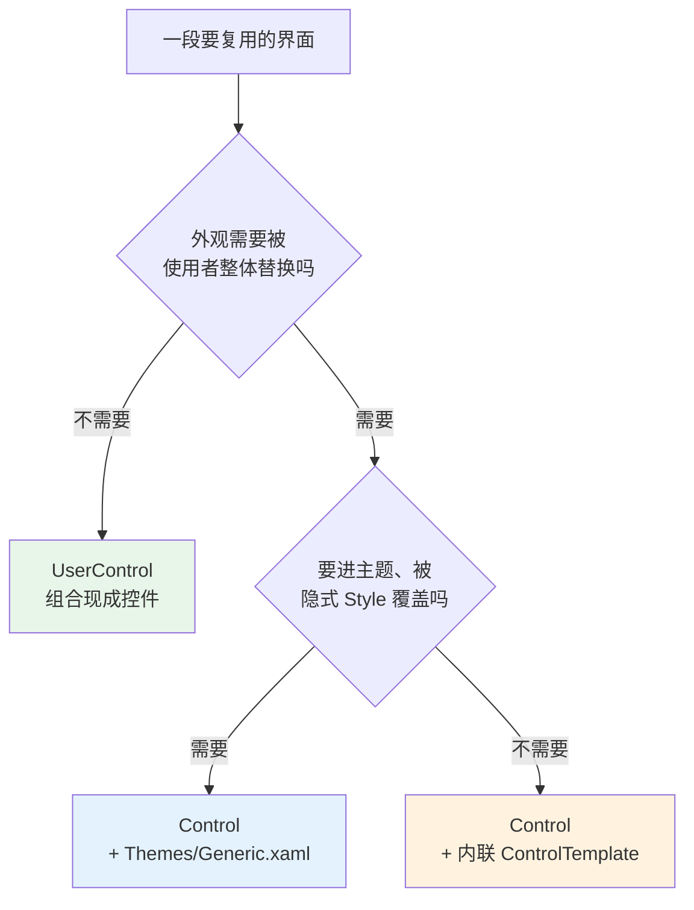
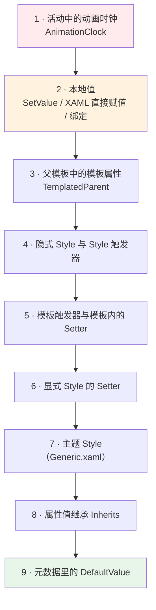

## 一、CLR 属性在 WPF 里为什么不够用

到第 13 章为止，DbLens 的界面全是"用现成控件拼出来的"。现在要加一个结果表格：行号列、斑马纹、加载遮罩、列头样式跟随主题。用 `Style` 能堆出来，但换一套视觉方案就得整段重抄。这时候你需要真正的控件，而控件的入口是依赖属性。

先给结论：**依赖属性（DependencyProperty，下称 DP）不是"带通知的属性"，它存在的唯一理由是参与 WPF 的值系统**。服务端的 POCO 属性直接落到字段上；DP 不是字段，它是注册在类型上的"槽位"，读值时要沿优先级链计算，写值时要通知所有关心的子系统。

| .NET 服务端熟悉的东西 | WPF 对应物 | 关键差别 |
|----------------------|-----------|---------|
| POCO 属性 + `INotifyPropertyChanged` | 依赖属性 + `PropertyChangedCallback` | DP 有多个值来源和优先级，不是单一字段 |
| `IOptions<T>` 绑定配置 | 普通 CLR 属性足够 | 配置对象不参与 UI，不需要 DP |
| 中间件在调用前后插逻辑 | `CoerceValueCallback` / `PropertyChangedCallback` | 回调在 UI 线程同步执行，禁止做重活 |
| DI 容器按类型解析实例 | 属性系统按 `DependencyProperty` 标识解析值来源 | 同一个 DP 可以被样式、模板、动画、继承同时写 |
| `record` 的不可变值对象 | 只读依赖属性 `RegisterReadOnly` | 对外只暴露 DP，写入需要 `DependencyPropertyKey` |

具体说，WPF 有四个系统只能通过 DP 工作：

| 系统 | 为什么必须是 DP |
|------|----------------|
| 数据绑定 | `Binding` 的目标必须是 DP，引擎需要读值、写值、并且能监听变化；普通属性在 XAML 里连目标都当不了 |
| 样式 | `Style` 的 `Setter` 走属性系统写入，优先级低于本地值；普通属性没有"优先级"这个概念 |
| 动画 | 动画时钟只能挂在 DP 上，而且它需要一个"临时覆盖当前值"的能力 |
| 资源 | `DynamicResource` 依赖属性系统在资源变化时重新求值，普通属性没有求值时机 |

再加上属性值继承、触发器和 `TemplateBinding`，结论很清楚：**要给别人绑定、改样式、加动画的属性只能是 DP；ViewModel 的数据属性用普通属性即可。** 给 ViewModel 写一堆 DP 是自找麻烦。

## 二、先选型：UserControl 还是 Control

做控件有两条路，选错了后面每一步都别扭。

| 维度 | `UserControl` | 自定义 `Control` |
|------|--------------|-----------------|
| 本质 | 一个 `ContentControl` + 一份固定 XAML | 无外观的语义控件，外观来自 `ControlTemplate` |
| 内部结构 | 你自己写的，外部改不了 | 模板可被使用者整体替换 |
| 换肤能力 | 只能改内部控件的属性，或覆盖资源 | 写一个新 `Template` 就换掉整个视觉树 |
| 是否进入主题体系 | 不进入，隐式 `Style` 对它的模板无效 | 进入，`Themes/Generic.xaml` 提供默认模板 |
| 适合场景 | 组合现成控件、业务专用小部件 | 通用控件、要给别人用、要跟着主题变 |
| 维护成本 | 低 | 中，需要维护额外资源字典 |



判断标准一句话：**控件是"几个控件的组合"就用 `UserControl`；是"有语义、长相可换"的东西就用 `Control`。**

### 2.1 SqlEditor：UserControl

DbLens 的 SQL 编辑器就是典型组合件：一个多行 `TextBox` 加一行状态信息。它不需要被换模板，只需要把 SQL 文本暴露出去。

```xml
<!-- Views/Controls/SqlEditor.xaml -->
<UserControl x:Class="DbLens.Controls.SqlEditor"
             xmlns="http://schemas.microsoft.com/winfx/2006/xaml/presentation"
             xmlns:x="http://schemas.microsoft.com/winfx/2006/xaml"
             x:Name="Root">
    <Grid>
        <Grid.RowDefinitions>
            <RowDefinition Height="*" />
            <RowDefinition Height="Auto" />
        </Grid.RowDefinitions>

        <TextBox AcceptsReturn="True"
                 AcceptsTab="True"
                 FontFamily="Cascadia Mono, Consolas"
                 FontSize="13"
                 VerticalScrollBarVisibility="Auto"
                 HorizontalScrollBarVisibility="Auto"
                 Text="{Binding SqlText, ElementName=Root, UpdateSourceTrigger=PropertyChanged}" />

        <TextBlock Grid.Row="1"
                   Margin="6,2"
                   Foreground="{DynamicResource SubtleTextBrush}"
                   Text="{Binding SqlText.Length, ElementName=Root, StringFormat='字符数 {0}'}" />
    </Grid>
</UserControl>
```

```csharp
namespace DbLens.Controls;

public partial class SqlEditor : UserControl
{
    public static readonly DependencyProperty SqlTextProperty =
        DependencyProperty.Register(
            nameof(SqlText),
            typeof(string),
            typeof(SqlEditor),
            new FrameworkPropertyMetadata(
                string.Empty,
                FrameworkPropertyMetadataOptions.BindsTwoWayByDefault));

    public SqlEditor()
    {
        InitializeComponent();
    }

    public string SqlText
    {
        get => (string)GetValue(SqlTextProperty);
        set => SetValue(SqlTextProperty, value);
    }
}
```

注意两件事。第一，`UserControl` 一样可以定义 DP，否则外面没法 `{Binding SqlText}`。第二，内部 `TextBox` 用 `ElementName=Root` 绑到自身，而不是继承外部 `DataContext`——这样即使被放进 `DataContext` 完全不同的容器，内部也不会绑错对象。**组合件要自洽。**

`BindsTwoWayByDefault` 是这里的关键：不写它，`<controls:SqlEditor SqlText="{Binding CurrentSql}" />` 只会从 VM 下发到控件，用户在编辑器里打字永远回不到 VM。

### 2.2 ResultGrid：自定义 Control

结果表格不一样。它是 DbLens 的核心视觉组件，必须能被主题换掉：暗色主题下遮罩是半透明黑，亮色下是半透明白；将来别人用你的库，也应该能一行 `Style` 改掉行高和内边距。这就是 `Control`。

```csharp
using System.Collections;

namespace DbLens.Controls;

public class ResultGrid : Control
{
    static ResultGrid()
    {
        // 告诉属性系统：我的默认样式 key 是 typeof(ResultGrid)，不是 typeof(Control)
        DefaultStyleKeyProperty.OverrideMetadata(
            typeof(ResultGrid),
            new FrameworkPropertyMetadata(typeof(ResultGrid)));
    }

    public static readonly DependencyProperty ItemsSourceProperty =
        DependencyProperty.Register(
            nameof(ItemsSource),
            typeof(IEnumerable),
            typeof(ResultGrid),
            new FrameworkPropertyMetadata(null, OnItemsSourceChanged));

    public static readonly DependencyProperty RowHeightProperty =
        DependencyProperty.Register(
            nameof(RowHeight),
            typeof(double),
            typeof(ResultGrid),
            new FrameworkPropertyMetadata(
                24d,
                FrameworkPropertyMetadataOptions.AffectsMeasure,
                null,
                CoerceRowHeight));

    private static readonly DependencyPropertyKey RowCountPropertyKey =
        DependencyProperty.RegisterReadOnly(
            nameof(RowCount),
            typeof(int),
            typeof(ResultGrid),
            new PropertyMetadata(0));

    public static readonly DependencyProperty RowCountProperty =
        RowCountPropertyKey.DependencyProperty;

    public IEnumerable? ItemsSource
    {
        get => (IEnumerable?)GetValue(ItemsSourceProperty);
        set => SetValue(ItemsSourceProperty, value);
    }

    public double RowHeight
    {
        get => (double)GetValue(RowHeightProperty);
        set => SetValue(RowHeightProperty, value);
    }

    public int RowCount => (int)GetValue(RowCountProperty);

    private static void OnItemsSourceChanged(DependencyObject d, DependencyPropertyChangedEventArgs e)
    {
        var grid = (ResultGrid)d;
        var count = e.NewValue switch
        {
            ICollection collection => collection.Count,
            IEnumerable source => source.Cast<object>().Count(),
            _ => 0
        };

        // 只读 DP 只能用 DependencyPropertyKey 写，SetValue 一个只读 DP 会抛异常
        grid.SetValue(RowCountPropertyKey, count);
    }

    private static object CoerceRowHeight(DependencyObject d, object baseValue)
        => Math.Clamp((double)baseValue, 18d, 80d);
}
```

`DefaultStyleKeyProperty.OverrideMetadata` 这一行如果漏了，症状非常迷惑：**控件完全不显示，也不报错**。原因是默认样式 key 是 `typeof(Control)`，属性系统去找 `Control` 的默认模板，那是个空模板，于是你的控件有尺寸但什么都没画。

配套的约定是 `Themes/Generic.xaml`：WPF 在 `Application.LoadComponent` 阶段会去程序集里找这个**精确路径**的资源字典，作为所有自定义控件的默认样式来源。它必须是 `Page` 生成操作，且必须放在项目根的 `Themes` 文件夹下。

```xml
<!-- Themes/Generic.xaml -->
<ResourceDictionary xmlns="http://schemas.microsoft.com/winfx/2006/xaml/presentation"
                    xmlns:x="http://schemas.microsoft.com/winfx/2006/xaml"
                    xmlns:controls="clr-namespace:DbLens.Controls">
    <Style TargetType="{x:Type controls:ResultGrid}">
        <Setter Property="Background" Value="{DynamicResource SurfaceBrush}" />
        <Setter Property="RowHeight" Value="24" />
        <Setter Property="Template">
            <Setter.Value>
                <ControlTemplate TargetType="{x:Type controls:ResultGrid}">
                    <Border Background="{TemplateBinding Background}"
                            BorderBrush="{DynamicResource BorderBrush}"
                            BorderThickness="1"
                            CornerRadius="4"
                            ClipToBounds="True">
                        <Grid>
                            <DataGrid ItemsSource="{TemplateBinding ItemsSource}"
                                      AutoGenerateColumns="False"
                                      HeadersVisibility="Column"
                                      GridLinesVisibility="Horizontal"
                                      RowHeight="{TemplateBinding RowHeight}"
                                      IsReadOnly="True"
                                      CanUserAddRows="False"
                                      EnableRowVirtualization="True"
                                      EnableColumnVirtualization="True" />

                            <Border x:Name="Mask"
                                    Background="#66000000"
                                    Opacity="0"
                                    IsHitTestVisible="False" />
                        </Grid>
                    </Border>
                </ControlTemplate>
            </Setter.Value>
        </Setter>
    </Style>
</ResourceDictionary>
```

模板里注意 `{TemplateBinding ItemsSource}`：它是单向、轻量的模板绑定，只能绑到模板所在控件的属性；需要双向时得写 `{Binding RelativeSource={RelativeSource TemplatedParent}, Path=..., Mode=TwoWay}`。

还有一个容易忘的声明，在 `Properties/AssemblyInfo.cs`：

```csharp
using System.Windows;

[assembly: ThemeInfo(
    ResourceDictionaryLocation.None,
    ResourceDictionaryLocation.SourceAssembly)]
```

第一个参数是"主题专用字典"（如 Aero、Luna）的位置，`None` 表示不提供；第二个参数是通用字典的位置，`SourceAssembly` 表示去当前程序集的 `Themes/Generic.xaml` 找。它通常由模板生成，但把控件拆到独立类库时容易漏写，结果就是控件在宿主程序里渲染成空气。

## 三、DependencyProperty.Register 的每个参数都在干什么

四个参数，每个都能卡你半小时：

```csharp
public static DependencyProperty Register(
    string name,
    Type propertyType,
    Type ownerType,
    PropertyMetadata typeMetadata);
```

| 参数 | 作用 | 常见错误 |
|------|------|---------|
| `name` | DP 的注册名，XAML 解析、动画路径、`GetValueSource` 诊断都靠它 | 与 CLR 包装器名不一致，导致样式里的 `Setter Property="RowHeight"` 找不到 |
| `propertyType` | 值的声明类型 | 用过于宽泛的类型（如 `object`），动画与类型转换都失效 |
| `ownerType` | 注册到哪个类型，同时决定元数据的查找起点 | 用基类注册、子类直接用，两个控件实际上共享同一个 DP |
| `typeMetadata` | 默认值 + 回调 + 元数据选项 | 需要影响布局却只用了 `PropertyMetadata`，布局永远不更新 |

`PropertyMetadata` 和 `FrameworkPropertyMetadata` 的区别要分清：前者只有默认值和 `PropertyChangedCallback`，后者多了 `CoerceValueCallback` 和 `FrameworkPropertyMetadataOptions`。**可视元素几乎总该用后者**，否则 `AffectsMeasure` 这类选项没地方写。

回调签名固定，且都是静态方法：

```csharp
private static void OnRowHeightChanged(DependencyObject d, DependencyPropertyChangedEventArgs e)
{
    var grid = (ResultGrid)d;
    var oldValue = (double)e.OldValue;
    var newValue = (double)e.NewValue;
    // 这里只做轻量同步，不要查库、不要读文件
}
```

`DependencyObject` 是属性系统的最小载体，`DependencyPropertyChangedEventArgs` 同时给出旧值和新值，比只知道"变了"的 `INotifyPropertyChanged` 好用。

## 四、CLR 包装器不是可选项

上面每个 DP 都配了 `get => (int)GetValue(...)` / `set => SetValue(...)`。它们不是装饰：XAML 编译器和绑定引擎都按属性名反射查找 CLR 属性，只有 DP 字段没有包装器，`{Binding RowCount}` 会直接报路径错误——这个属性只存在于属性系统内部，外部看不见。

反过来，包装器里不要写业务逻辑：

```csharp
// 反模式：包装器里加校验
public double RowHeight
{
    get => (double)GetValue(RowHeightProperty);
    set
    {
        if (value < 0) value = 0;   // 永远不会按你预期执行
        SetValue(RowHeightProperty, value);
    }
}
```

因为动画、`Style` 的 `Setter`、`SetCurrentValue`、绑定的内部写入全都直接调 `SetValue`，绕过你的包装器。校验只能放在 `CoerceValueCallback` 里，那里是唯一保证被调用的地方。

## 五、元数据选项与值优先级

`FrameworkPropertyMetadataOptions` 是一组按位标记，最常用的六个：

| 选项 | 作用 | 漏了会怎样 |
|------|------|-----------|
| `AffectsRender` | 值变只触发重绘 | 颜色、边框变了，界面不刷新 |
| `AffectsMeasure` | 值变触发 Measure | 行高改了，表格还是旧高度 |
| `AffectsArrange` | 值变触发 Arrange | 位置相关属性改了不重排 |
| `AffectsParentMeasure` | 连带让父级重新测量 | 子元素变宽，父容器不撑开 |
| `BindsTwoWayByDefault` | 默认双向绑定 | `TextBox` 类控件只下发不回写 |
| `Inherits` | 值沿可视化树向下继承 | 想在容器上设一次、子孙全生效，做不到 |

只影响视觉用 `AffectsRender`，影响尺寸用 `AffectsMeasure`；选大了多跑布局，选小了界面不更新。

真正的难点是值优先级：**同一个 DP 可能被多处写，属性系统按固定顺序算出"当前有效值"**：



很多人记成"本地值最高"，其实**活动的动画时钟会盖住本地值**——这正是第 16 章"动画结束后跳回"的根源。要确认值从哪来，直接问属性系统：

```csharp
var source = DependencyPropertyHelper.GetValueSource(this, RowHeightProperty);

Debug.WriteLine($"来源：{source.BaseValueSource}");  // Local / Style / Inherited / Default ...
Debug.WriteLine($"是否动画：{source.IsAnimated}");
Debug.WriteLine($"是否被 Coerce：{source.IsCoerced}");
```

还有一个进阶工具 `SetCurrentValue`：写入的值不会顶掉样式或动画，也不会踢掉绑定。控件内部改自己的属性（比如拖动分隔条改行高）应该用它；用 `SetValue` 会留下一个本地值，从此样式再也改不动这个属性。

## 六、只读依赖属性

`RowCount` 是典型只读属性：外部能绑定、能读，但绝不能写。只读 DP 用两个字段实现：

```csharp
// 写入口：private，只有本类能用
private static readonly DependencyPropertyKey RowCountPropertyKey =
    DependencyProperty.RegisterReadOnly(
        nameof(RowCount),
        typeof(int),
        typeof(ResultGrid),
        new PropertyMetadata(0));

// 读入口：public，给 XAML、绑定、动画用
public static readonly DependencyProperty RowCountProperty =
    RowCountPropertyKey.DependencyProperty;
```

`DependencyPropertyKey` 的本质是"带写入权限的 DP 句柄"，`RegisterReadOnly` 内部创建的仍是普通 DP，只是不公开 key。`ActualWidth`、`IsMouseOver` 都是这种只读 DP。判断标准很简单：**值由控件自己算出来，就该只读。**

## 七、附加属性：把能力挂到别人的控件上

附加属性解决的是"给一个不属于我的控件加属性"。经典例子是 `Grid.Row`：定义在 `Grid` 上，却写在 `Button` 上。DbLens 里做一个 `GridLines.ShowLines`，让任何 `DataGrid` 一行 XAML 就打开网格线：

```csharp
namespace DbLens.Controls;

public static class GridLines
{
    public static readonly DependencyProperty ShowLinesProperty =
        DependencyProperty.RegisterAttached(
            "ShowLines",
            typeof(bool),
            typeof(GridLines),
            new FrameworkPropertyMetadata(
                false,
                FrameworkPropertyMetadataOptions.Inherits,
                OnShowLinesChanged));

    public static bool GetShowLines(DependencyObject element)
        => (bool)element.GetValue(ShowLinesProperty);

    public static void SetShowLines(DependencyObject element, bool value)
        => element.SetValue(ShowLinesProperty, value);

    private static void OnShowLinesChanged(DependencyObject d, DependencyPropertyChangedEventArgs e)
    {
        if (d is DataGrid grid)
        {
            grid.GridLinesVisibility = (bool)e.NewValue
                ? DataGridGridLinesVisibility.All
                : DataGridGridLinesVisibility.None;
        }
    }
}
```

```xml
<DataGrid local:GridLines.ShowLines="True"
          ItemsSource="{Binding Rows}" />
```

三个约定：`name` 是 `"ShowLines"`（不带 Property 后缀）；访问器必须叫 `GetShowLines` / `SetShowLines`，XAML 解析器靠命名约定查找；`ownerType` 是那个静态类，不是目标控件。

加上 `Inherits` 之后，外层容器写一次 `<Grid local:GridLines.ShowLines="True">`，里面所有 `DataGrid` 都会收到——继承值沿树下发，并对每个 `DataGrid` 触发回调。

## 八、共享属性与继承属性

两个控件表达同一个概念时，不要各注册一个 DP，用 `AddOwner` 复用同一个标识符。假设结果区要加两个小控件：`ScoreBar`（横条）和 `ProgressBadge`（圆形徽标），它们共享同一个 `Value` 语义：

```csharp
public class ScoreBar : Control
{
    public static readonly DependencyProperty ValueProperty =
        DependencyProperty.Register(
            nameof(Value),
            typeof(double),
            typeof(ScoreBar),
            new FrameworkPropertyMetadata(0d, FrameworkPropertyMetadataOptions.BindsTwoWayByDefault));

    public double Value
    {
        get => (double)GetValue(ValueProperty);
        set => SetValue(ValueProperty, value);
    }
}

public class ProgressBadge : Control
{
    // 不是新注册，而是接管 ScoreBar 的 DP，两个类型共享同一个标识符
    public static readonly DependencyProperty ValueProperty =
        ScoreBar.ValueProperty.AddOwner(
            typeof(ProgressBadge),
            new FrameworkPropertyMetadata(0d, FrameworkPropertyMetadataOptions.BindsTwoWayByDefault));

    public double Value
    {
        get => (double)GetValue(ValueProperty);
        set => SetValue(ValueProperty, value);
    }
}
```

`AddOwner` 的价值在于：样式里写一份 `Setter Property="local:ScoreBar.Value"`，两个控件都能用；类型转换、验证逻辑只写一次；跨控件共享值的场景行为一致。

继承属性则是另一个维度。`FontSize`、`FontFamily`、`Foreground`、`DataContext` 都是 `Inherits` 的 DP：父级设一次，整棵子树都拿到。你自己注册的 DP 也能继承，但要记住两点：**继承值只在没有本地值、样式值、动画值时生效**；以及继承会带来"这值到底谁设的"的排查困难，诊断时优先看 `BaseValueSource.Inherited`。

## 九、回调里不能干什么

这是最容易出事故的地方，四条红线：

1. **`CoerceValueCallback` 里不要做有副作用的事**。Coerce 可能被调用多次，必须是纯函数：同样的输入给同样的输出，不碰别的属性、不查数据库。
2. **`PropertyChangedCallback` 里不要再写同一个属性**。写入会再次触发回调，轻则递归多层，重则栈溢出，或在动画进行中抛 `InvalidOperationException`。
3. **回调里不要做重活**。它在 UI 线程同步执行，而控件初始化、模板应用、样式求值阶段会被密集调用。DbLens 里 `OnItemsSourceChanged` 那个 `Count()` 就是半个反例——`ICollection` 是 O(1)，纯 `IEnumerable` 却会在 UI 线程上把整个序列走一遍，上万行时直接卡住首屏。
4. **"值稳定之后"才做的事别放回调**。用 `Dispatcher.BeginInvoke(DispatcherPriority.Background, ...)` 推迟一拍，或放到 `OnApplyTemplate` / `Loaded` 里。

一个实用的替代写法：

```csharp
private static void OnItemsSourceChanged(DependencyObject d, DependencyPropertyChangedEventArgs e)
{
    var grid = (ResultGrid)d;

    // 回调只记录，真正的统计推迟到布局空隙
    grid.Dispatcher.BeginInvoke(
        DispatcherPriority.Background,
        new Action(() => grid.SetValue(RowCountPropertyKey, CountRows(grid.ItemsSource))));
}
```

## 十、踩坑清单

| 现象 | 原因 | 处理 |
|------|------|------|
| 自定义 `Control` 完全不显示，也不报错 | 没 `OverrideMetadata(DefaultStyleKeyProperty)`，或 `Themes/Generic.xaml` 路径/生成操作不对 | 补上 override；确认字典在 `Themes/Generic.xaml` 且为 `Page` |
| XAML 里写自定义属性报"类型不包含该属性" | 只有 DP 字段，没有 CLR 包装器 | 补 `get`/`set` 调 `GetValue`/`SetValue` |
| 属性在 XAML 里赋了值，立刻被改回去 | 在 `PropertyChangedCallback` 里又写了同一个属性 | 改别的属性，或用 `SetCurrentValue` |
| 双向绑定只从 VM 下发，界面改不回 VM | 元数据没声明 `BindsTwoWayByDefault`，XAML 也没写 `Mode=TwoWay` | 二选一，推荐元数据声明 |
| 属性值变了但界面不刷新 | 漏了 `AffectsRender` / `AffectsMeasure` | 按是否影响尺寸选对应标记 |
| 在 XAML 里给只读 DP 赋值，抛异常 | 只读 DP 不允许外部写入 | 只能通过 `DependencyPropertyKey` 在类内部写 |
| 附加属性的回调不触发 | `GetXxx`/`SetXxx` 命名不规范，或 `name` 带了 `Property` 后缀 | 严格按约定命名 |

## 十一、本章小结

- DP 的唯一目的是接入属性系统：绑定、样式、动画、资源、继承全部依赖它，普通 CLR 属性一个都参与不了。
- `UserControl` 组合现成控件；`Control` 用于"语义明确、外观可换"的控件，必须配 `DefaultStyleKeyProperty.OverrideMetadata` 和 `Themes/Generic.xaml`。
- `DependencyProperty.Register` 四个参数决定名字、类型、归属和元数据；可视控件一律用 `FrameworkPropertyMetadata`。
- 值优先级里"活动动画"高于本地值，这解释了后面动画结束时的值跳变；排查值来源用 `DependencyPropertyHelper.GetValueSource`。
- 只读 DP 用 `RegisterReadOnly` + `DependencyPropertyKey`；附加属性用 `RegisterAttached` 并遵守 `Get`/`Set` 命名约定；跨控件复用 DP 用 `AddOwner`。

**练习**：给 `ResultGrid` 加一个 `EmptyText` DP（类型 `string`，默认值「没有结果」），在模板里用 `TextBlock` 显示它，并在 `ItemsSource` 为空时通过一个 `DataTrigger` 让这块文字显示出来。然后故意漏掉 `DefaultStyleKeyProperty` 那一行，观察控件"消失"的现象——你会对这条约定印象深得多。

下一章解决万行数据：`ItemsSource` 背后那层 `CollectionView`，以及为什么虚拟化会突然失效。
