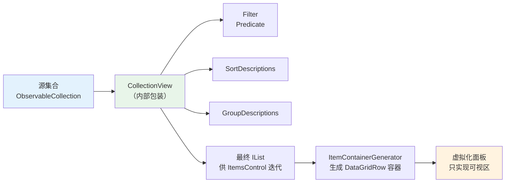
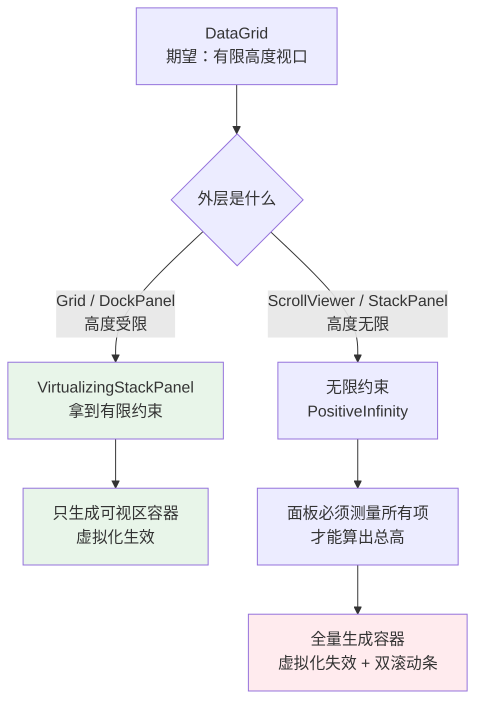

## 一、`ItemsSource` 接收的不是集合，是视图

第 07 章说 `ItemsSource` 接受 `IEnumerable`，这句话只说了一半。真实情况是：**你交给 `ItemsSource` 的任何集合，WPF 都会在内部包一层 `CollectionView`**。`List<T>`、`ObservableCollection<T>`、`DataTable`、数组，全都要经过这层包装，`ItemsControl` 真正渲染的是这层视图。



拿到这一层视图的入口是：

```csharp
ICollectionView view = CollectionViewSource.GetDefaultView(Rows);
```

同一个源集合，永远返回**同一个**视图实例，这就是 `GetDefaultView` 里"Default"的含义。这也解释了一个常见困惑：你在 A 处给 `List<T>` 加了排序，B 处绑定同一个 `List<T>` 时排序也生效了——因为它们共享同一个默认视图。想互不干扰，就用 `new CollectionViewSource { Source = list }.View` 各建一个。

| .NET 服务端熟悉的做法 | WPF 里的对应物 | 差别 |
|----------------------|---------------|------|
| LINQ `Where` 生成新序列 | `ICollectionView.Filter` | 视图不复制数据，只过滤可见项；源集合不变 |
| `OrderBy` 返回新列表 | `SortDescriptions` | 排序由视图维护，可运行时增删 |
| `GroupBy` 返回分组序列 | `GroupDescriptions` | 分组结果直接喂给 `GroupStyle` 渲染 |
| 每次查询都重新 `ToList()` | `Refresh()` | 不重建集合，只重算视图，但仍有成本 |

关键认知：**筛选和排序发生在"视图"层，不是数据层**。你在 UI 里筛选，内存里那一万行一个都没少。要真正降内存，得回到查询层分页，这是两件不同的事。

## 二、`ICollectionView` 能做的三件事

`ICollectionView` 的接口不大，真正用的就三个属性加两个方法：

| 成员 | 类型 | 用途 |
|------|------|------|
| `Filter` | `Predicate<object>` | 逐项判断是否可见，返回 `false` 就隐藏 |
| `SortDescriptions` | `SortDescriptionCollection` | 按属性名多级排序 |
| `GroupDescriptions` | `GroupDescriptionCollection` | 按属性名或转换器分组 |
| `Refresh()` | 方法 | 重算整个视图 |
| `DeferRefresh()` | 返回 `IDisposable` | 挂起刷新，批量改完一次性生效 |

`Filter` 是逐项调用的，每次 `Refresh` 都会把源集合完整走一遍。**一万行就是一万次委托调用**，所以谓词里不要做字符串拼接、不要 `ToString()` 格式化、更不要查数据库。判断逻辑尽量基于已经算好的字段。

排序用属性路径字符串，支持索引器和嵌套路径：

```csharp
view.SortDescriptions.Add(new SortDescription("Values[0]", ListSortDirection.Ascending));
view.SortDescriptions.Add(new SortDescription(nameof(ResultRow.Ordinal), ListSortDirection.Ascending));
```

第一条是主排序，第二条是次排序。**`SortDescription` 的字符串是按属性名反射解析的**，写错了不报错，只是不排序——这是它和 LINQ `OrderBy` 最大的体验差异。

分组也是一样，但分组会显著改变渲染结构：每个分组头是一个 `GroupItem`，里面再套一个 `ItemsPresenter`。**分组和虚拟化是有冲突历史的**：老版本 WPF 里分组会关闭虚拟化，.NET 4.5 之后 `VirtualizingPanel.IsVirtualizingWhenGrouping="True"` 才让分组下的虚拟化重新可用。

## 三、在 DbLens 里接上筛选、排序、分组

DbLens 的结果页需要三件事：关键字过滤、点列头排序、把 NULL 值单独归一组。全部落在 ViewModel 里，视图只负责绑定：

```csharp
using System.Collections.ObjectModel;
using System.ComponentModel;
using System.Windows.Data;

namespace DbLens.ViewModels;

public sealed partial class ResultsViewModel : ObservableObject
{
    public ObservableCollection<ResultRow> Rows { get; } = new();

    // 暴露给 XAML 的就是这层视图
    public ICollectionView RowsView { get; }

    [ObservableProperty]
    private string? _filterText;

    [ObservableProperty]
    private string? _sortMember;

    [ObservableProperty]
    private bool _groupNulls;

    public ResultsViewModel()
    {
        RowsView = CollectionViewSource.GetDefaultView(Rows);
        RowsView.Filter = MatchesFilter;
        RowsView.SortDescriptions.Add(
            new SortDescription(nameof(ResultRow.Ordinal), ListSortDirection.Ascending));
    }

    partial void OnFilterTextChanged(string? value) => RowsView.Refresh();

    partial void OnSortMemberChanged(string? value) => ApplySort(value);

    partial void OnGroupNullsChanged(bool value) => ApplyGrouping(value);

    private bool MatchesFilter(object item)
    {
        if (string.IsNullOrWhiteSpace(FilterText))
        {
            return true;
        }

        return item is ResultRow row
            && row.Values.Any(v => v?.ToString()?.Contains(
                FilterText, StringComparison.OrdinalIgnoreCase) == true);
    }

    private void ApplySort(string? member)
    {
        // 清空 + 添加是两次变更，用 DeferRefresh 合并成一次重算
        using (RowsView.DeferRefresh())
        {
            RowsView.SortDescriptions.Clear();
            RowsView.SortDescriptions.Add(new SortDescription(
                member ?? nameof(ResultRow.Ordinal),
                ListSortDirection.Ascending));
        }
    }

    private void ApplyGrouping(bool enabled)
    {
        using (RowsView.DeferRefresh())
        {
            RowsView.GroupDescriptions.Clear();

            if (enabled)
            {
                RowsView.GroupDescriptions.Add(new PropertyGroupDescription(
                    nameof(ResultRow.FirstValue),
                    new NullGroupConverter()));
            }
        }
    }
}
```

```csharp
using System.Globalization;

namespace DbLens.Converters;

public sealed class NullGroupConverter : IValueConverter
{
    public object Convert(object value, Type targetType, object parameter, CultureInfo culture)
        => value is null ? "空值" : "有值";

    public object ConvertBack(object value, Type targetType, object parameter, CultureInfo culture)
        => throw new NotSupportedException("分组转换器不需要回写");
}
```

视图这边只需要绑定 `RowsView`，并在列头上挂一个排序命令：

```xml
<DataGrid ItemsSource="{Binding RowsView}"
          AutoGenerateColumns="False"
          CanUserSortColumns="False"
          EnableRowVirtualization="True">
    <DataGrid.Columns>
        <DataGridTextColumn Header="#"
                            Binding="{Binding Ordinal}"
                            Width="50" />
        <DataGridTextColumn Header="首列"
                            Binding="{Binding FirstValue}"
                            Width="160" />
    </DataGrid.Columns>
</DataGrid>
```

注意 `CanUserSortColumns="False"`：`DataGrid` 自带的列头排序会直接改写同一个视图的 `SortDescriptions`，和你手写的排序互相覆盖，表现为"点一次列头，顺序跳两下"。要么全交给 `DataGrid`，要么全自己控制。

## 四、XAML 里的 `CollectionViewSource`

不想在 ViewModel 里持有视图时，可以在 XAML 里声明：

```xml
<UserControl.Resources>
    <CollectionViewSource x:Key="ResultView" Source="{Binding Rows}" />
</UserControl.Resources>

<DataGrid ItemsSource="{Binding Source={StaticResource ResultView}}" />
```

`CollectionViewSource` 是 `Freezable`，靠在资源树里的"继承上下文"拿到 `DataContext`，所以 `Source="{Binding Rows}"` 能解析到 ViewModel 的 `Rows`。**必须放在窗口或用户控件的 `Resources` 里**，放到 `App.Resources` 就失去继承上下文，绑定解析不到 `Rows`——这是它最典型的失败方式。

声明式的真正用处是配合 `SortDescriptions`、`GroupDescriptions` 写静态配置，或者给多个 `ItemsControl` 共享同一个视图（比如表格和饼图绑同一份筛选结果）。运行时频繁改筛选条件的场景，还是代码里拿 `RowsView` 更直接。

## 五、`DeferRefresh` 不是性能银弹

一次 `Refresh()` 的成本 = 重新过滤全部项 + 重新排序（`O(n log n)`）+ 重新分组 + 让 `ItemContainerGenerator` 重建容器。改三个属性做三次刷新，就是三倍成本。

```csharp
// 反模式：三次刷新
view.SortDescriptions.Clear();
view.SortDescriptions.Add(new SortDescription("A", ListSortDirection.Ascending));
view.Filter = newFilter;

// 正确：合并成一次
using (view.DeferRefresh())
{
    view.SortDescriptions.Clear();
    view.SortDescriptions.Add(new SortDescription("A", ListSortDirection.Ascending));
    view.Filter = newFilter;
}
```

`DeferRefresh` 内部是一个引用计数，`Dispose` 时计数归零才真正刷新，所以可以嵌套。但它只合并"刷新次数"，不优化单次刷新的复杂度——一万行排序该慢还是慢。

这里有个和服务端完全不同的直觉：服务端你会想"反正就一万行，`OrderBy` 一下几毫秒"。但 UI 线程上的每次 `Refresh` 后面都跟着布局和容器生成，**真正贵的不是排序，是让一万个 `DataGridRow` 参与测量**。这就是虚拟化要解决的问题。

## 六、`LiveShaping`：数据在变时也保持有序

`ICollectionView` 的排序是"快照式"的：排完序之后，如果某一行的值变了，它不会自动挪位置。对只读的查询结果这没问题，但 DbLens 允许就地编辑结果（生成 `UPDATE` 语句），编辑后排序就乱了。

.NET 4.5 起 WPF 支持实时整形：

```csharp
if (view is ICollectionViewLiveShaping live && live.CanChangeLiveSorting)
{
    live.LiveSortingProperties.Add(nameof(ResultRow.Ordinal));
    live.IsLiveSorting = true;
}
```

`ICollectionViewLiveShaping` 还支持 `LiveFilteringProperties` 与 `LiveGroupingProperties`，前提是数据项实现了 `INotifyPropertyChanged`。代价是每一行的属性变更都要走一遍视图逻辑，**万行级别下开销是实实在在的**。判断标准：需要"边编辑边保持顺序"才开，纯展示的结果集一律不开。

## 七、虚拟化：三个开关和一个前提

虚拟化的含义：`ItemsControl` 只创建可视区内的容器，滚动时回收再利用。没有它，一万行就是一万个 `DataGridRow` 实例，每个都带 `Border`、`ContentPresenter`、若干个 `TextBlock`，几十万个可视对象，布局系统直接跪。

```xml
<DataGrid VirtualizingPanel.IsVirtualizing="True"
          VirtualizingPanel.VirtualizationMode="Recycling"
          VirtualizingPanel.ScrollUnit="Pixel"
          VirtualizingPanel.CacheLength="1,1"
          VirtualizingPanel.CacheLengthUnit="Page"
          ScrollViewer.CanContentScroll="True"
          EnableRowVirtualization="True"
          EnableColumnVirtualization="True"
          ItemsSource="{Binding RowsView}" />
```

| 设置 | 作用 | 不设的后果 |
|------|------|-----------|
| `IsVirtualizing` | 总开关 | 全量生成容器，万行直接卡死 |
| `VirtualizationMode="Recycling"` | 复用容器，只换 `DataContext` | 每次滚动都新建/销毁容器，滚动发涩 |
| `ScrollUnit="Pixel"` | 按像素滚动 | 默认按项滚动，行高不一时跳动 |
| `CacheLength` | 可视区外预生成的缓冲 | 快速滚动出现空白 |
| `CanContentScroll="True"` | **虚拟化的前提** | 面板拿到无限约束，虚拟化直接失效 |

`ScrollViewer.CanContentScroll` 为什么是前提？因为虚拟化依赖"滚动偏移以**项**为单位"来算可视区索引。`CanContentScroll=False` 时滚动条按像素工作，`VirtualizingStackPanel` 拿不到"当前第几项"，只能把所有项都摆出来再交给 `ScrollViewer` 裁切——看起来能滚，实际上容器一个不少。这是最隐蔽的一种"假虚拟化"。

## 八、套进 `ScrollViewer` 就全废了

第 04 章讲过布局的无限约束：父容器在 `Measure` 时传 `double.PositiveInfinity`，子元素就按"内容想要多大"来测量。虚拟化面板正是靠"我知道视口高度有限"来决定生成几行。



```xml
<!-- 反模式：DataGrid 被套在 ScrollViewer 里 -->
<ScrollViewer VerticalScrollBarVisibility="Auto">
    <StackPanel>
        <DataGrid ItemsSource="{Binding RowsView}" />
    </StackPanel>
</ScrollViewer>
```

这段 XAML 会有两个可见症状：外层滚动条出现了，表格自己的滚动条也还在；滚到几千行时内存暴涨。修复只有一个方向——**让 `DataGrid` 直接成为有限高度容器的子元素**：

```xml
<Grid>
    <Grid.RowDefinitions>
        <RowDefinition Height="Auto" />
        <RowDefinition Height="*" />   <!-- 关键：星号行给出有限高度 -->
    </Grid.RowDefinitions>

    <TextBlock Grid.Row="0" Text="查询结果" />

    <DataGrid Grid.Row="1"
              ItemsSource="{Binding RowsView}"
              VirtualizingPanel.IsVirtualizing="True"
              VirtualizingPanel.VirtualizationMode="Recycling"
              ScrollViewer.CanContentScroll="True" />
</Grid>
```

同理，`StackPanel` 的竖直方向、`ScrollViewer` 的内容区、`Height="Auto"` 的行，都会给子元素无限约束。判断方法很简单：**从 `DataGrid` 往上数，只要有一层给了无限高度，虚拟化就废了。**

## 九、万行数据：三种承载方式

选错数据容器，再怎么调虚拟化参数都救不回来。

| 方案 | 每行开销 | 变更通知 | 排序筛选 | 适用 |
|------|---------|---------|---------|------|
| `DataTable` / `DataView` | 高，`DataRow` + 列元数据 + 状态位，比对象数组多三到五成 | 集合级 `ListChanged`，没有逐项 `INPC` | `DataView.Sort` / `RowFilter`，字符串表达式 | 列在运行期才确定、完全动态 |
| `ObservableCollection<T>` | 低，纯对象引用 | 逐项 `INPC` + 集合事件 | `ICollectionView` | 强类型、列已知、需要编辑回写 |
| 分页 / 窗口化查询 | 最低，只留当前页 | 自己实现 | 在 SQL 层做 | 十万行以上 |

DbLens 的选择是 `ObservableCollection<ResultRow>`：列虽然动态，但每行是一条 `object?[]`，列描述单独放在 `ResultColumn` 集合里，`DataGrid` 的列在运行时按索引绑定生成：

```csharp
public sealed class ResultRow
{
    public int Ordinal { get; init; }

    public object?[] Values { get; init; } = Array.Empty<object?>();

    public string? FirstValue => Values.FirstOrDefault()?.ToString();
}
```

`DataTable` 的诱人之处是"什么都不用写"，但它的每行都带 `RowState`、`Original`/`Current` 两份版本、列元数据引用，十万行时内存能差出一倍。而且 `DataView` 改了筛选条件要重新 `ToList` 才能拿到强类型结果，回写数据库时还得再转一次。

真正超过十万行的场景，正确做法不是在内存里硬扛，而是**改成分页查询**：把 `Take`/`Skip` 或游标下推到 SQL，UI 只保留一页。虚拟化解决的是"渲染"问题，不是"数据量"问题，这两件事经常被混为一谈。

## 十、`DataGrid` 的性能开关

除了虚拟化三件套，还有几个直接影响首屏的设置：

| 设置 | 推荐值 | 原因 |
|------|--------|------|
| `AutoGenerateColumns` | `False` | 自动生成列要反射扫属性、构造绑定，列多时首屏明显变慢，且无法控制格式 |
| `EnableRowVirtualization` | `True` | 行虚拟化，行数多时必须开 |
| `EnableColumnVirtualization` | `True` | 列多（几十列）时只生成可视列 |
| `Width`（列） | 固定值或 `SizeToCells` | `Auto` 会对每行内容做测量，列一多就是灾难 |
| `RowHeight` | 固定值 | 行高固定后面板能精确算偏移，`ScrollUnit=Pixel` 下更稳 |
| `VirtualizingPanel.CacheLength` | `1,1` 页 | 太大浪费内存，太小快速滚动白屏 |
| `IsReadOnly` | 只读结果集设 `True` | 省掉编辑模板与验证逻辑 |

```xml
<DataGrid AutoGenerateColumns="False"
          IsReadOnly="True"
          RowHeight="24"
          EnableRowVirtualization="True"
          EnableColumnVirtualization="True"
          VirtualizingPanel.IsVirtualizing="True"
          VirtualizingPanel.VirtualizationMode="Recycling"
          VirtualizingPanel.ScrollUnit="Pixel"
          VirtualizingPanel.CacheLength="1,1"
          VirtualizingPanel.CacheLengthUnit="Page"
          ScrollViewer.CanContentScroll="True" />
```

列宽用 `Auto` 是新手最常踩的性能坑：`DataGridLength.Auto` 会让每一列对**所有已生成行**做测量取最大值，而行虚拟化下"所有行"这个概念本身就不成立，结果是列宽随滚动变化、并且每次滚动都触发一轮测量。

## 十一、怎么确认虚拟化真的生效

不要靠"感觉变快了"来判断。两个可量化的手段。

第一，数一下真实生成的容器数量：

```csharp
private void ReportRealizedRows()
{
    var realized = 0;

    for (var i = 0; i < Grid.Items.Count; i++)
    {
        if (Grid.ItemContainerGenerator.ContainerFromIndex(i) is not null)
        {
            realized++;
        }
    }

    Debug.WriteLine($"总行数 {Grid.Items.Count}，已生成容器 {realized}");
}
```

一万行数据，虚拟化生效时这个数字应该是几十到一两百；如果是 10000，说明虚拟化没工作，回去查 `CanContentScroll` 和外层容器。

第二，量首屏耗时。关键是**要等渲染完成再停表**，否则测到的只是"数据塞进集合"的时间：

```csharp
using System.Diagnostics;

private void OnResultsLoaded(object sender, RoutedEventArgs e)
{
    var sw = Stopwatch.StartNew();

    Dispatcher.BeginInvoke(DispatcherPriority.ContextIdle, new Action(() =>
    {
        sw.Stop();
        Debug.WriteLine($"首屏渲染完成：{sw.ElapsedMilliseconds} ms");
    }));
}
```

`DispatcherPriority.ContextIdle` 低于 `Render`，排到它执行时第一帧已经画完了。这个数字才是用户感知到的"结果出来要多久"。

再往下就是绑定层诊断：给绑定加 `PresentationTraceSources.TraceLevel=High`，看输出窗口里的绑定错误和耗时告警，这部分放到第 18 章。

## 十二、踩坑清单

| 现象 | 原因 | 处理 |
|------|------|------|
| 筛选改了，界面没变 | 只改了 `Filter` 字段没调 `Refresh()`，或改的是另一个视图实例 | 调 `Refresh()`；确认用的是 `GetDefaultView` 拿到的同一个视图 |
| `SortDescriptions` 加了但不排序 | 属性名拼错，或属性没有公共 getter | 用 `nameof`；确认属性可读 |
| 点列头排序结果乱跳 | `DataGrid` 自带排序与手写 `SortDescriptions` 同时生效 | 关掉 `CanUserSortColumns`，只留一套 |
| 一万行滚动卡顿、内存上 G | 虚拟化没生效 | 检查 `CanContentScroll`、外层是否有 `ScrollViewer`/`StackPanel` |
| 出现内外两个滚动条 | `DataGrid` 被套进外层 `ScrollViewer` | 去掉外层，让 `DataGrid` 自己滚 |
| 快速滚动出现空白行 | `CacheLength` 太小或 `VirtualizationMode=Standard` | 设 `Recycling`，缓存给 1 页 |
| 分组后卡顿加剧 | 分组默认关闭虚拟化 | 设 `VirtualizingPanel.IsVirtualizingWhenGrouping="True"` |
| 列宽随滚动变化 | 列宽用了 `Auto` | 改固定宽度或 `SizeToCells` |
| `CollectionViewSource` 绑不到数据 | 放在了 `App.Resources`，没有继承上下文 | 移到窗口/用户控件的 `Resources` |
| 编辑单元格后顺序错乱 | 视图排序是快照式的 | 开 `LiveSorting`，或编辑后手动 `Refresh()` |

## 十三、本章小结

- `ItemsSource` 拿到的任何集合都会被包一层 `CollectionView`，`GetDefaultView` 返回的是同一个共享实例，筛选排序都发生在这一层，源集合不变。
- `ICollectionView` 的三件套是 `Filter`、`SortDescriptions`、`GroupDescriptions`；批量修改用 `DeferRefresh` 合并刷新，但它不降低单次刷新的复杂度。
- 虚拟化的前提是 `ScrollViewer.CanContentScroll="True"`，本质是让滚动偏移以项为单位；再配合 `Recycling` 与 `Pixel` 才完整。
- 只要祖先给的是无限高度（`ScrollViewer`、`StackPanel`、`Auto` 行），虚拟化立刻失效——这与第 04 章的布局约束是同一件事。
- 万行结果集优先 `ObservableCollection<T>`；`DataTable` 的内存和通知成本都更高；十万行以上应该分页查询而不是堆内存。
- 用"已生成容器数"和"ContextIdle 时刻的首屏耗时"验证效果，不要靠感觉。

**练习**：给 DbLens 的结果页加一个「只显示含 NULL 的行」开关，用 `Filter` 实现，并在状态栏显示"当前可见 / 总行数"。然后用 `ItemContainerGenerator.ContainerFromIndex` 数一下生成容器数，再把 `DataGrid` 套进 `ScrollViewer` 里对比一次——亲手看到虚拟化被关掉的数字差异。

下一章让界面动起来：动画本质上就是往依赖属性上挂一个时钟。
