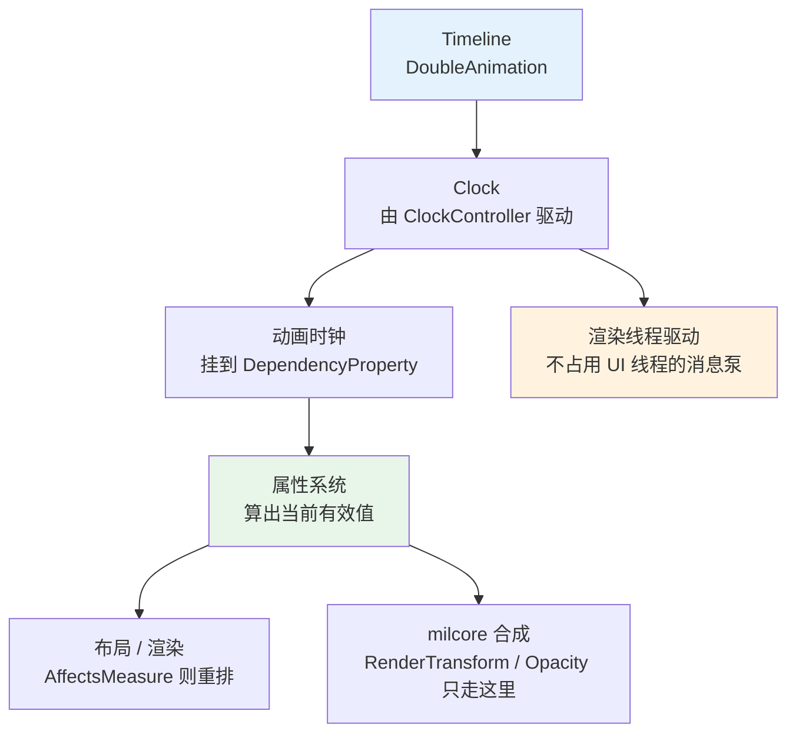
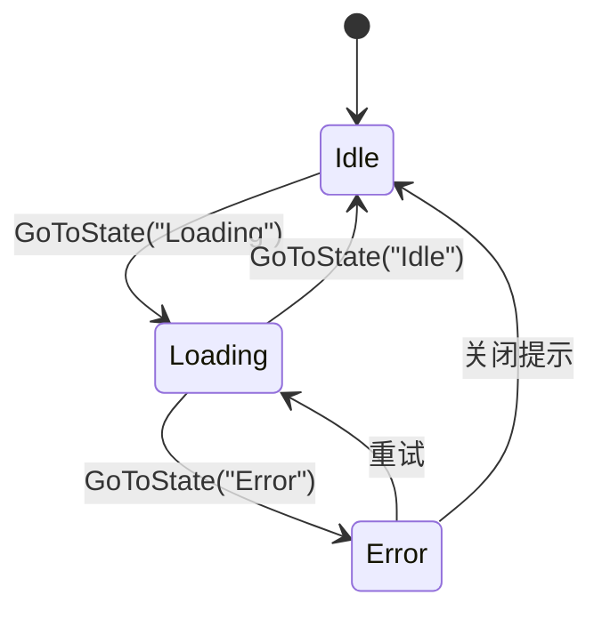

## 一、动画不是"播放"，是给 DP 挂一个时钟

服务端程序员第一次看 WPF 动画，容易把它理解成"定时器不断改值"。不是。WPF 动画的实现是：**创建一个 `AnimationClock`，挂到某个依赖属性的值来源链上，由渲染线程按帧率推进，属性系统每帧把插值结果写进有效值**。



这条链路推出四个结论，后面所有细节都从这里来：

1. **只有依赖属性（以及 `Freezable` 的子属性）能被动画**。普通 CLR 属性没有值来源链，动画挂不上去。
2. **动画值在优先级上高于本地值**。第 14 章那张优先级图里，动画时钟在最顶层，所以"给一个已被 `Style` 设值的属性加动画"是有效的。
3. **动画由渲染线程推进**。UI 线程在跑消息泵、跑你的业务代码时，动画照样在走——这是 WPF 动画比"定时器改属性"流畅得多的原因。
4. **`RenderTransform`、`Opacity` 这类属性不触发布局**，插值结果直接进合成器；而 `Width`、`Margin` 每帧都要重新测量整棵子树。

| .NET 服务端熟悉的东西 | WPF 动画里的对应物 | 差别 |
|----------------------|-------------------|------|
| `Timer` 定时改字段 | `AnimationClock` 驱动 DP | 帧驱动、由渲染线程推进、自动插值 |
| `DateTime.Now` 算进度 | `Timeline` 的 `Duration` / `BeginTime` | 时间轴是声明式的，可暂停、可反向、可重复 |
| CSS transition 直觉 | `DoubleAnimation` + `EasingFunction` | 概念接近，但 WPF 的缓动是对象而不是字符串 |
| 状态机 + 手动切 UI | `VisualStateManager` | 状态与视觉分离，模板里声明，代码里只需 `GoToState` |

## 二、Timeline 家族速查

| 类型 | 插值对象 | 典型用途 |
|------|---------|---------|
| `DoubleAnimation` | `double` | 透明度、旋转角、位移、缩放 |
| `ColorAnimation` | `Color` | 背景色、边框色渐变 |
| `ThicknessAnimation` | `Thickness` | 内边距、边框粗细变化 |
| `PointAnimation` | `Point` | 渐变起点、路径点 |
| `ObjectAnimationUsingKeyFrames` | 任意离散值 | 枚举、`Visibility`、图标切换（无插值） |
| `DoubleAnimationUsingKeyFrames` | `double`，多关键帧 | 复杂轨迹、分段缓动 |

`ObjectAnimationUsingKeyFrames` 值得单独说：**它不做插值，只在关键帧时刻瞬间改值**。凡是不连续的值（`Visibility`、`HorizontalAlignment`、某个枚举状态）都靠它。用它来做淡入淡出是错的，因为中间没有过渡帧。

## 三、`Storyboard` 与属性路径

单个 `Animation` 只能动一个属性，`Storyboard` 是动画的容器，负责"同一时间轴上的一组动画"。它的核心难点是 `TargetProperty` 的路径写法。

```xml
<Storyboard x:Key="Spin">
    <DoubleAnimation Storyboard.TargetName="Spinner"
                     Storyboard.TargetProperty="(UIElement.RenderTransform).(RotateTransform.Angle)"
                     From="0" To="360"
                     Duration="0:0:1"
                     RepeatBehavior="Forever" />
</Storyboard>
```

`TargetProperty` 有两种写法：

| 写法 | 适用 | 注意 |
|------|------|------|
| `"Opacity"` | 目标对象自身的 DP，名字唯一 | 最常用 |
| `"(OwnerType.PropertyName)"` | 属性名有歧义时消歧义，如 `(UIElement.Opacity)` | 括号是类型限定符 |
| `"(UIElement.RenderTransform).(RotateTransform.Angle)"` | 沿属性链往下走，动子对象 | 每一段都要用括号包起来 |
| `"(Control.Background).(SolidColorBrush.Color)"` | 动画刷颜色 | `SolidColorBrush` 必须未冻结、且每行独立 |

路径里的每一段都是"属性名"，WPF 靠反射逐段解析。**路径写错不报错，只是不生效**；如果某一段解析到 `null`（比如 `RenderTransform` 还没赋值），整条路径失效。所以用 `RenderTransform` 做动画，必须先在元素上显式声明一个未冻结的 `RotateTransform`：

```xml
<Path x:Name="Spinner"
      Data="M 10,10 A 8,8 0 1 1 9.9,10"
      RenderTransformOrigin="0.5,0.5">
    <Path.RenderTransform>
        <RotateTransform Angle="0" />
    </Path.RenderTransform>
</Path>
```

如果 `RenderTransform` 是从 `Style` 里通过 `StaticResource` 拿到的共享 `RotateTransform`，它可能已经冻结，动画会直接抛 `InvalidOperationException`——"freezable 已冻结，无法动画"。这类错误信息很明确，看到就去找那个共享资源。

## 四、声明式触发：`EventTrigger` 与 `DataTrigger`

不需要 C# 的动画写在 `Style`/`ControlTemplate` 的触发器里。`EventTrigger` 响应路由事件：

```xml
<Style TargetType="Button">
    <Style.Triggers>
        <EventTrigger RoutedEvent="MouseEnter">
            <BeginStoryboard>
                <Storyboard>
                    <DoubleAnimation Storyboard.TargetProperty="Opacity"
                                     To="0.85" Duration="0:0:0.12" />
                </Storyboard>
            </BeginStoryboard>
        </EventTrigger>
        <EventTrigger RoutedEvent="MouseLeave">
            <BeginStoryboard>
                <Storyboard>
                    <DoubleAnimation Storyboard.TargetProperty="Opacity"
                                     To="1" Duration="0:0:0.12" />
                </Storyboard>
            </BeginStoryboard>
        </EventTrigger>
    </Style.Triggers>
</Style>
```

`DataTrigger` 响应数据变化，用 `EnterActions` / `ExitActions` 成对写：

```xml
<DataGrid.RowStyle>
    <Style TargetType="DataGridRow">
        <Style.Triggers>
            <DataTrigger Binding="{Binding HasChanged}" Value="True">
                <DataTrigger.EnterActions>
                    <BeginStoryboard>
                        <Storyboard>
                            <DoubleAnimation Storyboard.TargetProperty="Opacity"
                                             From="0.4" To="1"
                                             Duration="0:0:0.3">
                                <DoubleAnimation.EasingFunction>
                                    <CubicEase EasingMode="EaseOut" />
                                </DoubleAnimation.EasingFunction>
                            </DoubleAnimation>
                        </Storyboard>
                    </BeginStoryboard>
                </DataTrigger.EnterActions>
            </DataTrigger>
        </Style.Triggers>
    </Style>
</DataGrid.RowStyle>
```

声明式触发的好处是**动画跟着状态走，不需要 ViewModel 知道"高亮"这件事**。它的局限是：触发器没有"回到原状态"的自动反向，`ExitActions` 要自己写；而且同一个触发器反复进出时，`BeginStoryboard` 会叠加启动，旧动画不自动停。

## 五、代码启动动画的三个参数

`Storyboard` 也能从代码启动，这时有三个关键点。先看它在 `QueryView` 资源里的定义：

```xml
<UserControl.Resources>
    <Storyboard x:Key="ShowMask">
        <DoubleAnimation Storyboard.TargetProperty="Opacity"
                         From="0" To="1" Duration="0:0:0.18">
            <DoubleAnimation.EasingFunction>
                <CubicEase EasingMode="EaseOut" />
            </DoubleAnimation.EasingFunction>
        </DoubleAnimation>
    </Storyboard>

    <Storyboard x:Key="HideMask">
        <DoubleAnimation Storyboard.TargetProperty="Opacity"
                         To="0" Duration="0:0:0.12" />
    </Storyboard>
</UserControl.Resources>
```

资源里的 `Storyboard` 不写 `TargetName`，`TargetProperty` 就指向传给 `Begin` 的那个元素：

```csharp
private void ShowLoadingMask()
{
    MaskLayer.Visibility = Visibility.Visible;

    var storyboard = (Storyboard)FindResource("ShowMask");

    // isControllable = true：保留 Clock，之后才能 Pause / Resume / Seek / Stop
    storyboard.Begin(MaskLayer, isControllable: true);
}

private void HideLoadingMask()
{
    var storyboard = (Storyboard)FindResource("HideMask");

    // HandoffBehavior.SnapshotAndReplace：新动画直接替换旧动画（默认）
    storyboard.Begin(MaskLayer, HandoffBehavior.SnapshotAndReplace);
}
```

| 参数 | 取值 | 含义 |
|------|------|------|
| `containingObject` | 通常是控件或窗口 | 提供 `TargetName` 的命名作用域；不传就只能动 `TargetProperty` 指向的元素本身 |
| `isControllable` | `true` / `false` | `true` 会保留 `ClockController`，可以事后 `Pause`/`Resume`/`Seek`；代价是时钟不能被回收 |
| `handoffBehavior` | `SnapshotAndReplace` / `Compose` | 前者替换同属性上的旧动画，后者把新动画叠加在旧动画之上 |

`Compose` 很少用，除非你要在已有动画上叠加一个偏移（比如用户拖拽时追加位移）。默认的 `SnapshotAndReplace` 更符合直觉：后启动的赢。

如果只是改一个属性，不需要时间轴容器，`BeginAnimation` 更轻：

```csharp
private void FadeInMask()
{
    var fade = new DoubleAnimation(0d, 1d, TimeSpan.FromMilliseconds(180))
    {
        EasingFunction = new CubicEase { EasingMode = EasingMode.EaseOut }
    };

    MaskLayer.BeginAnimation(UIElement.OpacityProperty, fade);
}
```

注意这里没有 `From`，第一个参数就是起点，第二个是终点，第三个是时长。`BeginAnimation` 作用于单个元素，不涉及命名作用域，代码里写起来最直接。

## 六、缓动函数与时长

线性动画在 UI 里几乎总是错的——它看起来"机械"。缓动函数决定插值曲线：

| 缓动 | 曲线特征 | 适合 |
|------|---------|------|
| `CubicEase` + `EaseOut` | 快速起步、缓慢收尾 | 绝大多数入场、淡入 |
| `CubicEase` + `EaseIn` | 缓慢起步、加速 | 退场、移出屏幕 |
| `BackEase` | 先越过终点再回弹 | 弹窗、卡片出现 |
| `ElasticEase` | 多次衰减振荡 | 强调性反馈，慎用 |
| `QuadraticEase` | 更平缓的二次曲线 | 颜色、微弱位移 |

| 动效类型 | 建议时长 | 说明 |
|---------|---------|------|
| 微交互（悬停、按下、选中） | 100-150 ms | 超过 200 ms 会觉得"黏" |
| 面板展开/收起、淡入淡出 | 180-260 ms | 用户能感知到但不等待 |
| 页面切换、侧边栏滑入 | 240-320 ms | 需要保持方向感 |
| 引导/强调动画 | 400 ms 以上 | 只在首次出现、演示场景使用 |

一条实用原则：**动效时长应该和"位移距离"匹配**。移动两个像素的悬停效果用 300 ms 会显得迟钝，而整块面板滑入 300 像素用 100 ms 会看不清。跨整个屏幕的大位移可以到 400 ms，小范围强调一律压在 150 ms 以内。

## 七、`VisualStateManager`：模板里的状态机

`Trigger` 的问题是"每加一个状态，就要在 XAML 里堆一组触发器，状态之间还没有互斥"。控件模板里的标准做法是 `VisualStateManager`：状态分组、组内互斥、由代码统一切换。



在 `Themes/Generic.xaml` 的 `ResultGrid` 模板里：

```xml
<ControlTemplate TargetType="{x:Type controls:ResultGrid}">
    <Grid>
        <VisualStateManager.VisualStateGroups>
            <VisualStateGroup x:Name="BusyStates">
                <VisualState x:Name="Idle" />

                <VisualState x:Name="Loading">
                    <Storyboard>
                        <DoubleAnimation Storyboard.TargetName="Mask"
                                         Storyboard.TargetProperty="Opacity"
                                         To="1" Duration="0:0:0.15" />
                        <DoubleAnimation Storyboard.TargetName="Spinner"
                                         Storyboard.TargetProperty="(UIElement.RenderTransform).(RotateTransform.Angle)"
                                         From="0" To="360"
                                         Duration="0:0:1"
                                         RepeatBehavior="Forever" />
                    </Storyboard>
                </VisualState>
            </VisualStateGroup>
        </VisualStateManager.VisualStateGroups>

        <DataGrid ItemsSource="{TemplateBinding ItemsSource}"
                  RowHeight="{TemplateBinding RowHeight}"
                  AutoGenerateColumns="False" />

        <Border x:Name="Mask"
                Background="#66000000"
                Opacity="0"
                IsHitTestVisible="False" />

        <Path x:Name="Spinner"
              Data="M 10,10 A 8,8 0 1 1 9.9,10"
              Stroke="White"
              Width="24" Height="24"
              HorizontalAlignment="Center"
              VerticalAlignment="Center"
              RenderTransformOrigin="0.5,0.5">
            <Path.RenderTransform>
                <RotateTransform Angle="0" />
            </Path.RenderTransform>
        </Path>
    </Grid>
</ControlTemplate>
```

先按第 14 章的方式给 `ResultGrid` 补一个 `IsBusy` 依赖属性，剩下的代码只做一件事：

```csharp
private static void OnIsBusyChanged(DependencyObject d, DependencyPropertyChangedEventArgs e)
{
    var grid = (ResultGrid)d;
    var state = (bool)e.NewValue ? "Loading" : "Idle";

    VisualStateManager.GoToState(grid, state, useTransitions: true);
}
```

`GoToState` 的第三个参数决定是否走过渡动画。**状态必须存在于模板的组里**，否则返回 `false`、什么也不发生——而且不报错。这是 VSM 最典型的静默失败，排查时先看 `VisualStateGroup` 的 `x:Name` 和状态名是否拼对。

另一个常见坑：在 `OnApplyTemplate` 之前调 `GoToState`，模板还没建出来，也会返回 `false`。正确做法是在 `OnApplyTemplate` 里根据当前 `IsBusy` 补一次状态同步：

```csharp
public override void OnApplyTemplate()
{
    base.OnApplyTemplate();

    // 模板刚建好，把当前状态再推一次，避免错过初始化时的切换
    VisualStateManager.GoToState(this, IsBusy ? "Loading" : "Idle", useTransitions: false);
}
```

为什么模板里该用 VSM 而不是 `Trigger`？三个原因：状态组内**天然互斥**，切到 `Loading` 就自动离开 `Idle`；状态切换集中在一处，不用为每个状态写一对 `EnterActions`/`ExitActions`；**模板作者可以完全重写状态动画**而不影响控件逻辑——这正是自定义控件的分工。

## 八、DbLens 的三个动效

**1. 查询遮罩淡入。** 关键不是动画本身，而是"什么时候结束"。遮罩应该在数据到达后淡出，而不是立刻消失：

```csharp
private void EndQuery()
{
    var fadeOut = new DoubleAnimation(1d, 0d, TimeSpan.FromMilliseconds(120))
    {
        FillBehavior = FillBehavior.Stop
    };

    fadeOut.Completed += (_, _) =>
    {
        MaskLayer.Visibility = Visibility.Collapsed;
        MaskLayer.Opacity = 1d;   // 复原基值，下次淡入还能从 1 开始算
    };

    MaskLayer.BeginAnimation(UIElement.OpacityProperty, fadeOut);
}
```

**2. 结果行高亮闪烁。** 新插入的行闪一下金色。这里必须**每行新建一个 `SolidColorBrush`**，复用共享画刷会让所有行一起变色：

```csharp
public static void FlashRow(DataGridRow row)
{
    var brush = new SolidColorBrush(Colors.Transparent);
    row.Background = brush;

    var flash = new ColorAnimation
    {
        From = Color.FromRgb(0xFF, 0xE0, 0x8A),
        To = Colors.Transparent,
        Duration = TimeSpan.FromMilliseconds(600),
        EasingFunction = new QuadraticEase { EasingMode = EasingMode.EaseOut }
    };

    // 动画作用在画刷的 Color 上，不影响行容器的其它属性
    brush.BeginAnimation(SolidColorBrush.ColorProperty, flash);
}
```

**3. 侧边栏展开。** 两种写法代价差一个数量级：

```csharp
// 便宜：只动合成层，不触发 Measure
private void SlideInSidebar()
{
    var transform = new TranslateTransform(-240, 0);
    Sidebar.RenderTransform = transform;

    transform.BeginAnimation(TranslateTransform.XProperty,
        new DoubleAnimation(-240, 0, TimeSpan.FromMilliseconds(220))
        {
            EasingFunction = new CubicEase { EasingMode = EasingMode.EaseOut }
        });
}

// 昂贵：每帧改 Width，触发整列 Measure + Arrange
private void ExpandSidebarByWidth()
{
    Sidebar.BeginAnimation(FrameworkElement.WidthProperty,
        new DoubleAnimation(0, 240, TimeSpan.FromMilliseconds(220)));
}
```

## 九、性能红线：哪些属性能动画

| 动画目标 | 触发的阶段 | 代价 | 建议 |
|---------|-----------|------|------|
| `Width` / `Height` / `Margin` / `Padding` | Measure → Arrange → Render | 高，每帧重排 | 能用 `RenderTransform` 就别用 |
| `Visibility` | Measure + Arrange | 高，切换瞬间整树重排 | 淡入淡出不改 `Visibility`，动 `Opacity`；彻底移除再设 `Collapsed` |
| `Canvas.Left` / `Top` | Arrange | 中 | 位移动画优先 `TranslateTransform` |
| `RenderTransform`（`Translate` / `Rotate` / `Scale`） | 仅合成 | 低 | 位移、旋转、缩放的首选 |
| `Opacity` | 仅合成 | 低 | 淡入淡出首选 |
| `Background` 的 `Color` | 重绘该区域 | 中 | 可以接受，但别在大面积上高频跑 |
| `Effect`（`DropShadowEffect`） | 每帧重新计算位图效果 | 很高 | 不要拿来做动画，静态用也要谨慎 |

`Timeline.DesiredFrameRate` 可以压低动画帧率，减少 CPU 占用：

```xml
<DoubleAnimation Storyboard.TargetProperty="Opacity"
                 To="1" Duration="0:0:0.3"
                 Timeline.DesiredFrameRate="30" />
```

30 fps 对淡入淡出足够，但**快速旋转、快速位移会明显发抖**。它更适合"后台常驻的低优先级动效"（比如状态指示灯呼吸），关键交互动效别降。

## 十、动画和绑定的冲突：为什么值会"跳回"

这是新手最懵的一个现象：动画结束后属性瞬间跳回原值。

原因是值优先级：**动画时钟在本地值之上，动画停止（或被替换）的瞬间，属性系统重新求值，落回下面的本地值或样式值。** 三层修正手段：

| 手段 | 写法 | 效果 |
|------|------|------|
| 让动画停在终点 | `FillBehavior="HoldEnd"`（默认） | 动画值一直保留，但会挡住后续的本地值写入 |
| 动画结束就清掉 | `FillBehavior="Stop"` + `Completed` 里设置最终值 | 值可控，不会长期占着优先级 |
| 让基值等于终点 | 动画前先把本地值设成终点值 | 动画结束时"跳回"的正好是同一个值，看不出跳变 |

第三种最优雅，代码里常用：

```csharp
// 先把基值设成终点，再跑动画：结束时平滑落回，不会闪
MaskLayer.Opacity = 1d;
MaskLayer.BeginAnimation(UIElement.OpacityProperty,
    new DoubleAnimation(0d, 1d, TimeSpan.FromMilliseconds(180))
    {
        FillBehavior = FillBehavior.Stop
    });
```

反过来，如果某个属性被动画长期占用（`HoldEnd`），之后你在 ViewModel 里改它、或者绑定更新它，界面都不会动——因为本地值的优先级低于那个还挂着的动画。看到"绑定改了但界面不变"，先查这个属性是不是还挂着动画，用 `DependencyPropertyHelper.GetValueSource(...).IsAnimated` 一眼就能确认。

## 十一、踩坑清单

| 现象 | 原因 | 处理 |
|------|------|------|
| 动画没有任何效果，也不报错 | `TargetProperty` 路径拼错，或中间某段为 `null` | 用 `(Owner.Property)` 消歧义；确认 `RenderTransform` 已赋值 |
| 一开动画就抛"freezable 已冻结" | 动画目标是共享的、已冻结的 `Brush`/`Transform` | 每个元素新建实例，不要用 `StaticResource` 共享画刷 |
| 动画结束后属性跳回旧值 | 动画停止后值优先级回落 | 用 `FillBehavior=Stop` + `Completed` 设终值，或先把基值设成终值 |
| 加了动画，之后绑定就改不动这个属性 | 动画 `HoldEnd` 长期占用最高优先级 | 结束时 `BeginAnimation(prop, null)` 清掉动画 |
| 所有行一起闪烁 | `Style` 的 `Setter` 共享同一个 `SolidColorBrush` | 每行在代码里 `new SolidColorBrush(...)` 后动画 |
| 面板展开时界面卡顿 | 动的是 `Width`/`Height`/`Margin` | 改 `RenderTransform` + `Opacity` |
| `GoToState` 返回 `false`，状态没变 | 状态名不在模板的 `VisualStateGroup` 里，或模板尚未应用 | 核对 `x:Name`；在 `OnApplyTemplate` 里补一次同步 |
| 调 `Pause()` 抛"Clock 不可控" | `Begin` 时 `isControllable=false` | 改成 `Begin(element, true)` |
| 动画帧率很高但 CPU 占用也高 | 大面积特效或高频 `Effect` 动画 | 去掉 `Effect` 动画，或设 `Timeline.DesiredFrameRate="30"` |

## 十二、本章小结

- 动画 = 挂在依赖属性上的 `AnimationClock`，由渲染线程推进；所以普通 CLR 属性动不了，动画值也会盖住本地值。
- `Storyboard` 是动画容器，`TargetProperty` 支持 `(Owner.Property)` 与 `(Owner.Prop).(Child.Prop)` 两种路径，路径解析失败是静默的。
- 声明式用 `EventTrigger` / `DataTrigger`，代码用 `Begin(element, isControllable)` 或 `BeginAnimation`；`isControllable` 决定之后能否暂停与定位。
- 控件模板里的状态用 `VisualStateManager` 而不是 `Trigger`：组内互斥、状态集中、模板可重写。`GoToState` 静默返回 `false` 时要先查状态名和模板是否已应用。
- 只动画 `RenderTransform` 与 `Opacity`；`Width`、`Margin`、`Visibility` 每帧触发布局，是卡顿的主要来源。
- 动画结束后值跳回的根因是优先级回落，用 `FillBehavior` + `Completed`，或"基值等于终值"来消除。

**练习**：给 DbLens 的连接状态指示点做一个呼吸动画（`Opacity` 在 0.4 和 1 之间 `AutoReverse` 循环），再把同样的效果改成动画 `Width` 版本，用任务管理器对比两次的 CPU 占用。然后把呼吸动画换成 `VisualStateGroup` 里的 `Connecting` / `Connected` 两个状态，用 `GoToState` 切换。

下一章回到那个绕不开的问题：为什么 `await` 之后能碰控件，而 `.Result` 会把界面锁死。
