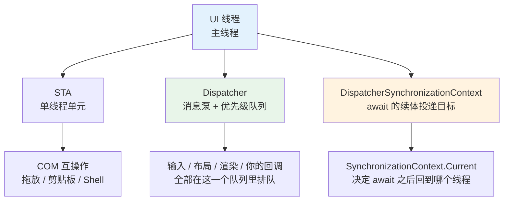
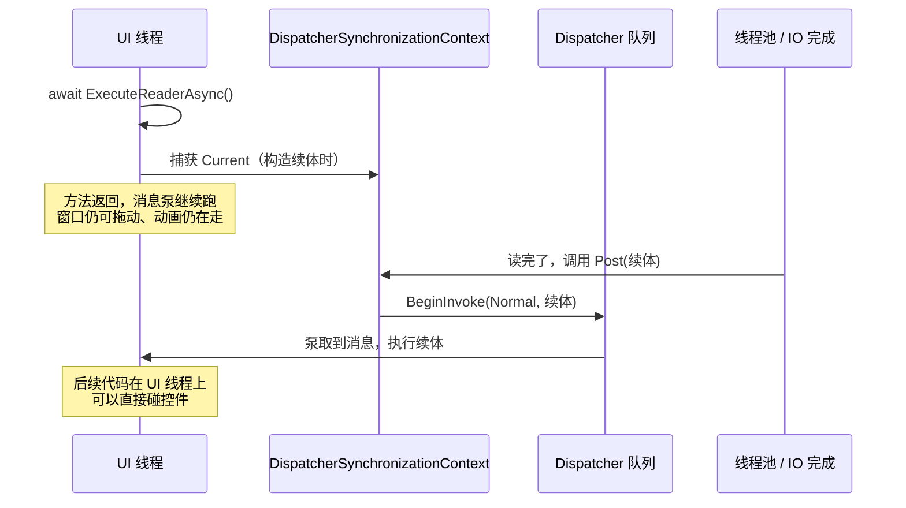

## 一、UI 线程的三个身份

服务端你从不关心代码跑在哪个线程上，因为线程池会替你兜住一切。WPF 里必须关心，因为 **UI 元素不是线程安全的，而且它们被一个特定的线程拥有**。

那条 UI 线程同时是三个东西：



- **STA**：进程启动时自动生成的 `Main` 带 `[STAThread]`。这是 COM 的要求，拖放、剪贴板、文件对话框都依赖它。
- **Dispatcher**：一个带优先级的消息队列。所有输入事件、布局、渲染、你通过 `Invoke` 投递的回调，都在这个队列里串行执行。`Application.Run()` 本质上就是启动这个泵并阻塞。
- **`SynchronizationContext`**：`DispatcherSynchronizationContext` 的实例被设置在 UI 线程的 `SynchronizationContext.Current` 上，这是 `await` 能回到 UI 线程的全部秘密。

关键推论：**"UI 卡死"不是线程太忙，而是消息泵不再取下一个消息**。你的任何一段长耗时同步代码都在阻塞这个泵，期间窗口不重绘、按钮不响应、动画停止。

| 服务端的直觉 | WPF 里的现实 |
|-------------|-------------|
| 线程池随便用，没有"主线程" | UI 线程被元素拥有，碰控件必须回到它上面 |
| `await` 只影响性能 | `await` 决定续体线程，直接影响能否碰控件 |
| `.Result` 最多阻塞一个请求线程 | `.Result` 会锁死整个界面，甚至死锁 |
| `async void` 只是不推荐 | 它的异常直接进 `DispatcherUnhandledException` |

## 二、`DispatcherObject` 与线程亲和性

`DispatcherObject` 是 `DependencyObject` 的基类，所有 `Visual`、`FrameworkElement`、`Freezable` 都从它继承，每个实例记着自己被创建时所在线程的 `Dispatcher`。访问时做一次检查：

```csharp
public void AppendLog(string text)
{
    // CheckAccess：只问"我在不在这个对象的 Dispatcher 线程上"
    if (!Dispatcher.CheckAccess())
    {
        // Invoke：同步排队，等 UI 线程执行完才返回
        Dispatcher.Invoke(() => AppendLog(text));
        return;
    }

    LogList.Items.Add(text);
}
```

| 方法 | 行为 | 何时用 |
|------|------|--------|
| `CheckAccess()` | 返回 `bool`，不抛异常 | 分支判断，最常用 |
| `VerifyAccess()` | 不在同一线程就抛 `InvalidOperationException` | 框架内部及你的断言 |
| `Dispatcher.Invoke(...)` | 同步投递，阻塞等待执行完 | 后台线程需要结果后才能继续，**且 UI 线程没在等它** |
| `Dispatcher.BeginInvoke(...)` | 异步投递，立即返回 | 更新 UI、把工作推迟一拍 |
| `Dispatcher.InvokeAsync(...)` | 异步投递，返回 `DispatcherOperation` | 需要 `await` 或取消投递时 |

跨线程异常的那句消息你应该背下来：

> The calling thread cannot access this object because a different thread owns it.

它出现的位置通常是绑定更新、`ObservableCollection.Add`、或者直接改控件属性。

## 三、`DispatcherPriority`：不是所有消息一样急

`Dispatcher` 的队列按优先级排序，同一个优先级内先进先出。常用的几档：

| 优先级 | 值 | 谁在用 |
|--------|-----|--------|
| `Send` | 最高 | 同步 `Invoke`，插队执行 |
| `Normal` | 9 | 大多数 `BeginInvoke` 的默认值 |
| `DataBind` | 8 | 绑定更新 |
| `Render` | 7 | 渲染与布局 |
| `Loaded` | 6 | `Loaded` 事件 |
| `Input` | 5 | 键盘、鼠标输入 |
| `Background` | 4 | 空闲时做的工作，如统计、预加载 |
| `ContextIdle` | 3 | 布局与渲染都完成之后 |
| `ApplicationIdle` | 2 | 完全空闲 |
| `SystemIdle` | 1 | 系统空闲，几乎不用 |

几个实用结论：

- **`DispatcherPriority.Render` 低于 `Input`**：所以你在 `Input` 回调里做重活，界面会先响应输入再渲染，表现为"点击有反馈但画面延迟"。
- **`Background` 是"做完正事再做"的正确选择**：统计行数、预加载下一页、写日志都该用它，不要用默认的 `Normal` 抢渲染的时间片。
- **不要用 `Send` 从后台线程回调 UI**，它会插到所有消息前面，等于把 UI 线程当成同步 RPC 端点，轻易造成重入。

```csharp
// 后台线程：更新状态栏，不阻塞自己
Dispatcher.BeginInvoke(DispatcherPriority.Background, new Action(() =>
{
    StatusText.Text = "已连接";
}));
```

## 四、`await` 为什么能回到 UI 线程

`await` 的语义不是"切线程"，而是"**如果这个 awaitable 还没完成，就挂一个续体；完成后由捕获的 `SynchronizationContext` 决定续体在哪跑**"。



`DispatcherSynchronizationContext.Post` 内部就是一次 `Dispatcher.BeginInvoke`。所以第 01 章那句"`await` 之后可以直接碰控件"成立，但它有三个前提：

1. `await` 之前你在 UI 线程上（否则捕获的是别的上下文或 `null`）。
2. 你没有写 `ConfigureAwait(false)`。
3. UI 线程没有在同步等待这个任务——否则队列里那条续体永远轮不到。

第 3 条就是死锁的全部原理。

## 五、`ConfigureAwait(false)` 在 WPF 里怎么写

服务端的最佳实践是"库代码一律 `ConfigureAwait(false)`"。这条在 WPF 里要分三层看：

| 代码位置 | 要不要 `ConfigureAwait(false)` | 理由 |
|---------|------------------------------|------|
| `DbLens.Core` 的库代码（服务、仓储、EF 查询封装） | **要** | 不依赖 UI，避免无谓地回 UI 线程，也避免库代码意外依赖调用方的上下文 |
| ViewModel 里不碰 UI 的中间层调用 | 可要 | 减少一次线程切换，但注意后续要回 UI |
| ViewModel 里改 `ObservableCollection` / 绑定属性 | **绝对不要** | 改了就会在线程池线程上执行，`ObservableCollection` 抛跨线程异常 |
| 事件处理器里 `await` 之后要碰控件 | 不要 | 同上 |

```csharp
// Core 层：不关心调用方是谁，也不需要 UI 上下文
public async Task<int> CountRowsAsync(CancellationToken ct)
{
    await using var db = await _factory.CreateDbContextAsync(ct).ConfigureAwait(false);
    return await db.Orders.CountAsync(ct).ConfigureAwait(false);
}

// ViewModel：await 之后要改集合，保持上下文
var total = await _executor.CountRowsAsync(token);   // 回到 UI 线程
TotalRows = total;                                    // 安全
```

`ObservableCollection<T>` 的跨线程异常长得很有辨识度：

> This type of CollectionView does not support changes to its SourceCollection from a thread different from the Dispatcher thread.

它不会在 `Add` 的地方提示根因，只在绑定已经挂上去之后才抛。**判断规则很简单：先问"这行代码之后要不要碰绑定数据"，要，就不写 `ConfigureAwait(false)`。**

## 六、死锁三连

### 6.1 UI 线程 `.Result` / `.Wait()`

```csharp
// 反例
private void OnQueryClick(object sender, RoutedEventArgs e)
{
    var schema = LoadSchemaAsync().Result;   // 卡在这里
    Tables.Clear();
    foreach (var t in schema) Tables.Add(t);
}

private async Task<List<string>> LoadSchemaAsync()
{
    await Task.Delay(200);                   // 捕获了 UI 上下文
    return new List<string> { "orders", "users" };
}
```

执行顺序：UI 线程调用 `LoadSchemaAsync()`，走到 `await` 时挂起并返回 `Task`；UI 线程立刻在 `.Result` 上**阻塞**；200 ms 后续体要回 UI 线程，被 `Post` 进队列；但 UI 线程正卡在 `.Result` 上，泵不动，续体永远不执行。经典互相等待。

修复方式只有一个方向：**把整条链路改成异步，从事件处理器开始**。

```csharp
private async void OnQueryClick(object sender, RoutedEventArgs e)
{
    try
    {
        var schema = await LoadSchemaAsync();
        Tables.Clear();
        foreach (var t in schema) Tables.Add(t);
    }
    catch (Exception ex)
    {
        Status = $"加载失败：{ex.Message}";
    }
}
```

事件处理器必须是 `async void`（路由事件签名固定为 `void`），这是 `async void` 唯一合法的位置。

### 6.2 UI 线程等后台线程，后台线程 `Invoke` 回 UI

```csharp
// 反例
private void OnRefreshClick(object sender, RoutedEventArgs e)
{
    var task = Task.Run(() =>
    {
        var count = CountRows();
        Dispatcher.Invoke(() => StatusText.Text = $"共 {count} 行");  // 等 UI 线程
    });

    task.Wait();   // UI 线程等后台线程 → 死锁
}
```

修复：不要在 UI 线程 `Wait`，直接 `await`；后台线程也别 `Invoke`，用 `await` 回到 UI 后再更新：

```csharp
private async void OnRefreshClick(object sender, RoutedEventArgs e)
{
    var count = await Task.Run(CountRows);
    StatusText.Text = $"共 {count} 行";   // 已经在 UI 线程
}
```

顺带纠正一个常见误解：**`Dispatcher.Invoke` 在 UI 线程上调用自己不会死锁**，它检测到同线程会直接内联执行。真正出事的是"一个线程同步等另一个线程，另一个线程又要 `Invoke` 回它"。

### 6.3 `async void` 吞异常

`async void` 方法没有 `Task` 可等，异常会直接 `Post` 到 `SynchronizationContext`，最终走到 `DispatcherUnhandledException`。调用方的 `try/catch` 抓不到：

```csharp
try
{
    FireAndForgetAsync();   // async void
}
catch (Exception ex)
{
    // 永远不会进来
}
```

`async void` 只允许出现在事件处理器里，其余一律 `async Task`。集合的 `Load` 事件、命令执行、初始化逻辑，全都有 `Task` 版本可用。

## 七、`Task.Run` 的边界

`Task.Run` 把工作丢到线程池，它不是"异步"的同义词。

| 工作性质 | 用 `Task.Run` | 原因 |
|---------|--------------|------|
| CPU 密集（结果集聚合、导出 CSV、压缩） | 是 | 会长时间占用线程，不能放在 UI 线程 |
| 有原生异步 API 的 IO（SQL、文件、HTTP） | 否 | `await` 期间不占线程，包一层 `Task.Run` 只是多一次线程切换 |
| 只有同步 API 的旧库 | 是 | 只能在后台线程阻塞，别无选择 |
| 上千个小任务 | 否 | 线程池调度与上下文切换的开销超过工作本身 |

DbLens 的分层因此很清晰：**Core 负责真正的异步 IO，Shell 只在需要时用 `Task.Run` 包裹 CPU 工作**。

```csharp
// Core：SQL 执行，全程异步 IO，不占用任何线程等待
public sealed record QueryProgress(int RowsRead);

public sealed class SqlExecutor : ISqlExecutor
{
    private readonly IDbContextFactory<DbLensContext> _factory;

    public SqlExecutor(IDbContextFactory<DbLensContext> factory) => _factory = factory;

    public async Task<QueryResult> ExecuteAsync(
        string sql,
        IProgress<QueryProgress>? progress,
        CancellationToken ct)
    {
        await using var db = await _factory.CreateDbContextAsync(ct).ConfigureAwait(false);
        var connection = db.Database.GetDbConnection();
        await connection.OpenAsync(ct).ConfigureAwait(false);

        await using var command = connection.CreateCommand();
        command.CommandText = sql;

        await using var reader = await command.ExecuteReaderAsync(ct).ConfigureAwait(false);

        var rows = new List<ResultRow>();
        var ordinal = 0;

        while (await reader.ReadAsync(ct).ConfigureAwait(false))
        {
            var values = new object?[reader.FieldCount];
            reader.GetValues(values);
            rows.Add(new ResultRow { Ordinal = ordinal++, Values = values });

            // 每 500 行报一次进度，避免刷爆 Dispatcher 队列
            if (progress is not null && ordinal % 500 == 0)
            {
                progress.Report(new QueryProgress(ordinal));
            }
        }

        progress?.Report(new QueryProgress(ordinal));
        return new QueryResult(rows);
    }
}
```

注意两个细节：Core 全程 `ConfigureAwait(false)`，因为它不需要 UI 上下文；进度不是每行都报，而是每 500 行——**`IProgress<T>.Report` 每次都往 UI 队列投递一条消息**，一行一条等于自己制造消息风暴。

## 八、进度与取消

`Progress<T>` 是 `IProgress<T>` 的实现，它在**构造时捕获当前 `SynchronizationContext`**，`Report` 时把回调投递回去。所以在 UI 线程构造，回调就在 UI 线程执行，不需要你写 `Dispatcher.BeginInvoke`：

```csharp
[RelayCommand]
private async Task ExecuteQueryAsync(CancellationToken token)
{
    IsBusy = true;
    Rows.Clear();

    // 必须在 UI 线程构造，才能捕获 UI 上下文
    var progress = new Progress<QueryProgress>(p =>
    {
        LoadedRows = p.RowsRead;
        Status = $"已读取 {p.RowsRead} 行";
    });

    try
    {
        var result = await _executor.ExecuteAsync(SqlText, progress, token);

        // await 已回到 UI 线程，逐条 Add 是安全的
        foreach (var row in result.Rows)
        {
            Rows.Add(row);
        }

        Status = $"完成，共 {result.Rows.Count} 行";
    }
    catch (OperationCanceledException)
    {
        Status = "查询已取消";
    }
    catch (Exception ex)
    {
        Status = $"执行失败：{ex.Message}";
    }
    finally
    {
        IsBusy = false;
    }
}
```

取消靠 `CancellationTokenSource`，传递到 `ExecuteReaderAsync` 之后，SQLite 会真正中断执行。CommunityToolkit.Mvvm 8.2 起，带 `CancellationToken` 参数的 `RelayCommand` 方法会自动配一个取消命令，XAML 直接绑它：

```xml
<Button Content="取消"
        Command="{Binding ExecuteQueryCancelCommand}"
        IsEnabled="{Binding IsBusy}" />
```

手动版也一样简单：

```csharp
private CancellationTokenSource? _cts;

[RelayCommand]
private async Task RunQueryAsync()
{
    _cts?.Cancel();
    _cts?.Dispose();
    _cts = new CancellationTokenSource();

    try
    {
        await _executor.ExecuteAsync(SqlText, null, _cts.Token);
    }
    catch (OperationCanceledException)
    {
        // 取消是正常路径，不要当错误记录
    }
}

[RelayCommand]
private void CancelQuery() => _cts?.Cancel();
```

两条纪律：`CancellationTokenSource` 要 `Dispose`；**取消抛出的 `OperationCanceledException` 是正常控制流**，不要记成 Error 级别日志，否则日志里全是噪音。

## 九、异常传播的三个出口

```csharp
protected override void OnStartup(StartupEventArgs e)
{
    base.OnStartup(e);

    // 1. UI 线程上的异常：事件处理器、绑定、布局、动画
    DispatcherUnhandledException += (_, args) =>
    {
        _logger.LogError(args.Exception, "UI 线程未处理异常");
        MessageBox.Show(args.Exception.Message, "DbLens", MessageBoxButton.OK, MessageBoxImage.Error);
        args.Handled = true;          // 标记已处理，进程继续运行
    };

    // 2. 被丢弃的 Task 的异常：GC 回收时才触发，不能当兜底
    TaskScheduler.UnobservedTaskException += (_, args) =>
    {
        _logger.LogError(args.Exception, "未观察的任务异常");
        args.SetObserved();
    };

    // 3. 非 UI 线程的致命异常：进程已经注定退出，只能记录现场
    AppDomain.CurrentDomain.UnhandledException += (_, args) =>
    {
        _logger.LogCritical(args.ExceptionObject as Exception, "进程级未处理异常");
    };
}
```

| 出口 | 覆盖范围 | 能否阻止崩溃 | 典型来源 |
|------|---------|-------------|---------|
| `DispatcherUnhandledException` | UI 线程 | 能（`Handled = true`） | 事件处理器、`async void`、绑定、布局 |
| `TaskScheduler.UnobservedTaskException` | 被 GC 的失败 `Task` | 不能，且时机不可控 | 忘记 `await` 的 `Task` |
| `AppDomain.UnhandledException` | 非 UI 线程 | 不能 | 后台线程未捕获异常 |

`TaskScheduler.UnobservedTaskException` **不能当兜底**：它要等 `Task` 被 GC 才触发，可能几分钟后才发生，也可能永远不发生。它唯一的价值是"发现你漏掉了 `await`"。

## 十、`DispatcherTimer` 还是别的定时器

| 类型 | 回调线程 | 精度 | 适用 |
|------|---------|------|------|
| `DispatcherTimer` | UI 线程 | 低（跟消息队列排队） | 刷新界面、轮询状态、动画辅助——回调里要碰控件就用它 |
| `System.Timers.Timer` | 线程池 | 中 | 后台轮询，回调里绝不能碰 UI |
| `System.Threading.Timer` | 线程池 | 中 | 轻量后台任务，不需要事件模型 |
| `PeriodicTimer` + `await` | 你的 `await` 上下文 | 中 | 现代化写法，配合 `CancellationToken` 天然可控 |

```csharp
// 界面倒计时：回调自带 UI 线程，不需要 Dispatcher
private readonly DispatcherTimer _clock = new() { Interval = TimeSpan.FromSeconds(1) };

private void StartClock()
{
    _clock.Tick += (_, _) => Elapsed = DateTime.Now - _startedAt;
    _clock.Start();
}

// 后台轮询：回调在线程池，碰 UI 必须自己回 Dispatcher
private async Task PollAsync(CancellationToken ct)
{
    using var timer = new PeriodicTimer(TimeSpan.FromSeconds(2));

    while (await timer.WaitForNextTickAsync(ct))
    {
        var alive = await _probe.PingAsync(ct);
        await Dispatcher.InvokeAsync(() => IsConnected = alive);
    }
}
```

`DispatcherTimer` 的一个隐患是生命周期：它是一个强引用持有者，**只要 `Tick` 还挂着处理器，目标对象就不会被回收**。页面关闭时记得 `Stop()` 并解绑，或者干脆把定时器放在页面自己的 `Dispose` 逻辑里——这类泄漏第 18 章会专门排查。

## 十一、踩坑清单

| 现象 | 原因 | 处理 |
|------|------|------|
| 界面完全冻结，点不动 | UI 线程上有同步阻塞（`.Result`、`.Wait()`、长循环、`Thread.Sleep`） | 全线改成 `await`；长计算放 `Task.Run` |
| `await` 之后改集合抛跨线程异常 | 用了 `ConfigureAwait(false)`，或 `await` 之前就不在 UI 线程 | 去掉 `ConfigureAwait(false)`，或用 `Dispatcher.InvokeAsync` |
| 界面卡住，任务永远不完成 | 死锁：UI 线程等任务，任务等 UI 线程 | 不在 UI 线程同步等待；改 `async void` 事件处理器 |
| 异常没有日志，程序直接退出 | `async void` 的异常无人捕获 | 改用 `async Task`；接 `DispatcherUnhandledException` |
| 进度条更新导致更卡 | `Report` 调用过于频繁，消息队列被刷爆 | 降频（每 N 行一次）或做节流 |
| 点取消没反应 | 没把 `CancellationToken` 传到真正的异步 API | 一直传到 `ExecuteReaderAsync` |
| 取消后日志里一堆 Error | 把 `OperationCanceledException` 当异常记录 | 单独 `catch`，按正常路径处理 |
| 定时器每秒触发但内存一直涨 | `DispatcherTimer` 强引用页面，未 `Stop`/解绑 | 关闭时 `Stop()` 并移除处理器 |
| 后台线程改控件偶尔才报错 | 竞态：有时 UI 线程空闲恰好没检查 | 不要赌，统一走 `Dispatcher` 或 `await` |

## 十二、本章小结

- UI 线程 = STA + `Dispatcher` 消息泵 + `DispatcherSynchronizationContext`；卡死意味着消息泵停转，而不是"线程太忙"。
- `await` 能回到 UI 线程，是因为续体被 `Post` 进了 `Dispatcher` 队列；`ConfigureAwait(false)` 主动放弃这次投递。
- 库代码用 `ConfigureAwait(false)`，ViewModel 里要改绑定数据时绝不能写——这是 WPF 和服务端最大的一条实践差异。
- 死锁的共同结构是"UI 线程同步等待一个需要 UI 线程的任务"；解药永远是去掉同步等待，从事件处理器开始 `async`。
- `async void` 仅限事件处理器；`Task.Run` 只给 CPU 密集或同步 IO，原生异步 API 不需要它。
- `Progress<T>` 靠构造时捕获的上下文自动回到 UI 线程，但 `Report` 的频率要控制；取消是正常控制流，不是错误。

**练习**：把 `ExecuteQueryAsync` 改成"边读边显示"——每读到 500 行就往 `Rows` 里加一批，并观察界面是否仍然可交互。然后故意在 `OnQueryClick` 里写一句 `ExecuteQueryAsync().Wait()`，用调试器看两个线程的调用栈，亲眼确认死锁的等待环。

下一章处理那些不报错的问题：绑定为什么静默失败、对象为什么没被回收、单文件怎么发出去。
