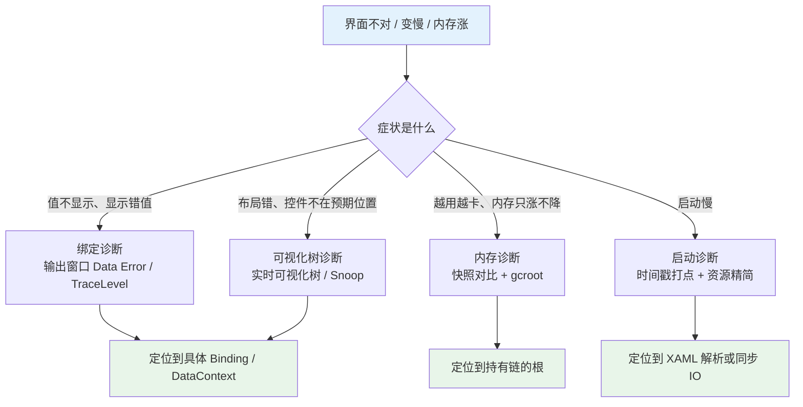

## 一、诊断顺序：先看树，再看代码

WPF 的问题大多不是"算得慢"，而是"树错了"或"对象没被释放"：绑定写错不报错，只是不显示；容器套错不报错，只是卡；事件忘解绑不报错，只是内存涨。所以排查顺序和写代码相反——先看运行时结构，再看逻辑。



服务端的排查手段在桌面端几乎都要换一套：

| 服务端的排查方式 | WPF 桌面端的手段 |
|-----------------|-----------------|
| 请求日志与 APM 链路 | 绑定日志 + 可视化树 |
| 压测看吞吐和 P99 | 看首屏耗时与每帧布局 |
| 内存上涨查缓存与静态集合 | 快照对比 + `gcroot` 找持有链 |
| 发布到 IIS / 容器 | 单文件 exe / MSIX / ClickOnce |

## 二、绑定诊断：让静默失败开口说话

绑定失败是 WPF 最安静的错误：输出窗口只在**调试**时打一行警告，Release 下什么都不说。

### 2.1 打开 `TraceLevel`

```xml
<Window xmlns:diag="clr-namespace:System.Diagnostics;assembly=WindowsBase"
        ...>
    <TextBlock Text="{Binding Connection.Host,
                             diag:PresentationTraceSources.TraceLevel=High}" />
</Window>
```

`TraceLevel` 有 `None`、`Low`、`Medium`、`High` 四档。`High` 会打印绑定表达式的完整生命周期：源是谁、路径怎么解析、每次值变化、为什么失败。**只用来定位单个可疑绑定**，全局开会把输出窗口淹掉。

全局开关在 `App` 启动时设置：

```csharp
using System.Diagnostics;

PresentationTraceSources.DataBindingSource.Switch.Level = SourceLevels.Warning;
PresentationTraceSources.DataBindingSource.Listeners.Add(
    new TextWriterTraceListener("binding.log"));
```

### 2.2 `System.Windows.Data Error: 40` 到底在说什么

输出窗口里最眼熟的就是这一行：

```text
System.Windows.Data Error: 40 : BindingExpression path error:
'Host' property not found on 'object' ''ConnectionSettings' (HashCode=...)'.
BindingExpression:Path=Connection.Host; DataItem='MainViewModel' ...
```

拆开看：`40` 是**路径错误**，后面依次告诉你哪个属性找不到、在什么对象上找、完整路径是什么、`DataContext` 是谁。九成情况是下面几种：

| 错误码 | 含义 | 最常见原因 |
|--------|------|-----------|
| `40` | 路径错误，属性不存在 | 属性名拼错、`DataContext` 类型不对、属性没有公共 getter |
| `4` | 找不到绑定源 | `ElementName` 写错、`RelativeSource AncestorType` 类型不匹配、资源 key 不存在 |
| `16` | 类型转换失败 | 字符串绑到了 `int`，且没有 `Converter` |
| `38` | 绑定被显式清除或目标不是 DP | 目标属性不是依赖属性，元素已被移除 |

排查套路固定三步：**先看 `DataItem` 是什么类型**，再看该类型上有没有这个属性，最后看 `DataContext` 是什么时候设的。`<TextBlock Text="{Binding}" />` 技巧在这里很好用——它直接把当前 `DataContext` 的类型打出来。

### 2.3 让失败可见

生产环境要让失败可见：

```xml
<TextBlock Text="{Binding Count,
                          FallbackValue='—',
                          TargetNullValue='—'}" />
```

`FallbackValue` 在绑定完全失败时使用，`TargetNullValue` 在值为 `null` 时使用。"绑定断了"在界面上表现为破折号，比空白更容易发现。

## 三、可视化树诊断

绑定问题看输出窗口，布局和模板问题看树。

| 工具 | 入口 | 看什么 |
|------|------|--------|
| 实时可视化树（VS） | 调试 → 窗口 → 实时可视化树 | 选中元素后看它的实际父链、`DataContext`、应用了哪个模板 |
| 实时属性资源管理器 | 同上，切到属性页 | 属性当前值、**值来源**（本地/样式/继承/动画） |
| Snoop | 独立工具，附加到进程 | 完整可视化树 + 逻辑树、任意元素的 `DataContext`、触发器状态 |
| WPF Inspector | 独立工具 | 类似 Snoop，附带属性编辑 |

三个高频用法：

1. **看 `DataContext` 继承断了没有**。选中不显示数据的元素，看属性面板的 `DataContext`——多数时候是 `null` 或行数据对象。
2. **看模板到底有没有应用**。选中自定义控件，看 `Template` 是不是 `Generic.xaml` 里那份。为 `null` 就回第 14 章检查 `DefaultStyleKeyProperty` 和 `ThemeInfo`。
3. **看布局为什么超界**。沿父链看 `ActualWidth` / `ActualHeight`，第一个"比预期大"的元素就是问题所在，通常是一个没设 `*` 的行或 `StackPanel`。

Snoop 的杀手级功能是**改值即时生效**：改一个值界面立刻重绘，先用它试出正确值再改 XAML，比反复编译快。

## 四、内存泄漏的五个来源

内存曲线应该是"涨—回落"。只涨不回落、GC 后托管堆仍上升，说明有对象被意外持有。下面五类覆盖绝大多数情况。

### 4.1 事件订阅：最常见的强引用

```csharp
// 单例，活得和进程一样长
public sealed class ConnectionMonitor
{
    public event EventHandler<ConnectionLostEventArgs>? ConnectionLost;

    public void Raise(string reason)
        => ConnectionLost?.Invoke(this, new ConnectionLostEventArgs { Reason = reason });
}

// 反例：页面订阅单例的事件
public partial class QueryView : UserControl
{
    public QueryView(ConnectionMonitor monitor)
    {
        InitializeComponent();
        monitor.ConnectionLost += OnConnectionLost;   // 单例 → 页面，强引用
    }

    private void OnConnectionLost(object? sender, ConnectionLostEventArgs e)
        => Status = "连接已断开：" + e.Reason;
}
```

持有链是 `ConnectionMonitor`（单例，GC root 可达）→ 委托 → `QueryView` → 整棵可视化树。页面关了、导航走了，内存里照样活着。**事件源比订阅者活得久，就必须解绑**：`Unloaded` 里 `-=`，或改用弱事件。

### 4.2 静态集合当缓存

```csharp
// 反例：以为只是缓存，实际是永不释放的根
private static readonly Dictionary<Guid, QueryView> Cache = new();

// 修复：弱引用 + 上限
private static readonly List<WeakReference<QueryView>> Cache = new();
```

静态字段本身就是 GC root，往里塞 View 等于手动钉住。缓存**数据**，不要缓存可视元素；必须缓存对象时用 `WeakReference<T>` 并设上限。

### 4.3 `DispatcherTimer` 没停

`DispatcherTimer` 的 `Tick` 持有目标委托，`Dispatcher` 又持有定时器。页面关了定时器还在跑，页面就一直被引用：

```csharp
// 反例：只在构造里 Start，从不 Stop
_clock.Tick += OnTick;
_clock.Start();

// 修复：页面卸载时停掉并解绑
Unloaded += (_, _) =>
{
    _clock.Stop();
    _clock.Tick -= OnTick;
};
```

### 4.4 绑定与 `DependencyPropertyDescriptor`

绑定引擎对 `INotifyPropertyChanged` 用弱事件，正常绑定不会泄漏。真正的坑在这两处：

```csharp
// 反例：DependencyPropertyDescriptor 的 AddValueChanged 是强引用
var descriptor = DependencyPropertyDescriptor.FromProperty(
    TextBlock.TextProperty, typeof(TextBlock));

descriptor.AddValueChanged(SomeLongLivedBlock, OnTextChanged);
// 忘记 RemoveValueChanged → SomeLongLivedBlock 永远活着
```

另一个反向案例：在 ViewModel 里持有控件引用，长命对象与控件之间的持有链就闭合了。规则很简单：**ViewModel 不要引用 View。**

修复方式：在 `Unloaded` 里 `RemoveValueChanged`，或改用弱事件（下一节）。

### 4.5 未释放的 `DbContext` / 连接

```csharp
// 反例：长命活的 DbContext，ChangeTracker 无限膨胀
private readonly DbLensContext _db = new();

// 正确：每次操作一个短命实例，用完即弃
await using var db = await _factory.CreateDbContextAsync(ct);
```

EF Core 的 `ChangeTracker` 会跟踪所有查出的实体，"进程级 DbContext"等于把整库数据钉在内存里。第 11 章的 `IDbContextFactory` 就是为这个场景准备的。**实现了 `IDisposable` 的对象都必须有明确所有者。**

| 泄漏源 | 持有链 | 修复 |
|--------|--------|------|
| 事件订阅 | 长命对象 → 委托 → 页面 → 可视树 | `-=` 解绑，或用 `WeakEventManager` |
| 静态集合 | 静态字段（GC root）→ 对象 | 用 `WeakReference<T>`，或缓存数据而非对象 |
| `DispatcherTimer` | `Dispatcher` → 定时器 → `Tick` → 页面 | `Stop()` + 解绑 |
| `DependencyPropertyDescriptor` | 描述符 → 回调 → 目标 | `RemoveValueChanged` |
| `DbContext` / 连接 | 字段 → 上下文 → 跟踪的实体 | `IDbContextFactory` + `await using` |

## 五、`WeakEventManager`：不想手动解绑时的选择

弱事件的语义是"订阅不阻止被订阅者被回收"。WPF 提供泛型版本，比自实现简单得多：

```csharp
using System.Windows;

public partial class QueryView : UserControl
{
    private readonly ConnectionMonitor _monitor;

    public QueryView(ConnectionMonitor monitor)
    {
        InitializeComponent();
        _monitor = monitor;

        // 弱引用：monitor 不会因为这次订阅而钉住 QueryView
        WeakEventManager<ConnectionMonitor, ConnectionLostEventArgs>.AddHandler(
            _monitor,
            nameof(ConnectionMonitor.ConnectionLost),
            OnConnectionLost);
    }

    private void OnConnectionLost(object? sender, ConnectionLostEventArgs e)
        => Status = "连接已断开：" + e.Reason;
}
```

三个限制：泛型版本要求事件是 `EventHandler<TEventArgs>` 形状；它只保证**订阅者**可回收，事件源本身仍是强引用；派发比普通事件慢，高频事件不要用。自定义事件源可以继承 `WeakEventManager`，把 `AddHandler` / `RemoveHandler` 转发进去。

## 六、运行时工具链

| 工具 | 命令 | 用途 |
|------|------|------|
| `dotnet-counters` | `dotnet-counters monitor -p <pid> --counters System.Runtime` | 实时看 GC、堆大小、线程池 |
| `dotnet-dump` | `dotnet-dump collect -p <pid>` | 抓内存转储，离线分析 |
| `dotnet-trace` | `dotnet-trace collect -p <pid>` | 采样 CPU，看热点方法 |
| VS 内存快照 | 调试 → 性能探查器 → 内存使用率 | 直接给增量对象与根路径 |
| PerfView | 独立工具 | ETW 级分析，看 UI 线程卡顿与 JIT |

最常用的是快照对比：

1. 启动应用，进入出问题的页面，**先拍一张快照**。
2. 反复执行可疑操作 10 次（开/关页面、查询、切换连接）。
3. 再拍一张，选"与上一个比较"。
4. 看增量最大的类型：`QueryView`、`DataGridRow`、`BindingExpression` 的数量随操作次数线性增长，泄漏就确认了。选中实例看"根路径"，它会直接指出持有者。

命令行版更轻量：

```powershell
dotnet tool install -g dotnet-counters
dotnet-counters monitor -p (Get-Process DbLens).Id --counters System.Runtime

dotnet tool install -g dotnet-dump
dotnet-dump collect -p (Get-Process DbLens).Id
dotnet-dump analyze .\dump_20261113_101500.dmp
```

进入 SOS 之后：

```text
> dumpheap -stat -type DbLens.Views.QueryView
> gcroot 000001f4c0a2b8d0
```

`dumpheap -stat` 看某类型的实例数与总大小，`gcroot` 打出完整持有链。这条链是排查泄漏最有力的证据。

## 七、启动优化

启动慢的原因只有四个：JIT、XAML 解析、同步 IO、一次性创建太多对象。逐个处理。

| 手段 | 做法 | 收益 | 代价 |
|------|------|------|------|
| ReadyToRun | `PublishReadyToRun=true` | 省掉大量启动期 JIT，通常快 20%-40% | 包体增大约三成 |
| 延迟创建页面 | 导航时再 `new`，别在 `OnStartup` 里全建好 | 直接砍掉未访问页面的成本 | 首次打开该页稍慢 |
| 精简 `Application.Resources` | 拆字典、按需 `MergedDictionaries` | 减少启动期 XAML 解析 | 需要规划资源分层 |
| 减少 `DynamicResource` | 能静态就静态 | 省掉运行时查找 | 换肤能力下降 |
| 异步化启动 IO | 配置、日志、许可证校验放后台 | 窗口先出来 | 需要处理"尚未就绪"状态 |

```csharp
protected override async void OnStartup(StartupEventArgs e)
{
    base.OnStartup(e);

    // 先让主窗口出来，用户立刻有反馈
    var window = _provider.GetRequiredService<MainWindow>();
    window.Show();

    // 再做重活，全部异步
    await _provider.GetRequiredService<IStartupWarmer>().WarmUpAsync();
}
```

`OnStartup` 写成 `async void` 是少数可接受的位置（本质是框架回调），但必须自己 `try/catch`，否则异常会变成进程级崩溃。

另一个问题是**启动时同步连数据库**：一次 schema 查询可能几百毫秒，放在构造函数里就是白屏。挪到后台，先显示"正在连接"。

## 八、发布：一条命令的参数含义

```powershell
dotnet publish src/DbLens.Shell/DbLens.Shell.csproj `
  -c Release `
  -r win-x64 `
  --self-contained true `
  -p:PublishSingleFile=true `
  -p:IncludeNativeLibrariesForSelfExtract=true `
  -p:EnableCompressionInSingleFile=true `
  -p:PublishReadyToRun=true `
  -o publish
```

| 参数 | 含义 | 取舍 |
|------|------|------|
| `-c Release` | 关调试符号，开 IL 优化 | 必选 |
| `-r win-x64` | 指定 RID，产出平台专用程序 | 必须指定，单文件与 R2R 都依赖它 |
| `--self-contained true` | 自带 .NET 运行时，目标机不用装 | 包体约 150 MB 起；false 则要求装运行时 |
| `PublishSingleFile=true` | 所有托管程序集打进一个 exe | 首次启动略慢，杀软可能误报 |
| `IncludeNativeLibrariesForSelfExtract=true` | 原生库也打进 exe，运行时解压到临时目录 | 解决"缺少 hostfxr / e_sqlite3"这类问题 |
| `EnableCompressionInSingleFile=true` | 压缩包内程序集 | 包体小，首次启动解压慢一点 |
| `PublishReadyToRun=true` | 预编译，减少启动 JIT | 包体增大，跨架构不可用 |
| `-o publish` | 输出目录 | 便于 CI 打包 |

关于 `PublishTrimmed`：**WPF 官方不支持裁剪，不要开**。XAML 反序列化、绑定路径解析、模板查找全靠运行期反射，裁剪器看不到这些引用，会把"看起来没人用"的类型裁掉。后果不是编译失败，而是发布后随机抛 `XamlParseException`、绑定静默失效。`PublishAot` 同理不适用。要减小体积，只能改 `--self-contained false`（要求目标机装运行时）或去掉 R2R。

## 九、版本号与文件属性

这些属性决定 exe 的属性页显示什么，也决定升级包如何判断新旧：

```xml
<PropertyGroup>
  <Version>1.4.0</Version>
  <FileVersion>1.4.0.0</FileVersion>
  <AssemblyVersion>1.4.0.0</AssemblyVersion>
  <InformationalVersion>1.4.0</InformationalVersion>
  <AssemblyTitle>DbLens</AssemblyTitle>
  <Product>DbLens</Product>
  <Company>koeltp</Company>
  <Copyright>© 2026 koeltp</Copyright>
  <ApplicationIcon>Assets\DbLens.ico</ApplicationIcon>
</PropertyGroup>
```

| 属性 | 出现在哪里 | 建议 |
|------|-----------|------|
| `Version` | 打包、NuGet、`InformationalVersion` 的默认值 | 语义化版本，每次发布递增 |
| `FileVersion` | 文件属性里的"文件版本" | 四段式，安装包/更新器靠它比较 |
| `AssemblyVersion` | 程序集绑定 | 强命名或插件化时才需要严格管理 |
| `InformationalVersion` | 文件属性里的"产品版本" | 可以带 commit 号，便于回溯 |
| `ApplicationIcon` | 窗口图标、任务栏、exe 图标 | `.ico` 至少包含 16/32/48/256 四种尺寸 |

窗口自己的图标还要单独设：`Icon="/Assets/DbLens.ico"`，否则任务栏显示的是默认图标。

## 十、三种分发方式

| 方式 | 优点 | 缺点 | 适用 |
|------|------|------|------|
| 单文件 exe | 免安装、拷贝即用、分发简单 | 无自动更新、杀软可能误报 | 工具类、内部小范围 |
| MSIX | 干净安装卸载、自动更新、可上商店 | 需签名证书，沙箱限制本地访问 | 对外发布、规范升级 |
| ClickOnce | 内网部署简单、自动检测更新 | 配置陈旧、自定义能力弱 | 企业内网、以发版为主 |

DbLens 是内部工具，主推单文件 exe：解压即用。要做自动更新，再加一段读远端 `version.json`、比较 `FileVersion` 的逻辑。

## 十一、从 01 到 18：知识地图


读完这十八章，你应该能独立做出一个有连接管理、大数据量表格、主题、能单文件分发的应用。接下来值得投入的方向：

- **性能剖析**：PerfView 与 `dotnet-trace` 的 ETW 事件，看清 UI 线程每一帧花在哪。
- **无障碍**：`AutomationProperties`、UI Automation 树、键盘导航，企业采购常见硬性要求。
- **打印**：`PrintDialog` + `FlowDocument` 的分页规则与 `XpsDocument` 导出。
- **COM 互操作**：`WebView2`、Office 自动化、ActiveX 宿主，内部工具绕不开。
- **跨平台**：Avalonia 的心智模型最接近 WPF，迁移成本最低。

## 十二、踩坑清单

| 现象 | 原因 | 处理 |
|------|------|------|
| 绑定不生效但没有任何报错 | 默认不输出绑定日志 | 加 `diag:PresentationTraceSources.TraceLevel=High`，看 `Data Error: 40` |
| 页面关了内存还涨 | 事件订阅、静态缓存、定时器未停 | 用快照对比 + `gcroot` 找持有链，逐类修 |
| 越查询越慢 | `DbContext` 长命活，`ChangeTracker` 膨胀 | `IDbContextFactory`，每次操作新建 |
| 启动白屏两三秒 | `OnStartup` 里同步连库/读配置 | 先 `Show()`，重活异步做 |
| 单文件发布后提示缺 `e_sqlite3` | 原生库没打进去 | 加 `IncludeNativeLibrariesForSelfExtract=true` |
| 发布后随机 `XamlParseException` | 开了 `PublishTrimmed` | 关掉裁剪，WPF 不支持 |
| 升级包判断不了新旧 | 只改了 `Version` 没改 `FileVersion` | 更新器比较 `FileVersion` |

## 十三、本章小结

- 诊断顺序是"先树后码"：绑定看 `Data Error`，布局看可视化树，内存看快照，启动慢看时间戳。
- `TraceLevel=High` 是绑定排查开关；`Data Error: 40` 表示路径解析失败，先看 `DataItem` 类型。
- 泄漏绝大多数来自五类强引用：事件、静态缓存、`DispatcherTimer`、`DependencyPropertyDescriptor`、未释放的 `DbContext`。
- `WeakEventManager<TSource, TArgs>` 让订阅不阻止回收，只适用于标准事件与低频场景。
- 发布用 `win-x64` + 自包含 + 单文件 + R2R；**WPF 不能裁剪**，`PublishTrimmed` 会导致运行期随机崩溃。
- 分发按场景选：便携用单文件，规范升级用 MSIX，内网自更新用 ClickOnce。

**练习**：用 VS 的内存快照给 DbLens 做一次泄漏排查——反复打开关闭 `QueryView` 十次，对比两次快照，找出增量最大的类型和它的根路径，然后修掉。修完再用 `dotnet publish` 打一个单文件 exe，在一台没装 .NET 的机器上跑起来，确认 SQLite 原生库正常加载。

到这里全书结束。你已经走完了从"服务端思维"到"桌面端工程化"的完整路径——剩下的，是在真实项目里把这些机制用熟。
